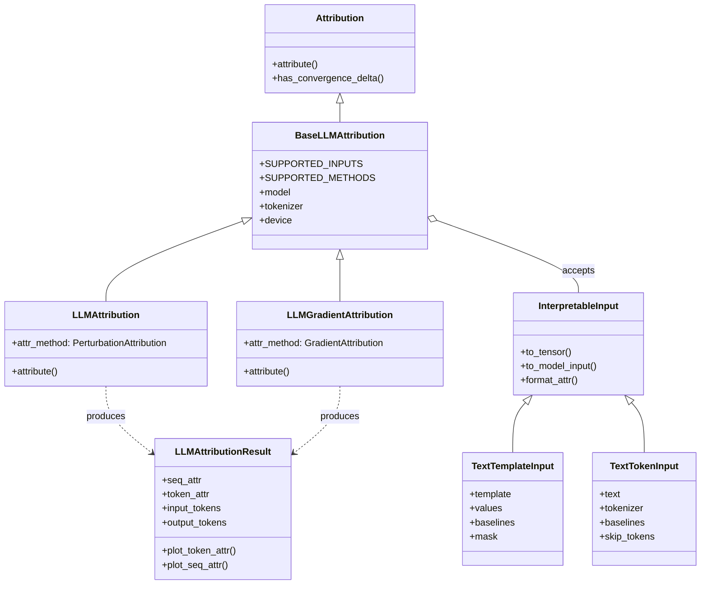
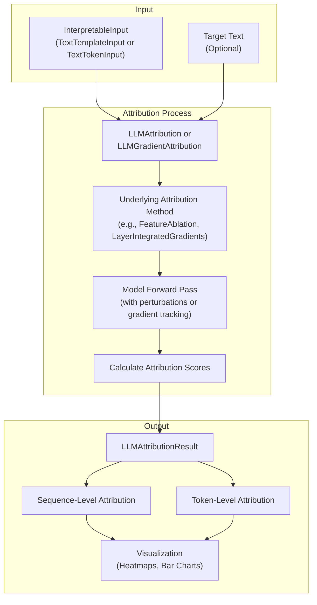
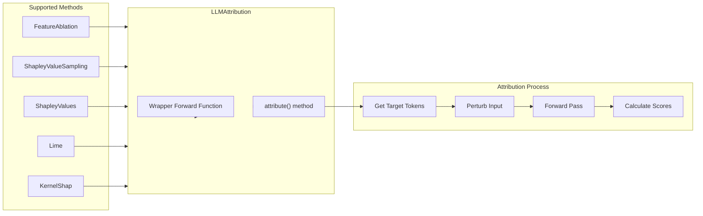
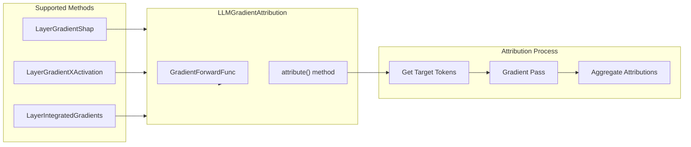
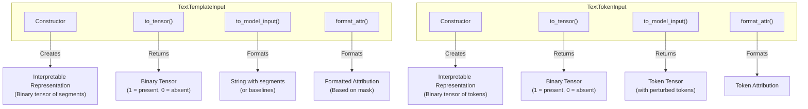
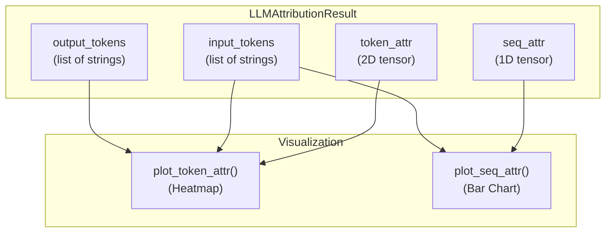
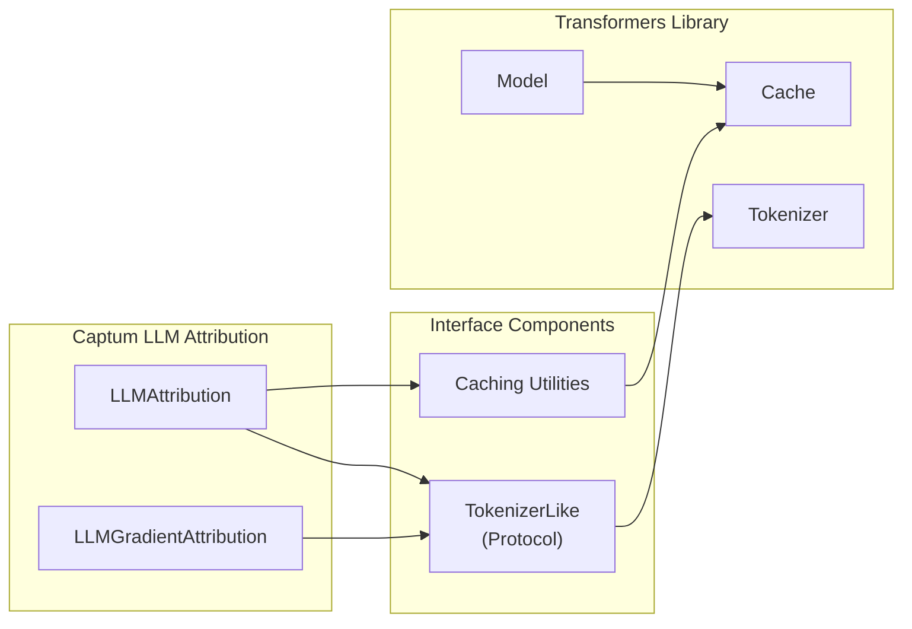

<!-- source: DeepWiki mcp.deepwiki.com · repo pytorch/captum · page 3.4 LLM Attribution · fetched 2026-10-21 -->

# LLM Attribution

<details>
<summary>Relevant source files</summary>

The following files were used as context for generating this wiki page:

- [captum/_utils/transformers_typing.py](captum/_utils/transformers_typing.py)
- [captum/_utils/typing.py](captum/_utils/typing.py)
- [captum/attr/_core/llm_attr.py](captum/attr/_core/llm_attr.py)
- [captum/attr/_utils/interpretable_input.py](captum/attr/_utils/interpretable_input.py)
- [tests/attr/test_interpretable_input.py](tests/attr/test_interpretable_input.py)
- [tests/attr/test_llm_attr.py](tests/attr/test_llm_attr.py)

</details>


## Purpose and Scope

This document describes the LLM Attribution system within Captum, which provides specialized methods for attributing and interpreting the outputs of Large Language Models (LLMs). LLM Attribution extends Captum's attribution capabilities to handle the unique challenges of text-based models, allowing users to determine which input tokens or segments most influenced a model's generated text.

The LLM Attribution system is designed to work with modern language models that follow the Hugging Face Transformers interface convention, providing both perturbation-based and gradient-based attribution methods for text generation tasks.

For information about other attribution methods in Captum, see:
- [Gradient-Based Attribution](#3.1)
- [Perturbation-Based Attribution](#3.2)
- [LIME and KernelShap](#3.3)
- [Layer Attribution Methods](#4.1)
- [Neuron Attribution Methods](#4.2)

Sources: [captum/attr/_core/llm_attr.py:451-469](), [captum/attr/_core/llm_attr.py:714-732]()

## Architecture Overview

The LLM Attribution system consists of several key components that work together to provide attribution capabilities for language models.



Sources: [captum/attr/_core/llm_attr.py:353-383](), [captum/attr/_core/llm_attr.py:451-469](), [captum/attr/_core/llm_attr.py:714-732](), [captum/attr/_utils/interpretable_input.py:58-105]()

## Attribution Methods and Workflow

The LLM Attribution system follows a specific workflow to attribute model outputs to input features:



Sources: [captum/attr/_core/llm_attr.py:614-703](), [captum/attr/_core/llm_attr.py:752-848]()

## Key Components

### BaseLLMAttribution

`BaseLLMAttribution` is the abstract base class for LLM attribution methods. It provides common functionality for both perturbation-based and gradient-based attribution methods.

Key properties and methods:
- `SUPPORTED_INPUTS`: Tuple of supported interpretable input types
- `SUPPORTED_METHODS`: Tuple of supported attribution methods
- `model`: The language model to attribute
- `tokenizer`: The tokenizer for text processing
- `_get_target_tokens()`: Converts target text to tokens or generates text if target is None
- `_format_model_input()`: Converts input to model-compatible format

Sources: [captum/attr/_core/llm_attr.py:353-383](), [captum/attr/_core/llm_attr.py:385-449]()

### LLMAttribution

`LLMAttribution` is designed for perturbation-based attribution methods. It wraps existing attribution algorithms to work with text inputs and produce token-level attributions.



Supported attribution methods:
- `FeatureAblation`
- `ShapleyValueSampling`
- `ShapleyValues`
- `Lime` (sequence-level only)
- `KernelShap` (sequence-level only)

The `attribute()` method computes attributions for the provided input with respect to either a specified target or a generated response.

Sources: [captum/attr/_core/llm_attr.py:451-469](), [captum/attr/_core/llm_attr.py:614-703]()

### LLMGradientAttribution

`LLMGradientAttribution` is designed for gradient-based attribution methods that operate on specific layers of the language model.



Supported attribution methods:
- `LayerGradientShap`
- `LayerGradientXActivation`
- `LayerIntegratedGradients`

The gradient-based methods require access to the model's internals, specifically the embedding layer, to compute attributions.

Sources: [captum/attr/_core/llm_attr.py:714-732](), [captum/attr/_core/llm_attr.py:752-848]()

### Interpretable Inputs

LLM Attribution supports two types of interpretable inputs:

1. **TextTemplateInput**: Allows defining interpretable features as segments (words, phrases) within a template
2. **TextTokenInput**: Defines interpretable features as individual tokens from a tokenizer



These input types allow users to define what should be considered as interpretable features for attribution.

Sources: [captum/attr/_utils/interpretable_input.py:163-230](), [captum/attr/_utils/interpretable_input.py:359-483]()

### LLMAttributionResult

The `LLMAttributionResult` class stores and provides visualization utilities for attribution results:

- `seq_attr`: Sequence-level attribution scores
- `token_attr`: Token-level attribution scores
- `input_tokens`: List of input tokens or segments
- `output_tokens`: List of output tokens
- `plot_token_attr()`: Generates a heatmap visualization
- `plot_seq_attr()`: Generates a bar chart visualization

Sources: [captum/attr/_core/llm_attr.py:47-221]()

## Usage Examples

Here are common usage patterns for LLM Attribution in Captum:

### Perturbation-based Attribution

```python
# Initialize with a perturbation-based method
from captum.attr import FeatureAblation, LLMAttribution
from transformers import AutoModelForCausalLM, AutoTokenizer

model = AutoModelForCausalLM.from_pretrained("gpt2")
tokenizer = AutoTokenizer.from_pretrained("gpt2")

# Create attribution method
feature_ablation = FeatureAblation(model)
llm_attribution = LLMAttribution(feature_ablation, tokenizer)

# Create interpretable input (template-based)
from captum.attr._utils.interpretable_input import TextTemplateInput
input_text = TextTemplateInput(
    template="The {} was {} and the {} was {}.",
    values=["dog", "happy", "cat", "sad"]
)

# Compute attributions
result = llm_attribution.attribute(
    inp=input_text,
    target="The animals had different emotions.",
    skip_tokens=[0]  # Skip special tokens
)

# Visualize results
result.plot_token_attr(show=True)
result.plot_seq_attr(show=True)
```

### Gradient-based Attribution

```python
# Initialize with a gradient-based method
from captum.attr import LayerIntegratedGradients, LLMGradientAttribution
from transformers import AutoModelForCausalLM, AutoTokenizer

model = AutoModelForCausalLM.from_pretrained("gpt2")
tokenizer = AutoTokenizer.from_pretrained("gpt2")

# Create attribution method
layer_ig = LayerIntegratedGradients(model, model.transformer.wte)
llm_attribution = LLMGradientAttribution(layer_ig, tokenizer)

# Create interpretable input (token-based)
from captum.attr._utils.interpretable_input import TextTokenInput
input_text = TextTokenInput("The dog was happy and the cat was sad.", tokenizer)

# Compute attributions
result = llm_attribution.attribute(
    inp=input_text,
    target="The animals had different emotions.",
    skip_tokens=[0]  # Skip special tokens
)

# Visualize results
result.plot_token_attr(show=True)
result.plot_seq_attr(show=True)
```

Sources: [captum/attr/_core/llm_attr.py:614-703](), [captum/attr/_core/llm_attr.py:752-848]()

## Key Parameters

### LLMAttribution Parameters

| Parameter | Description |
|-----------|-------------|
| `attr_method` | Instance of a supported perturbation attribution method |
| `tokenizer` | Tokenizer for the LLM model |
| `attr_target` | Attribution target ("log_prob" or "prob") |
| `inp` | Input text as an InterpretableInput instance |
| `target` | Target response text (string or tensor) |
| `skip_tokens` | Tokens to skip in attribution (e.g., special tokens) |
| `num_trials` | Number of trials to run for averaging attributions |
| `gen_args` | Arguments for text generation when target is None |
| `use_cached_outputs` | Whether to use model's caching for efficiency |

Sources: [captum/attr/_core/llm_attr.py:476-511](), [captum/attr/_core/llm_attr.py:614-649]()

### LLMGradientAttribution Parameters

| Parameter | Description |
|-----------|-------------|
| `attr_method` | Instance of a supported gradient attribution method |
| `tokenizer` | Tokenizer for the LLM model |
| `inp` | Input text as an InterpretableInput instance |
| `target` | Target response text (string or tensor) |
| `skip_tokens` | Tokens to skip in attribution (e.g., special tokens) |
| `gen_args` | Arguments for text generation when target is None |

Sources: [captum/attr/_core/llm_attr.py:734-745](), [captum/attr/_core/llm_attr.py:752-779]()

## Attribution Result Visualization

The `LLMAttributionResult` class provides two visualization methods:

1. **Token-level attribution** (`plot_token_attr()`): Generates a heatmap showing the influence of each input token on each output token.

2. **Sequence-level attribution** (`plot_seq_attr()`): Generates a bar chart showing the overall influence of each input token on the entire output.



The visualizations use color coding to represent positive (blue) and negative (red) attributions, with intensity indicating the magnitude of the attribution.

Sources: [captum/attr/_core/llm_attr.py:70-221]()

## Integration with Transformers

LLM Attribution integrates with the Hugging Face Transformers library to support efficient token handling and model caching.



Key integration points:
- The `TokenizerLike` protocol defines the interface for tokenizers
- Caching utilities manage model state for efficient generation
- Special handling for transformers models with different versions

Sources: [captum/_utils/typing.py:61-110](), [captum/_utils/transformers_typing.py:13-117]()

## Limitations and Considerations

When using LLM Attribution, consider the following:

1. **Computational Cost**: Perturbation-based methods like Shapley Values can be computationally expensive for long inputs

2. **Method Selection**: 
   - Use perturbation-based methods (`LLMAttribution`) when you need to understand the impact of removing/replacing input segments
   - Use gradient-based methods (`LLMGradientAttribution`) when you need attributions based on internal model representations

3. **Input Types**:
   - `TextTemplateInput` is best for attributing to whole words or phrases
   - `TextTokenInput` is better for token-level attributions when working directly with model tokens

4. **Visualization Limits**: 
   - The visualization becomes less readable with very long inputs or outputs
   - For large texts, consider focusing on specific sections

5. **Attribution Target**: 
   - The default `attr_target` for `LLMAttribution` is "log_prob" (log probability)
   - Using "prob" (probability) may be more intuitive in some cases but can lead to different attribution patterns

Sources: [captum/attr/_core/llm_attr.py:476-511](), [captum/attr/_core/llm_attr.py:734-745]()

## Conclusion

LLM Attribution provides powerful tools for understanding and interpreting the outputs of Large Language Models within Captum. By supporting both perturbation-based and gradient-based attribution methods, it accommodates different analysis needs and model architectures. The integration with the Hugging Face Transformers library makes it compatible with a wide range of modern language models.

The system's flexible input representation through `InterpretableInput` allows users to define attribution targets at different granularity levels, from tokens to phrases. The built-in visualization capabilities make it easy to interpret and communicate attribution results.

---

