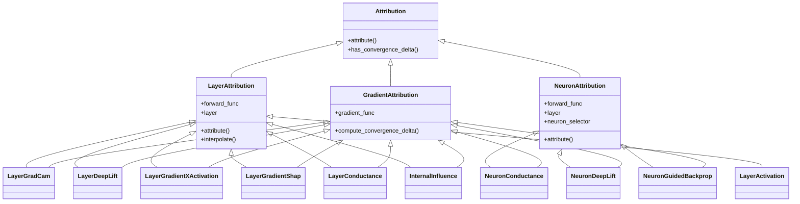
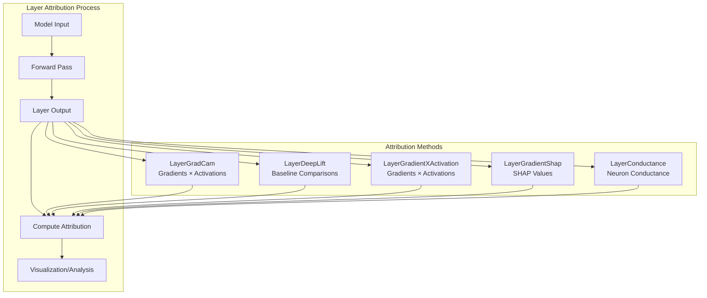
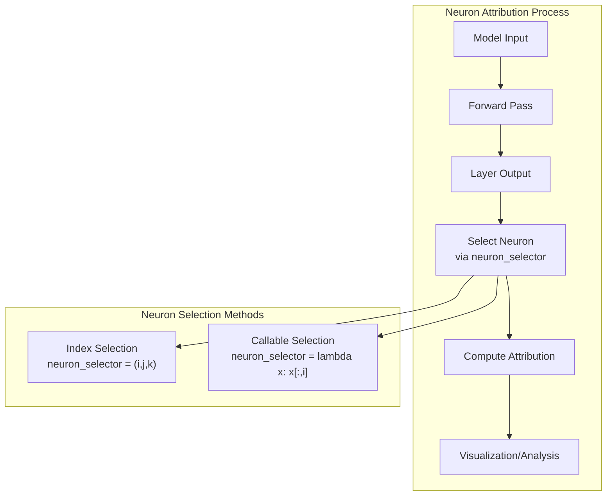
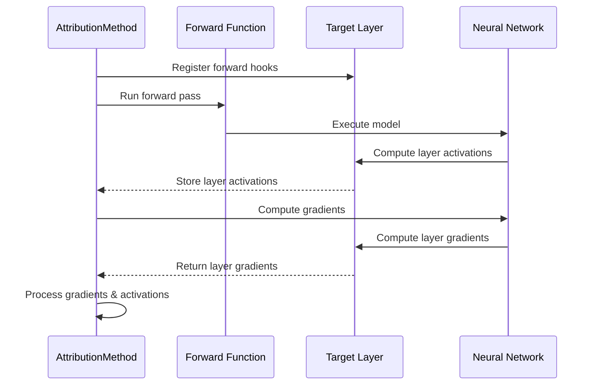
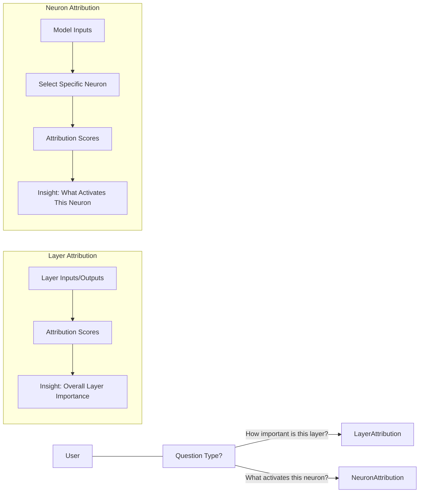

<!-- source: DeepWiki mcp.deepwiki.com · repo pytorch/captum · page 4 Layer and Neuron Attribution · fetched 2026-10-21 -->

# Layer and Neuron Attribution

<details>
<summary>Relevant source files</summary>

The following files were used as context for generating this wiki page:

- [captum/_utils/common.py](captum/_utils/common.py)
- [captum/_utils/gradient.py](captum/_utils/gradient.py)
- [captum/attr/_core/layer/grad_cam.py](captum/attr/_core/layer/grad_cam.py)
- [captum/attr/_core/layer/internal_influence.py](captum/attr/_core/layer/internal_influence.py)
- [captum/attr/_core/layer/layer_activation.py](captum/attr/_core/layer/layer_activation.py)
- [captum/attr/_core/layer/layer_conductance.py](captum/attr/_core/layer/layer_conductance.py)
- [captum/attr/_core/layer/layer_deep_lift.py](captum/attr/_core/layer/layer_deep_lift.py)
- [captum/attr/_core/layer/layer_gradient_shap.py](captum/attr/_core/layer/layer_gradient_shap.py)
- [captum/attr/_core/layer/layer_gradient_x_activation.py](captum/attr/_core/layer/layer_gradient_x_activation.py)
- [captum/attr/_core/neuron/neuron_conductance.py](captum/attr/_core/neuron/neuron_conductance.py)
- [tests/attr/layer/test_grad_cam.py](tests/attr/layer/test_grad_cam.py)
- [tests/attr/layer/test_internal_influence.py](tests/attr/layer/test_internal_influence.py)
- [tests/attr/layer/test_layer_gradient_x_activation.py](tests/attr/layer/test_layer_gradient_x_activation.py)
- [tests/attr/neuron/test_neuron_conductance.py](tests/attr/neuron/test_neuron_conductance.py)
- [tests/utils/test_common.py](tests/utils/test_common.py)

</details>


Layer and Neuron Attribution methods in Captum allow you to compute attribution scores for specific layers and neurons within your neural network model. These methods help identify which layers and neurons contribute most significantly to model predictions, providing deeper insights into model behavior than input attributions alone.

For attribution methods that analyze inputs to the model, see [Core Attribution Methods](#3).

## Key Concepts

Layer and Neuron Attribution methods analyze the contribution of internal components of a neural network:

- **Layer Attribution** computes importance scores for each input/output of a specific layer
- **Neuron Attribution** computes importance scores showing how each input feature contributes to a specific neuron's activation

Both types of attribution inherit from general attribution base classes and implement gradient-based and perturbation-based approaches.



Sources: 
- [captum/attr/_core/layer/layer_deep_lift.py:31-96](captum/attr/_core/layer/layer_deep_lift.py:31-96)
- [captum/attr/_core/layer/layer_gradient_shap.py:25-103](captum/attr/_core/layer/layer_gradient_shap.py:25-103)
- [captum/attr/_core/layer/grad_cam.py:21-78](captum/attr/_core/layer/grad_cam.py:21-78)
- [captum/attr/_core/neuron/neuron_conductance.py:36-96](captum/attr/_core/neuron/neuron_conductance.py:36-96)

## Layer Attribution Methods

Layer attribution methods compute attribution scores with respect to the inputs or outputs of a specific layer in the model. Captum provides several methods that use different approaches:

| Method | Description | Use Case | Multiply by Inputs Option |
|--------|-------------|----------|---------------------------|
| `LayerGradCam` | Computes gradients of target output w.r.t. layer and multiplies by layer activations | Particularly useful for CNN visualization, typically applied to last convolutional layer | No |
| `LayerDeepLift` | Applies DeepLIFT (Deep Learning Important Features) algorithm at the layer level | When attributions comparable to Integrated Gradients are needed but with better performance | Yes |
| `LayerGradientXActivation` | Element-wise product of gradients and activations for layer | When simple gradient-based attribution is needed | Yes |
| `LayerGradientShap` | Approximates SHAP values by computing expectations of gradients | When attributions need to account for feature interactions | Yes |
| `LayerConductance` | Computes conductance for each neuron in the layer | When analyzing internal neuron importance and signal propagation | No |
| `LayerActivation` | Simply returns the activation of a layer | For analyzing activation patterns (not attribution) | Yes |
| `InternalInfluence` | Approximates integral of gradients along path from baseline to input | When analyzing layer's influence in terms of integrated gradients | No |



Sources:
- [captum/attr/_core/layer/layer_deep_lift.py:31-96](captum/attr/_core/layer/layer_deep_lift.py:31-96)
- [captum/attr/_core/layer/layer_gradient_shap.py:25-103](captum/attr/_core/layer/layer_gradient_shap.py:25-103)
- [captum/attr/_core/layer/grad_cam.py:21-78](captum/attr/_core/layer/grad_cam.py:21-78)
- [captum/attr/_core/layer/layer_gradient_x_activation.py:19-213](captum/attr/_core/layer/layer_gradient_x_activation.py:19-213)
- [captum/attr/_core/layer/layer_conductance.py:29-70](captum/attr/_core/layer/layer_conductance.py:29-70)
- [captum/attr/_core/layer/layer_activation.py:16-141](captum/attr/_core/layer/layer_activation.py:16-141)
- [captum/attr/_core/layer/internal_influence.py:28-70](captum/attr/_core/layer/internal_influence.py:28-70)

### Common Parameters

Most layer attribution methods share common parameters:

- `forward_func`: The forward function of the model (or a modification)
- `layer`: The layer for which attributions are computed
- `device_ids`: Device IDs when using DataParallel models
- `multiply_by_inputs`: Whether to factor inputs' multiplier in attribution scores

The `attribute()` method takes these common arguments:

- `inputs`: Input tensor(s) for which attributions are computed
- `target`: Output indices (e.g., target class) for which attributions are computed
- `additional_forward_args`: Additional arguments for the forward function
- `attribute_to_layer_input`: Whether to attribute to layer input (True) or output (False)

Some methods like `LayerDeepLift`, `LayerGradientShap`, and `LayerConductance` also accept:

- `baselines`: Reference samples to compare with inputs
- `n_steps`: Number of steps for approximation methods
- `method`: Method for approximating integrals (e.g., "gausslegendre", "riemann_trapezoid")

Sources:
- [captum/attr/_core/layer/layer_deep_lift.py:98-283](captum/attr/_core/layer/layer_deep_lift.py:98-283)
- [captum/attr/_core/layer/layer_gradient_shap.py:105-184](captum/attr/_core/layer/layer_gradient_shap.py:105-184)
- [captum/attr/_core/layer/grad_cam.py:80-194](captum/attr/_core/layer/grad_cam.py:80-194)
- [captum/attr/_core/layer/layer_gradient_x_activation.py:74-142](captum/attr/_core/layer/layer_gradient_x_activation.py:74-142)

## Neuron Attribution Methods

Neuron attribution methods compute attribution scores that explain the behavior of specific neurons within a layer. These methods help understand what inputs activate particular neurons.

| Method | Description | Use Case |
|--------|-------------|----------|
| `NeuronConductance` | Computes conductance with respect to a specific neuron | Understanding how each input feature contributes to a particular neuron's activation |
| `NeuronDeepLift` | Applies DeepLIFT algorithm for a specific neuron | More efficient attribution for specific neurons with comparable results to integrated gradients |
| `NeuronGuidedBackprop` | Uses guided backpropagation for a specific neuron | Visualizing what inputs activate specific neurons |



Sources:
- [captum/attr/_core/neuron/neuron_conductance.py:36-96](captum/attr/_core/neuron/neuron_conductance.py:36-96)
- [captum/_utils/common.py:706-723](captum/_utils/common.py:706-723)

### Neuron Selection

The most important parameter specific to neuron attribution is the `neuron_selector`, which can be provided as:

1. A single integer - selects neuron column if layer output is 2D
2. A tuple of integers - identifies specific neuron in multi-dimensional layer output
3. A callable function - takes layer output and returns selected neuron output

Example neuron selectors:
```python
# For a convolutional layer with output shape (Batch, Channels, Height, Width)
# To select a specific feature map/channel (channel 5)
neuron_selector = (5, slice(None), slice(None))  # All spatial positions of channel 5

# To select a specific neuron at position (5,10,12)
neuron_selector = (5, 10, 12)

# Using a callable to select based on custom logic
neuron_selector = lambda x: x[:, 5].sum(dim=(1,2))  # Sum over all spatial positions of channel 5
```

Sources:
- [captum/attr/_core/neuron/neuron_conductance.py:126-157](captum/attr/_core/neuron/neuron_conductance.py:126-157)
- [captum/_utils/common.py:706-723](captum/_utils/common.py:706-723)

## Implementation Details

### Computing Layer Gradients and Evaluations

Both layer and neuron attribution methods rely on computing gradients with respect to layers. The `compute_layer_gradients_and_eval` function in `captum/_utils/gradient.py` is a key utility that:

1. Registers hooks on the target layer
2. Performs forward pass through the model
3. Computes gradients with respect to layer inputs/outputs
4. Collects layer evaluations (activations)

This is particularly important for handling DataParallel models where computation is distributed across devices.



Sources:
- [captum/_utils/gradient.py:597-773](captum/_utils/gradient.py:597-773)
- [captum/_utils/gradient.py:257-357](captum/_utils/gradient.py:257-357)

### Attribution Processing

Most attribution methods follow these general steps:

1. Format inputs and baselines
2. Register hooks on the target layer
3. Perform forward passes (and potentially multiple passes for integral approximation)
4. Compute gradients
5. Process gradients and layer activations to produce final attribution scores

For methods that use integral approximation (`LayerConductance`, `NeuronConductance`, etc.), the integration is performed using techniques like Riemann sums or Gauss-Legendre quadrature.

Sources:
- [captum/attr/_core/layer/layer_deep_lift.py:298-361](captum/attr/_core/layer/layer_deep_lift.py:298-361)
- [captum/attr/_core/layer/layer_gradient_shap.py:310-332](captum/attr/_core/layer/layer_gradient_shap.py:310-332)
- [captum/attr/_core/layer/grad_cam.py:200-238](captum/attr/_core/layer/grad_cam.py:200-238)

## Usage Examples

### Layer Attribution Example

```python
# ImageClassifier takes a single input tensor of images Nx3x32x32,
# and returns an Nx10 tensor of class probabilities.
net = ImageClassifier()
# creates an instance of LayerGradCam to interpret target class 3
# with respect to conv4 layer
layer_gc = LayerGradCam(net, net.conv4)
input = torch.randn(2, 3, 32, 32, requires_grad=True)
# Computes layer GradCAM for class 3
# attribution size matches layer output except for dimension 1
attr = layer_gc.attribute(input, 3)
# GradCAM attributions are often upsampled and viewed as a
# mask to the input, since the convolutional layer output
# spatially matches the original input image
upsampled_attr = LayerAttribution.interpolate(attr, (32, 32))
```

### Neuron Attribution Example

```python
# ImageClassifier takes a single input tensor of images Nx3x32x32,
# and returns an Nx10 tensor of class probabilities.
# It contains an attribute conv1, which is an instance of nn.conv2d,
# and the output of this layer has dimensions Nx12x32x32.
net = ImageClassifier()
neuron_cond = NeuronConductance(net, net.conv1)
input = torch.randn(2, 3, 32, 32, requires_grad=True)
# To compute neuron attribution, we need to provide the neuron
# index for which attribution is desired. Since the layer output
# is Nx12x32x32, we need a tuple in the form (0..11,0..31,0..31)
# which indexes a particular neuron in the layer output.
# Computes neuron conductance for neuron with index (4,1,2).
attribution = neuron_cond.attribute(input, (4,1,2))
```

Sources:
- [captum/attr/_core/layer/grad_cam.py:175-193](captum/attr/_core/layer/grad_cam.py:175-193)
- [captum/attr/_core/neuron/neuron_conductance.py:270-286](captum/attr/_core/neuron/neuron_conductance.py:270-286)

## Comparing Layer vs. Neuron Attribution



When to use each type:

- **Layer Attribution**: When you want to understand the importance of an entire layer to the model's output, or analyze which neurons within a layer are most influential.

- **Neuron Attribution**: When you want to understand what input features activate a specific neuron, useful for understanding what patterns a neuron has learned to detect.

- **Combined Analysis**: For deep insights, use both. First identify important layers with layer attribution, then analyze important neurons within those layers with neuron attribution.

Sources:
- [captum/attr/_core/layer/layer_deep_lift.py:31-96](captum/attr/_core/layer/layer_deep_lift.py:31-96)
- [captum/attr/_core/neuron/neuron_conductance.py:36-96](captum/attr/_core/neuron/neuron_conductance.py:36-96)
- [tests/attr/neuron/test_neuron_conductance.py:151-185](tests/attr/neuron/test_neuron_conductance.py:151-185)

## Advanced Options

### Multiplying by Inputs

Many attribution methods include a `multiply_by_inputs` parameter that controls whether attribution scores are multiplied by the difference between inputs and baselines. This corresponds to:

- `True` (default for most methods): Global attribution, which factors in the input multiplier
- `False`: Local attribution, which doesn't factor in the input multiplier

This can significantly impact attribution patterns, especially for methods like `LayerGradientXActivation` and `LayerDeepLift`.

Sources:
- [captum/attr/_core/layer/layer_gradient_x_activation.py:51-58](captum/attr/_core/layer/layer_gradient_x_activation.py:51-58)
- [captum/attr/_core/layer/layer_deep_lift.py:75-90](captum/attr/_core/layer/layer_deep_lift.py:75-90)
- [captum/attr/_core/layer/layer_gradient_shap.py:85-98](captum/attr/_core/layer/layer_gradient_shap.py:85-98)

### Batching and Performance

For methods that require multiple forward/backward passes (like integral approximation methods), Captum supports batching via the `internal_batch_size` parameter. This is useful for large models or datasets to manage memory consumption.

For DataParallel models, Captum automatically handles collecting outputs from multiple devices when `device_ids` is provided.

Sources:
- [captum/attr/_core/neuron/neuron_conductance.py:303-318](captum/attr/_core/neuron/neuron_conductance.py:303-318)
- [captum/_utils/gradient.py:359-416](captum/_utils/gradient.py:359-416)

---

