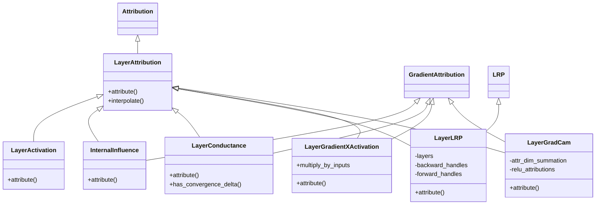
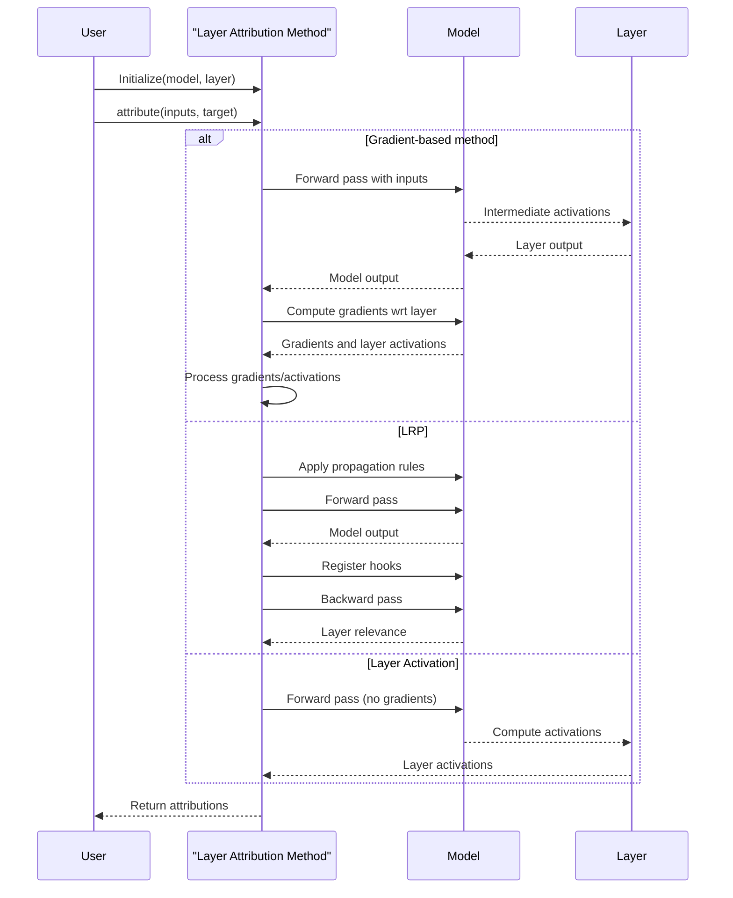

<!-- source: DeepWiki mcp.deepwiki.com · repo pytorch/captum · page 4.1 Layer Attribution Methods · fetched 2026-10-21 -->

# Layer Attribution Methods

<details>
<summary>Relevant source files</summary>

The following files were used as context for generating this wiki page:

- [captum/attr/_core/layer/grad_cam.py](captum/attr/_core/layer/grad_cam.py)
- [captum/attr/_core/layer/internal_influence.py](captum/attr/_core/layer/internal_influence.py)
- [captum/attr/_core/layer/layer_activation.py](captum/attr/_core/layer/layer_activation.py)
- [captum/attr/_core/layer/layer_conductance.py](captum/attr/_core/layer/layer_conductance.py)
- [captum/attr/_core/layer/layer_gradient_x_activation.py](captum/attr/_core/layer/layer_gradient_x_activation.py)
- [captum/attr/_core/layer/layer_lrp.py](captum/attr/_core/layer/layer_lrp.py)
- [captum/attr/_core/lrp.py](captum/attr/_core/lrp.py)
- [captum/attr/_core/neuron/neuron_conductance.py](captum/attr/_core/neuron/neuron_conductance.py)
- [captum/attr/_utils/custom_modules.py](captum/attr/_utils/custom_modules.py)
- [captum/attr/_utils/lrp_rules.py](captum/attr/_utils/lrp_rules.py)
- [tests/attr/layer/test_grad_cam.py](tests/attr/layer/test_grad_cam.py)
- [tests/attr/layer/test_internal_influence.py](tests/attr/layer/test_internal_influence.py)
- [tests/attr/layer/test_layer_gradient_x_activation.py](tests/attr/layer/test_layer_gradient_x_activation.py)
- [tests/attr/layer/test_layer_lrp.py](tests/attr/layer/test_layer_lrp.py)
- [tests/attr/models/test_pytext.py](tests/attr/models/test_pytext.py)
- [tests/attr/neuron/test_neuron_conductance.py](tests/attr/neuron/test_neuron_conductance.py)
- [tests/attr/test_lrp.py](tests/attr/test_lrp.py)

</details>


Layer Attribution Methods in Captum provide techniques for attributing predictions to specific layers within neural networks rather than input features. This allows for better understanding of how internal representations and transformations within a model contribute to its predictions.

For attribution to input features, see [Core Attribution Methods](#3).

## Overview and Class Hierarchy

Layer attribution methods extend the base `LayerAttribution` class, often also inheriting from `GradientAttribution` for gradient-based methods. Each method provides a unique approach to computing the importance of specific layer activations.



Sources: 
- [captum/attr/_core/layer/grad_cam.py:21-78]()
- [captum/attr/_core/layer/layer_gradient_x_activation.py:19-68]()
- [captum/attr/_core/layer/layer_lrp.py:34-74]()
- [captum/attr/_core/layer/layer_conductance.py:29-70]()
- [captum/attr/_core/layer/internal_influence.py:28-67]()
- [captum/attr/_core/layer/layer_activation.py:16-47]()

## Attribution Methods

### LayerGradCam

GradCAM is designed specifically for convolutional neural networks and is typically applied to the last convolutional layer. It computes the gradients of the target output with respect to the given layer, averages for each output channel, and multiplies the average gradient for each channel by the layer activations.

**Key Implementation Details:**
- Computes gradient of output with respect to the layer
- Averages gradients across spatial dimensions for each channel
- Multiplies by layer activations
- Optionally applies ReLU to attributions

```python
# Example usage
net = ImageClassifier()
layer_gc = LayerGradCam(net, net.conv4)
input = torch.randn(2, 3, 32, 32, requires_grad=True)
# Attribution size matches layer output except for dimension 1
# Dimensions of attr would be Nx1x8x8
attr = layer_gc.attribute(input, target=3)
# Upsample to input size for visualization
upsampled_attr = LayerAttribution.interpolate(attr, (32, 32))
```

Sources:
- [captum/attr/_core/layer/grad_cam.py:21-238]()
- [tests/attr/layer/test_grad_cam.py:22-158]()

### LayerGradientXActivation

This method computes the element-wise product of gradient and activation for the selected layer. It provides a straightforward approach to understand how gradients flow through a specific layer multiplied by that layer's activations.

**Key Implementation Details:**
- Computes gradient of output with respect to layer
- Multiplies gradient by layer activation (optional with `multiply_by_inputs` parameter)
- Supports attributing to multiple layers

```python
# Example usage
net = ImageClassifier()
layer_grad_act = LayerGradientXActivation(net, net.conv1)
input = torch.randn(2, 3, 32, 32, requires_grad=True)
# Attribution size matches layer output, Nx12x32x32
attribution = layer_grad_act.attribute(input, target=3)
```

Sources:
- [captum/attr/_core/layer/layer_gradient_x_activation.py:19-212]()
- [tests/attr/layer/test_layer_gradient_x_activation.py:24-209]()

### LayerLRP (Layer-wise Relevance Propagation)

LRP propagates relevance backwards through the network according to custom propagation rules. The model output score represents the initial relevance which is decomposed into values for each neuron of the underlying layers.

**Key Implementation Details:**
- Works by propagating relevance from output to target layer
- Uses custom propagation rules for different layer types
- Supports multiple custom rules like `EpsilonRule`, `GammaRule`, and more
- Can attribute to either layer input or output

```python
# Example usage
net = ImageClassifier()
layer_lrp = LayerLRP(net, net.conv1)
input = torch.randn(3, 3, 32, 32)
# Attribution size matches this layer's input or output 
attribution = layer_lrp.attribute(input, target=5)
```

Sources:
- [captum/attr/_core/layer/layer_lrp.py:34-315]()
- [captum/attr/_core/lrp.py:32-447]()
- [captum/attr/_utils/lrp_rules.py:13-221]()
- [tests/attr/layer/test_layer_lrp.py:21-196]()

### LayerConductance

Computes conductance with respect to the given layer, showing the total conductance of each hidden layer neuron. The method is based on the concept of path integration between a baseline input and the actual input.

**Key Implementation Details:**
- Computes path integral of gradient × activation difference
- Uses similar integration techniques as Integrated Gradients
- Supports multiple approximation methods for integration
- Can return convergence delta to measure approximation error

```python
# Example usage
net = ImageClassifier()
layer_cond = LayerConductance(net, net.conv1)
input = torch.randn(2, 3, 32, 32, requires_grad=True)
# Attribution size matches layer output, Nx12x32x32
attribution = layer_cond.attribute(input, target=3)
```

Sources:
- [captum/attr/_core/layer/layer_conductance.py:29-409]()
- [tests/attr/neuron/test_neuron_conductance.py:26-289]()

### InternalInfluence

This method approximates the integral of gradients for a particular layer along the path from a baseline input to the given input. It's conceptually similar to applying integrated gradients directly to a layer.

**Key Implementation Details:**
- Similar to Integrated Gradients but applied to a layer
- Computes path integral of gradient of output with respect to layer
- Uses techniques for approximating the path integral
- Supports batching for memory efficiency

```python
# Example usage
net = ImageClassifier()
layer_int_inf = InternalInfluence(net, net.conv1)
input = torch.randn(2, 3, 32, 32, requires_grad=True)
# Attribution size matches layer output
attribution = layer_int_inf.attribute(input)
```

Sources:
- [captum/attr/_core/layer/internal_influence.py:28-321]()
- [tests/attr/layer/test_internal_influence.py:21-197]()

### LayerActivation

The simplest layer attribution method - it just returns the activation of the specified layer for the given input, without computing attributions. This can be useful as a baseline or for simple analyses.

**Key Implementation Details:**
- Simply returns layer activations
- Doesn't compute gradients
- Very computationally efficient
- Can return either layer input or output activations

```python
# Example usage
net = ImageClassifier()
layer_act = LayerActivation(net, net.conv1)
input = torch.randn(2, 3, 32, 32)
# Output is layer activation
activation = layer_act.attribute(input)
```

Sources:
- [captum/attr/_core/layer/layer_activation.py:16-141]()

## Common Attribution Flow

The following diagram illustrates the general process flow when using layer attribution methods:



Sources:
- [captum/attr/_core/layer/grad_cam.py:79-238]()
- [captum/attr/_core/layer/layer_gradient_x_activation.py:74-212]()
- [captum/attr/_core/layer/layer_lrp.py:103-307]()
- [captum/attr/_core/layer/layer_activation.py:49-137]()

## LRP Propagation Rules

Layer-wise Relevance Propagation (LRP) utilizes specific propagation rules to determine how relevance is backpropagated through different layer types. These rules are defined in the `captum/attr/_utils/lrp_rules.py` file:

| Rule | Description | Recommended Use |
|------|-------------|-----------------|
| `EpsilonRule` | Uses a small epsilon value to avoid numerical instabilities | Middle layers |
| `GammaRule` | Gives more importance to positive relevance | Lower layers |
| `Alpha1_Beta0_Rule` | Only propagates positive relevance, also known as Deep-Taylor | Lower layers |
| `IdentityRule` | Skips layer manipulation, useful for layers with same dimensions for inputs and outputs | BatchNorm layers |

Rules can be attached to specific layers in the model:

```python
# Example of setting LRP rules
model.conv1.rule = EpsilonRule()
model.linear1.rule = GammaRule(gamma=0.5)
model.linear2.rule = Alpha1_Beta0_Rule()
```

Sources:
- [captum/attr/_utils/lrp_rules.py:13-221]()
- [captum/attr/_utils/custom_modules.py:8-18]()
- [tests/attr/test_lrp.py:27-339]()

## Method Selection Guidelines

Each attribution method has its strengths and appropriate use cases:

| Method | Best For | Computational Cost | Key Advantage |
|--------|----------|-------------------|---------------|
| LayerGradCam | CNNs, visualization | Low | Effective for localizing important regions |
| LayerGradientXActivation | General purpose | Low | Fast, direct interpretation |
| LayerLRP | Precise attribution | Medium-High | Rule-based propagation for different layer types |
| LayerConductance | Detailed neuron analysis | Medium-High | Integrated path reduces noise |
| InternalInfluence | Understanding layer impact | Medium-High | Path integration for stability |
| LayerActivation | Baseline/reference | Very Low | Simple activation values |

Sources:
- All method files

## Working with Multiple Layers

Some layer attribution methods support attributing to multiple layers simultaneously:

```python
# Attributing to multiple layers
modules = [model.conv1, model.conv2]
layer_attr = LayerLRP(model, modules)
attributions = layer_attr.attribute(inputs)
# attributions is a list with one element per layer
```

This is supported in:
- LayerLRP
- LayerGradientXActivation
- LayerActivation

Sources:
- [captum/attr/_core/layer/layer_lrp.py:168-196]()
- [captum/attr/_core/layer/layer_gradient_x_activation.py:183-200]()
- [captum/attr/_core/layer/layer_activation.py:128-136]()

## Common Parameters

Most layer attribution methods share these important parameters:

| Parameter | Description | Default |
|-----------|-------------|---------|
| `attribute_to_layer_input` | Whether to compute attributions for layer inputs or outputs | `False` |
| `target` | Output indices for which attributions are computed | `None` |
| `additional_forward_args` | Additional arguments for the forward function | `None` |
| `n_steps` | Number of steps for integral approximation methods | `50` |
| `method` | Integration method for path-based methods | `"gausslegendre"` |
| `internal_batch_size` | Batch size for processing large inputs | `None` |

Sources:
- [captum/attr/_core/layer/grad_cam.py:79-163]()
- [captum/attr/_core/layer/layer_gradient_x_activation.py:74-140]()
- [captum/attr/_core/layer/layer_conductance.py:74-242]()
- [captum/attr/_core/layer/internal_influence.py:68-242]()

## Practical Considerations

1. **Computational Efficiency**: Methods like LayerGradCam and LayerGradientXActivation are computationally efficient, while methods requiring integration (LayerConductance, InternalInfluence) are more expensive.

2. **Visualization**: For convolutional layers, attributions often need to be upsampled to match input dimensions for visualization. Use `LayerAttribution.interpolate()` for this purpose:
   ```python
   upsampled_attr = LayerAttribution.interpolate(attribution, input_shape)
   ```

3. **Layer Selection**: 
   - For CNNs, the last convolutional layer often provides the most informative attributions with GradCam
   - For LRP, different rules may be appropriate for different layer types

4. **DataParallel Models**: When using models wrapped with DataParallel, provide the `device_ids` parameter to correctly reconstruct intermediate outputs from batched results across devices.

5. **Memory Limitations**: For large models or inputs, use `internal_batch_size` parameter to process in smaller chunks.

Sources:
- All method files
- [tests/attr/layer/test_grad_cam.py:110-141]()
- [tests/attr/layer/test_internal_influence.py:165-197]()

---

