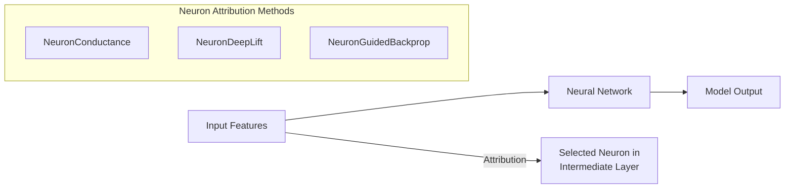
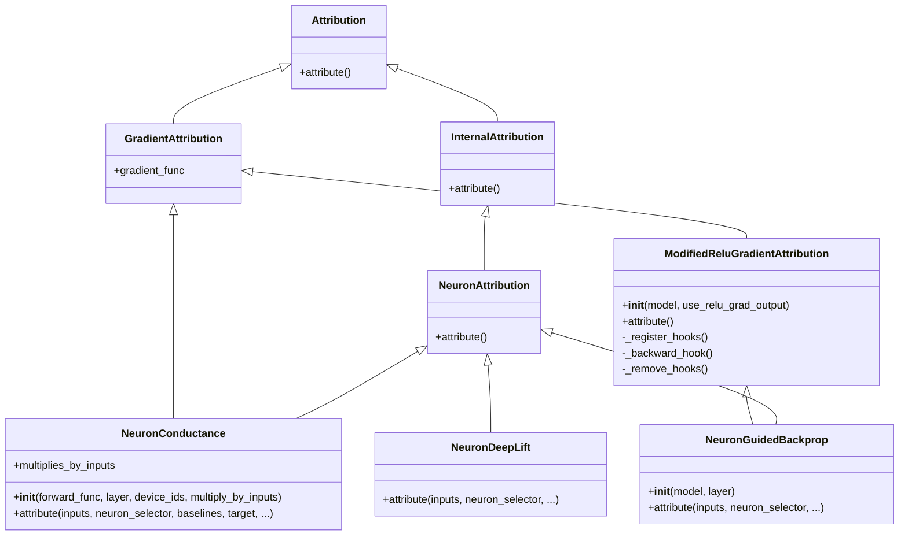
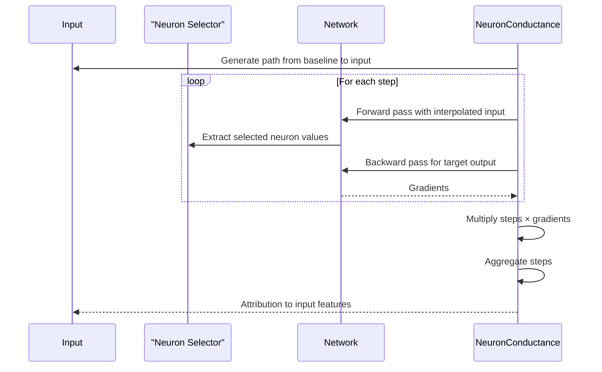
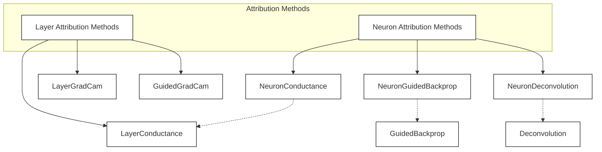

<!-- source: DeepWiki mcp.deepwiki.com · repo pytorch/captum · page 4.2 Neuron Attribution Methods · fetched 2026-10-21 -->

# Neuron Attribution Methods

<details>
<summary>Relevant source files</summary>

The following files were used as context for generating this wiki page:

- [captum/attr/_core/guided_backprop_deconvnet.py](captum/attr/_core/guided_backprop_deconvnet.py)
- [captum/attr/_core/guided_grad_cam.py](captum/attr/_core/guided_grad_cam.py)
- [captum/attr/_core/layer/grad_cam.py](captum/attr/_core/layer/grad_cam.py)
- [captum/attr/_core/layer/internal_influence.py](captum/attr/_core/layer/internal_influence.py)
- [captum/attr/_core/layer/layer_activation.py](captum/attr/_core/layer/layer_activation.py)
- [captum/attr/_core/layer/layer_conductance.py](captum/attr/_core/layer/layer_conductance.py)
- [captum/attr/_core/layer/layer_gradient_x_activation.py](captum/attr/_core/layer/layer_gradient_x_activation.py)
- [captum/attr/_core/neuron/neuron_conductance.py](captum/attr/_core/neuron/neuron_conductance.py)
- [tests/attr/layer/test_grad_cam.py](tests/attr/layer/test_grad_cam.py)
- [tests/attr/layer/test_internal_influence.py](tests/attr/layer/test_internal_influence.py)
- [tests/attr/layer/test_layer_gradient_x_activation.py](tests/attr/layer/test_layer_gradient_x_activation.py)
- [tests/attr/neuron/test_neuron_conductance.py](tests/attr/neuron/test_neuron_conductance.py)
- [tests/attr/test_deconvolution.py](tests/attr/test_deconvolution.py)
- [tests/attr/test_guided_backprop.py](tests/attr/test_guided_backprop.py)
- [tests/attr/test_guided_grad_cam.py](tests/attr/test_guided_grad_cam.py)

</details>


This page documents the neuron attribution methods in Captum, which allow attribution to specific neurons within a neural network layer. Unlike layer attribution methods (which compute attributions with respect to entire layers, see [Layer Attribution Methods](#4.1)), neuron attribution methods focus on understanding the importance of individual neurons to model predictions.

## Introduction to Neuron Attribution

Neuron attribution methods compute the contribution of input features toward the activation of a specific neuron in an intermediate layer. These methods help answer questions like "which input features most strongly activate this specific hidden neuron?" and are useful for understanding:

1. What features or concepts individual neurons detect
2. How information flows through specific pathways in a neural network
3. Which neurons are responsible for detecting particular patterns or concepts



Sources: [captum/attr/_core/neuron/neuron_conductance.py]

## Class Hierarchy

Neuron attribution methods in Captum follow a well-defined inheritance structure:



The `NeuronAttribution` base class provides the foundation for attributing to specific neurons within a layer, while each implementation offers different approaches to computing these attributions.

Sources: [captum/attr/_core/neuron/neuron_conductance.py], [captum/attr/_core/guided_backprop_deconvnet.py]

## Neuron Selection

A core concept in neuron attribution is specifying which neuron(s) to analyze. Captum offers flexible ways to select neurons using the `neuron_selector` parameter:

| Selector Type | Description | Use Case |
|---------------|-------------|----------|
| Single Integer | Selects a neuron column in a 2D layer output | Simple layers with single-dimensional outputs |
| Tuple of Integers | Specifies indices for each dimension except batch dimension | Convolutional layers with multi-dimensional feature maps |
| Callable Function | Custom selector function that takes layer output and returns selected neurons | Complex selection criteria or selecting neurons from layer with multiple output tensors |

Example tuple selector for a convolutional layer with output shape (batch_size, channels, height, width):
```python
# Select neuron at channel 4, height 1, width 2
neuron_selector = (4, 1, 2)
```

Sources: [captum/attr/_core/neuron/neuron_conductance.py:100-157]

## NeuronConductance

`NeuronConductance` is a powerful method that computes attributions showing how each input feature affects a specific neuron's activation. It builds on the conductance concept, which is related to integrated gradients but focused on internal neurons rather than model outputs.

### How It Works

NeuronConductance computes the contribution to a specific neuron's activation by:
1. Calculating gradients of the output with respect to the given layer
2. Calculating gradients of the layer with respect to the input
3. Computing an approximation of the integral of these gradients along a path from a baseline to the input



### Key Parameters

When using `NeuronConductance.attribute()`:

- `inputs`: Input for which neuron conductance is computed
- `neuron_selector`: Selector for neuron in given layer (integer, tuple, or callable)
- `baselines`: Optional starting point for integral computation (defaults to zero)
- `target`: Optional target class or output index
- `n_steps`: Number of steps in the integral approximation (default: 50)
- `method`: Method for approximating the integral (default: "riemann_trapezoid")
- `multiply_by_inputs`: Whether to multiply attributions by (inputs - baselines)

### Example Usage

```python
# For a convolutional neural network
net = ImageClassifier()
# Create NeuronConductance for first convolutional layer
neuron_cond = NeuronConductance(net, net.conv1)
# Input tensor
input = torch.randn(2, 3, 32, 32, requires_grad=True)
# Compute attributions for neuron at channel 4, height 1, width 2
attribution = neuron_cond.attribute(input, (4, 1, 2))
```

Sources: [captum/attr/_core/neuron/neuron_conductance.py:36-436]

## NeuronGuidedBackprop

`NeuronGuidedBackprop` applies guided backpropagation to attribute the activation of a specific neuron to the input features. Guided backpropagation modifies the gradient calculation by only letting positive gradients flow through ReLU layers during backpropagation.

### How It Works

1. Registers hooks on all ReLU layers to modify gradient flow
2. Performs a forward pass through the network
3. Backpropagates from the selected neuron to the input
4. Only passes positive gradients through ReLU during backpropagation

This creates a clearer visualization of which input features positively contribute to the neuron's activation.

### Key Parameters

- `inputs`: Input tensor or tuple of tensors
- `neuron_selector`: Selector for neuron in given layer
- `additional_forward_args`: Any additional arguments needed for the forward function

### Example Usage

```python
# For a convolutional neural network
net = ImageClassifier()
# Create NeuronGuidedBackprop for a given layer
ngbp = NeuronGuidedBackprop(net, net.conv1)
# Input tensor
input = torch.randn(2, 3, 32, 32, requires_grad=True)
# Compute attributions for neuron at position (4, 1, 2)
attribution = ngbp.attribute(input, (4, 1, 2))
```

Sources: [captum/attr/_core/guided_backprop_deconvnet.py:27-142], [tests/attr/test_guided_backprop.py:36-67]

## NeuronDeconvolution

`NeuronDeconvolution` applies deconvolution techniques to attribute a specific neuron's activation to the input features. Similar to guided backpropagation, it modifies gradient propagation but differs in how it handles ReLU gradients.

### How It Works

1. Registers hooks on ReLU layers to modify gradient flow
2. Performs a forward pass through the network  
3. Backpropagates from the selected neuron to the input
4. During backpropagation, gradients of ReLU inputs are computed by taking ReLU of the output gradient, regardless of the ReLU input's sign

This approach helps reveal which input patterns would most activate the selected neuron.

### Key Parameters

Same as `NeuronGuidedBackprop`:
- `inputs`: Input tensor or tuple of tensors
- `neuron_selector`: Selector for neuron in given layer
- `additional_forward_args`: Any additional arguments needed for the forward function

### Example Usage

```python
# For a convolutional neural network
net = ImageClassifier()
# Create NeuronDeconvolution for a given layer
ndeconv = NeuronDeconvolution(net, net.conv1)
# Input tensor
input = torch.randn(2, 3, 32, 32, requires_grad=True)
# Compute attributions for neuron at position (4, 1, 2)
attribution = ndeconv.attribute(input, (4, 1, 2))
```

Sources: [captum/attr/_core/guided_backprop_deconvnet.py:226-332], [tests/attr/test_deconvolution.py:36-58]

## Relationship to Layer Attribution Methods

Neuron attribution methods are closely related to layer attribution methods but provide more granular insights:



The sum of neuron attributions across all neurons in a layer is often comparable to the layer attribution for the entire layer, providing a way to verify the consistency of these methods.

Sources: [tests/attr/neuron/test_neuron_conductance.py:139-187]

## Method Comparison and Selection

| Method | Strengths | Use Cases |
|--------|-----------|-----------|
| NeuronConductance | - Theoretically sound<br>- Accounts for baseline<br>- Detailed attribution | - When precise, path-based attribution is needed<br>- When comparing to a meaningful baseline |
| NeuronGuidedBackprop | - Fast computation<br>- Clear visualizations<br>- Highlights positive contributions | - Visual explanations of CNN neurons<br>- Identifying positive patterns that activate neurons |
| NeuronDeconvolution | - Less restrictive than guided backprop<br>- Good for pattern visualization | - Visualizing patterns that activate neurons<br>- Alternative to guided backprop for comparison |

For convolutional neural networks, neuron attribution methods can help visualize what patterns or features specific filters are detecting. For other network types, they can help identify which input features are most important for specific internal representations.

Sources: [captum/attr/_core/neuron/neuron_conductance.py], [tests/attr/test_guided_backprop.py], [tests/attr/test_deconvolution.py]

## Implementation Notes

- All neuron attribution methods inherit from the `NeuronAttribution` base class
- Computations can be batched using the `internal_batch_size` parameter for efficiency with large inputs
- Most methods support multiple input tensors and additional forward arguments
- For convolutional networks, attributions can be visualized as heatmaps over the input
- When using `NeuronGuidedBackprop` or `NeuronDeconvolution`, ensure all ReLU operations in the model use modules (nn.module.ReLU) rather than functional operations (nn.functional.ReLU)

Sources: [captum/attr/_core/neuron/neuron_conductance.py], [captum/attr/_core/guided_backprop_deconvnet.py:129-132, 240-243]

---

