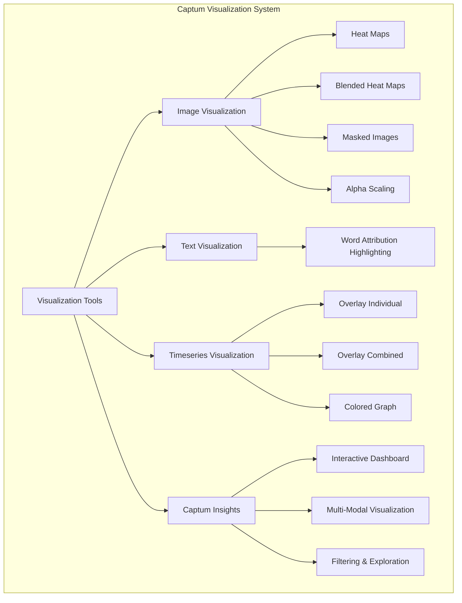
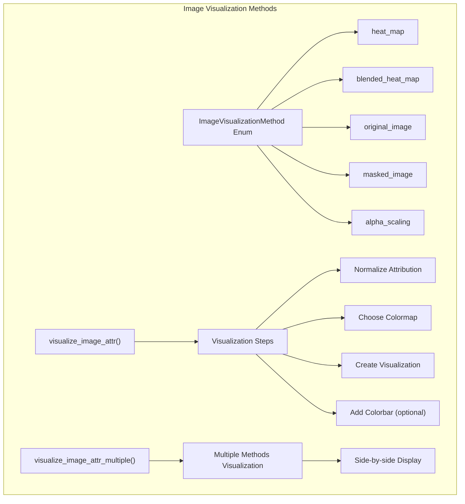
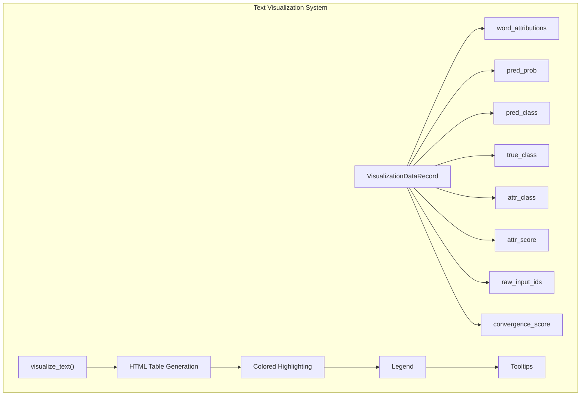
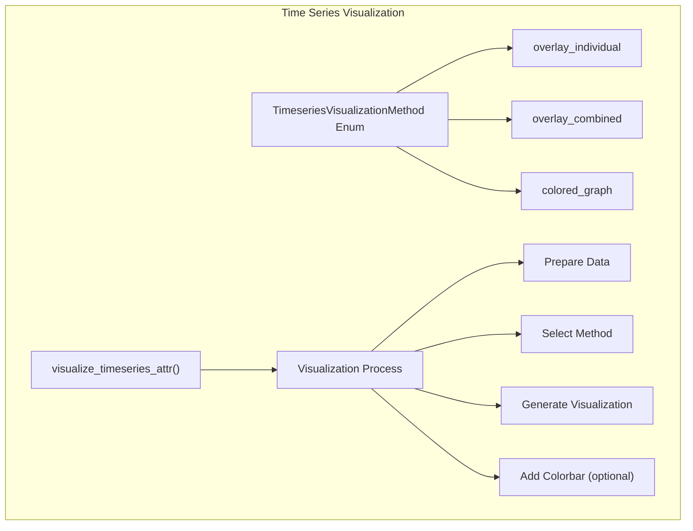
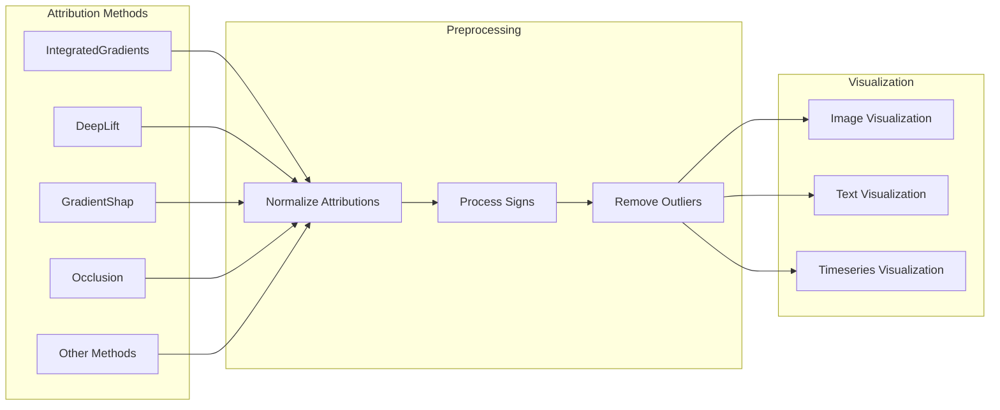
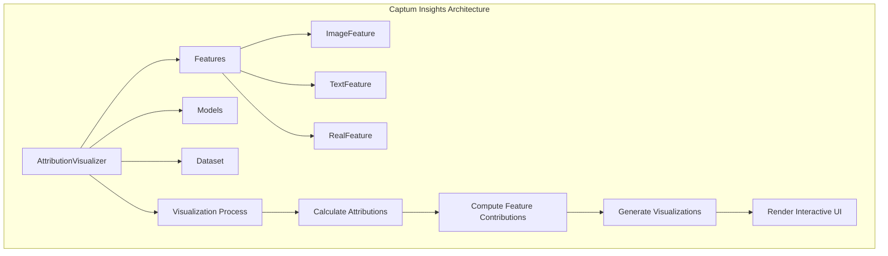
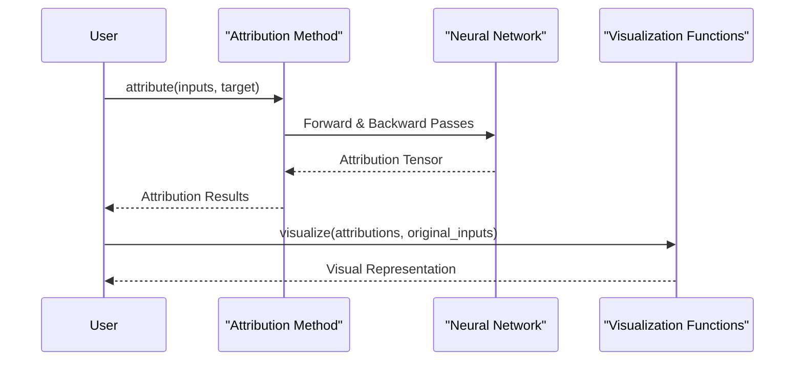
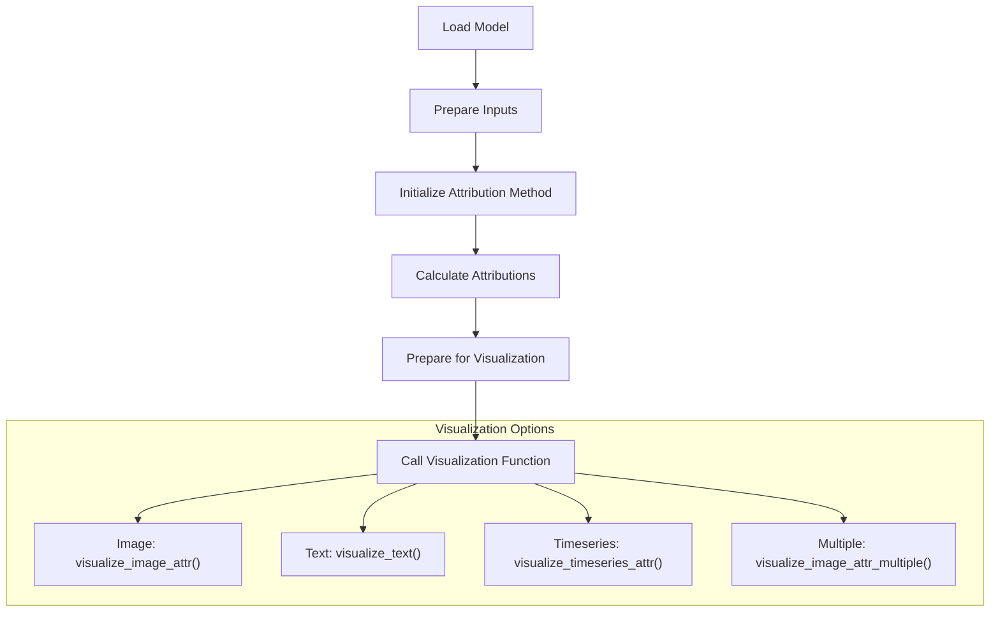

<!-- source: DeepWiki mcp.deepwiki.com · repo pytorch/captum · page 5 Visualization · fetched 2026-10-21 -->

# Visualization

<details>
<summary>Relevant source files</summary>

The following files were used as context for generating this wiki page:

- [captum/attr/_utils/visualization.py](captum/attr/_utils/visualization.py)
- [captum/insights/example.py](captum/insights/example.py)
- [tests/insights/test_contribution.py](tests/insights/test_contribution.py)
- [tutorials/CIFAR_TorchVision_Interpret.ipynb](tutorials/CIFAR_TorchVision_Interpret.ipynb)
- [tutorials/IMDB_TorchText_Interpret.ipynb](tutorials/IMDB_TorchText_Interpret.ipynb)
- [tutorials/Multimodal_VQA_Interpret.ipynb](tutorials/Multimodal_VQA_Interpret.ipynb)
- [tutorials/Titanic_Basic_Interpret.ipynb](tutorials/Titanic_Basic_Interpret.ipynb)
- [tutorials/models/titanic_model.pt](tutorials/models/titanic_model.pt)

</details>


This page documents the visualization components and utilities in Captum, which allow users to visually interpret the results of attribution methods. Captum provides specialized visualization tools for different data types, including images, text, and time series data, making it easier to understand model decisions and attribution results.

For information about the attribution methods themselves, see [Core Attribution Methods](#3).

## Overview of Visualization Capabilities

Captum's visualization module provides tools to convert attribution values (which are often tensors of numbers) into human-interpretable visual formats. These visualizations help users understand which input features contributed most to a model's output.

The visualization capabilities in Captum are organized into different components based on data type:



Sources: [captum/attr/_utils/visualization.py:30-48](). [captum/attr/_utils/visualization.py:234-237]().

## Image Attribution Visualization

The image visualization module supports multiple methods for displaying attribution values on images:



Sources: [captum/attr/_utils/visualization.py:30-36](). [captum/attr/_utils/visualization.py:235-250](). [captum/attr/_utils/visualization.py:438-548]().

### Image Visualization Methods

The `ImageVisualizationMethod` enum defines several methods for visualizing attributions on images:

1. **Heat Map**: Displays a heat map of attribution values
2. **Blended Heat Map**: Overlays attribution heat map on a grayscale version of the original image
3. **Original Image**: Shows only the original image (for comparison)
4. **Masked Image**: Masks the original image based on attribution values
5. **Alpha Scaling**: Sets the alpha channel of each pixel based on attribution values

Each method provides a different way to understand how attribution values relate to the original image.

Sources: [captum/attr/_utils/visualization.py:30-36]().

### Key Image Visualization Functions

The primary functions for visualizing image attributions are:

1. **`visualize_image_attr`**: Visualizes attribution for a single image using the specified method.
   ```python
   visualize_image_attr(
       attr,                 # Attribution tensor [H,W,C]
       original_image=None,  # Original image tensor [H,W,C]
       method="heat_map",    # Visualization method
       sign="absolute_value", # Sign type: "positive", "negative", "absolute_value", or "all"
       plt_fig_axis=None,    # Optional existing figure/axis
       outlier_perc=2,       # Percentile for outlier removal
       cmap=None,            # Optional colormap
       alpha_overlay=0.5,    # Alpha for blended_heat_map
       show_colorbar=False,  # Whether to show colorbar
       title=None,           # Optional title
       fig_size=(6,6),       # Figure size
       use_pyplot=True       # Whether to use pyplot or return figure object
   )
   ```

2. **`visualize_image_attr_multiple`**: Visualizes attribution using multiple methods side-by-side.
   ```python
   visualize_image_attr_multiple(
       attr,                # Attribution tensor
       original_image,      # Original image tensor
       methods,             # List of methods
       signs,               # List of sign types
       titles=None,         # Optional list of titles
       fig_size=(8,6),      # Figure size
       use_pyplot=True,     # Whether to use pyplot
       **kwargs             # Additional arguments passed to visualize_image_attr
   )
   ```

Sources: [captum/attr/_utils/visualization.py:235-457](). [captum/attr/_utils/visualization.py:438-548]().

## Text Attribution Visualization

For text data, Captum provides tools to visualize word-level attributions by highlighting text with colors based on attribution values.



Sources: [captum/attr/_utils/visualization.py:912-954](). [captum/attr/_utils/visualization.py:982-1013]().

### Text Visualization Components

1. **`VisualizationDataRecord`**: A class that stores all data necessary for text visualization, including:
   - Word attributions
   - Prediction probability
   - Predicted class
   - True class
   - Attribution class
   - Attribution score
   - Raw input ids (words/tokens)
   - Convergence score

2. **`visualize_text`**: Generates HTML visualization of text attributions using the data records.

Sources: [captum/attr/_utils/visualization.py:912-954](). [tutorials/IMDB_TorchText_Interpret.ipynb:358-368]().

### Example Text Visualization

When visualizing text attributions, words are highlighted with colors ranging from red (negative attribution) to green (positive attribution), with the intensity of the color representing the magnitude of attribution. This makes it easy to see which words were most important for the model's prediction.

Sources: [tutorials/IMDB_TorchText_Interpret.ipynb:438-439](). [captum/attr/_utils/visualization.py:957-1013]().

## Time Series Visualization

For time series data, Captum provides several methods to visualize attributions over sequential data.



Sources: [captum/attr/_utils/visualization.py:38-42](). [captum/attr/_utils/visualization.py:671-904]().

### Time Series Visualization Methods

The `TimeseriesVisualizationMethod` enum defines three methods for visualizing attributions on time series data:

1. **Overlay Individual**: Plots each channel individually and overlays attributions as a heat map
2. **Overlay Combined**: Plots all channels in one panel and overlays the average attributions
3. **Colored Graph**: Plots each channel with the graph color representing attribution values

Sources: [captum/attr/_utils/visualization.py:38-42](). [captum/attr/_utils/visualization.py:583-668]().

### Key Time Series Visualization Function

The main function for visualizing time series attributions is `visualize_timeseries_attr`:

```python
visualize_timeseries_attr(
    attr,                # Attribution tensor [N,C] or [C,N]
    data,                # Original data tensor [N,C] or [C,N]
    x_values=None,       # Optional x-axis values
    method="overlay_individual", # Visualization method
    sign="absolute_value", # Sign type
    channel_labels=None, # Optional channel labels
    channels_last=True,  # Whether channels are the last dimension
    plt_fig_axis=None,   # Optional existing figure/axis
    outlier_perc=2,      # Percentile for outlier removal
    cmap=None,           # Optional colormap
    alpha_overlay=0.7,   # Alpha for overlay methods
    show_colorbar=False, # Whether to show colorbar
    title=None,          # Optional title
    fig_size=(6,6),      # Figure size
    use_pyplot=True,     # Whether to use pyplot
    **pyplot_kwargs      # Additional pyplot arguments
)
```

Sources: [captum/attr/_utils/visualization.py:671-904]().

## Data Flow in Visualization Process

The following diagram illustrates the data flow from attribution methods to visualization:



Sources: [captum/attr/_utils/visualization.py:51-110](). [captum/attr/_utils/visualization.py:388-413]().

## Captum Insights

Captum Insights is a higher-level visualization interface built on top of the core visualization utilities. It provides an interactive dashboard for exploring model interpretations.



Sources: [tests/insights/test_contribution.py:10-42](). [tests/insights/test_contribution.py:169-181](). [tests/insights/test_contribution.py:213-236]().

### Key Components of Captum Insights

1. **`AttributionVisualizer`**: The main class that orchestrates the visualization process
2. **Features**: Different feature types that can be visualized (image, text, numerical)
3. **Models**: The models to be interpreted
4. **Dataset**: The data samples to generate attributions for

Captum Insights calculates feature contributions and provides an interactive interface for exploring model interpretations.

Sources: [tests/insights/test_contribution.py:169-188](). [tests/insights/test_contribution.py:213-237]().

## Integration with Attribution Methods

Visualization tools in Captum are designed to work seamlessly with attribution methods. Here's how they integrate:



Sources: [tutorials/Titanic_Basic_Interpret.ipynb:299-321](). [tutorials/CIFAR_TorchVision_Interpret.ipynb:534-547]().

## Example Usage Workflow

The following diagram shows a typical workflow for attribution visualization:



Sources: [tutorials/IMDB_TorchText_Interpret.ipynb:306-367](). [tutorials/CIFAR_TorchVision_Interpret.ipynb:534-547](). [tutorials/Multimodal_VQA_Interpret.ipynb:465-501]().

## Customization Options

Captum's visualization tools offer several customization options:

| Data Type | Customization Options |
|-----------|------------------------|
| Images    | Visualization method, sign type, colormap, alpha overlay, outlier percentile, figure size |
| Text      | Highlighting color scheme, tooltips |
| Time Series | Visualization method, sign type, channel labels, colormap, alpha overlay |

Sources: [captum/attr/_utils/visualization.py:254-337](). [captum/attr/_utils/visualization.py:709-778]().

## Best Practices for Visualization

1. Choose the appropriate visualization method for your data type and use case
2. Consider showing multiple visualization methods side-by-side for comparison
3. Adjust the sign parameter to focus on positive or negative attributions as needed
4. Remove outliers (with `outlier_perc`) to ensure attributions are visible
5. Add a colorbar when using heat maps for better interpretation
6. When visualizing multiple attributions, use consistent parameters for fair comparison

Sources: [tutorials/CIFAR_TorchVision_Interpret.ipynb:534-547](). [tutorials/Multimodal_VQA_Interpret.ipynb:465-501]().

## Conclusion

Captum's visualization tools provide powerful capabilities for interpreting model attributions across different data types. By converting attribution values into visual formats, they make it easier to understand which features contribute most to model predictions, facilitating model debugging, validation, and explanation.

---

