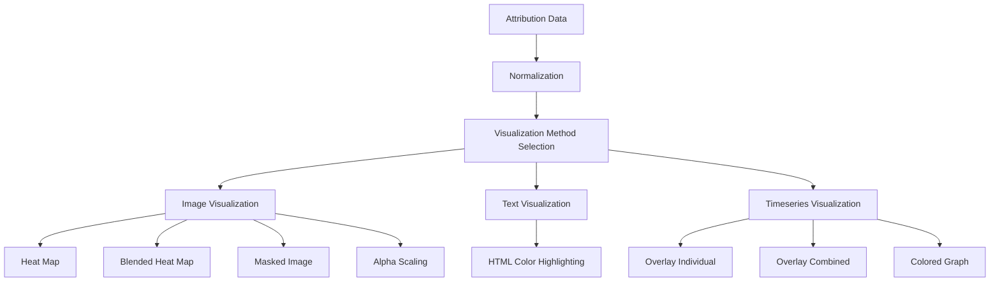
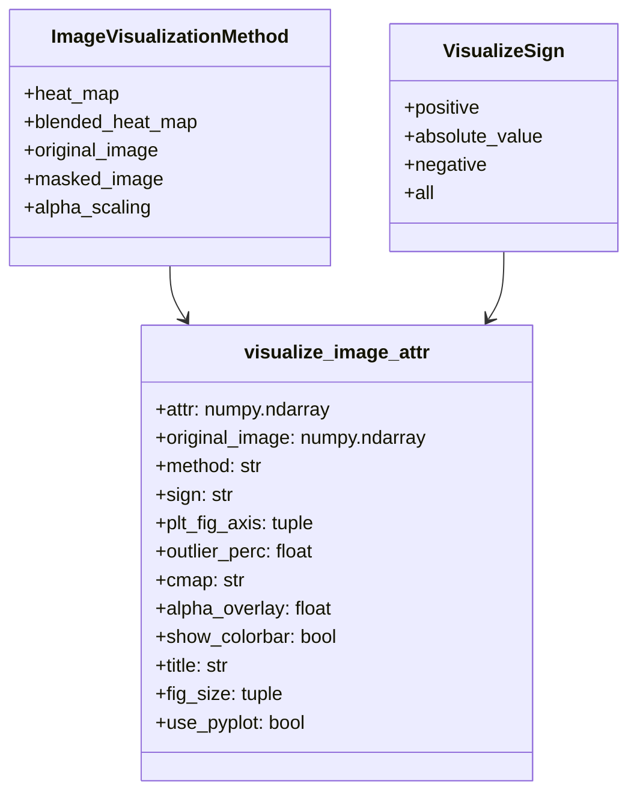
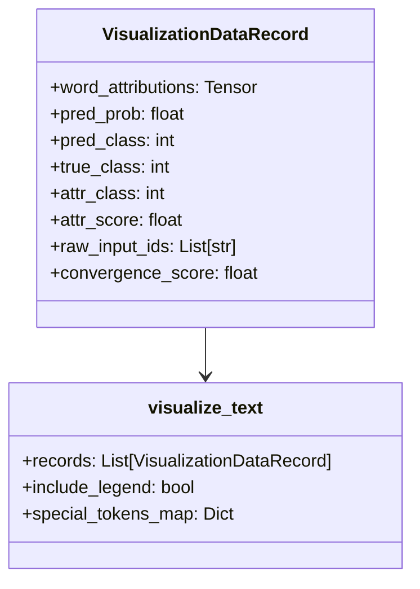
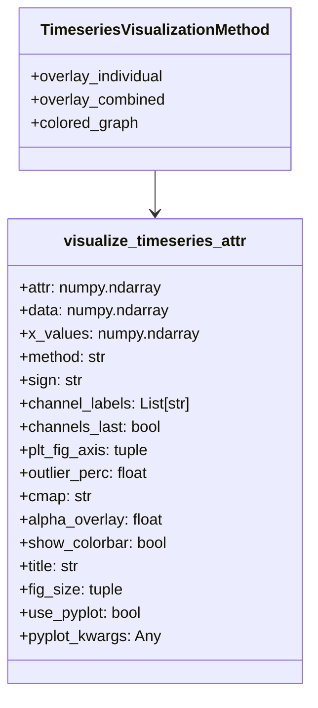
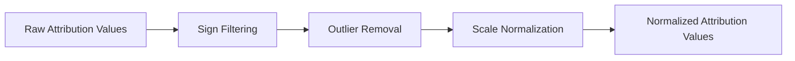
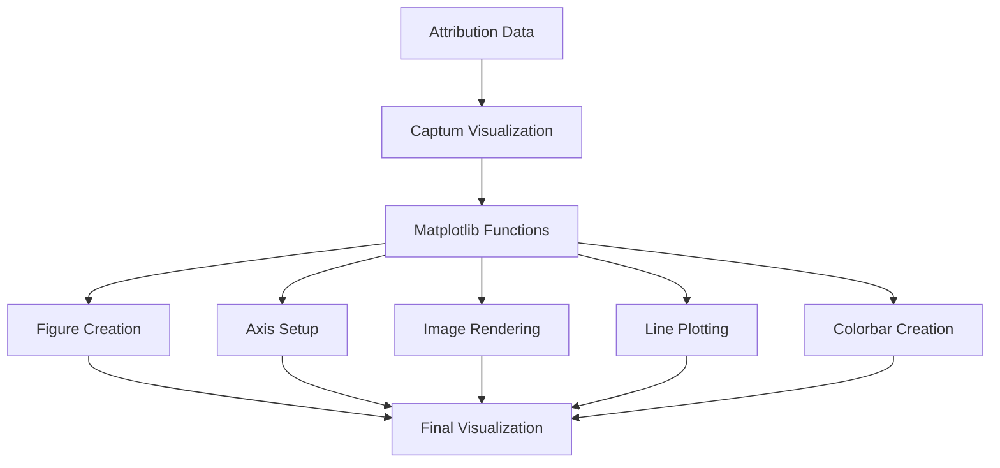

<!-- source: DeepWiki mcp.deepwiki.com · repo pytorch/captum · page 5.1 Visualization Utilities · fetched 2026-10-21 -->

# Visualization Utilities

<details>
<summary>Relevant source files</summary>

The following files were used as context for generating this wiki page:

- [captum/attr/_utils/visualization.py](captum/attr/_utils/visualization.py)
- [tutorials/CIFAR_TorchVision_Interpret.ipynb](tutorials/CIFAR_TorchVision_Interpret.ipynb)
- [tutorials/IMDB_TorchText_Interpret.ipynb](tutorials/IMDB_TorchText_Interpret.ipynb)
- [tutorials/Multimodal_VQA_Interpret.ipynb](tutorials/Multimodal_VQA_Interpret.ipynb)
- [tutorials/Titanic_Basic_Interpret.ipynb](tutorials/Titanic_Basic_Interpret.ipynb)
- [tutorials/models/titanic_model.pt](tutorials/models/titanic_model.pt)

</details>


The Captum visualization utilities provide a set of functions to display attribution results across different data types, helping users understand and interpret model predictions. These utilities support three main data types: images, text, and time series data, offering various visualization methods for each type.

For interactive visualization dashboards, see [Captum Insights](#5.2).

## Overview of Visualization Utilities

Captum's visualization utilities are designed to transform numerical attribution values into visual representations that are easier to interpret. These utilities handle the complexities of normalizing attribution values, applying appropriate color mappings, and rendering visualizations in a user-friendly manner.



Sources: [captum/attr/_utils/visualization.py:1-904]()

## Image Attribution Visualization

The image visualization utilities allow users to visualize which portions of an input image contributed most to a model's prediction.

### Main Functions

1. `visualize_image_attr()`: Visualizes attribution for a single image
2. `visualize_image_attr_multiple()`: Visualizes attribution using multiple methods in a grid

### Visualization Methods



Sources: [captum/attr/_utils/visualization.py:30-48](), [captum/attr/_utils/visualization.py:235-350]()

### Visualization Method Details

1. **Heat Map**: Shows a heat map of attribution values
2. **Blended Heat Map**: Overlays heat map on grayscale version of original image
3. **Original Image**: Displays only the original image
4. **Masked Image**: Masks the original image by attribution values
5. **Alpha Scaling**: Sets alpha channel according to attribution values

### Sign Options

1. **Positive**: Shows only positive attributions
2. **Negative**: Shows only negative attributions
3. **Absolute Value**: Shows absolute value of attributions
4. **All**: Shows both positive and negative attributions

### Example Usage

The following example demonstrates how to visualize integrated gradients attribution for an image:

```python
# Compute attributions
attribution, delta = ig.attribute(input, baselines, target=pred_label_idx)

# Visualize attribution
visualization.visualize_image_attr(
    attribution[0].cpu().permute(1,2,0).detach().numpy(),
    original_image[0].permute(1,2,0).numpy(),
    method="blended_heat_map",
    sign="all",
    show_colorbar=True,
    title="Integrated Gradients"
)
```

To display multiple visualization methods side by side:

```python
visualization.visualize_image_attr_multiple(
    attribution[0].cpu().permute(1,2,0).detach().numpy(),
    original_image[0].permute(1,2,0).numpy(),
    ["original_image", "heat_map", "blended_heat_map"],
    ["all", "positive", "absolute_value"],
    show_colorbar=True,
    titles=["Original", "Heat Map", "Blended Heat Map"]
)
```

Sources: [captum/attr/_utils/visualization.py:235-438](), [tutorials/CIFAR_TorchVision_Interpret.ipynb:348-373]()

## Text Attribution Visualization

Text visualization utilities in Captum render attributions as HTML with colored text highlighting, making it easy to identify which words or tokens contributed most to a model's prediction.

### Main Components

1. `VisualizationDataRecord`: A class for storing attribution-related information
2. `visualize_text()`: Renders attributions as HTML with colored text



Sources: [captum/attr/_utils/visualization.py:912-956](), [captum/attr/_utils/visualization.py:957-1097]()

### Color Mapping

Text is colored based on attribution values:
- Positive attributions: Green with intensity based on magnitude
- Negative attributions: Red with intensity based on magnitude
- Neutral attributions: White

### Example Usage

```python
# Create visualization data record
vis_data_records = [
    visualization.VisualizationDataRecord(
        word_attributions,
        pred_score,
        pred_class,
        true_class,
        attr_class,
        attr_score,
        raw_input_ids,
        convergence_score
    )
]

# Display visualization
visualization.visualize_text(vis_data_records)
```

In practice, this is often used with LayerIntegratedGradients to visualize word importance in NLP tasks:

```python
# After computing attribution for text inputs
attributions = lig.attribute(inputs, baselines, target=target_idx)

# Normalize attributions
word_attributions = attributions.sum(dim=2).squeeze(0) / norm_factor

# Create visualization record
vis_data_records = [
    visualization.VisualizationDataRecord(
        word_attributions,
        pred_score,
        pred_label,
        true_label,
        attr_label,
        attribution_score,
        input_tokens,
        0.0
    )
]

# Visualize the result
visualization.visualize_text(vis_data_records)
```

Sources: [captum/attr/_utils/visualization.py:957-1097](), [tutorials/IMDB_TorchText_Interpret.ipynb:314-369](), [tutorials/Multimodal_VQA_Interpret.ipynb:446-483]()

## Timeseries Attribution Visualization

Timeseries visualization utilities help visualize how different time steps or channels in time series data contributed to model predictions.

### Main Functions

1. `visualize_timeseries_attr()`: Visualizes attribution for timeseries data

### Visualization Methods



Sources: [captum/attr/_utils/visualization.py:38-42](), [captum/attr/_utils/visualization.py:551-906]()

### Visualization Method Details

1. **Overlay Individual**: Plots each channel individually in separate panels with attributions as heat map overlays
2. **Overlay Combined**: Plots all channels in the same panel with average attributions as a heat map overlay
3. **Colored Graph**: Plots each channel in a separate panel with the line colors representing attribution values

### Example Usage

```python
# After computing attribution for timeseries data
attribution = dl.attribute(data, target=0)

# Visualize attribution for the first sample
visualize_timeseries_attr(
    attribution[0],
    data[0],
    method="overlay_individual",
    channel_labels=["Channel 1", "Channel 2", "Channel 3"],
    show_colorbar=True
)
```

Sources: [captum/attr/_utils/visualization.py:551-906]()

## Common Implementation Details

All visualization utilities share common implementation patterns:

### Attribution Normalization

The `_normalize_attr()` function handles normalization of attribution values across all visualization types:

1. Handles different sign options (positive, negative, absolute, all)
2. Removes outliers based on specified percentile 
3. Scales values to a consistent range



Sources: [captum/attr/_utils/visualization.py:82-110]()

### Color Mapping

The `_initialize_cmap_and_vmin_vmax()` function sets up appropriate color maps based on sign selection:
- Positive: Green colormap
- Negative: Red colormap
- Absolute: Blue colormap
- All: Red-White-Green diverging colormap

Sources: [captum/attr/_utils/visualization.py:132-151]()

## Integration with Matplotlib

All visualization utilities are built on top of Matplotlib for customizable rendering:

1. Support for custom figure and axis objects
2. Control over plot aesthetics (size, colormap, etc.)
3. Option to use pyplot interface or object-oriented API
4. Support for colorbars and other annotations



Sources: [captum/attr/_utils/visualization.py:113-128](), [captum/attr/_utils/visualization.py:423-429]()

## Practical Examples

Here are some common use patterns from the tutorial notebooks:

### CIFAR10 Image Classification

Visualizing attributions for image classification models using multiple methods:

```python
# For attribution methods like IntegratedGradients, Saliency, DeepLift
attribution = attr_method.attribute(input, target=pred_class)

# Visualize using multiple methods
_ = viz.visualize_image_attr_multiple(
    np.transpose(attribution.squeeze().cpu().detach().numpy(), (1,2,0)),
    np.transpose(original_image.squeeze().cpu().detach().numpy(), (1,2,0)),
    ["original_image", "heat_map"],
    ["all", "positive"],
    show_colorbar=True,
    titles=["Original", "Attribution"],
    fig_size=(18, 6)
)
```

Sources: [tutorials/CIFAR_TorchVision_Interpret.ipynb:348-373]()

### Titanic Dataset Feature Importance

Visualizing feature importance for tabular data:

```python
# After computing attributions for the features
attr = ig.attribute(test_input_tensor, target=1)

# Visualize average feature importance
plt.figure(figsize=(12,6))
plt.bar(feature_names, np.mean(attr.detach().numpy(), axis=0))
plt.title("Average Feature Importances")
plt.xlabel("Features")
```

Sources: [tutorials/Titanic_Basic_Interpret.ipynb:348-373]()

### IMDB Sentiment Analysis

Visualizing word importance in text classification:

```python
# Create visualization data records
vis_data_records = [
    visualization.VisualizationDataRecord(
        attributions.sum(dim=2).squeeze(0) / attributions.sum(),
        pred_score,
        pred_label,
        true_label,
        "positive",
        attributions.sum(),
        input_tokens,
        delta
    )
]

# Display the text visualization
visualization.visualize_text(vis_data_records)
```

Sources: [tutorials/IMDB_TorchText_Interpret.ipynb:360-369]()

## Best Practices

When using Captum's visualization utilities, consider the following best practices:

1. **Choose appropriate visualization method** based on your data type and what aspect you want to highlight
2. **Select the right sign option** to focus on positive contributions, negative contributions, or both
3. **Adjust the outlier_perc parameter** to better highlight relevant attributions (default is 2%)
4. **Use multiple visualization methods** side by side for more comprehensive understanding
5. **Customize colormaps** when needed for better visual interpretation
6. **Add informative titles** to clearly identify what is being shown

## Summary

Captum's visualization utilities provide a comprehensive set of tools for interpreting model predictions across different data types:

- Image visualization with various methods like heat maps and blended overlays
- Text visualization with colored highlighting based on word importance
- Timeseries visualization with overlay and colored graph options

These utilities are designed to work seamlessly with Captum's attribution methods, allowing for quick and informative visualization of model behavior and feature importance.

Sources: [captum/attr/_utils/visualization.py:1-1097]()

---

