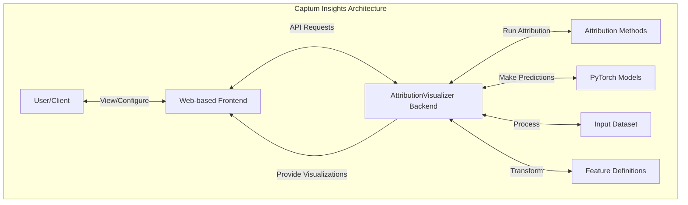
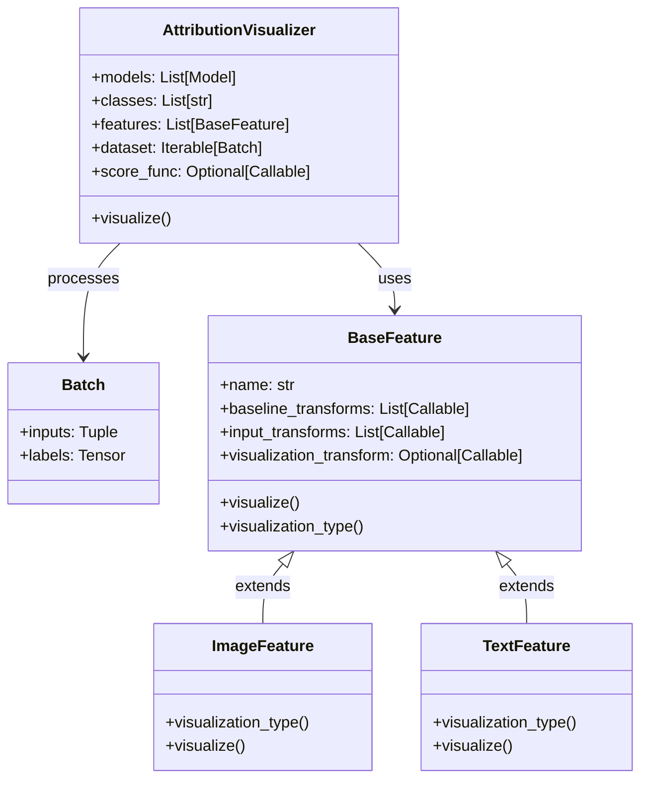
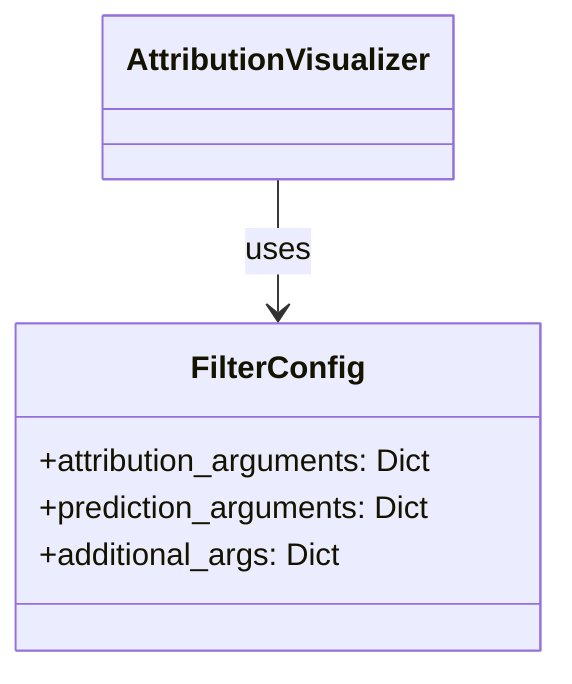
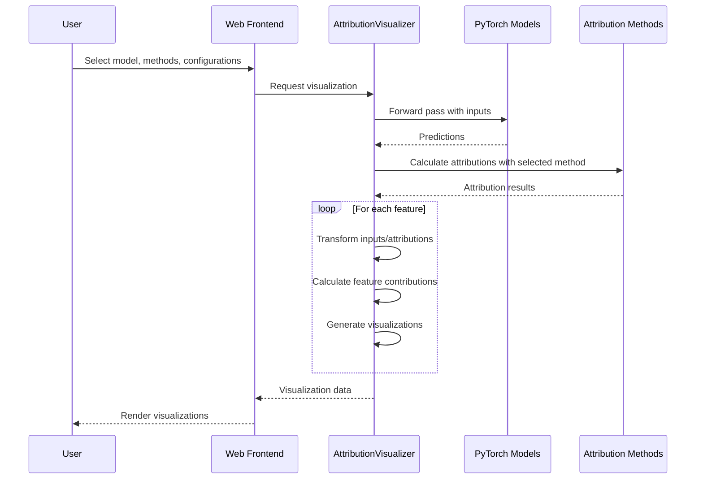
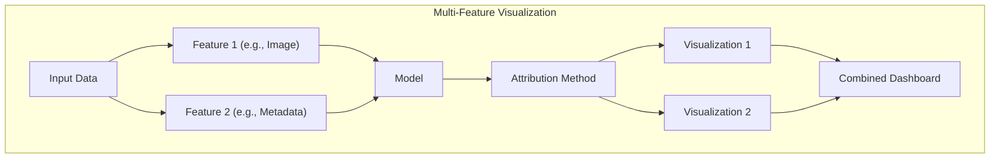

<!-- source: DeepWiki mcp.deepwiki.com · repo pytorch/captum · page 5.2 Captum Insights · fetched 2026-10-21 -->

# Captum Insights

<details>
<summary>Relevant source files</summary>

The following files were used as context for generating this wiki page:

- [captum/insights/example.py](captum/insights/example.py)
- [tests/insights/test_contribution.py](tests/insights/test_contribution.py)

</details>


## Purpose and Scope

Captum Insights is an interactive visualization tool within the Captum library that provides a web interface for exploring and understanding model attributions. It allows users to visualize feature attributions generated by Captum's attribution methods in a user-friendly, interactive environment. This document describes the architecture, components, and usage of Captum Insights.

For information about other visualization utilities in Captum, see [Visualization Utilities](#5.1).

## Overview

Captum Insights creates an interactive web application that allows users to:
- Visualize attributions from multiple attribution methods simultaneously
- Compare attributions across different models
- Filter and sort results by prediction confidence
- Analyze contribution proportions across different input features
- Interactively explore attributions for individual instances



Sources: [tests/insights/test_contribution.py:169-181]()

## Key Components

### AttributionVisualizer

The core component of Captum Insights is the `AttributionVisualizer` class which:
- Manages models and attribution methods
- Processes input data
- Calculates and normalizes attributions
- Serves the web interface
- Handles visualization requests



Sources: [tests/insights/test_contribution.py:169-181](), [tests/insights/test_contribution.py:214-230]()

### Feature Types

Captum Insights supports different types of features, each with specific visualization capabilities:

| Feature Type | Description | Visualization Type |
|--------------|-------------|-------------------|
| ImageFeature | For image data | Heatmap overlay on images |
| TextFeature | For text data | Word-level highlighting |
| Custom Features | User-defined features | Custom visualization methods |

Each feature type must implement:
- `visualization_type()` - Returns the type of visualization
- `visualize()` - Produces the visualization output

Sources: [tests/insights/test_contribution.py:19-45](), [tests/insights/test_contribution.py:172-177]()

### Configuration System

Captum Insights uses a configuration system to control:
- Attribution method parameters
- Visualization settings
- Filtering options



Sources: [tests/insights/test_contribution.py:182](), [tests/insights/test_contribution.py:231]()

## Data Flow Process

The following diagram illustrates how data flows through Captum Insights:



Sources: [tests/insights/test_contribution.py:184-188](), [tests/insights/test_contribution.py:233-237]()

## Multi-Feature and Multi-Modal Support

Captum Insights supports:
1. Multiple features for a single input (e.g., analyzing different aspects of an image)
2. Multi-modal inputs where the model takes different types of inputs (e.g., image + text)

For each feature or input modality, Captum calculates:
- Individual attributions
- Relative contribution proportions among features
- Normalized contributions that sum to 1.0 across all features



Sources: [tests/insights/test_contribution.py:190-237]()

## Implementation Details

### Data Processing

Captum Insights processes data through:
1. **Batch Processing**: Inputs are processed in batches for efficiency
2. **Transformations**: Each feature can specify:
   - Input transforms - preprocessing the raw inputs
   - Baseline transforms - creating baseline inputs for attribution methods
   - Visualization transforms - preparing data for visualization

### Contribution Calculation

For each feature, Captum Insights:
1. Calculates raw attributions using the specified attribution method
2. Aggregates attributions per feature
3. Normalizes contributions so they sum to 1.0 across all features
4. Uses these normalized values to represent the relative importance of each feature

Sources: [tests/insights/test_contribution.py:186-188](), [tests/insights/test_contribution.py:235-237]()

## Usage Examples

To use Captum Insights, you need to:
1. Define your features
2. Configure an AttributionVisualizer
3. Start the visualization server

### Basic Example

```python
from captum.insights import AttributionVisualizer
from captum.insights.attr_vis.features import ImageFeature
from captum.attr import IntegratedGradients

# Define the model
model = MyModel()

# Define the features
features = [
    ImageFeature(
        "Image",
        # Transforms for the input
        input_transforms=[normalize_transform],
        # Transforms for the baseline
        baseline_transforms=[lambda x: x * 0]
    )
]

# Create the visualizer
visualizer = AttributionVisualizer(
    models=[model],
    classes=class_names,
    features=features,
    dataset=my_dataset_iterator
)

# Launch the web interface
visualizer.serve()
```

Sources: [tests/insights/test_contribution.py:169-181]()

### Multi-Modal Example

```python
from captum.insights import AttributionVisualizer
from captum.insights.attr_vis.features import ImageFeature, TextFeature

# Create visualizer with multiple features
visualizer = AttributionVisualizer(
    models=[multimodal_model],
    classes=class_names,
    features=[
        ImageFeature(
            "Image",
            input_transforms=[image_transform],
            baseline_transforms=[image_baseline]
        ),
        TextFeature(
            "Text",
            input_transforms=[text_transform],
            baseline_transforms=[text_baseline]
        )
    ],
    dataset=multimodal_dataset_iterator
)
```

Sources: [tests/insights/test_contribution.py:214-230]()

## Extension Points

Captum Insights can be extended in several ways:

1. **Custom Features**: Create new feature types by subclassing BaseFeature
2. **Multiple Models**: Compare attributions across different model architectures
3. **Attribution Methods**: Use any of Captum's attribution methods
4. **Custom Transforms**: Define custom input, baseline, and visualization transforms

Sources: [tests/insights/test_contribution.py:19-45]()

## Integration with Captum

Captum Insights integrates with the broader Captum ecosystem:
- Uses Captum's attribution methods to calculate attributions
- Follows the same attribution interfaces
- Complements the lower-level visualization utilities in Captum

Sources: [tests/insights/test_contribution.py:10-12]()

---

