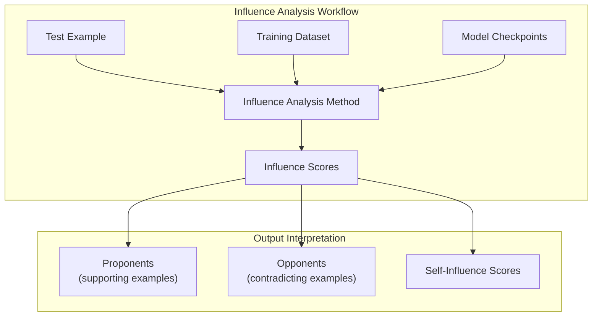
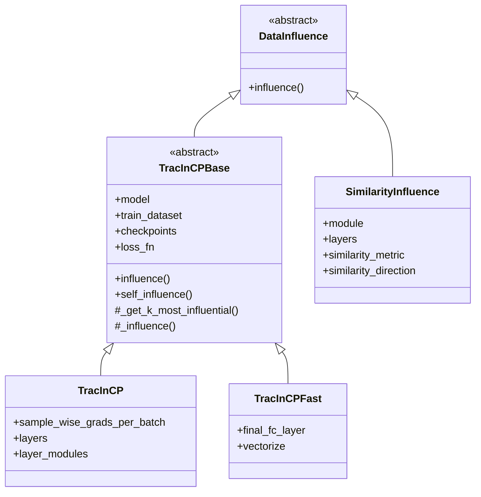
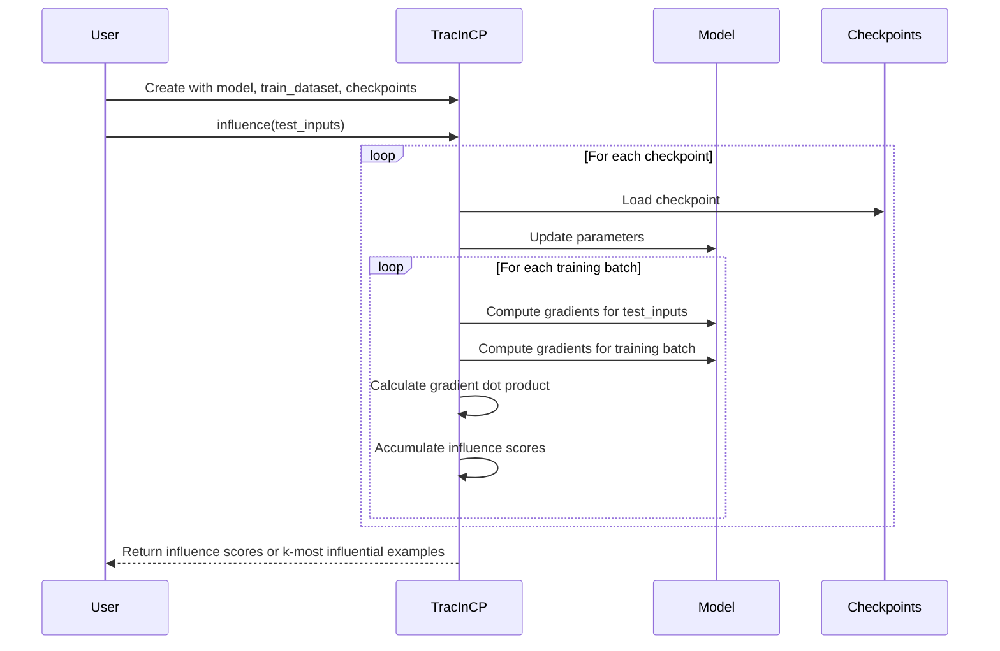
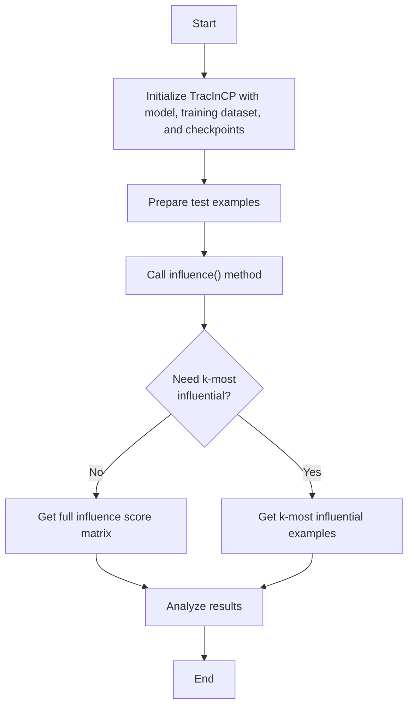
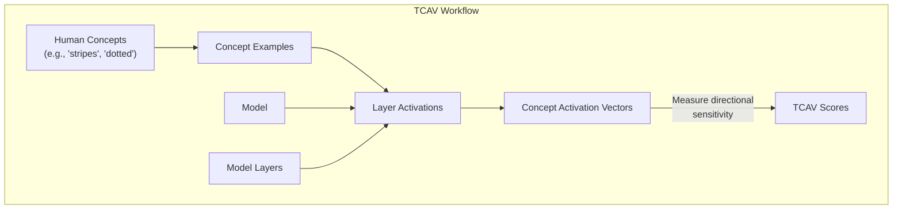
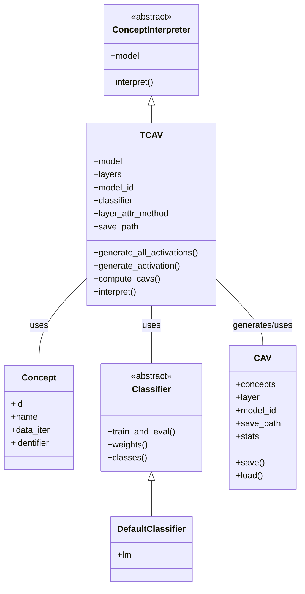
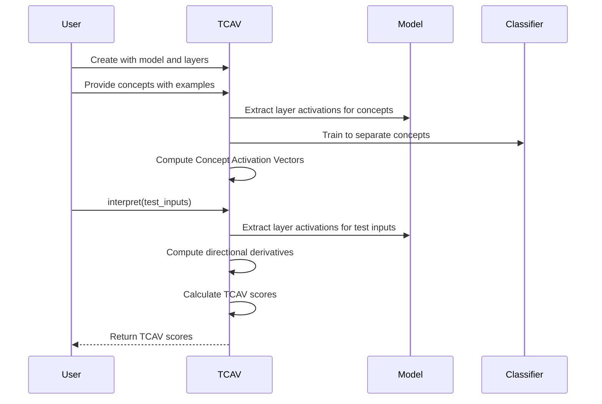
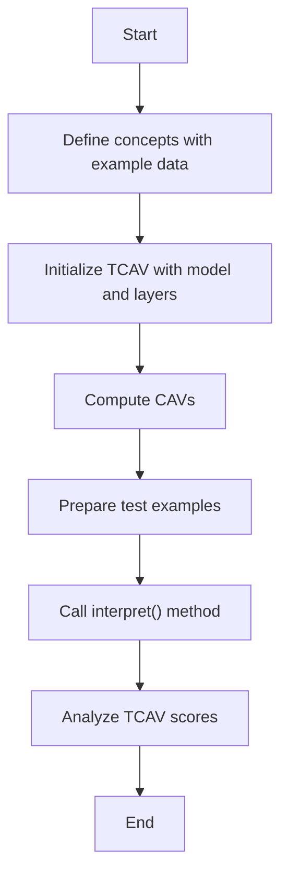

<!-- source: DeepWiki mcp.deepwiki.com · repo pytorch/captum · page 6 Advanced Analysis · fetched 2026-10-21 -->

# Advanced Analysis

Relevant source files

The following files were used as context for generating this wiki page:

- [captum/_utils/av.py](captum/_utils/av.py)
- [captum/_utils/progress.py](captum/_utils/progress.py)
- [captum/concept/_core/concept.py](captum/concept/_core/concept.py)
- [captum/concept/_core/tcav.py](captum/concept/_core/tcav.py)
- [captum/concept/_utils/classifier.py](captum/concept/_utils/classifier.py)
- [captum/influence/_core/similarity_influence.py](captum/influence/_core/similarity_influence.py)
- [captum/influence/_core/tracincp.py](captum/influence/_core/tracincp.py)
- [captum/influence/_core/tracincp_fast_rand_proj.py](captum/influence/_core/tracincp_fast_rand_proj.py)
- [captum/influence/_utils/common.py](captum/influence/_utils/common.py)
- [tests/concept/test_tcav.py](tests/concept/test_tcav.py)
- [tests/influence/_core/test_tracin_show_progress.py](tests/influence/_core/test_tracin_show_progress.py)

Advanced Analysis in Captum provides techniques for deeper model introspection beyond basic attribution methods. While attribution methods (covered in [Core Attribution Methods](#3)) focus on assigning importance to inputs and model components, Advanced Analysis techniques help understand models through higher-level abstractions like training data influence and conceptual understanding.

This page covers two primary advanced analysis capabilities:

1. **Influence Functions** - Methods to quantify how specific training examples impact model predictions
2. **Concept Testing** - Techniques to test sensitivity of models to human-interpretable concepts

## Influence Functions

Influence Functions in Captum help determine how training examples affect model predictions. By measuring this influence, you can identify the most relevant training examples for a given prediction, debug data quality issues, and better understand model behavior.

### Influence Analysis Overview

Sources:
- [captum/influence/_core/tracincp.py:43-61]()
- [captum/influence/_core/tracincp_fast_rand_proj.py:49-62]()

### TracIn Implementation

TracIn (Tracing Influences) is based on the research paper "[Estimating Training Data Influence by Tracking Gradient Descent](https://arxiv.org/abs/2002.08484)". It computes influence scores by accumulating gradient dot products across saved model checkpoints.

Sources:
- [captum/influence/_core/tracincp.py:74-442]()
- [captum/influence/_core/tracincp_fast_rand_proj.py:75-254]()
- [captum/influence/_core/similarity_influence.py:66-309]()

#### TracInCP

TracInCP provides the standard TracIn implementation, calculating influence scores between training and test examples. The influence score measures how much a training example affected a test example's loss during training.

Key features:

- Supports arbitrary layers in the model
- Handles both gradient-based and perturbation-based influence computation
- Provides both influence scores and k-most influential example retrieval
- Can calculate self-influence (influence of examples on themselves)

Sources:
- [captum/influence/_core/tracincp.py:456-745]()
- [captum/influence/_utils/common.py:68-86]()

#### TracInCPFast

TracInCPFast is an optimized implementation for the special case of analyzing only the final fully-connected layer. It achieves the same results as TracInCP but with significant computational speedups.

Key features:

- Requires specifying the final fully-connected layer
- Much faster computation for large models
- Maintains the same API as TracInCP
- Specialized for models with a standard fully-connected output layer

Sources:
- [captum/influence/_core/tracincp_fast_rand_proj.py:75-588]()

#### SimilarityInfluence

SimilarityInfluence provides an alternative approach to influence analysis using similarity metrics between activation vectors rather than gradient calculations.

Key features:

- Supports multiple similarity metrics (cosine similarity, euclidean distance)
- Can operate on activations from any layer
- Allows custom similarity metrics
- Typically faster than gradient-based methods

Sources:
- [captum/influence/_core/similarity_influence.py:66-309]()
- [captum/influence/_core/similarity_influence.py:23-52]()

### Using Influence Functions

Here's the general workflow for using influence functions:

1. Initialize the influence object with model, training dataset, and checkpoints
2. Call `influence()` to get influence scores between training and test examples
3. Alternatively, retrieve the k-most influential examples using the same method with `k` parameter

Sources:
- [captum/influence/_core/tracincp.py:617-684]()
- [tests/influence/_core/test_tracin_show_progress.py:105-256]()

## Concept Testing

Concept Testing in Captum enables testing how sensitive a model is to human-interpretable concepts. The primary implementation is Testing with Concept Activation Vectors (TCAV), which helps quantify the degree to which a concept is important for a classification decision.

### TCAV Overview

Sources:
- [captum/concept/_core/tcav.py:217-312]()

### Components of Concept Testing

Sources:
- [captum/concept/_core/concept.py:11-92]()
- [captum/concept/_core/tcav.py:216-831]()
- [captum/concept/_utils/classifier.py:16-254]()

#### Concepts

A Concept represents a human-interpretable idea that you want to test against your model. Examples include visual concepts like "stripes" or "bright colors", or textual concepts like "toxic language" or "professional tone".

In Captum, a Concept is defined with:
- A unique identifier
- A human-readable name
- A data iterator that provides examples representing the concept

Sources:
- [captum/concept/_core/concept.py:11-58]()

#### Concept Activation Vectors (CAVs)

CAVs are vectors that represent concepts in the activation space of a neural network layer. They are computed by:

1. Collecting activations at a specific layer for examples of a concept
2. Training a linear classifier to distinguish between activations of different concepts
3. Using the classifier's weights as the concept activation vector

Sources:
- [captum/concept/_core/tcav.py:113-213]()

#### Classifier for CAVs

TCAV uses a linear classifier to find the decision boundary between concepts. Captum provides a default classifier (DefaultClassifier), but you can implement custom classifiers by extending the Classifier abstract class.

Sources:
- [captum/concept/_utils/classifier.py:16-124]()
- [captum/concept/_utils/classifier.py:124-254]()
- [tests/concept/test_tcav.py:38-146]()

#### TCAV Workflow

The TCAV methodology involves:

1. Defining concepts with example data
2. Extracting activations for concept examples at specific model layers
3. Training a linear classifier to separate concepts
4. Computing directional derivatives to measure concept sensitivity
5. Calculating TCAV scores representing concept importance

Sources:
- [captum/concept/_core/tcav.py:355-403]()
- [captum/concept/_core/tcav.py:478-575]()
- [captum/concept/_core/tcav.py:656-709]()

### Using TCAV

Here's the general workflow for using TCAV:

1. Define concepts with example data
2. Initialize TCAV with model and target layers
3. Compute CAVs (optionally in parallel for performance)
4. Run `interpret()` with test examples to get TCAV scores

Sources:
- [captum/concept/_core/tcav.py:574-709]()
- [tests/concept/test_tcav.py:298-364]()

## Utilities and Common Components

Both influence analysis and concept testing utilize several shared utilities within Captum:

### Activation Vectors

The AV (Activation Vectors) utility class provides functionality to store and load activation vectors generated for specific model layers.

Key features:
- Saves/loads activation vectors to/from disk
- Manages batches of activations
- Provides dataset-like access to stored activations

Sources:
- [captum/_utils/av.py:19-447]()

### Progress Tracking

For long-running computations, Captum provides progress tracking utilities that work with or without tqdm.

Sources:
- [captum/_utils/progress.py:34-248]()
- [tests/influence/_core/test_tracin_show_progress.py:33-72]()

## Conclusion

Advanced Analysis techniques in Captum provide powerful tools for understanding model behavior beyond basic attribution methods:

1. **Influence Functions** help identify how specific training examples impact model predictions, providing insights into data quality and model training dynamics.

2. **Concept Testing** enables assessment of model sensitivity to human-interpretable concepts, bridging the gap between technical model behavior and human understanding.

These techniques allow for deeper model introspection and can be particularly valuable for model debugging, fairness analysis, and building trust in model predictions.

---

