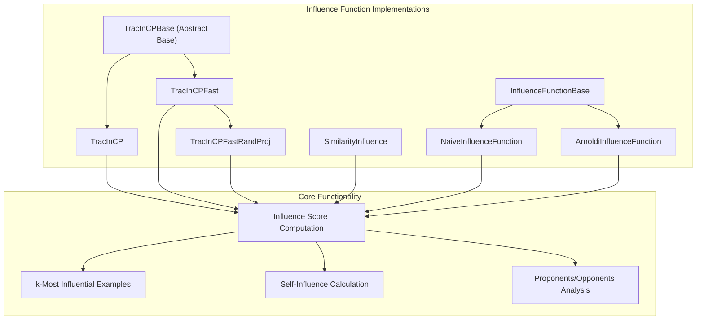
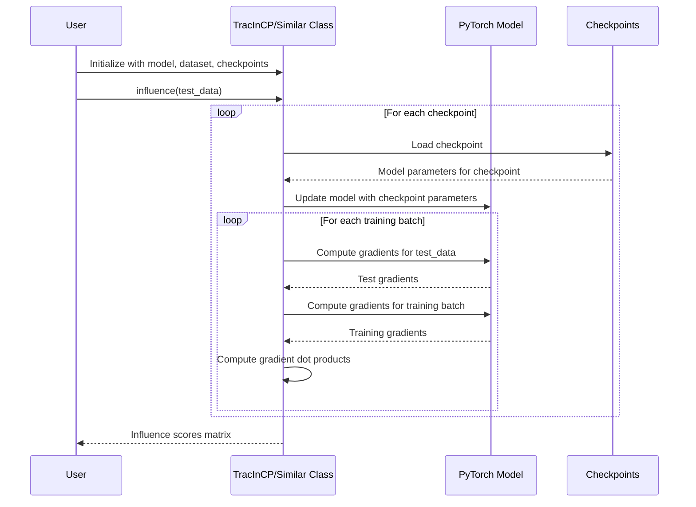
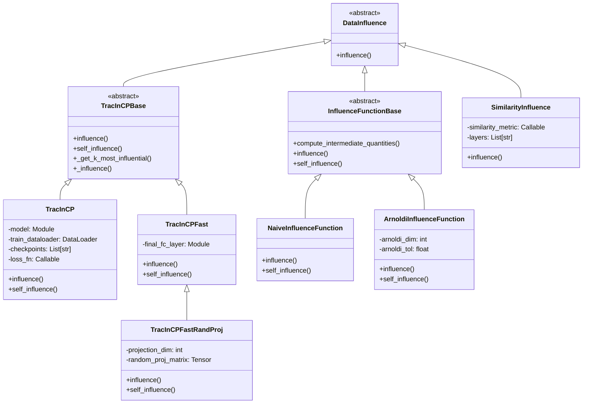
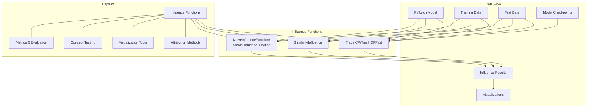

<!-- source: DeepWiki mcp.deepwiki.com · repo pytorch/captum · page 6.1 Influence Functions · fetched 2026-10-21 -->

# Influence Functions

<details>
<summary>Relevant source files</summary>

The following files were used as context for generating this wiki page:

- [captum/_utils/progress.py](captum/_utils/progress.py)
- [captum/influence/_core/similarity_influence.py](captum/influence/_core/similarity_influence.py)
- [captum/influence/_core/tracincp.py](captum/influence/_core/tracincp.py)
- [captum/influence/_core/tracincp_fast_rand_proj.py](captum/influence/_core/tracincp_fast_rand_proj.py)
- [captum/influence/_utils/common.py](captum/influence/_utils/common.py)
- [tests/influence/_core/test_arnoldi_influence.py](tests/influence/_core/test_arnoldi_influence.py)
- [tests/influence/_core/test_dataloader.py](tests/influence/_core/test_dataloader.py)
- [tests/influence/_core/test_naive_influence.py](tests/influence/_core/test_naive_influence.py)
- [tests/influence/_core/test_tracin_aggregate_influence.py](tests/influence/_core/test_tracin_aggregate_influence.py)
- [tests/influence/_core/test_tracin_intermediate_quantities.py](tests/influence/_core/test_tracin_intermediate_quantities.py)
- [tests/influence/_core/test_tracin_k_most_influential.py](tests/influence/_core/test_tracin_k_most_influential.py)
- [tests/influence/_core/test_tracin_regression.py](tests/influence/_core/test_tracin_regression.py)
- [tests/influence/_core/test_tracin_self_influence.py](tests/influence/_core/test_tracin_self_influence.py)
- [tests/influence/_core/test_tracin_show_progress.py](tests/influence/_core/test_tracin_show_progress.py)
- [tests/influence/_core/test_tracin_validation.py](tests/influence/_core/test_tracin_validation.py)
- [tests/influence/_core/test_tracin_xor.py](tests/influence/_core/test_tracin_xor.py)

</details>


This page documents the Influence Functions module in Captum, which provides tools for quantifying the influence training data has on model predictions. Influence Functions help researchers and practitioners identify which training examples are most responsible for a model's predictions on specific test instances, enabling deeper understanding of model behavior and facilitating tasks like debugging, active learning, and data cleaning.

Unlike feature attribution methods (covered in [Core Attribution Methods](#3)), which assign importance scores to input features, influence functions focus on understanding the impact of training examples on model predictions.

## 1. Overview

Influence Functions in machine learning quantify how individual training examples affect a model's predictions. Captum implements several approaches for computing influence scores, with a primary focus on TracIn-based methods alongside other implementations like direct influence function computation with various optimizations.



Sources:
- [captum/influence/_core/tracincp.py:43-454]()
- [captum/influence/_core/tracincp_fast_rand_proj.py:49-93]()
- [captum/influence/_core/similarity_influence.py:55-67]()

## 2. Core Concepts

The key idea behind influence functions is to measure how much a model's predictions would change if a specific training example were removed or modified. In Captum, this is primarily implemented through two approaches:

1. **TracIn-based methods**: These compute influence scores based on the dot product of gradients between test and training examples across model checkpoints, following the TracIn paper (https://arxiv.org/abs/2002.08484).

2. **Direct influence functions**: These compute the influence by estimating the effect of removing a training example on the model parameters and predictions.

### 2.1 Data Flow in Influence Computation



Sources:
- [captum/influence/_core/tracincp.py:617-802]()
- [captum/influence/_utils/common.py:68-86]()

## 3. Implementation Details

### 3.1 TracInCP (TracIn with Checkpoints)

`TracInCP` is the main implementation of the TracIn paper, computing influence scores by accumulating gradient dot products across model checkpoints. It represents influence as the total change a training example causes in the loss of a test example during the training process.

Key features:
- Supports arbitrary PyTorch models and datasets
- Works with both feature and layer attribution
- Allows finding proponents (most positively influential examples) and opponents (most negatively influential examples)
- Can compute self-influence scores
- Offers flexible configuration of layers to consider for gradients

```python
tracin = TracInCP(
    model,                   # PyTorch model
    train_dataset,           # Training dataset or DataLoader
    checkpoints_dir,         # Path to model checkpoints
    batch_size=16,           # Batch size for processing
    loss_fn=nn.CrossEntropyLoss(reduction="sum")  # Loss function
)

# Compute influence scores of all training examples on test_batch
influence_scores = tracin.influence(test_batch)

# Find top-5 proponents for each test example
proponents, scores = tracin.influence(test_batch, k=5, proponents=True)
```

Sources:
- [captum/influence/_core/tracincp.py:456-802]()
- [tests/influence/_core/test_tracin_regression.py:152-258]()

### 3.2 TracInCPFast

`TracInCPFast` optimizes TracInCP for the special case where only the gradients in the last fully-connected layer are considered. This provides significant speedup without loss of accuracy for this specific scenario.

```python
tracin_fast = TracInCPFast(
    model,                    # PyTorch model
    final_fc_layer,           # Last fully connected layer
    train_dataset,            # Training dataset
    checkpoints_dir,          # Path to model checkpoints
    loss_fn=nn.CrossEntropyLoss(reduction="sum")  # Loss function
)

# Usage is identical to TracInCP
influence_scores = tracin_fast.influence(test_batch)
```

Sources:
- [captum/influence/_core/tracincp_fast_rand_proj.py:75-327]()
- [tests/influence/_core/test_tracin_regression.py:85-90]()

### 3.3 TracInCPFastRandProj

`TracInCPFastRandProj` further optimizes computation by using random projections to reduce the dimensionality of the gradient space, offering even faster computation with a controlled approximation error.

```python
tracin_fast_randproj = TracInCPFastRandProj(
    model,                    # PyTorch model
    final_fc_layer,           # Last fully connected layer
    train_dataset,            # Training dataset
    checkpoints_dir,          # Path to model checkpoints
    projection_dim=128,       # Dimension of random projection
    loss_fn=nn.CrossEntropyLoss(reduction="sum")  # Loss function
)
```

Sources:
- [captum/influence/_core/tracincp_fast_rand_proj.py]()
- [tests/influence/_core/test_tracin_intermediate_quantities.py:274-285]()

### 3.4 SimilarityInfluence

`SimilarityInfluence` offers an alternative approach to computing influence based on similarity metrics between activation vectors rather than gradients. This can be useful when direct gradient computation is computationally expensive or when the focus is on comparing high-level representations.

```python
similarity = SimilarityInfluence(
    model,                     # PyTorch model
    ["linear1", "linear2"],    # Layers to extract activations from
    train_dataset,             # Training dataset
    activation_dir,            # Directory to store/retrieve activations
    similarity_metric=cosine_similarity  # Similarity function to use
)

# Find top-10 most similar training examples to test_batch
results = similarity.influence(test_batch, top_k=10)
```

Sources:
- [captum/influence/_core/similarity_influence.py:66-308]()

## 4. Class Hierarchy and Architecture

The influence function implementations in Captum follow a well-defined inheritance hierarchy to promote code reuse and consistent APIs.



Sources:
- [captum/influence/_core/tracincp.py:74-454]()
- [captum/influence/_core/tracincp_fast_rand_proj.py:75-772]()
- [captum/influence/_core/similarity_influence.py:66-308]()

## 5. Common Operations and Functionality

All influence function implementations provide several common operations:

### 5.1 Influence Score Computation

The `influence` method computes influence scores between test examples and training examples, returning a matrix where entry (i,j) represents the influence of training example j on test example i.

```python
# Compute influence of all training examples on test_data
influence_scores = tracin.influence(test_data)  # Shape: [n_test, n_train]
```

Sources:
- [captum/influence/_core/tracincp.py:362-442]()
- [captum/influence/_core/tracincp.py:617-775]()

### 5.2 K-Most Influential Examples

Finding the k training examples with the highest influence on each test example:

```python
# Find top-5 most influential training examples for each test example
indices, scores = tracin.influence(test_data, k=5, proponents=True)
```

Sources:
- [captum/influence/_core/tracincp.py:274-324]()
- [captum/influence/_utils/common.py:204-324]()

### 5.3 Self-Influence Calculation

Computing the influence of training examples on themselves, which can identify examples with high influence on the model:

```python
# Compute self-influence scores for all training examples
self_influences = tracin.self_influence()
```

Sources:
- [captum/influence/_core/tracincp.py:214-271]()
- [tests/influence/_core/test_tracin_self_influence.py:156-201]()

### 5.4 Aggregate Influence

Computing the total influence of training examples on a test dataset:

```python
# Compute aggregate influence of each training example on all test examples
aggregate_influences = tracin.influence(test_data, aggregate=True)
```

Sources:
- [captum/influence/_core/tracincp.py:617-659]()
- [tests/influence/_core/test_tracin_aggregate_influence.py:39-81]()

## 6. Performance Considerations and Optimizations

The different implementations offer various trade-offs between accuracy and computation speed:

| Implementation | Accuracy | Speed | Memory Usage | Use Case |
|----------------|----------|-------|--------------|----------|
| TracInCP | Highest | Slowest | High | When exact influence scores are needed |
| TracInCPFast | High | Faster | Moderate | When only gradients in the last FC layer matter |
| TracInCPFastRandProj | Moderate | Fastest | Lowest | For very large models and datasets |
| SimilarityInfluence | Varies | Fast | Moderate | When gradient computation is impractical |

### 6.1 Optimization Techniques

Several optimization techniques are implemented:

1. **Batching**: All implementations support batched processing of training and test data to manage memory usage.

2. **Sample-wise Gradient Computation**: `TracInCP` offers an option to compute sample-wise gradients more efficiently with the `sample_wise_grads_per_batch` parameter.

3. **Random Projection**: `TracInCPFastRandProj` uses random projections to reduce the dimensionality of the gradient space.

4. **Progress Tracking**: Long-running computations can display progress bars to track completion time.

Sources:
- [captum/influence/_core/tracincp.py:570-578]()
- [captum/influence/_core/tracincp_fast_rand_proj.py:186-187]()
- [captum/_utils/progress.py:195-248]()
- [tests/influence/_core/test_tracin_show_progress.py:105-254]()

## 7. Integration with Captum Ecosystem

Influence Functions integrate with other Captum components:



Sources:
- All provided code files collectively demonstrate this integration

## 8. Use Cases and Examples

### 8.1 Debugging Model Predictions

```python
# Identify training examples responsible for a bad prediction
model = MyModel()
train_dataset = MyDataset()
checkpoints = "path/to/checkpoints/"

tracin = TracInCP(model, train_dataset, checkpoints, loss_fn=nn.CrossEntropyLoss())
bad_prediction = get_misclassified_example()

# Find top-10 most influential examples for this prediction
indices, scores = tracin.influence(bad_prediction, k=10, proponents=True)

# Review these examples to understand why the model made this prediction
```

### 8.2 Data Cleaning

```python
# Find examples with unusually high self-influence (potential outliers)
self_influences = tracin.self_influence()
potential_outliers = torch.topk(self_influences, k=20).indices

# Review these examples for quality issues
```

### 8.3 Active Learning

```python
# Find training examples with lowest influence on validation set
validation_data = get_validation_data()
aggregate_influences = tracin.influence(validation_data, aggregate=True)
least_influential = torch.topk(aggregate_influences, k=100, largest=False).indices

# These examples contribute little to model performance and could be removed
```

Sources:
- [tests/influence/_core/test_tracin_regression.py:152-258]()
- [tests/influence/_core/test_tracin_self_influence.py:156-201]()
- [tests/influence/_core/test_tracin_xor.py:234-276]()

## 9. Conclusion

Influence Functions in Captum provide powerful tools for understanding the relationship between training data and model predictions. By offering multiple implementations with different performance characteristics, Captum allows users to choose the approach that best fits their specific needs and computational constraints.

When working with Influence Functions, consider:

- Which implementation is most appropriate for your model architecture and dataset size
- What specific questions about training data influence you're trying to answer
- How to integrate influence analysis into your broader ML workflow

For related functionality, see [Core Attribution Methods](#3) for feature attribution and [Concept Testing](#6.2) for testing with concept activation vectors.

---

