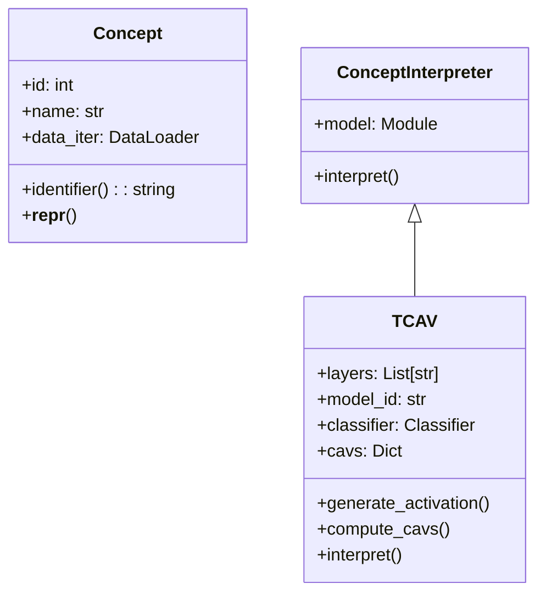
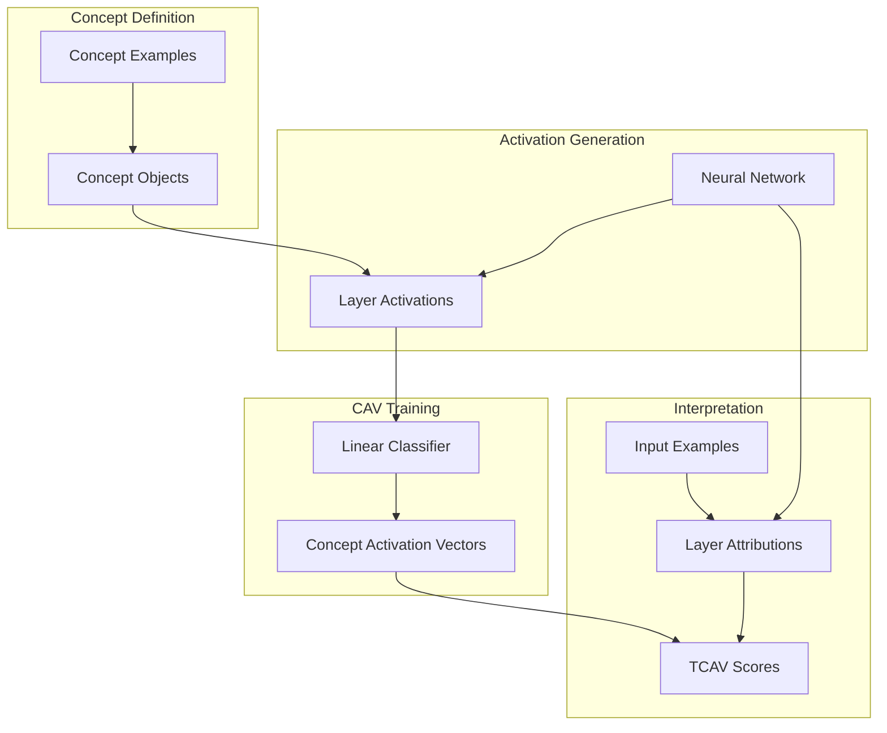
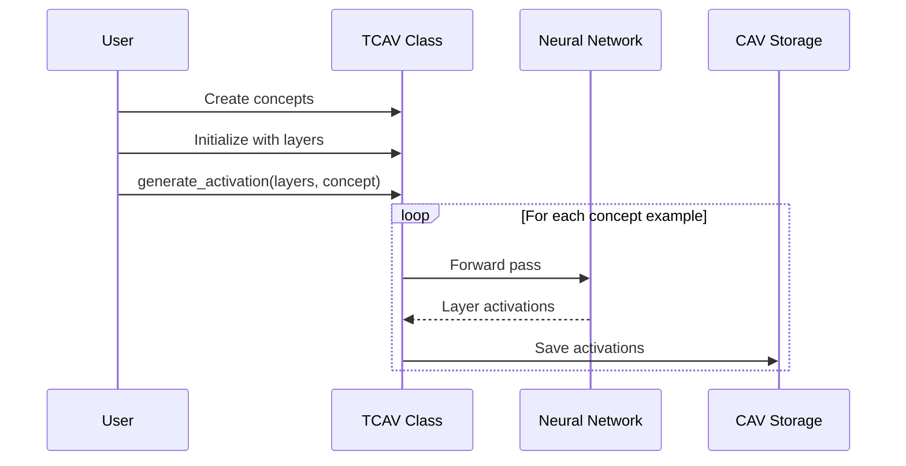
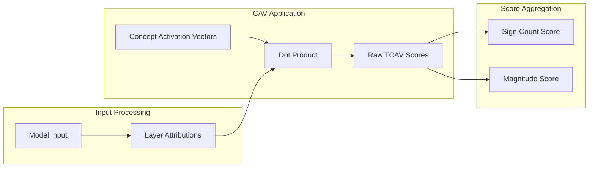
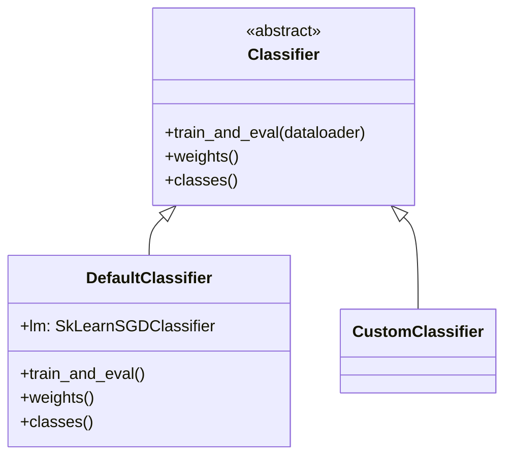
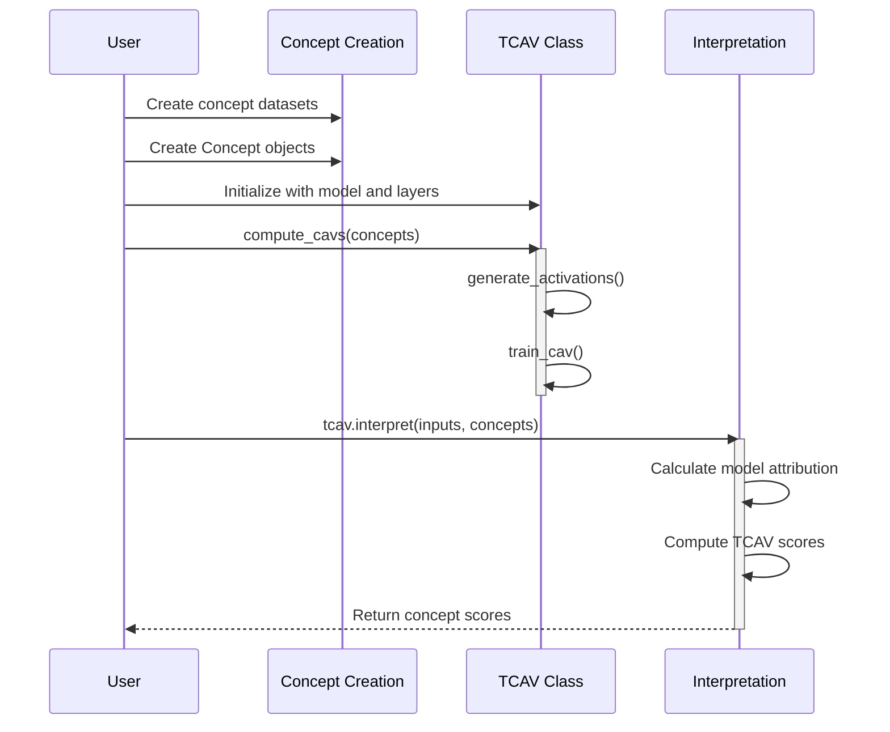

<!-- source: DeepWiki mcp.deepwiki.com · repo pytorch/captum · page 6.2 Concept Testing · fetched 2026-10-21 -->

# Concept Testing

<details>
<summary>Relevant source files</summary>

The following files were used as context for generating this wiki page:

- [captum/_utils/av.py](captum/_utils/av.py)
- [captum/concept/_core/concept.py](captum/concept/_core/concept.py)
- [captum/concept/_core/tcav.py](captum/concept/_core/tcav.py)
- [captum/concept/_utils/classifier.py](captum/concept/_utils/classifier.py)
- [tests/concept/test_tcav.py](tests/concept/test_tcav.py)

</details>


Concept Testing in Captum provides capabilities for testing and interpreting neural networks using human-understandable concepts. The primary implementation is TCAV (Testing with Concept Activation Vectors), a technique that quantifies the importance of user-defined concepts for a model's predictions. For information about influence analysis, see [Influence Functions](#6.1).

## Introduction to TCAV

TCAV (Testing with Concept Activation Vectors) allows users to test the sensitivity of model predictions to high-level concepts rather than individual features. For example, you can test whether a model recognizes "stripes" in image classification or "sentiment" in text analysis.

The key idea behind TCAV is to:
1. Define concepts through examples (e.g., images with stripes)
2. Learn directional vectors in the model's activation space that represent these concepts
3. Measure how sensitive model predictions are to changes in the direction of these concept vectors

This approach bridges the gap between statistical learning and human-interpretable concepts.

Sources:
- [captum/concept/_core/tcav.py:215-215]()
- [captum/concept/_core/tcav.py:218-226]()

## Concept Representation

### The Concept Class

The foundation of concept testing is the `Concept` class, which represents a human-understandable concept through examples.



A concept is defined by:
- A unique numerical identifier
- A descriptive name
- A data iterator providing examples of the concept

For instance, you might create a "stripes" concept with examples of striped patterns, or a "medical" concept with examples of medical terminology.

Sources:
- [captum/concept/_core/concept.py:11-55]()
- [tests/concept/test_tcav.py:624-633]()

## TCAV Architecture

TCAV builds upon the `ConceptInterpreter` abstract class, providing a workflow to:
1. Generate layer activations for concept examples
2. Train Concept Activation Vectors (CAVs)
3. Compute TCAV scores for inputs



The TCAV class connects these components, providing methods to:
- Generate activations for concept examples
- Train classifiers to learn concept boundaries
- Interpret inputs with respect to concepts

Sources:
- [captum/concept/_core/tcav.py:256-269]()
- [captum/concept/_core/tcav.py:586-678]()

## CAV Generation Process

CAVs (Concept Activation Vectors) represent the directional vectors of concepts in a model's activation space. The process involves:

### 1. Activation Generation

For each concept and layer of interest:
1. Pass concept examples through the model
2. Extract activations from specified layers
3. Store these activations for training



### 2. Training CAV Classifiers

Once activations are generated:
1. Train a linear classifier to separate activations of different concepts
2. Extract weights from the classifier, which represent the CAVs
3. Store CAVs for interpretation

Sources:
- [captum/concept/_core/tcav.py:355-401]()
- [captum/concept/_core/tcav.py:113-213]()
- [captum/_utils/av.py:19-29]()

## Interpreting with TCAV

TCAV scores quantify the importance of a concept to a model's prediction. The interpretation process:

### TCAV Score Computation

1. Compute layer attributions (sensitivities) for the input
2. Calculate dot product between the attributions and CAVs
3. Derive two types of scores:
   - Sign-count: Fraction of examples with positive TCAV scores
   - Magnitude: Average magnitude of TCAV scores



A high sign-count score indicates the concept is consistently important for the prediction, while magnitude scores reflect the strength of the relationship.

Sources:
- [captum/concept/_core/tcav.py:784-828]()
- [captum/concept/_core/tcav.py:692-782]()

## Custom Classifiers

TCAV supports custom classifiers for CAV training, giving flexibility in how concept boundaries are learned:



The `Classifier` abstract class requires implementing:
- `train_and_eval()`: Train the classifier and evaluate performance
- `weights()`: Access classifier weights (the CAVs)
- `classes()`: Get class information

The default implementation uses a scikit-learn SGD classifier, but you can provide custom implementations for specific needs.

Sources:
- [captum/concept/_utils/classifier.py:16-121]()
- [captum/concept/_utils/classifier.py:124-235]()
- [tests/concept/test_tcav.py:38-146]()

## Practical Usage

### TCAV Workflow

The general workflow for using TCAV consists of:

1. Define concepts with examples
2. Initialize TCAV with model and layers of interest
3. Generate activations for concept examples
4. Compute CAVs
5. Interpret inputs to obtain TCAV scores



### Example Results Format

TCAV returns scores in a nested dictionary structure:

```
{
  "0-1": {                # Concept set id (e.g., "stripes-random")
    "inception4c": {      # Layer name
      "sign_count": tensor([0.58, 0.42]),  # Sign count scores for each concept
      "magnitude": tensor([0.66, 0.34])    # Magnitude scores for each concept
    },
    "inception4d": {
      ...
    }
  },
  "2-3": {                # Another concept set
    ...
  }
}
```

Sources:
- [captum/concept/_core/tcav.py:586-678]()
- [captum/concept/_core/tcav.py:658-677]()

## Implementation Details

### Key Components

The TCAV implementation consists of several key components:

1. **Activation Storage**
   - The `AV` (Activation Vector) class manages storage and retrieval of layer activations
   - Activations are stored on disk and loaded when needed

2. **CAV Training**
   - The `train_cav` function trains a classifier and extracts CAVs
   - Can be parallelized using Python's multiprocessing

3. **Labelled Dataset**
   - The `LabelledDataset` class combines activation vectors with concept labels for classifier training

4. **TCAV Score Calculation**
   - Matrix multiplication between attributions and CAVs
   - Aggregation into sign-count and magnitude scores

### Data Flow and Storage

Activations and CAVs are stored on disk for reuse:

```
/save_path/
    /av/                  # Activation vectors
        /model_id/
            /concept-id/
                /layer/
                    0.pt  # Batch 0 activations
                    1.pt  # Batch 1 activations
                    ...
    /concept-ids-layer.pkl  # CAV for concepts in layer
```

This storage approach enables:
- Reusing activations across multiple runs
- Incremental computation of CAVs
- Parallel processing of multiple concept sets

Sources:
- [captum/_utils/av.py:89-95]()
- [captum/_utils/av.py:151-188]()
- [captum/concept/_core/tcav.py:25-110]()

## Advanced Features

### Parallel Computation

TCAV supports parallel computation of CAVs using Python's multiprocessing:

```python
# Example usage with parallel processing
tcav.compute_cavs(experimental_sets, processes=4)
```

This can significantly speed up CAV computation for multiple concept sets.

### Incremental Learning

TCAV can load existing CAVs and only compute new ones:

```python
# Force re-training all CAVs
tcav.compute_cavs(experimental_sets, force_train=True)

# Load existing CAVs and only train missing ones 
tcav.compute_cavs(experimental_sets, force_train=False)
```

This is useful for iteratively adding new concepts to an existing analysis.

Sources:
- [captum/concept/_core/tcav.py:473-584]()
- [captum/concept/_core/tcav.py:545-577]()

## Limitations and Considerations

When using TCAV, keep in mind:

1. **Concept Quality**: The quality of TCAV results depends on the quality and representativeness of concept examples

2. **Layer Selection**: Results can vary significantly based on which layers are chosen for analysis

3. **Classifier Performance**: CAV quality depends on the linear classifier being able to separate concept examples

4. **Resource Usage**: For large models and datasets, activation storage can require significant disk space

Sources:
- [captum/concept/_utils/classifier.py:135-143]()
- [captum/concept/_core/tcav.py:478-543]()

---

