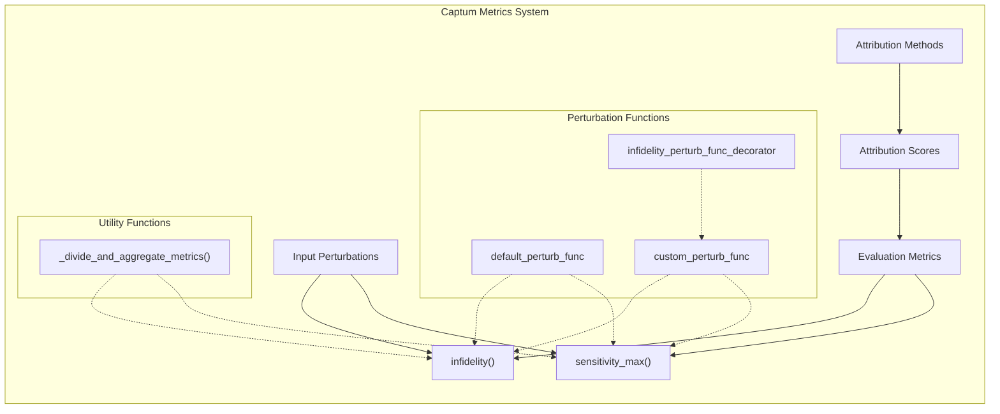
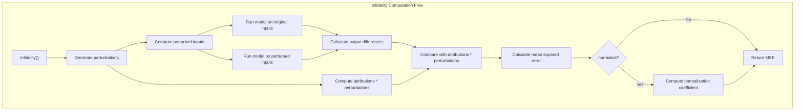
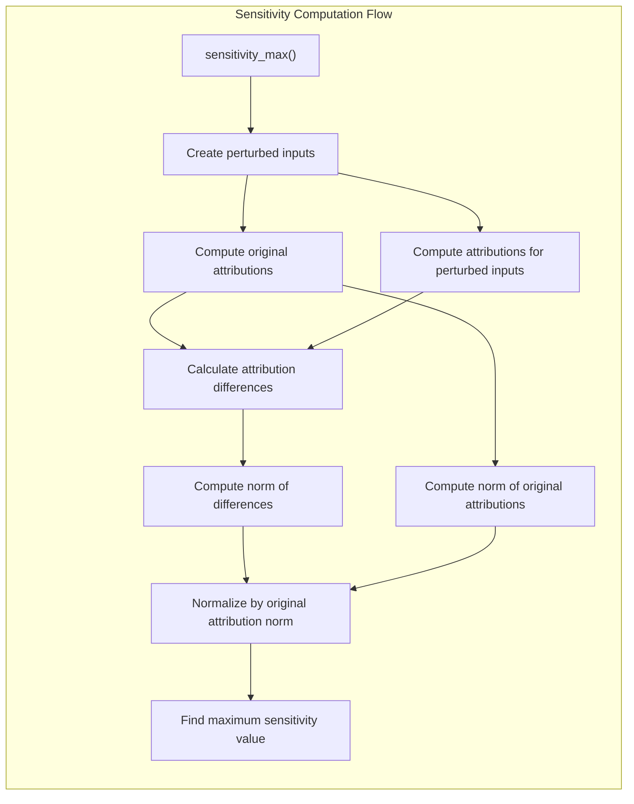
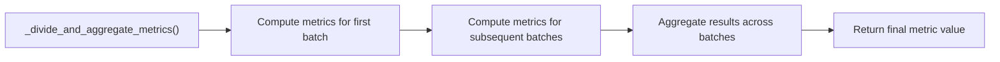

<!-- source: DeepWiki mcp.deepwiki.com · repo pytorch/captum · page 7 Metrics and Evaluation · fetched 2026-10-21 -->

# Metrics and Evaluation

<details>
<summary>Relevant source files</summary>

The following files were used as context for generating this wiki page:

- [captum/metrics/_core/infidelity.py](captum/metrics/_core/infidelity.py)
- [captum/metrics/_core/sensitivity.py](captum/metrics/_core/sensitivity.py)
- [captum/metrics/_utils/batching.py](captum/metrics/_utils/batching.py)
- [tests/attr/layer/test_layer_conductance.py](tests/attr/layer/test_layer_conductance.py)
- [tests/attr/layer/test_layer_deeplift.py](tests/attr/layer/test_layer_deeplift.py)
- [tests/attr/layer/test_layer_gradient_shap.py](tests/attr/layer/test_layer_gradient_shap.py)
- [tests/attr/neuron/test_neuron_deeplift.py](tests/attr/neuron/test_neuron_deeplift.py)
- [tests/attr/test_deeplift_basic.py](tests/attr/test_deeplift_basic.py)
- [tests/attr/test_gradient_shap.py](tests/attr/test_gradient_shap.py)
- [tests/attr/test_hook_removal.py](tests/attr/test_hook_removal.py)
- [tests/attr/test_jit.py](tests/attr/test_jit.py)
- [tests/metrics/test_infidelity.py](tests/metrics/test_infidelity.py)
- [tests/metrics/test_sensitivity.py](tests/metrics/test_sensitivity.py)

</details>


This document covers the metrics and evaluation methods available in Captum for assessing the quality and reliability of attribution explanations. These metrics help quantify how well attribution methods explain model behavior and how robust those explanations are to input changes.

## Core Evaluation Metrics Overview

Captum provides two primary metrics for evaluating attribution methods:

1. **Infidelity**: Measures how accurately attributions explain a model's behavior when inputs are perturbed.
2. **Sensitivity**: Measures how stable attributions are when inputs are slightly perturbed.

These metrics are implemented in the `captum/metrics/_core/` directory and complement each other to provide a comprehensive assessment of attribution quality.



Sources: [captum/metrics/_core/infidelity.py:141-482](), [captum/metrics/_core/sensitivity.py:63-332]()

## Infidelity

Infidelity represents how faithfully the attribution values explain model predictions when the input is perturbed. It measures the expected mean-squared error between:
1. The explanation multiplied by an input perturbation
2. The difference between the model output at original and perturbed inputs

Lower infidelity values indicate better attribution quality.

### Mathematical Formulation

The infidelity metric is computed as:

```
Infidelity(f, Φ, x) = E[( I^T · Φ(f, x) - (f(x) - f(x - I)) )²]
```

Where:
- `f` is the model
- `Φ` is the attribution method
- `x` is the input
- `I` is the perturbation
- `E` denotes expectation over the perturbation distribution

### Implementation Details



The implementation uses a batching system to handle large numbers of perturbation samples efficiently:

1. Generate perturbations for input examples
2. Compute model outputs for original and perturbed inputs
3. Calculate differences between original and perturbed outputs
4. Compare with the product of attributions and perturbations
5. Compute MSE and optionally normalize the result

Sources: [captum/metrics/_core/infidelity.py:141-482](), [captum/metrics/_utils/batching.py:12-90]()

### Perturbation Functions

Infidelity requires a perturbation function that defines how inputs are perturbed. Captum provides a decorator to simplify creating such functions:

```python
@infidelity_perturb_func_decorator(multiply_by_inputs=False)
def my_perturb_func(inputs):
    # Create perturbations
    return perturbed_inputs
```

The `multiply_by_inputs` parameter controls how perturbations are calculated:
- `False`: perturbation = input - perturbed_input
- `True`: perturbation = (input - perturbed_input) / (input - baseline)

Sources: [captum/metrics/_core/infidelity.py:29-138]()

### Usage Example

```python
from captum.metrics import infidelity

# Using a Saliency attribution method
saliency = Saliency(model)
attr = saliency.attribute(input, target=3)

# Define perturbation function
def perturb_fn(inputs):
    noise = torch.tensor(np.random.normal(0, 0.003, inputs.shape)).float()
    return noise, inputs - noise

# Compute infidelity
infid = infidelity(model, perturb_fn, input, attr)
```

Sources: [captum/metrics/_core/infidelity.py:394-421]()

## Sensitivity

Sensitivity measures how much attributions change when inputs are slightly perturbed. High sensitivity may indicate that the model's explanations are unstable and potentially untrustworthy.

### Mathematical Formulation

Sensitivity is computed by measuring the maximum change in attributions for small perturbations:

```
Sensitivity_max(Φ, x) = max_{x' ∈ B(x,ε)} ||Φ(x) - Φ(x')||/||Φ(x)||
```

Where:
- `Φ` is the attribution method
- `x` is the input
- `B(x,ε)` is a ball of radius ε around x
- `||·||` is a norm (Frobenius norm by default)

### Implementation Details



The sensitivity implementation includes:

1. Monte Carlo sampling of perturbations (default: uniform sampling from an L-infinity ball)
2. Computing attributions for original and perturbed inputs
3. Calculating normalized differences between attributions
4. Returning the maximum sensitivity value

Sources: [captum/metrics/_core/sensitivity.py:63-332]()

### Default Perturbation Function

Captum provides a default perturbation function that samples uniformly from an L-infinity ball:

```python
def default_perturb_func(inputs, perturb_radius=0.02):
    # Generates perturbations within a L-infinity ball of radius perturb_radius
    return tuple(
        input + torch.FloatTensor(input.size()).uniform_(-perturb_radius, perturb_radius).to(input.device)
        for input in inputs
    )
```

You can define custom perturbation functions for domain-specific perturbations.

Sources: [captum/metrics/_core/sensitivity.py:23-60]()

### Usage Example

```python
from captum.metrics import sensitivity_max
from captum.attr import IntegratedGradients

# Initialize attribution method
ig = IntegratedGradients(model)

# Calculate sensitivity
sens = sensitivity_max(
    ig.attribute,
    inputs,
    perturb_radius=0.02,
    n_perturb_samples=10,
    target=0
)
```

Sources: [captum/metrics/_core/sensitivity.py:193-201]()

## Batching System

Both metrics use Captum's batching system to efficiently process multiple perturbations:



The batching system:
1. Divides large numbers of samples into smaller batches
2. Computes metrics for each batch
3. Aggregates results across all batches

Key parameters:
- `n_perturb_samples`: Number of perturbations per input example
- `max_examples_per_batch`: Maximum examples processed per batch

Sources: [captum/metrics/_utils/batching.py:12-90]()

## Comparing Attribution Methods

The metrics can be used to compare different attribution methods:

| Method | Use Case | Infidelity | Sensitivity |
|--------|----------|------------|-------------|
| IntegratedGradients | General purpose | Low to medium | Medium |
| DeepLift | Comparable to IG | Low to medium | Medium |
| GradientShap | Stochastic | Medium | Medium to high |
| Saliency | Fast, simple | High | High |
| FeatureAblation | Model-agnostic | Medium | Low |
| Occlusion | Model-agnostic | Medium | Low |

Lower values are better for both metrics.

Sources: [tests/metrics/test_infidelity.py:114-509](), [tests/metrics/test_sensitivity.py:64-317]()

## Best Practices

When evaluating attribution methods with these metrics:

1. **Use both metrics together**: Infidelity measures explanation accuracy, while sensitivity measures stability.

2. **Test with multiple perturbation functions**: Different perturbation types can reveal different aspects of attribution quality.

3. **Consider normalization**: For infidelity, normalization makes scores invariant to attribution scaling.

4. **Tune batch parameters**: Adjust `n_perturb_samples` and `max_examples_per_batch` based on memory constraints and desired accuracy.

5. **Test across various inputs**: Evaluation should cover diverse inputs, as attribution quality can vary significantly.

Sources: [captum/metrics/_core/infidelity.py:156-405](), [captum/metrics/_core/sensitivity.py:76-182]()

## Relation to Attribution Methods

The metrics are designed to work with all attribution methods in Captum, with specific implementations tested for:

- IntegratedGradients
- DeepLift
- GradientShap
- Saliency
- FeatureAblation
- FeaturePermutation
- GuidedBackprop
- LayerGradCam
- NeuronConductance

Sources: [tests/attr/test_gradient_shap.py:28-262](), [tests/attr/test_deeplift_basic.py:29-411](), [tests/attr/layer/test_layer_gradient_shap.py:32-213]()

---

