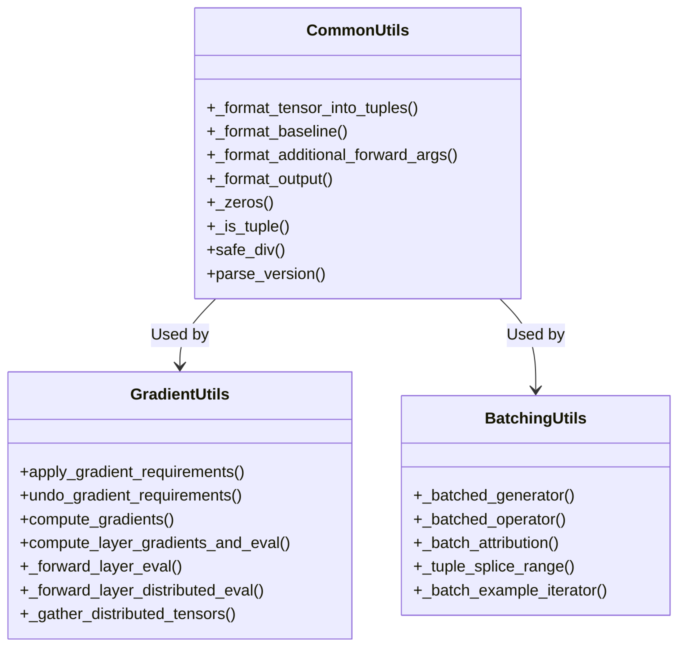
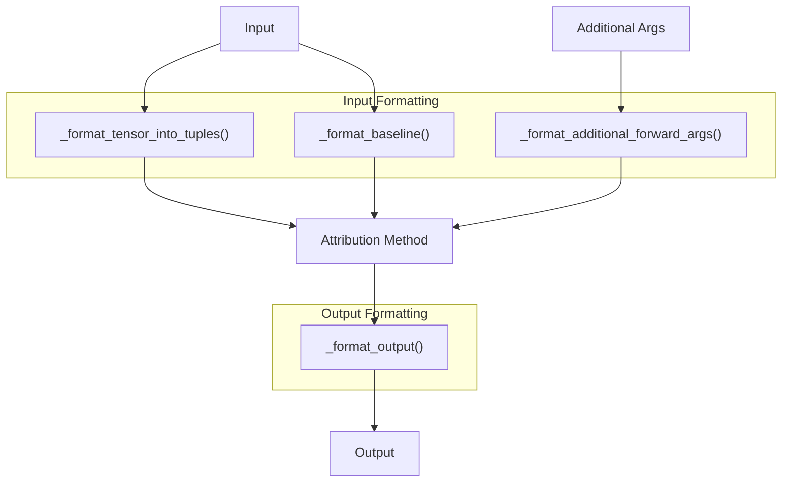
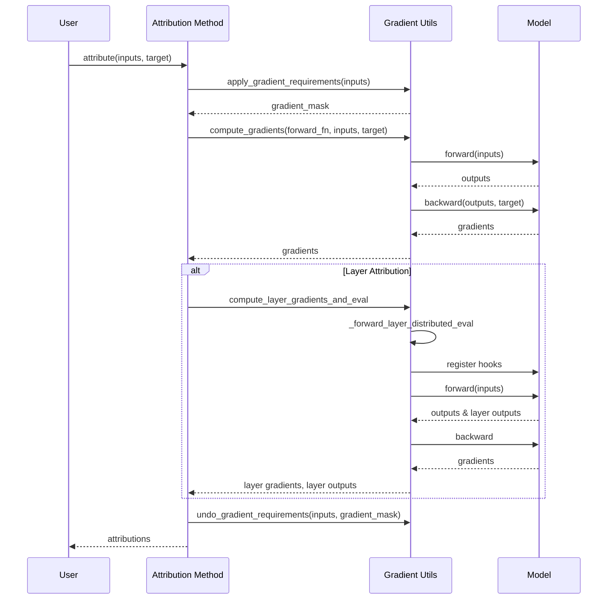
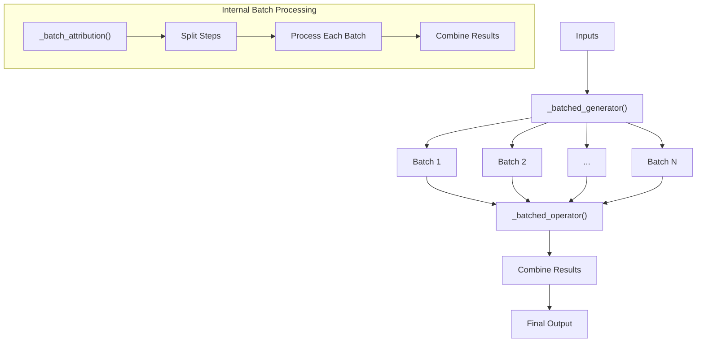
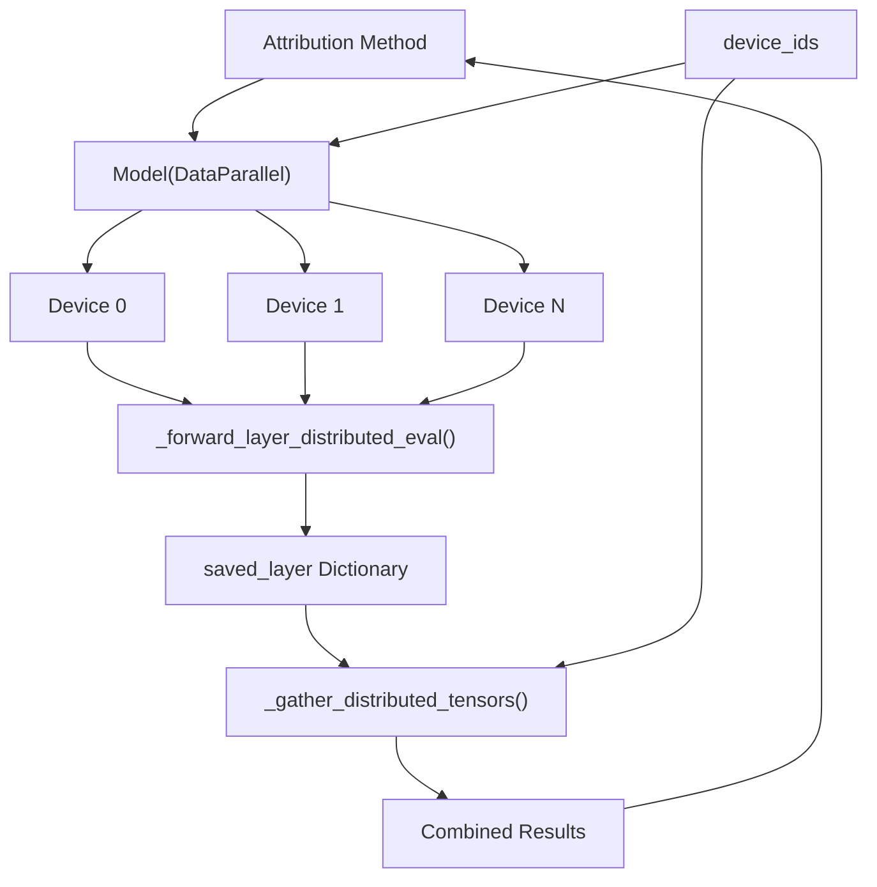
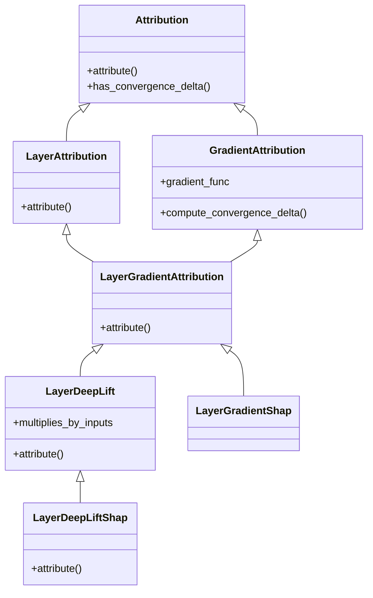
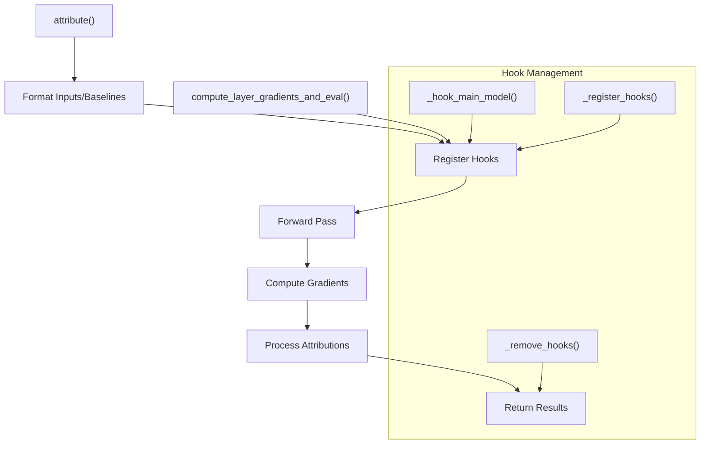

<!-- source: DeepWiki mcp.deepwiki.com · repo pytorch/captum · page 8 Implementation Details · fetched 2026-10-21 -->

# Implementation Details

<details>
<summary>Relevant source files</summary>

The following files were used as context for generating this wiki page:

- [captum/_utils/common.py](captum/_utils/common.py)
- [captum/_utils/gradient.py](captum/_utils/gradient.py)
- [captum/attr/_core/layer/layer_deep_lift.py](captum/attr/_core/layer/layer_deep_lift.py)
- [captum/attr/_core/layer/layer_gradient_shap.py](captum/attr/_core/layer/layer_gradient_shap.py)
- [captum/attr/_utils/batching.py](captum/attr/_utils/batching.py)
- [tests/attr/test_data_parallel.py](tests/attr/test_data_parallel.py)
- [tests/attr/test_targets.py](tests/attr/test_targets.py)
- [tests/utils/test_common.py](tests/utils/test_common.py)

</details>


This document provides a detailed overview of the internal implementation mechanisms in Captum. It focuses on core utilities, gradient computation, batching processes, and data parallelism support that form the foundation of Captum's attribution methods. For information about specific attribution methods themselves, see [Core Attribution Methods](#3).

## Core Utilities

Captum features several utility modules that provide essential functionality used throughout the library. These utilities handle various aspects such as tensor transformations, gradient computation, and batching operations.

### Common Utilities Structure



Sources: [captum/_utils/common.py:1-916](), [captum/_utils/gradient.py:1-538](), [captum/_utils/batching.py:1-250]()

### Input and Output Formatting

Captum employs multiple utility functions to ensure consistent handling of inputs, baselines, and outputs. These utilities standardize the data format throughout the attribution pipeline.



Sources: [captum/_utils/common.py:84-221](), [captum/_utils/common.py:230-256](), [captum/_utils/common.py:292-300](), [captum/_utils/common.py:484-520]()

Key formatting utilities include:

- `_format_tensor_into_tuples`: Ensures inputs are in tuple format, even if only a single tensor is provided
- `_format_baseline`: Formats baselines to match input structure
- `_format_additional_forward_args`: Prepares additional arguments for forward function
- `_format_output`: Ensures outputs match input structure (tuple or single tensor)

## Gradient Computation

Gradient computation is central to many of Captum's attribution methods. The library provides robust utilities for computing gradients with respect to model inputs, layer inputs/outputs, and individual neurons.

### Gradient Process Flow



Sources: [captum/_utils/gradient.py:38-101](), [captum/_utils/gradient.py:103-140](), [captum/_utils/gradient.py:597-667]()

Key gradient utilities include:

- `apply_gradient_requirements`: Sets `requires_grad=True` for input tensors and records original states
- `compute_gradients`: Computes gradients of outputs with respect to inputs
- `compute_layer_gradients_and_eval`: Computes gradients with respect to layer inputs/outputs
- `_forward_layer_distributed_eval`: Handles forward pass with hooks on specified layers
- `_gather_distributed_tensors`: Collects tensors from multiple devices in data parallel scenarios
- `undo_gradient_requirements`: Restores original `requires_grad` states after attribution

### Target Selection

An important aspect of attribution is selecting the correct targets (output indices) for which to compute gradients. The `_select_targets` function handles various target formats:

```
- Integer index (for single target for all examples)
- Tensor with a single value (similar to integer index)
- List or 1D tensor with length matching batch size (per-example targets)
- Tuple for multidimensional outputs (same target for all examples)
- List of tuples for multidimensional outputs (per-example targets)
```

Sources: [captum/_utils/common.py:603-681](), [tests/utils/test_common.py:86-126]()

## Batching System

The batching system allows Captum to efficiently process large inputs by dividing them into smaller batches, reducing memory requirements.

### Batching Process



Sources: [captum/_utils/batching.py:24-104](), [captum/_utils/batching.py:140-221]()

The batching process consists of:

1. `_batched_generator`: Creates an iterator that yields batches of inputs and corresponding additional arguments
2. `_batched_operator`: Applies a given operator to each batch and combines the results
3. `_batch_attribution`: Handles attribution methods that require multiple steps, dividing steps into batches

The batching system is particularly useful for attribution methods that require multiple steps (like IntegratedGradients) or large inputs that don't fit in memory.

## Data Parallelism

Captum supports data parallelism through integration with PyTorch's DataParallel and DistributedDataParallel modules, enabling efficient computation on multiple GPUs.

### Data Parallel Architecture



Sources: [captum/_utils/gradient.py:258-357](), [captum/_utils/gradient.py:360-378](), [tests/attr/test_data_parallel.py:133-241]()

Data parallelism support includes:

1. Detection of DataParallel models and appropriate handling
2. Collection of layer activations from multiple devices using hooks
3. Proper ordering of results based on device IDs
4. Support for both default and custom device ID orderings
5. DistributedDataParallel support for multi-node parallelism

Key components involved in data parallelism:

- `_forward_layer_distributed_eval`: Sets hooks and collects outputs from all devices
- `_gather_distributed_tensors`: Combines tensors from multiple devices
- `_extract_device_ids`: Extracts device IDs from the model or provided arguments
- `_sort_key_list`: Ensures correct ordering of tensors from different devices

## Attribution Method Implementation

Attribution methods in Captum follow a hierarchical implementation pattern, with base classes providing common functionality and derived classes implementing specific algorithms.

### Attribution Method Structure



Sources: [captum/attr/_core/layer/layer_deep_lift.py:31-435](), [captum/attr/_core/layer/layer_gradient_shap.py:25-485]()

Implementation patterns across attribution methods:

1. **Method Overloading**: Attribution methods typically provide multiple overloaded `attribute()` methods to handle different return types (with or without convergence delta)
2. **Input Validation**: Methods validate and format inputs using common utilities
3. **Hook Management**: Layer attribution methods register hooks to capture layer activations
4. **Gradient Management**: Methods ensure inputs require gradients and restore original states after computation
5. **Batching Integration**: Attribution methods integrate with the batching system for efficient processing

### Data Flow in Layer Attribution



Sources: [captum/attr/_core/layer/layer_deep_lift.py:125-372](), [captum/attr/_core/layer/layer_gradient_shap.py:139-326]()

## Conclusion

The implementation details covered in this document provide a foundation for understanding how Captum's attribution methods work under the hood. The library's modular design, with separate utilities for common operations, gradient computation, batching, and data parallelism, enables the efficient implementation of various attribution methods while maintaining a consistent API.

---

