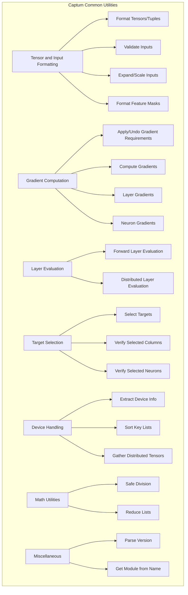
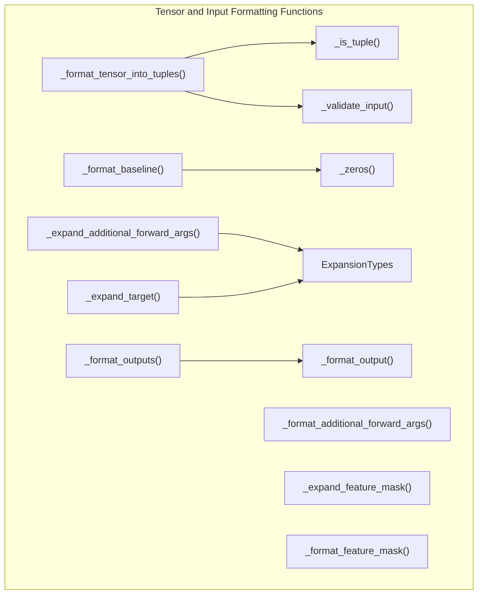
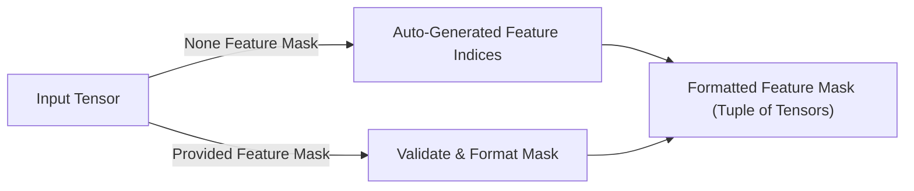
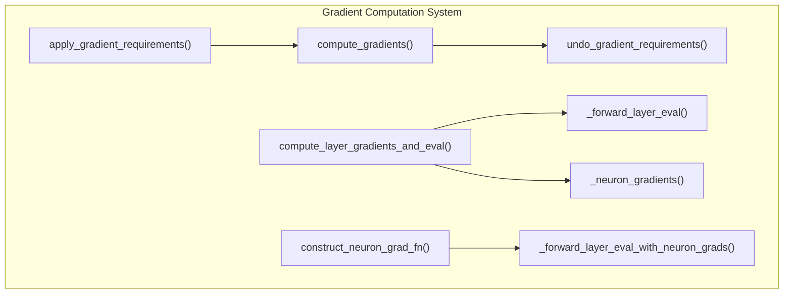
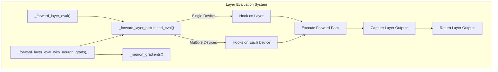
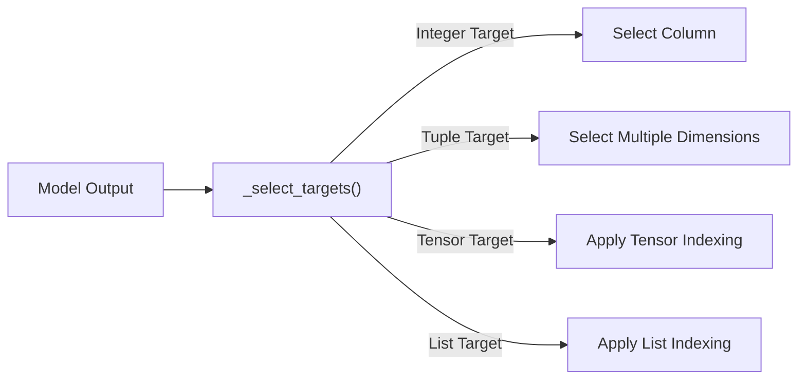
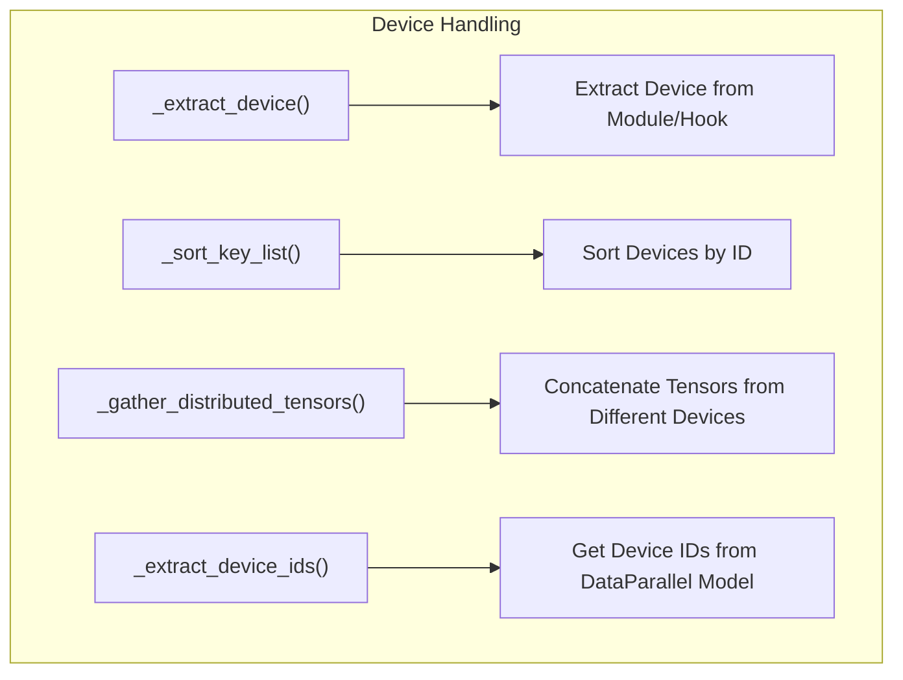
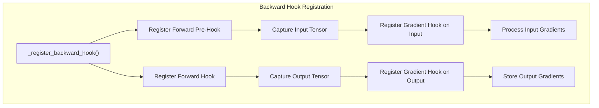

<!-- source: DeepWiki mcp.deepwiki.com · repo pytorch/captum · page 8.1 Common Utilities · fetched 2026-10-21 -->

# Common Utilities

<details>
<summary>Relevant source files</summary>

The following files were used as context for generating this wiki page:

- [captum/_utils/common.py](captum/_utils/common.py)
- [captum/_utils/gradient.py](captum/_utils/gradient.py)
- [captum/attr/_core/layer/layer_deep_lift.py](captum/attr/_core/layer/layer_deep_lift.py)
- [captum/attr/_core/layer/layer_gradient_shap.py](captum/attr/_core/layer/layer_gradient_shap.py)
- [tests/utils/test_common.py](tests/utils/test_common.py)

</details>


This page documents the common utility functions in Captum, which provide essential functionality used throughout the framework. These utilities handle tensor operations, gradient computations, input/output formatting, device management, and other core functionalities that attribution methods depend on.

For utility functions specific to visualization, see [Visualization Utilities](#5.1). For data parallelism utilities, see [Data Parallelism and Performance](#8.2).

## Overview

The common utilities in Captum are organized into several functional categories:



Sources: [captum/_utils/common.py:1-916](), [captum/_utils/gradient.py:1-100]()

## Tensor and Input Formatting

The tensor and input formatting utilities are essential for handling various input formats and ensuring consistency throughout the attribution process.



Sources: [captum/_utils/common.py:84-251](), [captum/_utils/common.py:303-482](), [captum/_utils/common.py:485-556]()

### Key Formatting Functions

- **Basic Formatting**:
  - `_is_tuple()`: Checks if input is a tuple
  - `_format_tensor_into_tuples()`: Converts a tensor into a tuple if it's not already
  - `_format_inputs()`: Formats inputs for forward functions
  - `_format_additional_forward_args()`: Formats additional arguments for forward functions

- **Baseline Formatting**:
  - `_format_baseline()`: Formats baselines, handling various input types
  - `_zeros()`: Creates a tuple of zeros matching input tensor shapes

- **Expansion Functions**:
  - `_expand_additional_forward_args()`: Expands additional forward arguments
  - `_expand_target()`: Expands targets to match batch dimensions
  - `_expand_feature_mask()`: Expands feature masks
  - `_expand_and_update_baselines()`: Expands baselines and updates kwargs

- **Output Formatting**:
  - `_format_output()`: Formats outputs to match input format
  - `_format_outputs()`: Formats multiple outputs to match multiple input formats

Sources: [captum/_utils/common.py:84-251](), [captum/_utils/common.py:303-482](), [captum/_utils/common.py:485-556]()

### Feature Mask Utilities

Feature masks are used to specify groups of features for certain attribution methods:

- `_format_feature_mask()`: Formats a feature mask into a tuple of tensors
- `_get_max_feature_index()`: Returns the max feature mask index



Sources: [captum/_utils/common.py:180-227](), [captum/_utils/common.py:906-916](), [tests/utils/test_common.py:128-167]()

## Gradient Computation

Gradient computation utilities are central to many attribution methods in Captum, particularly for gradient-based attribution approaches.



Sources: [captum/_utils/gradient.py:39-101](), [captum/_utils/gradient.py:103-168](), [captum/_utils/gradient.py:597-773]()

### Basic Gradient Functions

- `apply_gradient_requirements()`: Sets requires_grad to true on tensors and zeros gradients
- `undo_gradient_requirements()`: Undoes the effects of prepare_gradient_inputs
- `compute_gradients()`: Computes gradients of outputs with respect to inputs

Example usage pattern:

```
# Set gradients required
grad_required = apply_gradient_requirements(inputs)

# Compute gradients
gradients = compute_gradients(forward_fn, inputs, target)

# Clean up
undo_gradient_requirements(inputs, grad_required)
```

Sources: [captum/_utils/gradient.py:39-101](), [captum/_utils/gradient.py:103-141]()

### Layer Gradient Functions

- `compute_layer_gradients_and_eval()`: Computes gradients of outputs with respect to layer inputs/outputs along with the layer evaluations
- `_neuron_gradients()`: Computes gradients for specific neurons
- `construct_neuron_grad_fn()`: Constructs a gradient function for neurons

These functions are extensively used by layer attribution methods like LayerDeepLift and LayerGradientShap.

Sources: [captum/_utils/gradient.py:597-773](), [captum/_utils/gradient.py:143-168](), [captum/_utils/gradient.py:776-805](), [captum/attr/_core/layer/layer_deep_lift.py:331-357](), [captum/attr/_core/layer/layer_gradient_shap.py:430-456]()

## Layer Evaluation

Layer evaluation utilities handle the evaluation of specific layers in a model, which is essential for layer attribution methods.



Sources: [captum/_utils/gradient.py:200-535](), [captum/_utils/gradient.py:258-357]()

### Key Layer Evaluation Functions

- `_forward_layer_eval()`: Evaluates a layer's forward pass
- `_forward_layer_distributed_eval()`: Evaluates a layer in a distributed setting with hooks
- `_forward_layer_eval_with_neuron_grads()`: Combines layer evaluation with neuron gradient computation
- `_gather_distributed_tensors()`: Concatenates tensors from different devices

These functions use PyTorch's hook mechanism to capture intermediate layer values during a forward pass.

Sources: [captum/_utils/gradient.py:200-221](), [captum/_utils/gradient.py:258-357](), [captum/_utils/gradient.py:468-535](), [captum/_utils/gradient.py:360-378]()

## Target Selection

Target selection utilities handle the selection of output indices for which attributions are computed.



Sources: [captum/_utils/common.py:603-691](), [tests/utils/test_common.py:86-127]()

### Target Selection Functions

- `_select_targets()`: Selects targets from outputs based on indices
- `_verify_select_column()`: Verifies and selects columns from outputs
- `_verify_select_neuron()`: Verifies and selects neurons from layer outputs

The `_select_targets()` function is particularly complex, handling various types of targets:
- Integer or scalar tensor: Selects a specific column for each example
- Tuple: Selects specific multi-dimensional indices for each example
- 1D tensor: Applies element-wise selection for each example
- List of integers: Similar to 1D tensor selection
- List of tuples: Applies tuple selection for each example

Sources: [captum/_utils/common.py:603-681](), [captum/_utils/common.py:684-723](), [tests/utils/test_common.py:86-127]()

## Device Handling

Device handling utilities manage operations across multiple devices, which is essential for distributed computing and models using DataParallel.



Sources: [captum/_utils/common.py:726-754](), [captum/_utils/common.py:801-828](), [captum/_utils/gradient.py:360-378](), [captum/_utils/gradient.py:381-415]()

### Key Device Handling Functions

- `_extract_device()`: Extracts device information from module, inputs, or outputs
- `_sort_key_list()`: Sorts device keys by device ID
- `_gather_distributed_tensors()`: Concatenates tensors from different devices
- `_extract_device_ids()`: Extracts device IDs for DataParallel models

These functions are particularly important when working with DataParallel models, as they help manage tensors distributed across multiple devices.

Sources: [captum/_utils/common.py:726-754](), [captum/_utils/common.py:801-828](), [captum/_utils/gradient.py:360-378](), [captum/_utils/gradient.py:381-415]()

## Mathematical Utilities

Several mathematical utility functions provide common operations used throughout attribution methods.

### Safe Division

The `safe_div()` function provides a safe way to perform division, handling cases where the denominator might be zero.

```python
# Safe division with scalar denominator
result = safe_div(numerator, 0, default_denom=1.0)  # Returns numerator / 1.0

# Safe division with tensor denominator
result = safe_div(numerator, tensor_denom, default_denom)  # Uses default where denom is 0
```

Sources: [captum/_utils/common.py:63-81](), [tests/utils/test_common.py:26-52]()

### List Reduction

The `_reduce_list()` function applies a reduction function (like `torch.cat`) to a list of tensors or tuples of tensors.

```python
# Reduce list of tensors
result = _reduce_list([tensor1, tensor2])  # Concatenates tensors

# Reduce list of tuples
result = _reduce_list([(tensor1a, tensor1b), (tensor2a, tensor2b)])
# Returns (concatenated_a_tensors, concatenated_b_tensors)
```

Sources: [captum/_utils/common.py:757-798](), [tests/utils/test_common.py:53-66]()

## Miscellaneous Utilities

### Version Parsing

The `parse_version()` function parses version strings into tuples for comparison.

```python
version_tuple = parse_version("1.13.0")  # Returns (1, 13, 0)
version_tuple = parse_version("2.3.0.dev20240311")  # Returns (2, 3, 0)
```

This is useful for checking compatibility with different PyTorch versions.

Sources: [captum/_utils/common.py:37-55](), [tests/utils/test_common.py:189-218]()

### Module Access

The `_get_module_from_name()` function retrieves a module from a model by name, which is useful for accessing specific layers.

```python
# Get a specific layer by name
layer = _get_module_from_name(model, "encoder.layer3.conv1")
```

Sources: [captum/_utils/common.py:837-850]()

### Hook Registration

The `_register_backward_hook()` function registers backward hooks on modules to capture gradients.



Sources: [captum/_utils/common.py:853-904]()

## Usage in Attribution Methods

The common utilities are extensively used in Captum's attribution methods. Here are some examples:

### Layer Attribution Example

In `LayerDeepLift`, the `compute_layer_gradients_and_eval()` function is used to compute gradients with respect to a layer:

```python
gradients, attrs = compute_layer_gradients_and_eval(
    wrapped_forward_func,
    self.layer,
    inputs,
    attribute_to_layer_input=attribute_to_layer_input,
    output_fn=lambda out: chunk_output_fn(out),
    grad_kwargs=grad_kwargs,
)
```

This function computes both the layer gradients and the layer activations, which are then used to compute the attribution scores.

Sources: [captum/attr/_core/layer/layer_deep_lift.py:331-342]()

### Gradient Shap Example

In `LayerGradientShap`, the `_forward_layer_eval()` function is used to evaluate the layer for baselines and inputs:

```python
attr_baselines = _forward_layer_eval(
    self.forward_func,
    baselines,
    cast(Module, self.layer),
    additional_forward_args=additional_forward_args,
    device_ids=self.device_ids,
    attribute_to_layer_input=attribute_to_layer_input,
)

attr_inputs = _forward_layer_eval(
    self.forward_func,
    inputs,
    cast(Module, self.layer),
    additional_forward_args=additional_forward_args,
    device_ids=self.device_ids,
    attribute_to_layer_input=attribute_to_layer_input,
)
```

These layer evaluations are then used alongside gradient computations to determine attribution scores.

Sources: [captum/attr/_core/layer/layer_gradient_shap.py:440-456]()

## Summary

The common utilities in Captum provide essential functionality for attribution methods:

1. **Tensor and Input Formatting** - Functions for handling various input formats
2. **Gradient Computation** - Functions for computing gradients of outputs with respect to inputs and layers
3. **Layer Evaluation** - Functions for evaluating layers and capturing intermediate values
4. **Target Selection** - Functions for selecting specific outputs to attribute
5. **Device Handling** - Functions for managing operations across multiple devices
6. **Mathematical Utilities** - Functions for common mathematical operations
7. **Miscellaneous Utilities** - Other utility functions for various purposes

These utilities form the foundation upon which Captum's attribution methods are built, providing consistent handling of tensors, gradients, and other core functionality.

---

