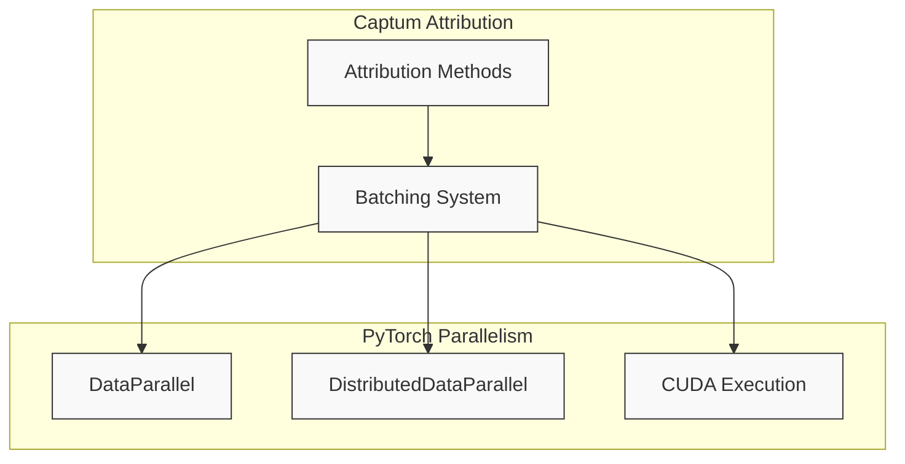
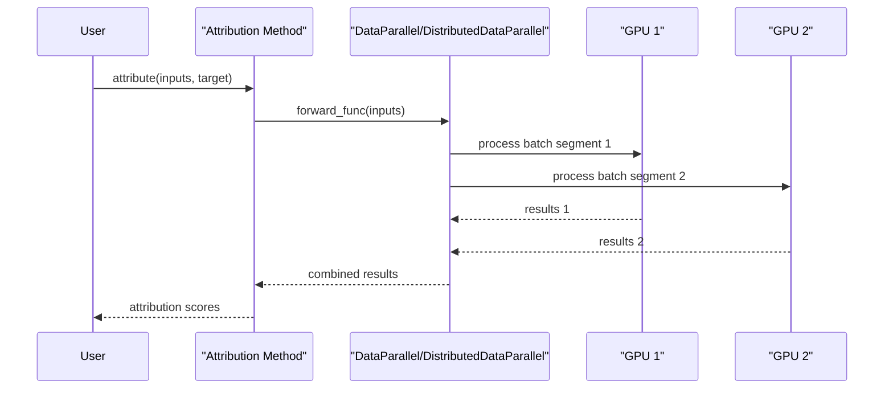
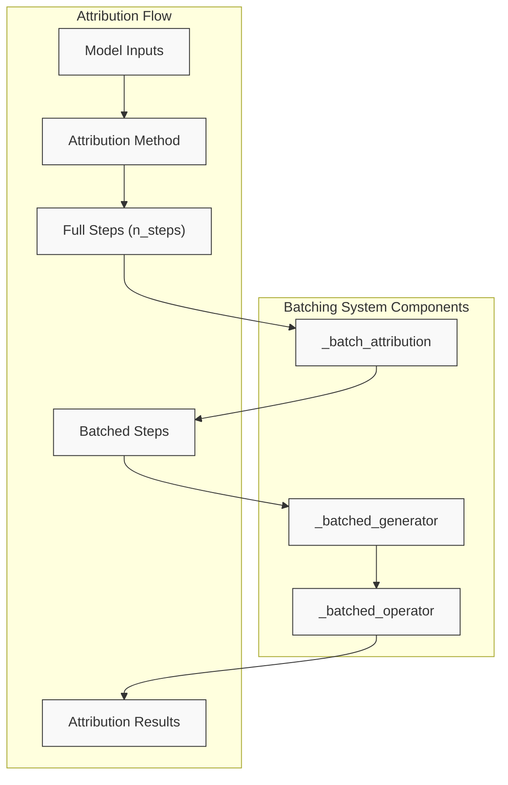
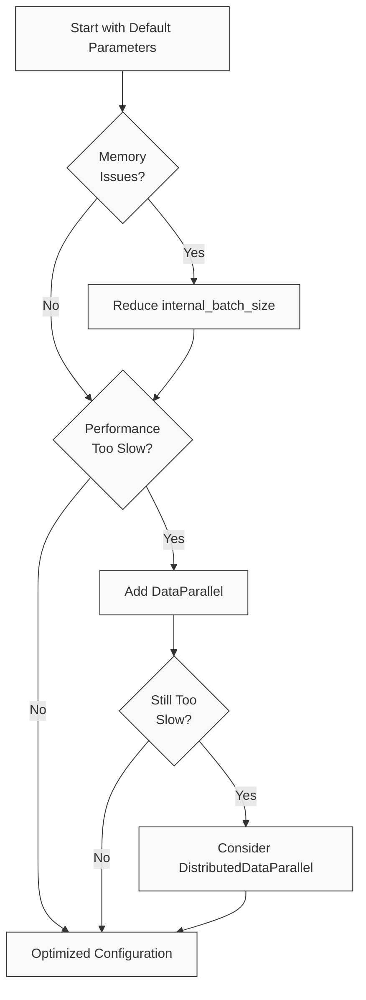

<!-- source: DeepWiki mcp.deepwiki.com · repo pytorch/captum · page 8.2 Data Parallelism and Performance · fetched 2026-10-21 -->

# Data Parallelism and Performance

<details>
<summary>Relevant source files</summary>

The following files were used as context for generating this wiki page:

- [captum/attr/_utils/batching.py](captum/attr/_utils/batching.py)
- [tests/attr/test_data_parallel.py](tests/attr/test_data_parallel.py)
- [tests/attr/test_targets.py](tests/attr/test_targets.py)

</details>


## Purpose and Scope

This document explains how to use Captum with data parallelism to improve performance, particularly for large models or datasets. It covers both PyTorch's data parallel mechanisms and Captum's internal batching system for efficient attribution computation. For information about the attribution methods themselves, see [Core Attribution Methods](#3).

## Overview of Parallelism in Captum

Captum supports multiple approaches to parallel computation that can significantly improve performance when working with large models or datasets. These approaches leverage PyTorch's parallelism mechanisms while ensuring that attribution results remain consistent regardless of execution mode.



Sources: [tests/attr/test_data_parallel.py:43-62]()

## Supported Parallelism Methods

Captum works with several PyTorch parallelism methods to distribute computation across available hardware:

| Method | Description | Use Case |
|--------|-------------|----------|
| `DataParallel` | Splits batch across available GPUs | Single machine, multiple GPUs |
| `DistributedDataParallel` | Multi-process parallelism with one GPU per process | Multi-GPU, multi-node deployments |
| CUDA Execution | Single GPU acceleration | Single GPU environments |

Each method has specific initialization requirements and performance characteristics. All attribution methods in Captum are designed to be compatible with these parallelism approaches.

Sources: [tests/attr/test_data_parallel.py:49-62](), [tests/attr/test_data_parallel.py:204-241]()

## Data Parallelism Implementation

When using data parallelism with Captum, the attribution computation is distributed across available computational resources while maintaining result consistency.



Sources: [tests/attr/test_data_parallel.py:129-201]()

## Using DataParallel with Captum

To use PyTorch's DataParallel with Captum, you need to wrap your model with `torch.nn.DataParallel` before passing it to the attribution method:

```python
# Example: Using DataParallel with IntegratedGradients
model = YourModel()
model = torch.nn.DataParallel(model)  # Wrap model with DataParallel
ig = IntegratedGradients(model)
attributions = ig.attribute(inputs, target=target)
```

### Special Considerations for Different Attribution Methods

Some attribution methods require special handling when used with DataParallel:

| Attribution Method Type | Special Handling |
|-------------------------|------------------|
| Layer Attribution | Need access to internal layers, use model's layers directly |
| Neuron Attribution | May require special device handling |
| Gradient-based Methods | Work directly with DataParallel models |
| Perturbation-based Methods | May require custom device_ids specification |

Sources: [tests/attr/test_data_parallel.py:243-302]()

## Using DistributedDataParallel

For multi-node scenarios or when greater performance is needed, Captum supports `DistributedDataParallel`:

```python
# Initialize process group
torch.distributed.init_process_group(backend="nccl")

# Create model and move it to GPU
model = YourModel().cuda()
model = torch.nn.parallel.DistributedDataParallel(
    model, device_ids=[local_rank], output_device=local_rank
)

# Create attribution method
attr_method = IntegratedGradients(model)
```

Sources: [tests/attr/test_data_parallel.py:229-237]()

## Internal Batching System for Performance

Captum provides an internal batching system to optimize memory usage and performance, especially for methods that require multiple model evaluations like IntegratedGradients.



Sources: [captum/attr/_utils/batching.py:1-250]()

### How Batching Works

The batching system divides attribution computation into manageable chunks:

1. **Step Batching**: For methods like IntegratedGradients that compute multiple steps along a path, `_batch_attribution` breaks these into smaller batches of steps.

2. **Input Batching**: For large datasets, `_batched_generator` creates smaller input batches to reduce memory requirements.

3. **Operator Batching**: `_batched_operator` applies operations to batches and assembles the results.

Sources: [captum/attr/_utils/batching.py:24-104](), [captum/attr/_utils/batching.py:139-221]()

### Configuring Batch Size

You can control the batch size through the `internal_batch_size` parameter when calling an attribution method:

```python
# Example: Using internal batching with IntegratedGradients
ig = IntegratedGradients(model)
attributions = ig.attribute(
    inputs, 
    target=target,
    n_steps=50,
    internal_batch_size=10  # Process in batches of 10 steps
)
```

The optimal batch size depends on:
- Available GPU memory
- Input size
- Model complexity
- Attribution method requirements

Sources: [captum/attr/_utils/batching.py:24-104]()

## Performance Considerations

### Memory-Compute Tradeoff

Attribution methods in Captum often involve a tradeoff between memory usage and computation time:

| Approach | Memory Usage | Computation Time | Configuration |
|----------|--------------|------------------|--------------|
| Large batch size | Higher | Lower | Larger `internal_batch_size` |
| Small batch size | Lower | Higher | Smaller `internal_batch_size` |
| Many small steps | Lower | Higher | Higher `n_steps`, small `internal_batch_size` |
| Few large steps | Higher | Lower | Lower `n_steps`, large `internal_batch_size` |

Sources: [captum/attr/_utils/batching.py:24-104]()

### Automatic Batch Size Adjustment

Captum's batching system includes safety mechanisms that automatically adjust batch sizes when they are impractically configured:

- If `internal_batch_size < num_examples`, it defaults to the number of examples
- For some methods requiring consecutive steps, it ensures the batch size is at least twice the number of examples

Sources: [captum/attr/_utils/batching.py:50-68]()

## Example Performance Optimization Workflow



Sources: [tests/attr/test_data_parallel.py:49-62](), [captum/attr/_utils/batching.py:24-104]()

## Comparing Attribution Results Across Devices

When using data parallelism, it's important to ensure that attribution results are consistent across different execution modes. Captum includes test utilities that compare attribution results between:

- CPU vs. CUDA execution
- Single GPU vs. DataParallel execution
- Different device ID configurations

Small numerical differences are expected due to floating-point computation, but they should generally be within a small delta (typically 0.0001).

Sources: [tests/attr/test_data_parallel.py:129-201]()

## Target Handling in Parallel Execution

When using batched inputs with targets, Captum ensures that each example's attribution is computed with respect to its specific target. The system handles:

- Tensor targets
- List targets
- Single targets applied to all examples

This ensures consistent behavior whether running on a single device or with data parallelism.

Sources: [tests/attr/test_targets.py:39-216]()

## Best Practices for Performance

1. **Start with appropriate batch sizes**: Begin with moderate internal batch sizes and adjust based on memory constraints.

2. **GPU utilization**: For large models, use DataParallel to distribute workload across available GPUs.

3. **Layer attribution with DataParallel**: When using layer attribution methods with DataParallel, access the original model's layers rather than through the DataParallel wrapper.

4. **Multi-node deployment**: For very large workloads, consider using DistributedDataParallel with proper process group initialization.

5. **Gradient checkpointing**: For extremely large models, consider using PyTorch's gradient checkpointing to trade computation for memory.

6. **Monitor memory usage**: Keep track of memory consumption to avoid out-of-memory errors during attribution computation.

Sources: [tests/attr/test_data_parallel.py:243-302](), [captum/attr/_utils/batching.py:24-104]()

---

