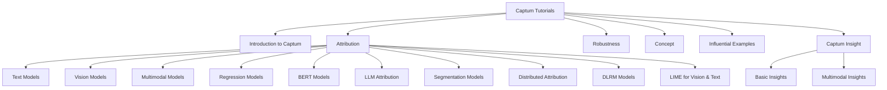
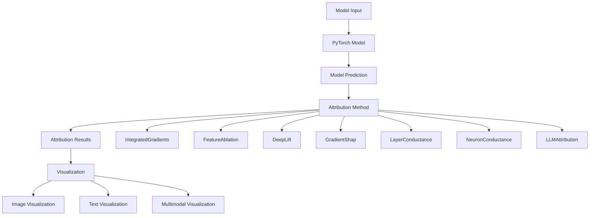
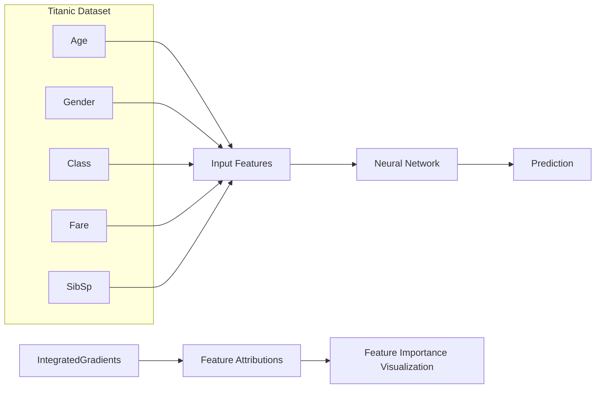
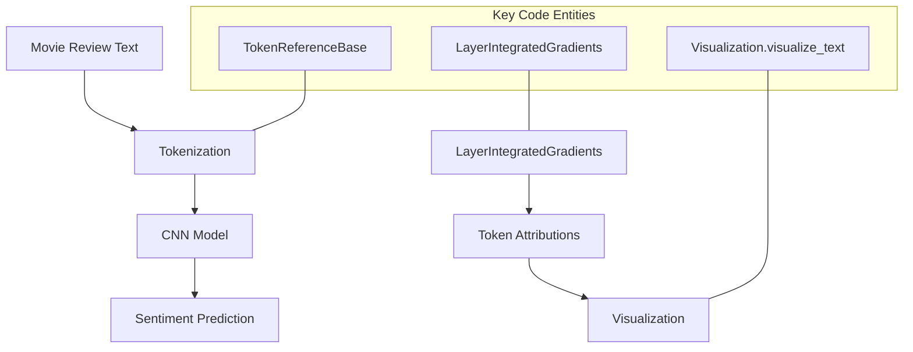
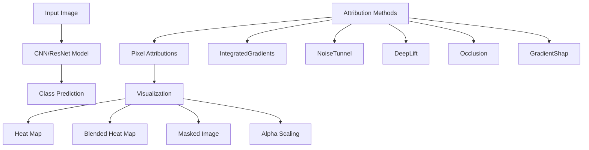
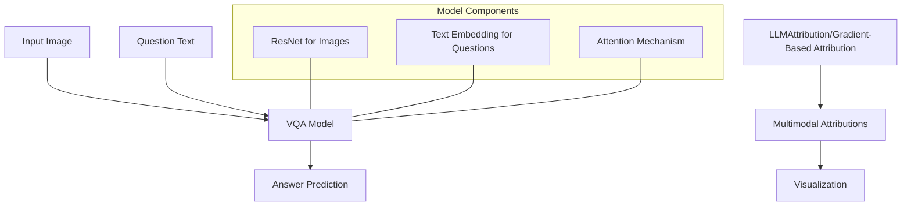
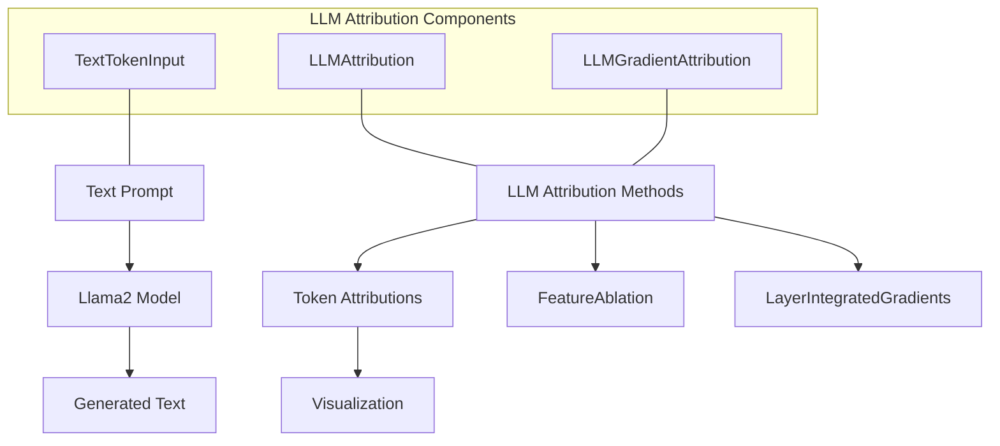
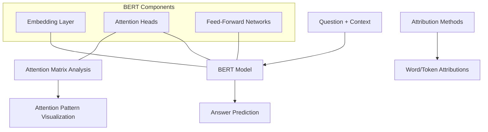
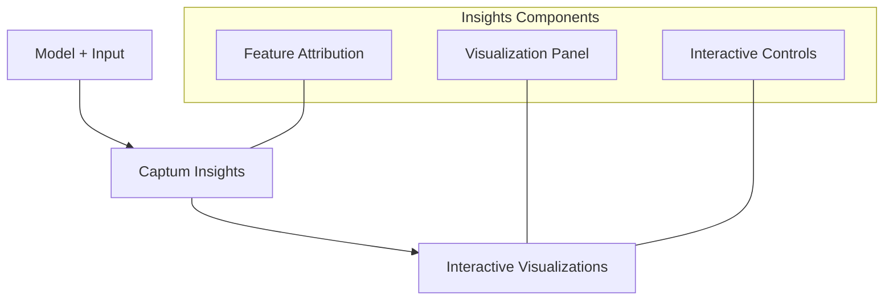
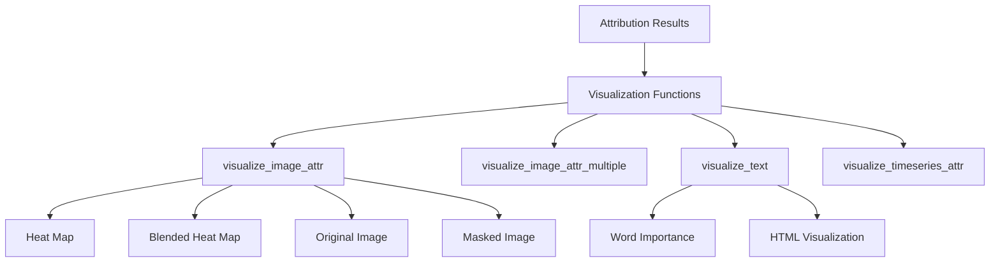

<!-- source: DeepWiki mcp.deepwiki.com · repo pytorch/captum · page 9 Tutorials and Examples · fetched 2026-10-21 -->

# Tutorials and Examples

Relevant source files

The following files were used as context for generating this wiki page:

- [captum/attr/_utils/visualization.py](captum/attr/_utils/visualization.py)
- [tutorials/Bert_SQUAD_Interpret2.ipynb](tutorials/Bert_SQUAD_Interpret2.ipynb)
- [tutorials/CIFAR_TorchVision_Interpret.ipynb](tutorials/CIFAR_TorchVision_Interpret.ipynb)
- [tutorials/IMDB_TorchText_Interpret.ipynb](tutorials/IMDB_TorchText_Interpret.ipynb)
- [tutorials/Llama2_LLM_Attribution.ipynb](tutorials/Llama2_LLM_Attribution.ipynb)
- [tutorials/Multimodal_VQA_Interpret.ipynb](tutorials/Multimodal_VQA_Interpret.ipynb)
- [tutorials/Titanic_Basic_Interpret.ipynb](tutorials/Titanic_Basic_Interpret.ipynb)
- [tutorials/TorchVision_Interpret.ipynb](tutorials/TorchVision_Interpret.ipynb)
- [tutorials/models/titanic_model.pt](tutorials/models/titanic_model.pt)
- [website/pages/tutorials/index.js](website/pages/tutorials/index.js)
- [website/tutorials.json](website/tutorials.json)

This page provides an overview of the tutorials and examples available for Captum, a model interpretability library for PyTorch. These tutorials demonstrate how to use Captum's various attribution methods to understand predictions made by different types of models across multiple domains, including text, vision, multimodal, and large language models (LLMs).

## Overview of Available Tutorials

Captum offers a comprehensive set of tutorials covering various aspects of model interpretability. The tutorials are organized into several categories:

Sources: [website/pages/tutorials/index.js:10-182](), [website/tutorials.json:1-99]()

### Tutorial Implementations and Attribution Flow

The following diagram illustrates how Captum's attribution methods flow through a typical model interpretation workflow:

Sources: [captum/attr/_utils/visualization.py:30-548](), [tutorials/IMDB_TorchText_Interpret.ipynb:61-66](), [tutorials/Titanic_Basic_Interpret.ipynb:30-33]()

## Getting Started with Captum

The "Getting Started" tutorial using the Titanic dataset provides a foundational understanding of Captum. This tutorial covers:

1. Training a simple neural network on the Titanic survival dataset
2. Using Integrated Gradients to understand feature importance
3. Applying Layer and Neuron Conductance for deeper model insights

### Feature Attribution Workflow

Sources: [tutorials/Titanic_Basic_Interpret.ipynb:25-201](), [tutorials/Titanic_Basic_Interpret.ipynb:284-370]()

## Attribution Tutorials

Attribution tutorials form the core of Captum's educational materials. These tutorials demonstrate how to apply various attribution methods to different model types.

### Text Model Interpretation with IMDB Dataset

This tutorial demonstrates how to interpret a CNN model trained for sentiment analysis on IMDB reviews:

1. Loading a pretrained CNN model
2. Using Layer Integrated Gradients to attribute predictions to input tokens
3. Visualizing token-level attributions

Key components include:
- Embedding layer attribution
- Token-level attribution visualization
- Handling text data with Captum

Sources: [tutorials/IMDB_TorchText_Interpret.ipynb:31-47](), [tutorials/IMDB_TorchText_Interpret.ipynb:283-369](), [captum/attr/_utils/visualization.py:909-1207]()

### Vision Model Interpretation (CIFAR/TorchVision)

These tutorials show how to interpret image classification models:

1. The CIFAR tutorial demonstrates attribution methods on a simple CNN model trained on CIFAR-10
2. The TorchVision tutorial applies attribution methods to pretrained models like ResNet and VGG

Methods covered include:
- Integrated Gradients
- Noise Tunnel
- DeepLift
- Occlusion
- GradientShap
- LRP (Layer-wise Relevance Propagation)

Sources: [tutorials/CIFAR_TorchVision_Interpret.ipynb:28-47](), [tutorials/CIFAR_TorchVision_Interpret.ipynb:103-133](), [tutorials/TorchVision_Interpret.ipynb:26-47](), [captum/attr/_utils/visualization.py:235-347]()

### Multimodal Model Interpretation (VQA)

This tutorial demonstrates interpretation of a Visual Question Answering (VQA) model that combines both image and text inputs:

1. Setting up a VQA model with ResNet for image features
2. Applying Integrated Gradients to attribute predictions to both image and text inputs
3. Visualizing attributions for multimodal inputs

Sources: [tutorials/Multimodal_VQA_Interpret.ipynb:45-74](), [tutorials/Multimodal_VQA_Interpret.ipynb:180-232]()

### LLM Attribution with Llama2

This tutorial demonstrates Captum's specialized tools for interpreting large language models (LLMs):

1. Setting up and loading Llama2 model
2. Using LLMAttribution and LLMGradientAttribution for text generation interpretation
3. Utilizing specialized text input adapters like TextTokenInput and TextTemplateInput

Sources: [tutorials/Llama2_LLM_Attribution.ipynb:30-39](), [tutorials/Llama2_LLM_Attribution.ipynb:171-177]()

### BERT Model Interpretation

Two tutorials cover the interpretation of BERT models for question answering:

1. Part 1 focuses on embeddings, sub-embeddings, and BERT architecture
2. Part 2 demonstrates how to analyze attention matrices using attribution algorithms

Sources: [tutorials/Bert_SQUAD_Interpret2.ipynb:29-49](), [website/tutorials.json:54-64]()

## Robustness Tutorials

The robustness tutorial demonstrates how to apply adversarial attacks and robustness metrics to models:

1. Applying FGSM and PGD attacks to a CIFAR model
2. Using MinParamPerturbation and AttackComparator
3. Combining robustness techniques with attribution algorithms

## Concept Testing (TCAV)

Testing with Concept Activation Vectors (TCAV) is demonstrated in two tutorials:

1. TCAV for image classification using a GoogleNet model
2. TCAV for NLP sentiment analysis model

These tutorials show how high-level concepts influence model predictions.

## Influential Examples

The TracInCP tutorial demonstrates:

1. Identifying influential training examples for a given prediction
2. Identifying potentially mislabeled examples in the training set

## Captum Insights

Captum Insights provides a visual interface for model interpretation:

1. The basic tutorial shows how to use Insights with a vision model
2. The multimodal tutorial demonstrates Insights for a VQA model

Sources: [website/tutorials.json:89-97](), [website/pages/tutorials/index.js:166-175]()

## Tutorial Structure and Organization

The tutorials follow a consistent structure:

| Section | Purpose |
|---------|---------|
| Introduction | Explains the tutorial's goal and model type |
| Setup | Dependencies and environment preparation |
| Model Loading | Loading or training the model to be interpreted |
| Attribution | Applying attribution methods to understand predictions |
| Visualization | Visualizing attribution results |
| Analysis | Analyzing and interpreting the results |

Each tutorial is designed to be self-contained but also build upon concepts from other tutorials.

## How to Use the Tutorials

The tutorials are provided as Jupyter notebooks that you can run locally. To use them:

1. Clone the Captum repository
2. Install the required dependencies (PyTorch, Captum, and domain-specific libraries)
3. Run the notebooks sequentially through Jupyter

Most tutorials include complete code for:
- Data preparation
- Model setup or loading
- Attribution calculation
- Result visualization

For some tutorials, you may need to download pretrained models or datasets as instructed in the notebook.

## Visualization Utilities

Captum provides specialized visualization utilities for different data types:

Sources: [captum/attr/_utils/visualization.py:235-547](), [captum/attr/_utils/visualization.py:671-905](), [captum/attr/_utils/visualization.py:909-1207]()

The visualization utilities support various options for customizing the display of attributions, making it easier to interpret model behavior across different domains and attribution methods.