# Page: Overview

# Overview

<details>
<summary>Relevant source files</summary>

The following files were used as context for generating this wiki page:

- [README.md](README.md)
- [captum/attr/_core/deep_lift.py](captum/attr/_core/deep_lift.py)
- [captum/attr/_core/gradient_shap.py](captum/attr/_core/gradient_shap.py)
- [captum/attr/_core/input_x_gradient.py](captum/attr/_core/input_x_gradient.py)
- [captum/attr/_core/integrated_gradients.py](captum/attr/_core/integrated_gradients.py)
- [captum/attr/_core/noise_tunnel.py](captum/attr/_core/noise_tunnel.py)
- [captum/attr/_core/saliency.py](captum/attr/_core/saliency.py)
- [captum/attr/_utils/approximation_methods.py](captum/attr/_utils/approximation_methods.py)
- [captum/attr/_utils/attribution.py](captum/attr/_utils/attribution.py)
- [captum/attr/_utils/common.py](captum/attr/_utils/common.py)
- [docs/Captum_Attribution_Algos.png](docs/Captum_Attribution_Algos.png)

</details>


Captum is a model interpretability and understanding library for PyTorch that provides state-of-the-art algorithms for explaining predictions of deep learning models. The name "Captum" means "comprehension" in Latin, reflecting its purpose of providing insights into how machine learning models make decisions. This document provides a high-level overview of Captum's architecture, components, and key functionality.

## Purpose and Scope

Captum helps researchers and practitioners understand their PyTorch models by attributing predictions to input features, neurons, or layers. It offers implementations of popular attribution methods such as Integrated Gradients, DeepLift, GradientSHAP, Feature Ablation, and more. The library serves two main audiences:

1. **Model developers** working to improve their models by understanding feature importance
2. **Interpretability researchers** who develop and benchmark attribution algorithms

For information about specific attribution methods, see [Core Attribution Methods](#3).

Sources: [README.md:21-36](README.md:21-36), [README.md:38-43](README.md:38-43)

## Core Components

Captum is organized around the central concept of "attribution" - assigning importance scores to different aspects of machine learning models.

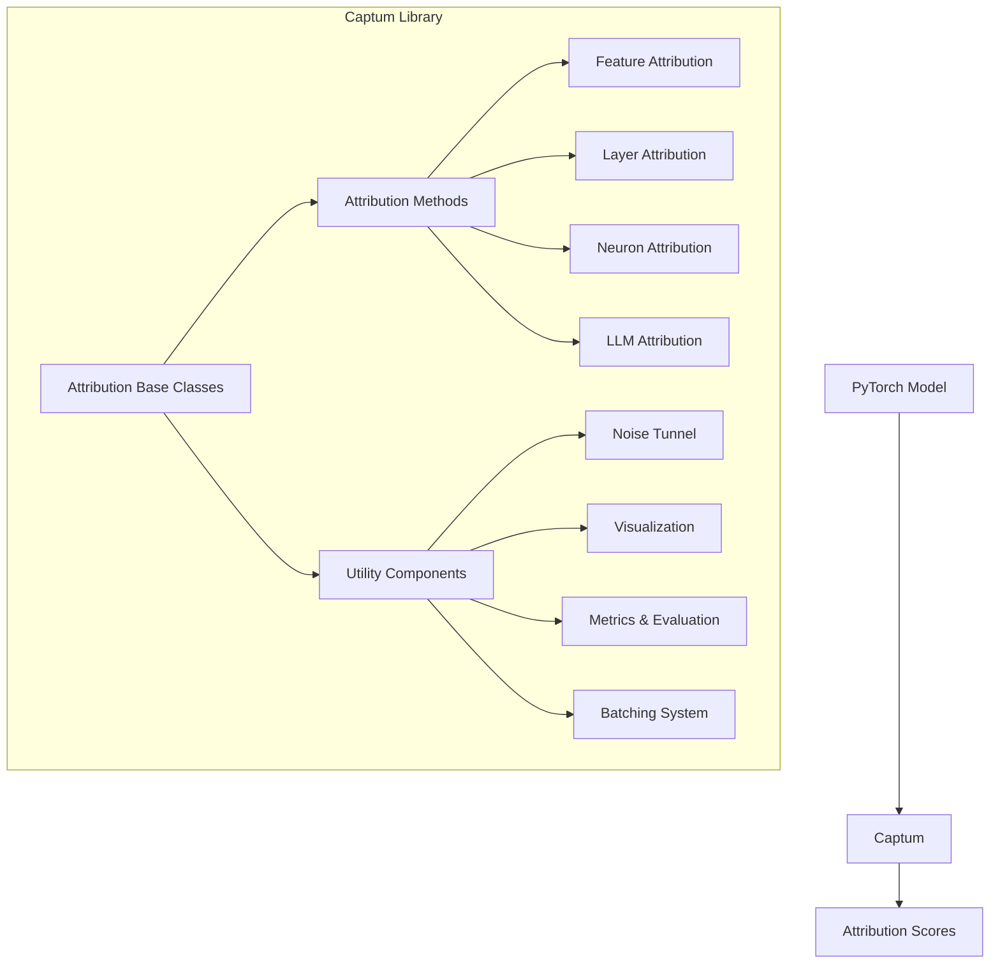

The core components of Captum include:

1. **Attribution Base Classes**: Define common interfaces and behaviors for attribution methods
2. **Attribution Methods**: Various techniques for computing feature, layer, and neuron importance
3. **Utility Components**: Tools for batching, noise addition, visualization, and quality metrics

Sources: [captum/attr/_utils/attribution.py:29-145](captum/attr/_utils/attribution.py:29-145), [README.md:29-31](README.md:29-31)

## Attribution Class Hierarchy

The design of Captum follows clear object-oriented principles with a well-defined inheritance hierarchy.

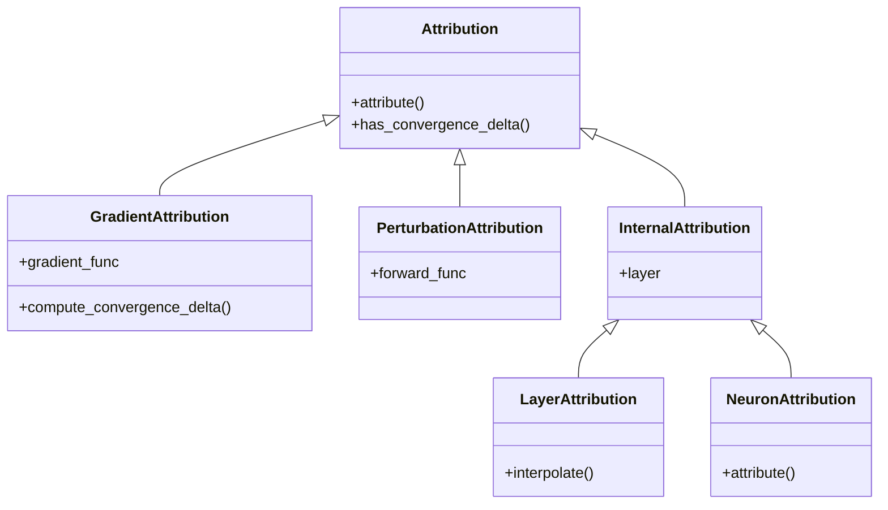

This hierarchy allows Captum to:
- Share common functionality between similar attribution methods
- Maintain a consistent API across different types of methods
- Extend with new methods while ensuring compatibility

Sources: [captum/attr/_utils/attribution.py:27-182](captum/attr/_utils/attribution.py:27-182), [captum/attr/_utils/attribution.py:183-344](captum/attr/_utils/attribution.py:183-344), [captum/attr/_utils/attribution.py:347-367](captum/attr/_utils/attribution.py:347-367)

## Key Attribution Approaches

Captum provides three major categories of attribution methods:

### 1. Gradient-Based Attribution

These methods use gradients of the model output with respect to inputs to determine feature importance.

- **IntegratedGradients**: Approximates the integral of gradients along a path from baseline to input
- **DeepLift**: Computes differences between inputs and reference activations
- **GradientShap**: Combines concepts from SHapley Additive exPlanations and gradients
- **Saliency**: Returns gradients (optionally absolute values) with respect to inputs
- **InputXGradient**: Multiplies input with gradients

Sources: [captum/attr/_core/integrated_gradients.py:28-408](captum/attr/_core/integrated_gradients.py:28-408), [captum/attr/_core/deep_lift.py:43-145](captum/attr/_core/deep_lift.py:43-145), [captum/attr/_core/gradient_shap.py:26-302](captum/attr/_core/gradient_shap.py:26-302), [captum/attr/_core/saliency.py:19-150](captum/attr/_core/saliency.py:19-150), [captum/attr/_core/input_x_gradient.py:17-144](captum/attr/_core/input_x_gradient.py:17-144)

### 2. Perturbation-Based Attribution

These methods analyze how perturbing input features affects model outputs.

- **FeatureAblation**: Measures impact of removing features
- **FeaturePermutation**: Measures impact of shuffling feature values
- **Occlusion**: Measures impact of replacing features with baselines

Sources: [captum/attr/_utils/attribution.py:346-366](captum/attr/_utils/attribution.py:346-366)

### 3. Internal Attribution

These methods examine contributions of specific internal components of the model.

- **LayerAttribution**: Analyzes importance of neurons in specific layers
- **NeuronAttribution**: Analyzes importance of inputs for specific neurons

Sources: [captum/attr/_utils/attribution.py:371-472](captum/attr/_utils/attribution.py:371-472), [captum/attr/_utils/attribution.py:405-538](captum/attr/_utils/attribution.py:405-538)

## Utility Components

### NoiseTunnel

NoiseTunnel enhances attribution quality by applying noise to inputs and aggregating the results:

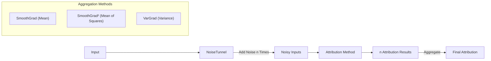

NoiseTunnel supports three aggregation types:
- **smoothgrad**: Computes mean of attributions for noisy samples
- **smoothgrad_sq**: Computes mean of squared attributions
- **vargrad**: Computes variance of attributions

Sources: [captum/attr/_core/noise_tunnel.py:33-519](captum/attr/_core/noise_tunnel.py:33-519)

### Approximation Methods

For methods like IntegratedGradients that require numerical integration, Captum provides different approximation approaches:

- **Riemann methods**: left, right, middle, trapezoid
- **Gauss-Legendre** quadrature

Sources: [captum/attr/_utils/approximation_methods.py:10-140](captum/attr/_utils/approximation_methods.py:10-140)

## Typical Workflow

The typical workflow for using Captum follows these steps:

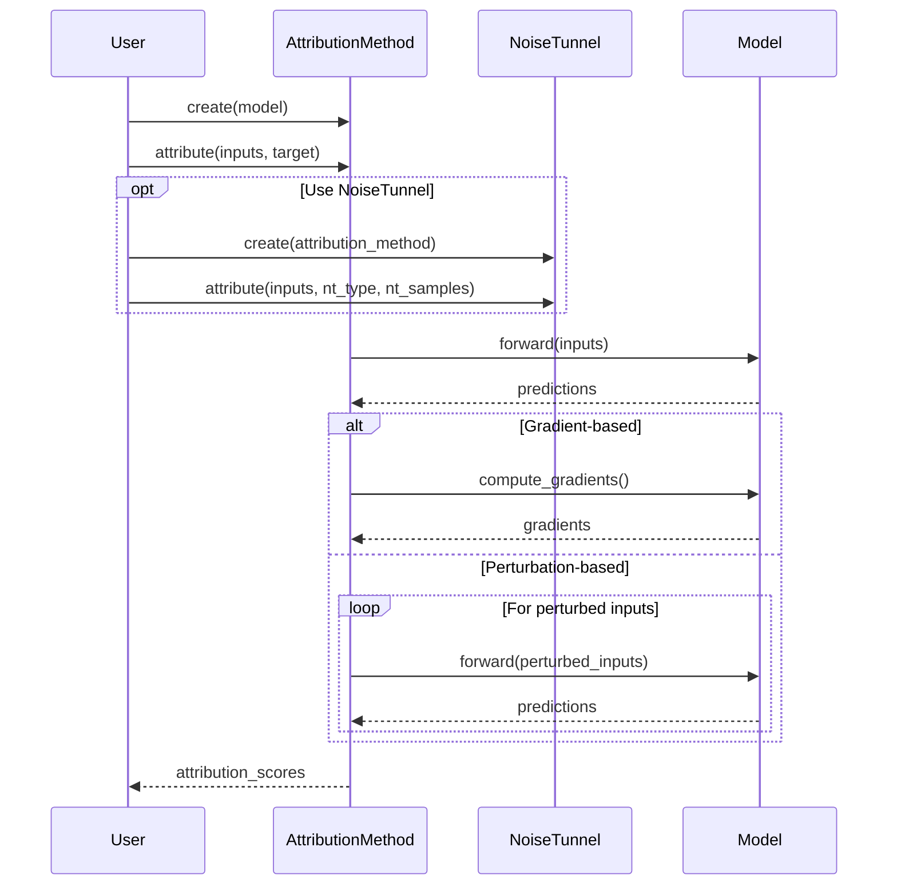

1. Initialize the attribution method with a PyTorch model
2. Call the `attribute()` method with inputs and optional parameters
3. Optionally wrap the attribution method in NoiseTunnel for smoother results
4. Use the resulting attribution scores for analysis or visualization

Sources: [README.md:106-115](README.md:106-115), [README.md:184-185](README.md:184-185)

## Example Usage

Here's a simplified example of how you would use Captum to compute Integrated Gradients for a classification model:

```python
# Create model
model = MyPytorchModel()

# Create attribution method
ig = IntegratedGradients(model)

# Compute attributions for class 3
attributions = ig.attribute(input, target=3)

# Optional: Use with NoiseTunnel for smoother results
nt = NoiseTunnel(ig)
attributions = nt.attribute(input, nt_type='smoothgrad', nt_samples=10, target=3)
```

This example demonstrates the core pattern of using Captum: initialize an attribution method with a model, then call `attribute()` with inputs and parameters specific to that method.

Sources: [README.md:117-309](README.md:117-309)

## Common Parameters

Most attribution methods in Captum share some common parameters:

| Parameter | Description |
|-----------|-------------|
| `inputs` | Input tensor(s) for which attributions are computed |
| `baselines` | Reference values compared to inputs (often zeros) |
| `target` | Output indices for which attributions are computed |
| `additional_forward_args` | Optional arguments passed to the model's forward function |
| `return_convergence_delta` | Whether to return approximation error metrics |

Sources: [captum/attr/_core/integrated_gradients.py:129-230](captum/attr/_core/integrated_gradients.py:129-230), [captum/attr/_core/deep_lift.py:149-274](captum/attr/_core/deep_lift.py:149-274)

## Convergence Delta

Many attribution methods in Captum provide a "convergence delta" that indicates the approximation error:

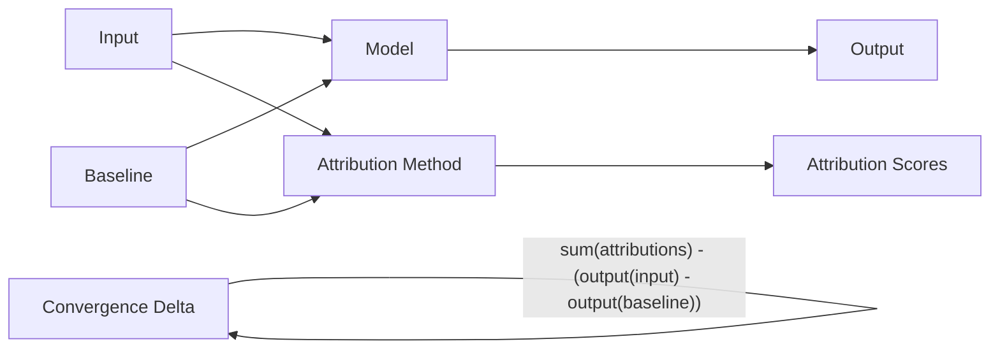

The convergence delta is based on the completeness axiom, which states that the sum of attributions should equal the difference between the model's outputs for the input and baseline.

Sources: [captum/attr/_utils/attribution.py:203-343](captum/attr/_utils/attribution.py:203-343), [captum/attr/_core/integrated_gradients.py:232-246](captum/attr/_core/integrated_gradients.py:232-246)

## Extension and Customization

Captum is designed to be extensible, allowing users to create custom attribution methods by:

1. Extending the appropriate base class (`Attribution`, `GradientAttribution`, etc.)
2. Implementing the required `attribute()` method
3. Optionally implementing `compute_convergence_delta()` and other methods

This architecture enables researchers to implement new attribution algorithms while leveraging Captum's infrastructure for common tasks.

Sources: [captum/attr/_utils/attribution.py:29-181](captum/attr/_utils/attribution.py:29-181)

---

# Page: Installation and Setup

# Installation and Setup

<details>
<summary>Relevant source files</summary>

The following files were used as context for generating this wiki page:

- [.conda/meta.yaml](.conda/meta.yaml)
- [.github/workflows/test-conda-cpu.yml](.github/workflows/test-conda-cpu.yml)
- [.github/workflows/test-pip-cpu.yml](.github/workflows/test-pip-cpu.yml)
- [CONTRIBUTING.md](CONTRIBUTING.md)
- [README.md](README.md)
- [captum/attr/_utils/approximation_methods.py](captum/attr/_utils/approximation_methods.py)
- [docs/Captum_Attribution_Algos.png](docs/Captum_Attribution_Algos.png)
- [scripts/install_via_conda.sh](scripts/install_via_conda.sh)
- [scripts/install_via_pip.sh](scripts/install_via_pip.sh)
- [setup.py](setup.py)
- [tests/attr/test_llm_attr_hf_compatibility.py](tests/attr/test_llm_attr_hf_compatibility.py)
- [website/static/CNAME](website/static/CNAME)

</details>


This page provides detailed instructions for installing and setting up Captum, a model interpretability and understanding library for PyTorch. It covers various installation methods, configuration options, and verification steps to ensure a successful setup. For an overview of Captum and its capabilities, please refer to [Overview](#1).

## System Requirements

Before installing Captum, ensure your system meets the following requirements:

| Requirement | Minimum Version |
|-------------|-----------------|
| Python      | 3.9 or higher   |
| PyTorch     | 1.10 or higher  |

Sources: [README.md:46-49](), [setup.py:18-31]()

## Installation Methods

Captum can be installed using different package managers. The following diagram illustrates the available installation methods:

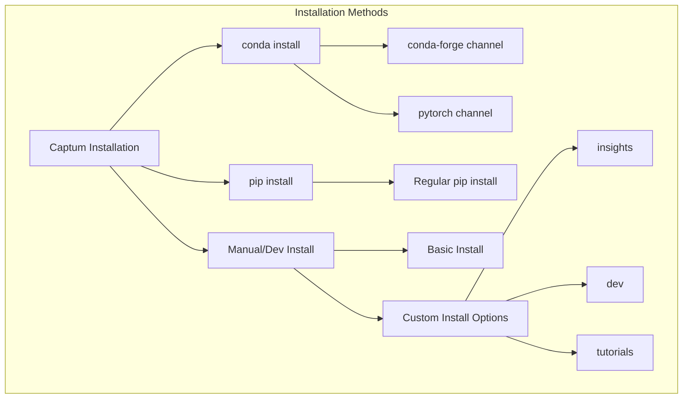

### Conda Installation (Recommended)

Conda is the recommended method for installing Captum. You can install it from either the `pytorch` or `conda-forge` channels:

From the PyTorch channel:
```bash
conda install captum -c pytorch
```

From the conda-forge channel:
```bash
conda install captum -c conda-forge
```

Sources: [README.md:54-71](), [.conda/meta.yaml:1-41]()

### Pip Installation

You can also install Captum using pip:

```bash
pip install captum
```

Sources: [README.md:72-77]()

### Manual/Dev Installation

For the latest development version or custom installation options, you can install directly from the GitHub repository:

1. Clone the repository:
```bash
git clone https://github.com/pytorch/captum.git
cd captum
```

2. Install based on your needs:

| Installation Type | Command | Purpose |
|------------------|---------|---------|
| Basic Install | `pip install -e .` | Minimal installation |
| Insights | `pip install -e .[insights]` | Includes Captum Insights (deprecated) |
| Development | `pip install -e .[dev]` | Includes development tools |
| Tutorials | `pip install -e .[tutorials]` | Includes tutorial dependencies |

Sources: [README.md:78-97](), [setup.py:54-81]()

## Installation Dependencies

The following diagram shows Captum's core and optional dependencies:

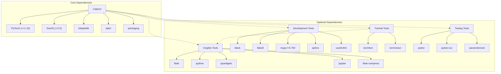

Sources: [setup.py:54-81](), [.conda/meta.yaml:14-24]()

## Installation Process

The following sequence diagram shows the typical installation process for Captum:

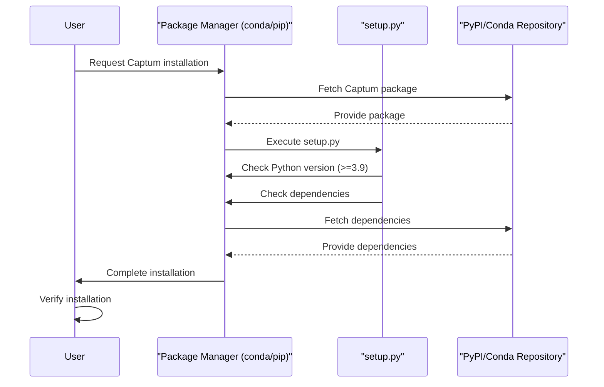

Sources: [setup.py:21-32](), [README.md:46-97]()

## Custom Installation Options

Captum provides several environment variables that can be used to customize the installation process:

| Environment Variable | Purpose |
|----------------------|---------|
| `BUILD_INSIGHTS` | Enables building Captum Insights via yarn |

To use these options, set the environment variable before running the installation:

```bash
# To build Captum Insights
BUILD_INSIGHTS=1 python setup.py develop
```

Sources: [setup.py:6-9](), [setup.py:40](), [setup.py:115-117]()

## Verifying Installation

After installing Captum, you can verify the installation by running a simple test:

```python
import captum
print(captum.__version__)
```

## Testing the Installation

To run the full test suite to ensure everything is working correctly:

```bash
# Using pytest
pytest -ra

# Using unittest
python -m unittest

# For coverage reports
pytest -ra --cov=. --cov-report term-missing
```

Sources: [README.md:98-104](), [CONTRIBUTING.md:71-83]()

## Version Compatibility

Captum is regularly tested against multiple Python and PyTorch versions. The following table shows the compatibility matrix:

| Python Version | Compatible PyTorch Versions |
|----------------|----------------------------|
| 3.9            | 1.10 - 2.3.0              |
| 3.10           | 1.11 - 2.3.0              |
| 3.11           | 1.13 - 2.3.0              |
| 3.12           | 2.2.0 - 2.3.0             |

Sources: [.github/workflows/test-pip-cpu.yml:14-38](), [.github/workflows/test-conda-cpu.yml:17-18]()

## Troubleshooting

### Common Issues

1. **Python Version Error**:
   If you see an error about the Python version, ensure you're using Python 3.9 or higher.

2. **PyTorch Compatibility**:
   Make sure your PyTorch version is compatible with Captum (1.10 or higher).

3. **ImportError for NumPy Features**:
   Some advanced attribution methods like `gausslegendre` require NumPy. If you encounter related errors, ensure NumPy is properly installed.

Sources: [setup.py:21-32](), [captum/attr/_utils/approximation_methods.py:123-124]()

### Using with CUDA

Captum works with both CPU and CUDA versions of PyTorch. The attribution calculations will automatically use CUDA if your model is on a CUDA device.

Sources: [tests/attr/test_llm_attr_hf_compatibility.py:29-33](), [tests/attr/test_llm_attr_hf_compatibility.py:76-77]()

---

# Page: Core Attribution Methods

# Core Attribution Methods

<details>
<summary>Relevant source files</summary>

The following files were used as context for generating this wiki page:

- [captum/attr/__init__.py](captum/attr/__init__.py)
- [captum/attr/_core/deep_lift.py](captum/attr/_core/deep_lift.py)
- [captum/attr/_core/feature_ablation.py](captum/attr/_core/feature_ablation.py)
- [captum/attr/_core/feature_permutation.py](captum/attr/_core/feature_permutation.py)
- [captum/attr/_core/gradient_shap.py](captum/attr/_core/gradient_shap.py)
- [captum/attr/_core/input_x_gradient.py](captum/attr/_core/input_x_gradient.py)
- [captum/attr/_core/integrated_gradients.py](captum/attr/_core/integrated_gradients.py)
- [captum/attr/_core/noise_tunnel.py](captum/attr/_core/noise_tunnel.py)
- [captum/attr/_core/occlusion.py](captum/attr/_core/occlusion.py)
- [captum/attr/_core/saliency.py](captum/attr/_core/saliency.py)
- [captum/attr/_utils/attribution.py](captum/attr/_utils/attribution.py)
- [captum/attr/_utils/common.py](captum/attr/_utils/common.py)
- [tests/attr/test_feature_ablation.py](tests/attr/test_feature_ablation.py)
- [tests/attr/test_feature_permutation.py](tests/attr/test_feature_permutation.py)
- [tests/attr/test_occlusion.py](tests/attr/test_occlusion.py)

</details>


This page provides an overview of the core attribution methods available in Captum, which form the foundation of the library's model interpretability capabilities. Attribution methods help quantify the contribution of input features to a model's output, allowing users to understand which features are most important for specific predictions.

For information about layer-specific or neuron-specific attribution methods, see [Layer and Neuron Attribution](#4). For visualization techniques, see [Visualization](#5).

## Attribution Method Hierarchy

Captum's attribution methods follow a well-defined class hierarchy that enables code reuse and consistent APIs across different attribution techniques.

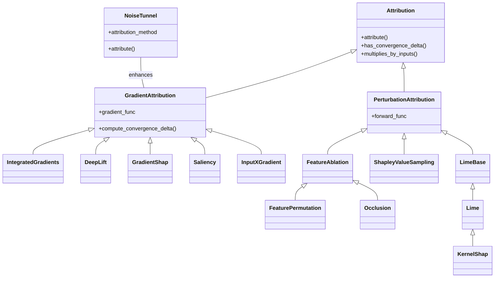

Sources: 
- [captum/attr/_utils/attribution.py:29-132](). The base `Attribution` class
- [captum/attr/_utils/attribution.py:183-343](). The `GradientAttribution` class
- [captum/attr/_utils/attribution.py:346-366](). The `PerturbationAttribution` class
- [captum/attr/__init__.py:1-153](). Registration of all attribution methods

All attribution methods in Captum follow this hierarchy:

1. **Attribution** - The base class for all attribution methods, defining the core API
2. **GradientAttribution** - Attribution methods that utilize gradients
3. **PerturbationAttribution** - Attribution methods that perturb inputs and observe changes in output

## Attribution Computation Flow

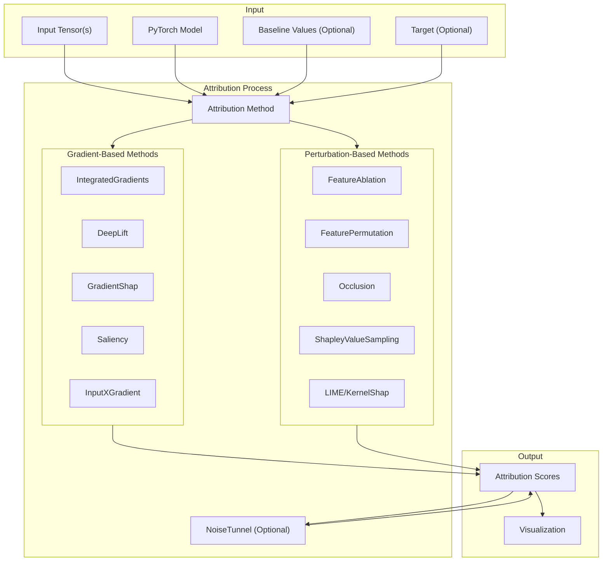

Sources:
- [captum/attr/_utils/attribution.py:47-74](). The core `attribute` method definition
- [captum/attr/_core/noise_tunnel.py:33-106](). The NoiseTunnel class

## Gradient-Based Attribution Methods

Gradient-based attribution methods compute feature importance by examining gradients of the output with respect to input features. These methods are generally faster and more efficient than perturbation-based approaches, especially for high-dimensional inputs.

### IntegratedGradients

Integrated Gradients approximates the integral of gradients along the path from a baseline to the input. It satisfies the completeness axiom, meaning the sum of attributions equals the difference between the model's output at the input and baseline.

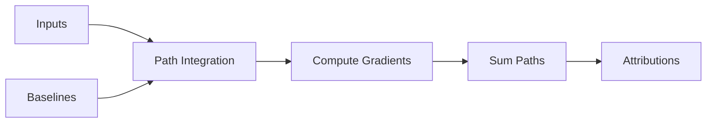

Sources:
- [captum/attr/_core/integrated_gradients.py:28-314]()

Key characteristics:
- Requires a baseline/reference point
- Approximates the integral using numerical techniques (e.g., Riemann sums or Gauss-Legendre quadrature)
- Supports convergence delta calculation to verify attribution quality

### DeepLift

DeepLift (Deep Learning Important FeaTures) computes attribution by comparing activations with reference activations at a baseline and backpropagating the differences.

Sources:
- [captum/attr/_core/deep_lift.py:43-555]() - The DeepLift class
- [captum/attr/_core/deep_lift.py:557-1123]() - DeepLiftShap extension

Key characteristics:
- Implements the Rescale rule for attributions
- Supports convergence delta calculation
- DeepLiftShap extends DeepLift to work with multiple baselines, approximating SHAP values

### GradientShap

GradientShap combines concepts from DeepLift and SHAP by computing the expected gradients using random sampling from a baseline distribution.

Sources:
- [captum/attr/_core/gradient_shap.py:26-302]()

Key characteristics:
- Approximates SHAP values using gradient-based methods
- Requires multiple baselines/references
- Can be viewed as an approximation of integrated gradients with multiple baselines

### Saliency

Saliency is the simplest gradient-based method, using the gradients of the output with respect to the input as attribution scores.

Sources:
- [captum/attr/_core/saliency.py:19-151]()

Key characteristics:
- Fast computation, no need for baselines
- Typically returns absolute values of gradients
- Can be noisy for complex models

### InputXGradient

InputXGradient multiplies inputs by their gradients, which often provides clearer attributions than raw gradients.

Sources:
- [captum/attr/_core/input_x_gradient.py:17-145]()

Key characteristics:
- Simple and efficient computation
- Provides better attribution quality than pure gradients in many cases
- Inherently multiplies by inputs

## Perturbation-Based Attribution Methods

Perturbation-based methods work by modifying input features and observing the effect on the model output. They tend to be more intuitive but are computationally more expensive.

### FeatureAblation

FeatureAblation measures importance by replacing features with a baseline value and measuring the change in output.

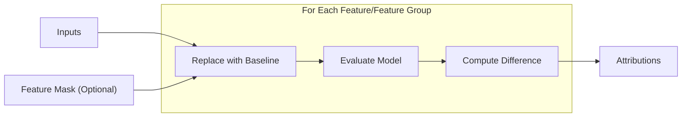

Sources:
- [captum/attr/_core/feature_ablation.py:52-702]()

Key characteristics:
- Can use feature masks to group features
- Flexible baseline specification
- Can be expensive for high-dimensional inputs
- Supports cross-tensor attribution

### FeaturePermutation

FeaturePermutation measures feature importance by shuffling feature values within a batch and measuring the change in output.

Sources:
- [captum/attr/_core/feature_permutation.py:28-329]()
- [tests/attr/test_feature_permutation.py:15-284]()

Key characteristics:
- Requires a batch of examples, cannot be performed on a single example
- Extends FeatureAblation but uses permutation instead of replacement
- Useful for identifying dependencies between features

### Occlusion

Occlusion is a variant of feature ablation that works by replacing contiguous rectangular regions with a baseline value.

Sources:
- [captum/attr/_core/occlusion.py:19-362]()
- [tests/attr/test_occlusion.py:28-366]()

Key characteristics:
- Especially useful for image data
- Configurable sliding window shape and stride
- Handles both single and multi-input models

## Noise Tunnel

NoiseTunnel is a wrapper that adds Gaussian noise to inputs before computing attributions, which can improve the quality and robustness of attributions.

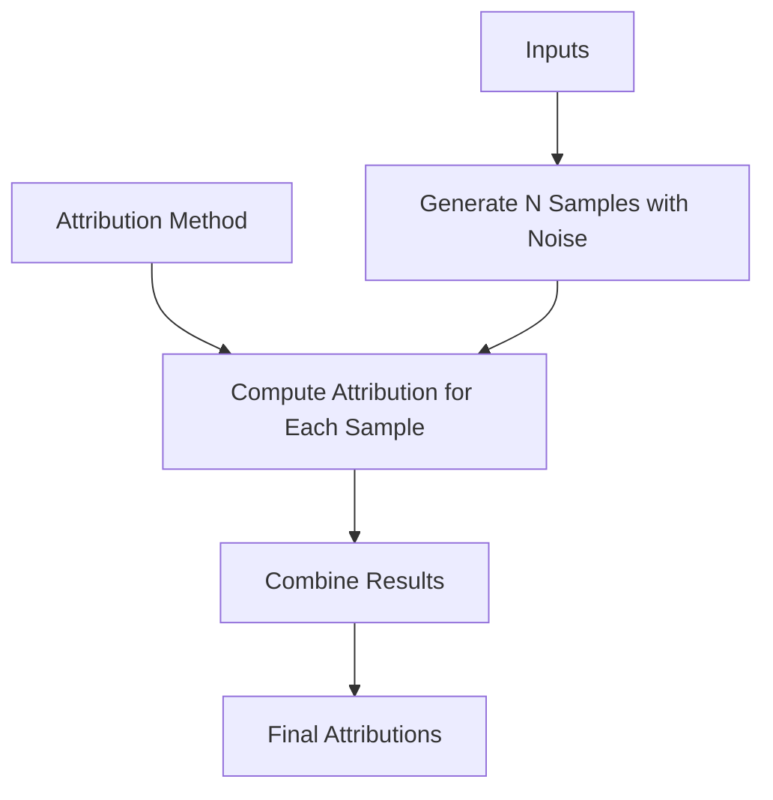

Sources:
- [captum/attr/_core/noise_tunnel.py:33-519]()

NoiseTunnel supports three methods:
1. **SmoothGrad** - Computes the mean of attributions for noisy samples
2. **SmoothGrad Squared** - Computes the mean of squared attributions
3. **VarGrad** - Computes the variance of attributions

## Common Usage Patterns

All attribution methods follow a consistent API pattern centered around the `attribute()` method. Here's a general workflow for using attribution methods:

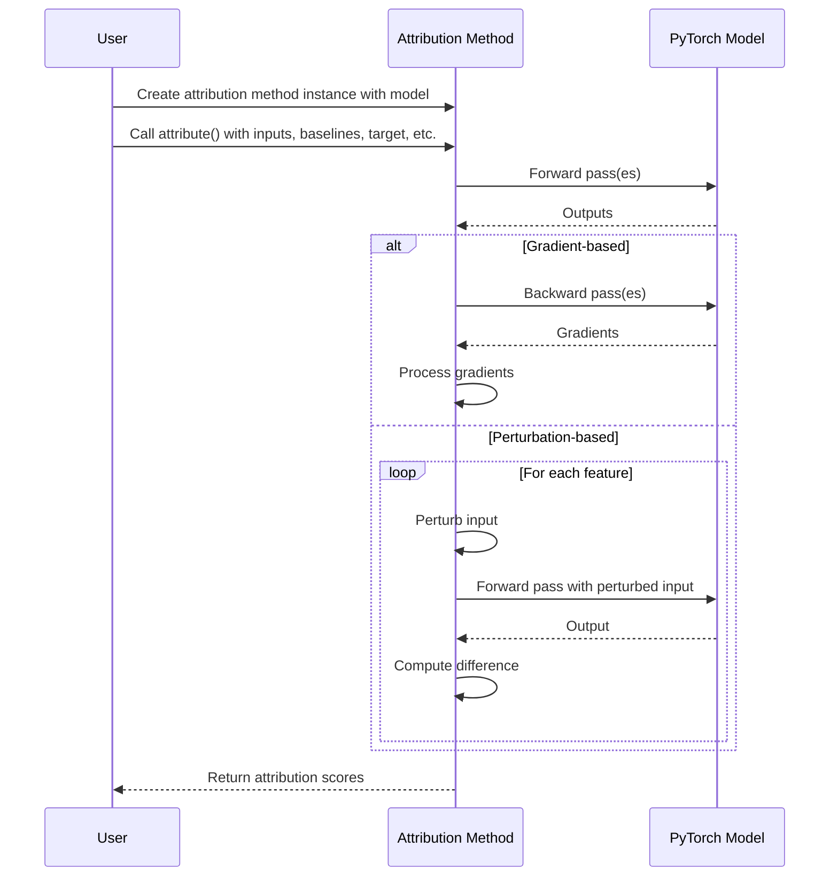

Sources:
- [captum/attr/_utils/attribution.py:47-74]() - Base `attribute()` method
- [captum/attr/_core/integrated_gradients.py:106-314]() - Example implementation in IntegratedGradients
- [captum/attr/_core/feature_ablation.py:110-408]() - Example implementation in FeatureAblation

Key parameters across attribution methods:
- `inputs`: Input tensor(s) for which attributions are computed
- `baselines`: Reference values for comparison (required for some methods)
- `target`: Output index for which attributions are computed
- `additional_forward_args`: Additional arguments for the forward function

## Choosing an Attribution Method

The appropriate attribution method depends on the model, data type, and desired properties:

| Method | Speed | Theoretical Guarantees | Input Types | Baseline Required |
|--------|-------|------------------------|-------------|-------------------|
| IntegratedGradients | Medium | Completeness, Implementation Invariance | Any | Yes |
| DeepLift | Fast | Completeness | Any | Yes |
| GradientShap | Medium | Expected Value Property | Any | Yes (multiple) |
| Saliency | Very Fast | None | Any | No |
| InputXGradient | Very Fast | None | Any | No |
| FeatureAblation | Slow | Model Agnostic | Any | Optional |
| FeaturePermutation | Slow | Model Agnostic | Requires batch | No |
| Occlusion | Very Slow | Model Agnostic | Spatial data | Optional |

Sources:
- Comparison based on method implementations across files
- [captum/attr/_core/integrated_gradients.py:28-45]() - IntegratedGradients guarantees
- [captum/attr/_core/deep_lift.py:43-72]() - DeepLift properties
- [captum/attr/_core/gradient_shap.py:26-57]() - GradientShap properties

## Advanced Features

### Batching and Performance Optimization

For large inputs, many attribution methods support batching computations through the `internal_batch_size` parameter, which chunks the computation to save memory.

Sources:
- [captum/attr/_utils/batching.py]() (implicit from references in code)
- [captum/attr/_core/integrated_gradients.py:214-222]() - Batching parameters

### Cross-Tensor Attribution

For multi-input models, attribution methods like FeatureAblation support `enable_cross_tensor_attribution`, allowing attribution of features that span across multiple input tensors.

Sources:
- [captum/attr/_core/feature_ablation.py:244-247]() - Cross-tensor attribution parameter
- [captum/attr/_core/feature_ablation.py:494-652]() - Cross-tensor attribution implementation

---

# Page: Gradient-Based Attribution

# Gradient-Based Attribution

<details>
<summary>Relevant source files</summary>

The following files were used as context for generating this wiki page:

- [captum/attr/_core/deep_lift.py](captum/attr/_core/deep_lift.py)
- [captum/attr/_core/gradient_shap.py](captum/attr/_core/gradient_shap.py)
- [captum/attr/_core/input_x_gradient.py](captum/attr/_core/input_x_gradient.py)
- [captum/attr/_core/integrated_gradients.py](captum/attr/_core/integrated_gradients.py)
- [captum/attr/_core/noise_tunnel.py](captum/attr/_core/noise_tunnel.py)
- [captum/attr/_core/saliency.py](captum/attr/_core/saliency.py)
- [captum/attr/_utils/attribution.py](captum/attr/_utils/attribution.py)
- [captum/attr/_utils/common.py](captum/attr/_utils/common.py)
- [tests/attr/test_common.py](tests/attr/test_common.py)
- [tests/attr/test_deeplift_classification.py](tests/attr/test_deeplift_classification.py)
- [tests/attr/test_input_x_gradient.py](tests/attr/test_input_x_gradient.py)
- [tests/attr/test_integrated_gradients_basic.py](tests/attr/test_integrated_gradients_basic.py)
- [tests/attr/test_integrated_gradients_classification.py](tests/attr/test_integrated_gradients_classification.py)
- [tests/attr/test_saliency.py](tests/attr/test_saliency.py)

</details>


Gradient-based attribution methods in Captum form a family of model interpretability techniques that quantify the importance of input features by analyzing gradients of model outputs with respect to inputs. These methods are foundational to many interpretability approaches and serve as the building blocks for understanding neural network behavior.

This document covers the various gradient-based attribution methods implemented in Captum, their underlying principles, implementation details, and usage patterns. For information about other attribution types like perturbation-based methods, see [Perturbation-Based Attribution](#3.2).

## Hierarchy and Relationships 

Gradient-based attribution methods in Captum share common infrastructure and inherit from the `GradientAttribution` base class, which itself inherits from the `Attribution` class.

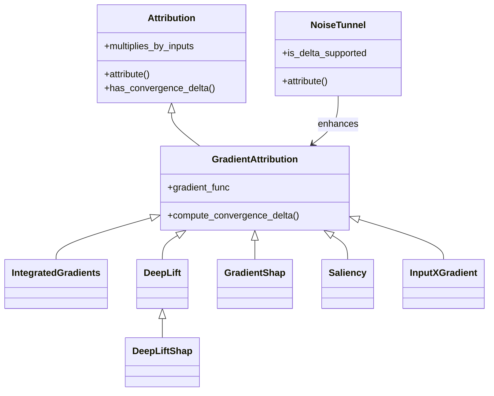

Sources: [captum/attr/_utils/attribution.py:183-344](). [captum/attr/_core/noise_tunnel.py:32-519]().

## Core Attribution Process

All gradient-based attribution methods follow a similar process but differ in how they compute and process gradients:

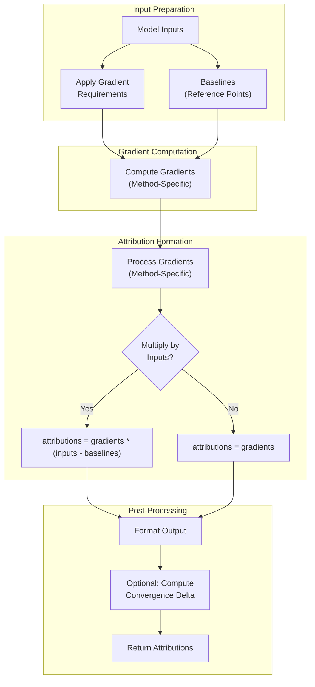

Sources: [captum/attr/_core/integrated_gradients.py:106-146](). [captum/attr/_utils/attribution.py:204-267]().

## Core Gradient-Based Attribution Methods

### Integrated Gradients

Integrated Gradients (IG) is an axiomatic attribution method that assigns importance scores by approximating the integral of gradients along a straight line path from a baseline to the input.

**Key characteristics:**
- Satisfies the completeness axiom (attributions sum to the difference between output at input and baseline)
- Implementation-invariant: attributions are identical for functionally equivalent networks
- Sensitive to all input features, regardless of gradient saturation
- Supports various integral approximation methods

**Implementation:**
```python
# Example usage
ig = IntegratedGradients(model)
attributions = ig.attribute(inputs, baselines=baseline, target=target_class, n_steps=50)
```

**Parameters:**
- `n_steps`: Number of steps in the path integral approximation (higher = more accurate)
- `method`: Approximation method (`riemann_right`, `riemann_left`, `riemann_middle`, `riemann_trapezoid`, `gausslegendre`)
- `internal_batch_size`: Controls memory usage for large inputs by dividing computation

The algorithm computes path integrals by:
1. Creating interpolated points between baseline and input
2. Computing gradients at these points
3. Integrating these gradients along the path
4. Optionally multiplying by (input - baseline) to get final attributions

Sources: [captum/attr/_core/integrated_gradients.py:28-409](). [tests/attr/test_integrated_gradients_classification.py:1-142]().

### DeepLift

DeepLift (Deep Learning Important FeaTures) assigns importance scores by comparing activation differences between the input and a reference (baseline) activation.

**Key characteristics:**
- Addresses gradient saturation issues through reference-based approach
- Rescale rule implementation that distributes importance based on neuron contributions
- Similar attribution quality to Integrated Gradients with faster computation

**Implementation:**
```python
# Example usage
dl = DeepLift(model)
attributions = dl.attribute(inputs, baselines=baseline, target=target_class)
```

DeepLift works by:
1. Registering hooks on non-linear layers
2. Calculating differences between activations at input and baseline
3. Propagating these differences through the network according to the rescale rule

**Limitations:**
- Currently supports a limited set of non-linear activations
- Does not support built-in PyTorch LSTMs/RNNs/GRUs (custom implementations required)

Sources: [captum/attr/_core/deep_lift.py:43-555](). [tests/attr/test_deeplift_classification.py:1-207]().

### DeepLiftShap

DeepLiftShap extends DeepLift by approximating SHAP (SHapley Additive exPlanations) values using DeepLift's algorithm.

**Key characteristics:**
- Combines DeepLift with SHAP framework for explanation
- Assumes feature independence and additive composition of effects
- Computes attributions with respect to multiple baselines, then averages results

**Implementation:**
```python
# Example usage
dl_shap = DeepLiftShap(model)
attributions = dl_shap.attribute(inputs, baselines=multiple_baselines, target=target_class)
```

**Differences from DeepLift:**
- Requires multiple baselines for distribution approximation
- Baselines can be provided as a tensor with the first dimension representing the distribution samples

Sources: [captum/attr/_core/deep_lift.py:557-775](). [tests/attr/test_deeplift_classification.py:84-101]().

### GradientShap

GradientShap approximates SHAP values by computing the expectations of gradients by randomly sampling from the distribution of baselines/references.

**Key characteristics:**
- Combines gradient-based methods with the SHAP framework
- Approximates SHAP values through random sampling and gradient computation
- Assumes feature independence and linear explanation model

**Implementation:**
```python
# Example usage
gs = GradientShap(model)
attributions = gs.attribute(inputs, baselines=multiple_baselines, n_samples=5, target=target_class)
```

**Parameters:**
- `n_samples`: Number of samples to generate with Gaussian noise
- `stdevs`: Standard deviation of Gaussian noise added to inputs

GradientShap works by:
1. Randomly selecting baselines from the provided distribution
2. Adding Gaussian noise to inputs
3. Computing gradients along paths between baselines and noisy inputs
4. Averaging results to approximate expected gradients

Sources: [captum/attr/_core/gradient_shap.py:26-439](). [tests/attr/test_integrated_gradients_classification.py:1-142]().

### Saliency

Saliency is a simple attribution method that returns the gradients of outputs with respect to inputs.

**Key characteristics:**
- Baseline approach for computing feature importance
- Simple and fast computation
- Can return absolute values of gradients for better visualization

**Implementation:**
```python
# Example usage
saliency = Saliency(model)
attributions = saliency.attribute(inputs, target=target_class, abs=True)
```

**Parameters:**
- `abs`: Whether to return absolute values of gradients (default: True)

Sources: [captum/attr/_core/saliency.py:19-151](). [tests/attr/test_saliency.py:1-181]().

### InputXGradient

InputXGradient is another simple baseline approach that multiplies inputs by their gradients.

**Key characteristics:**
- Provides element-wise product of input and gradient
- Simple computation that highlights both input magnitude and gradient direction
- Also known as "gradient * input" in literature

**Implementation:**
```python
# Example usage
input_x_grad = InputXGradient(model)
attributions = input_x_grad.attribute(inputs, target=target_class)
```

Unlike Saliency, InputXGradient always multiplies gradients by inputs, which can lead to different interpretations as it emphasizes features based on both their value and gradient magnitude.

Sources: [captum/attr/_core/input_x_gradient.py:17-145](). [tests/attr/test_input_x_gradient.py:1-131]().

## Enhancing Attribution with Noise Tunnel

NoiseTunnel is a wrapper that adds Gaussian noise to inputs before computing attributions, which can produce smoother and more reliable results.

### Noise Types

NoiseTunnel supports three types of noise-based attribution:

| Noise Type | Description | Use Case |
|------------|-------------|----------|
| `smoothgrad` | Averages attributions across noisy samples | General smoothing of attributions |
| `smoothgrad_sq` | Averages squared attributions | Emphasizes high-variance regions |
| `vargrad` | Computes variance of attributions | Identifies high-uncertainty areas |

### Implementation

```python
# Example usage with Integrated Gradients
ig = IntegratedGradients(model)
nt = NoiseTunnel(ig)
attributions = nt.attribute(inputs, 
                           nt_type='smoothgrad', 
                           nt_samples=10, 
                           stdevs=0.1, 
                           target=target_class)
```

**Parameters:**
- `nt_type`: Noise tunnel type (`smoothgrad`, `smoothgrad_sq`, or `vargrad`)
- `nt_samples`: Number of noisy samples to generate
- `nt_samples_batch_size`: Batch size for processing noisy samples (for memory efficiency)
- `stdevs`: Standard deviation of Gaussian noise

NoiseTunnel works by:
1. Generating multiple noisy versions of the input
2. Computing attributions for each noisy sample
3. Combining results according to the selected noise type

Sources: [captum/attr/_core/noise_tunnel.py:32-519](). [tests/attr/test_integrated_gradients_basic.py:31-46]().

## Common Implementation Details

### Convergence Delta

Many gradient-based methods support computing a convergence delta, which measures the approximation error based on the completeness axiom:

```
delta = sum(attributions) - (F(input) - F(baseline))
```

This value should be close to zero for accurate attributions. Methods that support this feature include:
- IntegratedGradients
- DeepLift
- GradientShap

```python
# Example usage with convergence delta
attributions, delta = ig.attribute(inputs, 
                                  baselines=baseline, 
                                  target=target_class,
                                  return_convergence_delta=True)
# delta provides approximation error information
```

Sources: [captum/attr/_utils/attribution.py:204-267](). [captum/attr/_utils/common.py:246-269]().

### Custom Attribution Functions

Most gradient-based methods support custom attribution functions for advanced use cases:

```python
# Example custom attribution function
def custom_attr_func(multipliers, inputs, baselines):
    return tuple(mult * (inp - base)**2 for mult, inp, base in zip(multipliers, inputs, baselines))

# Usage with custom function
attributions = ig.attribute(inputs, 
                           baselines=baseline, 
                           custom_attribution_func=custom_attr_func)
```

This gives flexibility to define your own logic for combining gradients with inputs.

Sources: [captum/attr/_utils/common.py:308-332](). [captum/attr/_core/deep_lift.py:229-248]().

### Batching Support

Gradient-based methods support batched inputs and provide utilities for memory-efficient computation:

```python
# Using internal batching for memory efficiency
attributions = ig.attribute(inputs, 
                           baselines=baseline, 
                           target=target_class,
                           n_steps=100,
                           internal_batch_size=16)
```

The `internal_batch_size` parameter divides the total computation into smaller chunks, which is useful for large inputs or many integration steps.

Sources: [captum/attr/_core/integrated_gradients.py:215-225](). [captum/attr/_utils/batching.py]().

## Method Comparison and Selection Guide

| Method | Speed | Memory Usage | Quality | Use Cases |
|--------|-------|-------------|---------|-----------|
| Saliency | Fastest | Lowest | Baseline | Quick approximate feature importance, debugging |
| InputXGradient | Fast | Low | Improved over Saliency | Simple attribution that accounts for input magnitude |
| IntegratedGradients | Moderate | High (depends on n_steps) | High | When accuracy matters, detailed analysis, verifiable results |
| DeepLift | Fast | Moderate | High | Faster alternative to IG with similar quality |
| GradientShap | Moderate | Moderate | High | When explanations need statistical grounding |
| DeepLiftShap | Moderate | Moderate | High | When combining DeepLift efficiency with SHAP framework |

**General guideline for choosing a method:**
- For quick visualization and debugging: Saliency or InputXGradient
- For detailed analysis with theoretical guarantees: IntegratedGradients
- For faster analysis with similar quality to IG: DeepLift
- For statistical robustness and feature interactions: GradientShap or DeepLiftShap
- For any method where noise helps: Use NoiseTunnel wrapper

Sources: [captum/attr/_core/deep_lift.py:60-62](). [captum/attr/_core/integrated_gradients.py:44-51]().

## Implementation Details: Key Properties and Parameters

Each gradient-based attribution method has specific parameters and characteristics:

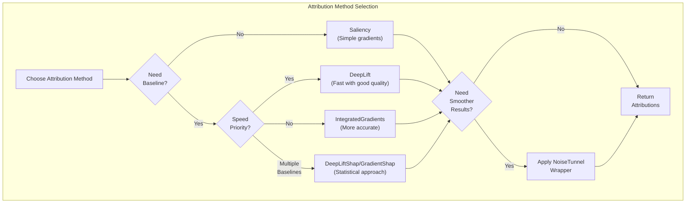

Source: [captum/attr/_utils/attribution.py:183-344](). [captum/attr/_core/noise_tunnel.py:32-519]().

### Implementation Details: Key File References

| Component | Primary File | Key Classes/Functions |
|-----------|-------------|------------------------|
| Base Classes | attr/_utils/attribution.py | `Attribution`, `GradientAttribution` |
| Integrated Gradients | attr/_core/integrated_gradients.py | `IntegratedGradients` |
| DeepLift | attr/_core/deep_lift.py | `DeepLift`, `DeepLiftShap` |
| GradientShap | attr/_core/gradient_shap.py | `GradientShap`, `InputBaselineXGradient` |
| Saliency | attr/_core/saliency.py | `Saliency` |
| InputXGradient | attr/_core/input_x_gradient.py | `InputXGradient` |
| Noise Tunnel | attr/_core/noise_tunnel.py | `NoiseTunnel`, `NoiseTunnelType` |
| Common Utilities | attr/_utils/common.py | `_compute_convergence_delta`, `_tensorize_baseline` |

## Conclusion

Gradient-based attribution methods are a fundamental part of Captum's model interpretability toolkit. Each method has its strengths and use cases, from simple gradient-based approaches to more sophisticated techniques that integrate statistical frameworks.

For most use cases, IntegratedGradients or DeepLift provide a good balance of accuracy and computational efficiency. When additional smoothing is needed, the NoiseTunnel wrapper can enhance results. For cases requiring statistical rigor and handling feature interactions, GradientShap or DeepLiftShap are appropriate choices.

---

# Page: Perturbation-Based Attribution

# Perturbation-Based Attribution

<details>
<summary>Relevant source files</summary>

The following files were used as context for generating this wiki page:

- [captum/_utils/exceptions.py](captum/_utils/exceptions.py)
- [captum/attr/__init__.py](captum/attr/__init__.py)
- [captum/attr/_core/feature_ablation.py](captum/attr/_core/feature_ablation.py)
- [captum/attr/_core/feature_permutation.py](captum/attr/_core/feature_permutation.py)
- [captum/attr/_core/occlusion.py](captum/attr/_core/occlusion.py)
- [captum/attr/_core/shapley_value.py](captum/attr/_core/shapley_value.py)
- [captum/testing/helpers/basic_models.py](captum/testing/helpers/basic_models.py)
- [tests/attr/test_feature_ablation.py](tests/attr/test_feature_ablation.py)
- [tests/attr/test_feature_permutation.py](tests/attr/test_feature_permutation.py)
- [tests/attr/test_occlusion.py](tests/attr/test_occlusion.py)
- [tests/attr/test_shapley.py](tests/attr/test_shapley.py)

</details>


Perturbation-based attribution methods in Captum determine feature importance by systematically modifying input features and measuring the resulting changes in model output. These methods provide an alternative to gradient-based approaches ([Gradient-Based Attribution](#3.1)) by directly observing the model's behavior under different input conditions, which can be more intuitive to understand and doesn't require model gradients.

Sources: [captum/attr/_utils/attribution.py](captum/attr/_utils/attribution.py), [captum/attr/__init__.py:96-99]()

## Core Concepts and Architecture

Perturbation-based attribution methods derive from the `PerturbationAttribution` base class, which extends the fundamental `Attribution` class in Captum.

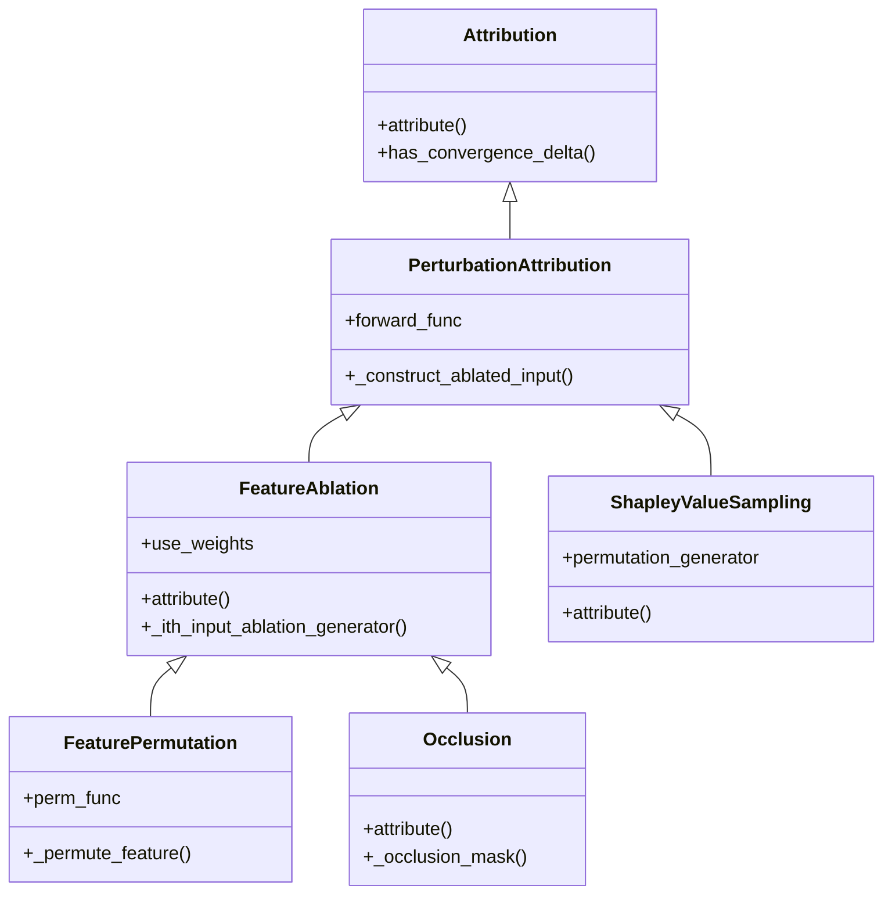

**Diagram: Perturbation-Based Attribution Class Hierarchy**

Sources: [captum/attr/__init__.py:96-100](), [captum/attr/_core/feature_ablation.py:52-108](), [captum/attr/_core/feature_permutation.py:28-95](), [captum/attr/_core/occlusion.py:19-48](), [captum/attr/_core/shapley_value.py:68-106]()

The key workflow for perturbation-based attribution methods involves:

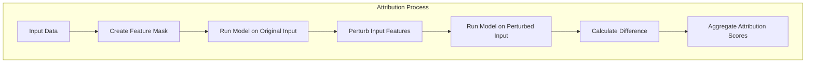

**Diagram: General Perturbation Attribution Workflow**

Sources: [captum/attr/_core/feature_ablation.py:100-408](), [captum/attr/_core/feature_permutation.py:100-297]()

## Feature Ablation

Feature ablation works by replacing individual features or feature groups with a baseline value and measuring the resulting change in output. This approach allows identifying which features contribute most significantly to the model's predictions.

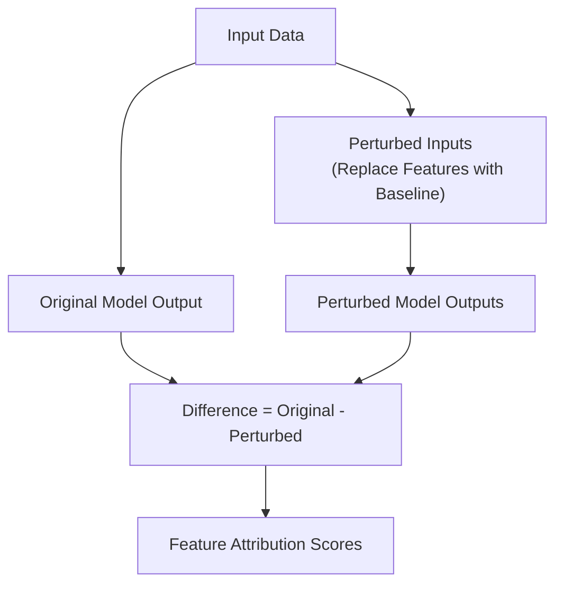

**Diagram: Feature Ablation Process**

Sources: [captum/attr/_core/feature_ablation.py:52-409]()

### Key Parameters

- **inputs**: Input tensor or tuple of tensors for which attributions are computed
- **baselines**: Reference values that replace features when ablated (defaults to zero)
- **feature_mask**: Optional mask for grouping features that should be ablated together
- **perturbations_per_eval**: Number of perturbations to process simultaneously
- **enable_cross_tensor_attribution**: Whether features should be grouped across input tensors

### Example Usage

```python
# Model takes a single input tensor of size Nx4x4
net = SimpleClassifier()
# Input with size 2 x 4 x 4
input = torch.randn(2, 4, 4)
# Initialize FeatureAblation
ablator = FeatureAblation(net)
# Compute attribution for each input element independently
attr = ablator.attribute(input, target=1)

# Group features using a feature mask (2x2 squares)
feature_mask = torch.tensor([[[0,0,1,1],[0,0,1,1],
                             [2,2,3,3],[2,2,3,3]]])
attr = ablator.attribute(input, target=1, feature_mask=feature_mask)
```

Sources: [captum/attr/_core/feature_ablation.py:272-303]()

## Feature Permutation

Feature permutation is a variant of feature ablation that, instead of replacing features with a baseline, permutes feature values within a batch. This technique requires that the batch contains multiple samples, as the permutation occurs across examples within the batch.

```mermaid
flowchart TD
    I["Batched Input Data"] --> O["Original Model Output"]
    I --> P["Permuted Inputs
    (Shuffle Feature Values Across Batch)"]
    P --> PO["Permuted Model Outputs"]
    O --> D["Difference = Original - Permuted"]
    PO --> D
    D --> A["Feature Attribution Scores"]
```

**Diagram: Feature Permutation Process**

Sources: [captum/attr/_core/feature_permutation.py:14-410]()

### Key Differences from Feature Ablation

1. Requires a batch size greater than 1 (typically at least 2 examples)
2. Uses permutation instead of replacement with baselines
3. Measures importance based on how shuffling feature values affects the model output

### Example Usage

```python
# Model takes a single input tensor of size Nx4x4
net = SimpleClassifier()
# Batch of 10 inputs
input = torch.randn(10, 4, 4)
# Initialize FeaturePermutation
feature_perm = FeaturePermutation(net)
# Compute attribution by permuting each input element independently
attr = feature_perm.attribute(input, target=1)

# Group features using a feature mask (2x2 squares)
feature_mask = torch.tensor([[[0,0,1,1],[0,0,1,1],
                             [2,2,3,3],[2,2,3,3]]])
attr = feature_perm.attribute(input, target=1, feature_mask=feature_mask)
```

Sources: [captum/attr/_core/feature_permutation.py:246-280]()

## Occlusion

Occlusion is a specialized perturbation method that replaces contiguous rectangular regions (or "patches") of the input with a baseline. This approach is particularly useful for images, where spatial relationships between features are important.

```mermaid
flowchart TD
    I["Input Data"] --> O["Original Model Output"]
    I --> SW["Define Sliding Window Shape & Stride"]
    SW --> P["Generate Occluded Inputs
    (Replace Each Region with Baseline)"]
    P --> PO["Occluded Model Outputs"]
    O --> D["Difference = Original - Occluded"]
    PO --> D
    D --> A["Feature Attribution Scores"]
```

**Diagram: Occlusion Attribution Process**

Sources: [captum/attr/_core/occlusion.py:19-363]()

### Key Parameters

- **sliding_window_shapes**: Shape of the patch (hyperrectangle) to occlude each input
- **strides**: Step by which the occlusion window should be shifted for each iteration
- **baselines**: Reference values that replace features when occluded

### Example Usage

```python
# Model takes a single input tensor of size Nx4x4
net = SimpleClassifier()
# Input with size 2 x 4 x 4
input = torch.randn(2, 4, 4)
# Initialize Occlusion
ablator = Occlusion(net)
# Compute attribution using 3x3 sliding windows
attr = ablator.attribute(input, target=1, sliding_window_shapes=(3,3))

# Use custom stride
attr = ablator.attribute(input, target=1, sliding_window_shapes=(3,3), strides=2)
```

Sources: [captum/attr/_core/occlusion.py:204-215]()

## Shapley Value Sampling

Shapley Value Sampling is a perturbation-based approach based on cooperative game theory. It works by taking random permutations of input features and adding them one-by-one to the baseline, measuring the incremental contribution of each feature.

```mermaid
flowchart TD
    I["Input Data"] --> O["Original Model Output with Baseline Only"]
    I --> R["Generate Random Feature Permutations"]
    R --> P["Evaluate Model Adding One Feature at a Time"]
    P --> IC["Calculate Incremental Contribution of Each Feature"]
    IC --> A["Average Attribution Across Permutations"]
```

**Diagram: Shapley Value Sampling Process**

Sources: [captum/attr/_core/shapley_value.py:68-1002]()

### Key Parameters

- **n_samples**: Number of feature permutations to test
- **feature_mask**: Optional mask for grouping features
- **perturbations_per_eval**: Allows multiple ablations to be processed simultaneously

### Example Usage

```python
# Model takes a single input tensor of size Nx4x4
net = SimpleClassifier()
# Input with size 2 x 4 x 4
input = torch.randn(2, 4, 4)
# Initialize ShapleyValueSampling
svs = ShapleyValueSampling(net)
# Compute attribution with 200 samples
attr = svs.attribute(input, target=1, n_samples=200)

# Group features using a feature mask (2x2 squares)
feature_mask = torch.tensor([[[0,0,1,1],[0,0,1,1],
                             [2,2,3,3],[2,2,3,3]]])
attr = svs.attribute(input, target=1, feature_mask=feature_mask)
```

Sources: [captum/attr/_core/shapley_value.py:264-298]()

## Implementation Details

### Feature Masking

All perturbation-based methods support the concept of feature masks, which allow grouping multiple input elements to be treated as a single feature. This is particularly useful for:

- Images: Group pixels into segments or regions
- Text: Group words or tokens
- Structured data: Group related features

```mermaid
graph TD
    subgraph "Feature Masking Example"
        A["Input Tensor"] --> B["Feature Mask"]
        B --> C["Group 0<br>(features with mask=0)"]
        B --> D["Group 1<br>(features with mask=1)"]
        B --> E["Group 2<br>(features with mask=2)"]
        B --> F["Group 3<br>(features with mask=3)"]
        
        C --> G["Attribution for Group 0"]
        D --> H["Attribution for Group 1"]
        E --> I["Attribution for Group 2"]
        F --> J["Attribution for Group 3"]
    end
```

**Diagram: Feature Masking Concept**

Sources: [captum/attr/_core/feature_ablation.py:201-222](), [captum/attr/_core/shapley_value.py:205-226]()

### Cross-Tensor Attribution

Perturbation-based methods in Captum can operate either:
- Within individual tensors (default behavior)
- Across tensors with `enable_cross_tensor_attribution=True`

This allows treating features from different input tensors as a unified group, which is useful for models that take multiple types of inputs.

Sources: [captum/attr/_core/feature_ablation.py:494-652](), [captum/attr/_core/feature_permutation.py:368-408]()

### Batched Processing

For efficiency, all perturbation methods support the `perturbations_per_eval` parameter, which allows processing multiple perturbations in a single forward pass:

```mermaid
flowchart TD
    I["Input Data"] --> B["Batch Multiple Perturbations"]
    B --> F["Single Forward Pass"]
    F --> S["Split Results"]
    S --> A["Compute Attribution for Each Perturbation"]
```

**Diagram: Batched Perturbation Processing**

Sources: [captum/attr/_core/feature_ablation.py:225-238](), [captum/attr/_core/shapley_value.py:229-246]()

## Choosing Between Perturbation Methods

| Method | When to Use | Advantages | Limitations |
|--------|-------------|------------|-------------|
| **Feature Ablation** | General purpose, when baselines are available | Simple, intuitive | Can be computationally expensive |
| **Feature Permutation** | When data has multiple examples and natural baseline isn't clear | Doesn't require explicit baseline | Requires batch size > 1, can give misleading results with correlated features |
| **Occlusion** | For spatial data (images, time series) | Captures spatial relationships | Only suitable for data with locality properties |
| **Shapley Value Sampling** | When theoretical foundation is important | Principled approach, well-defined properties | Most computationally expensive |

Sources: [captum/attr/_core/feature_ablation.py:52-68](), [captum/attr/_core/feature_permutation.py:28-74](), [captum/attr/_core/occlusion.py:19-38](), [captum/attr/_core/shapley_value.py:68-89]()

## Common Implementation Details

### Asynchronous Support

Most perturbation methods support asynchronous computation through the `attribute_future` method, which returns a Future object containing the attribution results.

```mermaid
sequenceDiagram
    participant User
    participant AttributionMethod
    participant Model
    participant Future
    
    User->>AttributionMethod: attribute_future(inputs)
    AttributionMethod->>Model: Forward pass (async)
    Model-->>Future: Set results
    Future-->>User: Return Future
    User->>Future: wait()
    Future-->>User: Return attribution
```

**Diagram: Asynchronous Attribution Flow**

Sources: [captum/attr/_core/feature_ablation.py:722-841](), [captum/attr/_core/feature_permutation.py:299-321]()

### Error Handling

Perturbation methods implement custom error types to handle asynchronous operations:
- `FeatureAblationFutureError`
- `ShapleyValueFutureError`

Sources: [captum/_utils/exceptions.py:1-19]()

## Summary

Perturbation-based attribution methods offer an intuitive approach to feature attribution by directly measuring the impact of feature modifications on model output. They provide flexibility through feature masking, cross-tensor attribution, and batch processing capabilities. While they tend to be more computationally expensive than gradient-based methods, they can be applied to any model (even non-differentiable ones) and often produce more interpretable results.

---

# Page: LIME and KernelShap

# LIME and KernelShap

<details>
<summary>Relevant source files</summary>

The following files were used as context for generating this wiki page:

- [captum/attr/_core/kernel_shap.py](captum/attr/_core/kernel_shap.py)
- [captum/attr/_core/lime.py](captum/attr/_core/lime.py)
- [tests/attr/test_kernel_shap.py](tests/attr/test_kernel_shap.py)
- [tests/attr/test_lime.py](tests/attr/test_lime.py)

</details>


This document covers the LIME (Local Interpretable Model-agnostic Explanations) and KernelShap implementation in Captum. These are perturbation-based attribution methods that explain model predictions by training surrogate interpretable models. The document details their implementation, usage patterns, and how they differ from other attribution approaches in Captum.

For gradient-based attribution methods, see [Gradient-Based Attribution](#3.1). For other perturbation-based methods like Feature Ablation and Occlusion, see [Perturbation-Based Attribution](#3.2).

## 1. Overview

LIME and KernelShap are model-agnostic interpretability techniques that explain individual predictions by approximating the complex model locally with a simpler, interpretable model. Unlike direct attribution methods, they return learned coefficients of a surrogate model rather than direct attribution scores.

```mermaid
flowchart TB
    subgraph "Perturbation-Based Attribution Methods"
        FA["FeatureAblation"]
        FP["FeaturePermutation"]
        OC["Occlusion"]
        
        subgraph "LIME Framework"
            LB["LimeBase"] --> L["Lime"]
            L --> KS["KernelShap"]
        end
    end
    
    subgraph "Key Differences"
        direction LR
        LIME1["LIME: Trains interpretable model\nto explain predictions locally"]
        KS1["KernelShap: Uses LIME framework\nto compute Shapley values"]
    end
```

Sources: [captum/attr/_core/lime.py:39-590](). [captum/attr/_core/kernel_shap.py:17-28]()

### 1.1 Key Concepts

Both methods operate by:
1. Generating perturbed versions of an input sample
2. Getting the complex model's predictions for these perturbed inputs 
3. Training a simple interpretable model (usually linear) to approximate the complex model locally
4. Using the coefficients of the interpretable model as feature importances

The main difference is that KernelShap uses a specific sampling approach and weighting to approximate Shapley values, while LIME offers more flexibility in how perturbations are generated and weighted.

### 1.2 Class Hierarchy

```mermaid
classDiagram
    class PerturbationAttribution {
        +forward_func
        +attribute()
    }
    
    class LimeBase {
        +interpretable_model
        +similarity_func
        +perturb_func
        +perturb_interpretable_space
        +from_interp_rep_transform
        +to_interp_rep_transform
        +attribute()
    }
    
    class Lime {
        +attribute()
    }
    
    class KernelShap {
        +kernel_shap_similarity_kernel()
        +kernel_shap_perturb_generator()
        +attribute()
    }
    
    PerturbationAttribution <|-- LimeBase
    LimeBase <|-- Lime
    Lime <|-- KernelShap
```

Sources: [captum/attr/_core/lime.py:39-721](). [captum/attr/_core/kernel_shap.py:17-18]()

## 2. LimeBase

`LimeBase` is the foundation class that provides a generic framework for training surrogate interpretable models. It differs from most other attribution methods since it returns coefficients of an interpretable model rather than direct attribution scores.

### 2.1 Key Parameters

```
LimeBase(
    forward_func,                   # Model to explain
    interpretable_model,            # Surrogate model (e.g., linear regression)
    similarity_func,                # Function to weight samples by similarity
    perturb_func,                   # Function to generate perturbed inputs
    perturb_interpretable_space,    # Whether perturbations are in interpretable space
    from_interp_rep_transform,      # Transform interpretable to original space
    to_interp_rep_transform         # Transform original to interpretable space
)
```

Sources: [captum/attr/_core/lime.py:69-235]()

### 2.2 Interpretable Space vs. Original Input Space

LimeBase allows two approaches to generate perturbations:

```mermaid
flowchart TB
    subgraph "Option 1: Sample in Interpretable Space"
        IS["Interpretable Space\n(Binary Vector)"] --> |"from_interp_rep_transform"| OS1["Original Input Space\n(e.g., Image)"] 
        OS1 --> |"forward_func"| P1["Prediction"]
    end
    
    subgraph "Option 2: Sample in Original Space"
        OS2["Original Input Space\n(e.g., Image)"] --> |"Perturbation"| PS["Perturbed Sample"] 
        PS --> |"to_interp_rep_transform"| IS2["Interpretable Space\n(Binary Vector)"]
        PS --> |"forward_func"| P2["Prediction"]
    end
```

Sources: [captum/attr/_core/lime.py:153-182](). [captum/attr/_core/lime.py:201-221]()

### 2.3 Attribution Process

The `attribute` method trains the surrogate model following these steps:

1. Generate perturbed samples using `perturb_func`
2. Convert between interpretable space and original space as needed
3. Compute model outputs for perturbed samples
4. Calculate similarity weights using `similarity_func`
5. Train the interpretable model with samples, outputs, and weights
6. Return the representation of the trained model (e.g., coefficients)

Sources: [captum/attr/_core/lime.py:241-516]()

## 3. Lime

`Lime` provides a more specific implementation than `LimeBase` with a consistent API similar to other perturbation-based attribution methods. It assumes the interpretable representation is a binary vector corresponding to elements in the input being set to baseline values (0) or original values (1).

### 3.1 Default Configuration

Lime initializes with sensible defaults:
- Interpretable model: `SkLearnLasso(alpha=0.01)`
- Similarity function: Exponential kernel with cosine distance
- Perturbation function: Random binary vectors with 0.5 probability for each feature

Sources: [captum/attr/_core/lime.py:757-871]()

### 3.2 Feature Masks

Feature masks allow grouping input elements to correspond to the same interpretable feature:

```mermaid
flowchart LR
    subgraph "Example: Image with Superpixels"
        I["Original Image"] --- FM["Feature Mask\n(Same value = same feature)"]
        
        subgraph "Perturbation Example"
            B["Binary Vector\n[1, 0, 1, 0]"] --- P["Perturbed Image\n(Some regions set to baseline)"]
        end
    end
```

Sources: [captum/attr/_core/lime.py:740-751](). [captum/attr/_core/lime.py:693-718]()

### 3.3 Attribution Method

The Lime class's `attribute` method extends `LimeBase.attribute` with:
- Support for baselines to replace masked features
- Feature mask handling to group input elements
- Option to return attributions in the input shape or as raw coefficients

Sources: [captum/attr/_core/lime.py:874-913]()

## 4. KernelShap

`KernelShap` is an extension of Lime that uses the LIME framework to compute Shapley values. It configures the sampling strategy and similarity kernel to approximate Shapley values more efficiently than direct computation.

### 4.1 Theoretical Foundation

KernelShap approximates Shapley values by:
1. Using a special perturbation generator that samples coalitions according to the Shapley kernel
2. Applying a specific similarity weighting that ensures proper weighting of coalitions
3. Training a linear model without regularization to compute feature attributions

```mermaid
flowchart TB
    subgraph "KernelShap Attribution Process"
        direction TB
        I["Input Sample"] --> S["Sample Coalitions\nAccording to Shapley Distribution"]
        S --> E["Evaluate Model on Perturbed Inputs"]
        E --> W["Weight Samples\nUsing Shapley Kernel"]
        W --> T["Train Linear Model\nWithout Regularization"]
        T --> C["Coefficients = Shapley Values"]
    end
```

Sources: [captum/attr/_core/kernel_shap.py:17-28](). [captum/attr/_core/kernel_shap.py:326-369]()

### 4.2 Implementation Details

KernelShap's implementation has several key components:

1. The `kernel_shap_perturb_generator` function:
   - Samples the number of selected features using the distribution p(k) = (M - 1) / (k * (M - k))
   - Generates random binary vectors with k ones
   - Always includes all-ones and all-zeros samples to satisfy endpoint constraints

2. The `kernel_shap_similarity_kernel` function:
   - Assigns extremely high weights to the all-ones and all-zeros samples (1000000)
   - Assigns equal weights (1.0) to all other samples

Sources: [captum/attr/_core/kernel_shap.py:302-324](). [captum/attr/_core/kernel_shap.py:326-369]()

### 4.3 Usage Pattern

The `attribute` method for KernelShap has the same parameters as Lime's method but performs specialized sampling internally:

```
KernelShap(forward_func).attribute(
    inputs,                   # Input to explain
    baselines=None,           # Baseline values for perturbations
    target=None,              # Output target index
    feature_mask=None,        # Mask for grouping features
    n_samples=25,             # Number of samples to generate
    perturbations_per_eval=1, # Batch size for model evaluation
    return_input_shape=True,  # Whether to reshape attributions to match input
    show_progress=False       # Whether to show progress bar
)
```

Sources: [captum/attr/_core/kernel_shap.py:46-293]()

## 5. Comparison of LIME and KernelShap

The following table highlights the key differences between LIME and KernelShap:

| Feature | LIME | KernelShap |
|---------|------|------------|
| Purpose | Generate local explanations with interpretable model | Approximate Shapley values efficiently |
| Sampling strategy | Flexible, defaults to uniform random | Specific distribution to match Shapley kernel |
| Similarity weighting | Flexible, defaults to exponential kernel | Fixed weighting based on Shapley kernel |
| Interpretable model | Configurable, defaults to Lasso | Linear regression without regularization |
| Theoretical guarantees | Local approximation | Approximates Shapley values |

Sources: [captum/attr/_core/lime.py:721-756](). [captum/attr/_core/kernel_shap.py:17-28]()

## 6. Data Flow During Attribution

```mermaid
sequenceDiagram
    participant User
    participant Lime/KernelShap
    participant PerturbFunc as "Perturbation Function"
    participant ForwardFunc as "Forward Function (Model)"
    participant InterpModel as "Interpretable Model"
    
    User->>Lime/KernelShap: attribute(inputs, ...)
    
    loop For n_samples
        Lime/KernelShap->>PerturbFunc: Generate perturbation
        PerturbFunc-->>Lime/KernelShap: Perturbed sample
        
        alt If perturb_interpretable_space
            Lime/KernelShap->>Lime/KernelShap: Transform to original space
        else
            Lime/KernelShap->>Lime/KernelShap: Transform to interpretable space
        end
        
        Lime/KernelShap->>Lime/KernelShap: Calculate similarity weight
        
        alt If batch is ready
            Lime/KernelShap->>ForwardFunc: Evaluate model on batch
            ForwardFunc-->>Lime/KernelShap: Model outputs
        end
    end
    
    Lime/KernelShap->>InterpModel: Train with samples, outputs, and weights
    InterpModel-->>Lime/KernelShap: Trained model
    
    alt If return_input_shape
        Lime/KernelShap->>Lime/KernelShap: Format coefficients to match input shape
    end
    
    Lime/KernelShap-->>User: Attribution (coefficients)
```

Sources: [captum/attr/_core/lime.py:241-516](). [captum/attr/_core/kernel_shap.py:46-293]()

## 7. Usage Examples

### 7.1 Basic LIME Example

```python
# Create explainer
lime = Lime(model)

# Generate explanations
attributions = lime.attribute(
    inputs,
    target=target_class,
    n_samples=100
)
```

### 7.2 LIME with Feature Mask

```python
# For image data, create a feature mask for superpixels
feature_mask = torch.tensor([[[0,0,1,1],
                             [0,0,1,1],
                             [2,2,3,3],
                             [2,2,3,3]]])

# Generate explanations with grouped features
attributions = lime.attribute(
    inputs,
    target=target_class,
    feature_mask=feature_mask,
    baselines=0.0,  # Set masked regions to black
    n_samples=200
)
```

### 7.3 KernelShap Example

```python
# Create explainer
ks = KernelShap(model)

# Generate explanations (approximating Shapley values)
attributions = ks.attribute(
    inputs,
    target=target_class,
    n_samples=500
)
```

Sources: [tests/attr/test_lime.py:540-577](). [tests/attr/test_kernel_shap.py:384-393]()

## 8. Common Utility Functions

### 8.1 Exponential Kernel Similarity

The `get_exp_kernel_similarity_function` creates a similarity function using an exponential kernel with either cosine or Euclidean distance:

```python
similarity_func = get_exp_kernel_similarity_function(
    distance_mode="cosine",  # or "euclidean"
    kernel_width=1.0         # Controls the width of the kernel
)
```

Sources: [captum/attr/_core/lime.py:622-671]()

### 8.2 Default Perturbation Function

The `default_perturb_func` generates random binary vectors with 0.5 probability for each feature:

```python
default_perturb_func(
    original_inp,
    num_interp_features=10  # Number of interpretable features
)
```

Sources: [captum/attr/_core/lime.py:674-686]()

### 8.3 Feature Mask Construction

The `construct_feature_mask` function creates a feature mask for grouping input elements:

```python
feature_mask_tuple, num_interp_features = construct_feature_mask(
    feature_mask,     # User-provided mask or None
    formatted_inputs  # Input tensors
)
```

Sources: [captum/attr/_core/lime.py:689-718]()

## 9. Implementation Notes

1. Both methods support multi-input models by using tuples of tensors
2. Both support batched inputs, explaining each example independently
3. Progress can be shown during attribution with `show_progress=True`
4. Both methods reuse the same interpretable model for different attributions
5. Neither method supports the `attribute_future` feature available in some other attribution methods

Sources: [captum/attr/_core/lime.py:551-558](). [captum/attr/_core/kernel_shap.py:295-300]()

---

# Page: LLM Attribution

# LLM Attribution

<details>
<summary>Relevant source files</summary>

The following files were used as context for generating this wiki page:

- [captum/_utils/transformers_typing.py](captum/_utils/transformers_typing.py)
- [captum/_utils/typing.py](captum/_utils/typing.py)
- [captum/attr/_core/llm_attr.py](captum/attr/_core/llm_attr.py)
- [captum/attr/_utils/interpretable_input.py](captum/attr/_utils/interpretable_input.py)
- [tests/attr/test_interpretable_input.py](tests/attr/test_interpretable_input.py)
- [tests/attr/test_llm_attr.py](tests/attr/test_llm_attr.py)

</details>


## Purpose and Scope

This document describes the LLM Attribution system within Captum, which provides specialized methods for attributing and interpreting the outputs of Large Language Models (LLMs). LLM Attribution extends Captum's attribution capabilities to handle the unique challenges of text-based models, allowing users to determine which input tokens or segments most influenced a model's generated text.

The LLM Attribution system is designed to work with modern language models that follow the Hugging Face Transformers interface convention, providing both perturbation-based and gradient-based attribution methods for text generation tasks.

For information about other attribution methods in Captum, see:
- [Gradient-Based Attribution](#3.1)
- [Perturbation-Based Attribution](#3.2)
- [LIME and KernelShap](#3.3)
- [Layer Attribution Methods](#4.1)
- [Neuron Attribution Methods](#4.2)

Sources: [captum/attr/_core/llm_attr.py:451-469](), [captum/attr/_core/llm_attr.py:714-732]()

## Architecture Overview

The LLM Attribution system consists of several key components that work together to provide attribution capabilities for language models.

```mermaid
classDiagram
    class Attribution {
        +attribute()
        +has_convergence_delta()
    }
    
    class InterpretableInput {
        +to_tensor()
        +to_model_input()
        +format_attr()
    }
    
    class BaseLLMAttribution {
        +SUPPORTED_INPUTS
        +SUPPORTED_METHODS
        +model
        +tokenizer
        +device
    }
    
    class LLMAttribution {
        +attr_method: PerturbationAttribution
        +attribute()
    }
    
    class LLMGradientAttribution {
        +attr_method: GradientAttribution
        +attribute()
    }
    
    class LLMAttributionResult {
        +seq_attr
        +token_attr
        +input_tokens
        +output_tokens
        +plot_token_attr()
        +plot_seq_attr()
    }
    
    class TextTemplateInput {
        +template
        +values
        +baselines
        +mask
    }
    
    class TextTokenInput {
        +text
        +tokenizer
        +baselines
        +skip_tokens
    }
    
    Attribution <|-- BaseLLMAttribution
    BaseLLMAttribution <|-- LLMAttribution
    BaseLLMAttribution <|-- LLMGradientAttribution
    
    LLMAttribution ..> LLMAttributionResult : produces
    LLMGradientAttribution ..> LLMAttributionResult : produces
    
    InterpretableInput <|-- TextTemplateInput
    InterpretableInput <|-- TextTokenInput
    
    BaseLLMAttribution o-- InterpretableInput : accepts
```

Sources: [captum/attr/_core/llm_attr.py:353-383](), [captum/attr/_core/llm_attr.py:451-469](), [captum/attr/_core/llm_attr.py:714-732](), [captum/attr/_utils/interpretable_input.py:58-105]()

## Attribution Methods and Workflow

The LLM Attribution system follows a specific workflow to attribute model outputs to input features:

```mermaid
flowchart TD
    subgraph Input
        A["InterpretableInput\n(TextTemplateInput or TextTokenInput)"]
        T["Target Text\n(Optional)"]
    end
    
    subgraph "Attribution Process"
        B["LLMAttribution or\nLLMGradientAttribution"]
        C["Underlying Attribution Method\n(e.g., FeatureAblation, LayerIntegratedGradients)"]
        D["Model Forward Pass\n(with perturbations or gradient tracking)"]
        E["Calculate Attribution Scores"]
    end
    
    subgraph Output
        F["LLMAttributionResult"]
        G["Sequence-Level Attribution"]
        H["Token-Level Attribution"]
        I["Visualization\n(Heatmaps, Bar Charts)"]
    end
    
    A --> B
    T --> B
    B --> C
    C --> D
    D --> E
    E --> F
    F --> G
    F --> H
    G --> I
    H --> I
```

Sources: [captum/attr/_core/llm_attr.py:614-703](), [captum/attr/_core/llm_attr.py:752-848]()

## Key Components

### BaseLLMAttribution

`BaseLLMAttribution` is the abstract base class for LLM attribution methods. It provides common functionality for both perturbation-based and gradient-based attribution methods.

Key properties and methods:
- `SUPPORTED_INPUTS`: Tuple of supported interpretable input types
- `SUPPORTED_METHODS`: Tuple of supported attribution methods
- `model`: The language model to attribute
- `tokenizer`: The tokenizer for text processing
- `_get_target_tokens()`: Converts target text to tokens or generates text if target is None
- `_format_model_input()`: Converts input to model-compatible format

Sources: [captum/attr/_core/llm_attr.py:353-383](), [captum/attr/_core/llm_attr.py:385-449]()

### LLMAttribution

`LLMAttribution` is designed for perturbation-based attribution methods. It wraps existing attribution algorithms to work with text inputs and produce token-level attributions.

```mermaid
flowchart LR
    subgraph "Supported Methods"
        FA["FeatureAblation"]
        SVS["ShapleyValueSampling"]
        SV["ShapleyValues"]
        L["Lime"]
        KS["KernelShap"]
    end
    
    subgraph "LLMAttribution"
        WF["Wrapper Forward Function"]
        AT["attribute() method"]
    end
    
    subgraph "Attribution Process"
        TT["Get Target Tokens"]
        PI["Perturb Input"]
        FP["Forward Pass"]
        CS["Calculate Scores"]
    end
    
    FA --> LLMAttribution
    SVS --> LLMAttribution
    SV --> LLMAttribution
    L --> LLMAttribution
    KS --> LLMAttribution
    
    LLMAttribution --> WF
    LLMAttribution --> AT
    
    AT --> TT
    TT --> PI
    PI --> FP
    FP --> CS
```

Supported attribution methods:
- `FeatureAblation`
- `ShapleyValueSampling`
- `ShapleyValues`
- `Lime` (sequence-level only)
- `KernelShap` (sequence-level only)

The `attribute()` method computes attributions for the provided input with respect to either a specified target or a generated response.

Sources: [captum/attr/_core/llm_attr.py:451-469](), [captum/attr/_core/llm_attr.py:614-703]()

### LLMGradientAttribution

`LLMGradientAttribution` is designed for gradient-based attribution methods that operate on specific layers of the language model.

```mermaid
flowchart LR
    subgraph "Supported Methods"
        LGS["LayerGradientShap"]
        LGXA["LayerGradientXActivation"]
        LIG["LayerIntegratedGradients"]
    end
    
    subgraph "LLMGradientAttribution"
        GF["GradientForwardFunc"]
        AT["attribute() method"]
    end
    
    subgraph "Attribution Process"
        TT["Get Target Tokens"]
        GP["Gradient Pass"]
        AA["Aggregate Attributions"]
    end
    
    LGS --> LLMGradientAttribution
    LGXA --> LLMGradientAttribution
    LIG --> LLMGradientAttribution
    
    LLMGradientAttribution --> GF
    LLMGradientAttribution --> AT
    
    AT --> TT
    TT --> GP
    GP --> AA
```

Supported attribution methods:
- `LayerGradientShap`
- `LayerGradientXActivation`
- `LayerIntegratedGradients`

The gradient-based methods require access to the model's internals, specifically the embedding layer, to compute attributions.

Sources: [captum/attr/_core/llm_attr.py:714-732](), [captum/attr/_core/llm_attr.py:752-848]()

### Interpretable Inputs

LLM Attribution supports two types of interpretable inputs:

1. **TextTemplateInput**: Allows defining interpretable features as segments (words, phrases) within a template
2. **TextTokenInput**: Defines interpretable features as individual tokens from a tokenizer

```mermaid
flowchart TD
    subgraph "TextTemplateInput"
        TT_C["Constructor"]
        TT_TT["to_tensor()"]
        TT_TMI["to_model_input()"]
        TT_FA["format_attr()"]
    end
    
    subgraph "TextTokenInput"
        TK_C["Constructor"]
        TK_TT["to_tensor()"]
        TK_TMI["to_model_input()"]
        TK_FA["format_attr()"]
    end
    
    TT_C -->|"Creates"| TT_I["Interpretable Representation\n(Binary tensor of segments)"]
    TT_TT -->|"Returns"| TT_B["Binary Tensor\n(1 = present, 0 = absent)"]
    TT_TMI -->|"Formats"| TT_M["String with segments\n(or baselines)"]
    TT_FA -->|"Formats"| TT_A["Formatted Attribution\n(Based on mask)"]
    
    TK_C -->|"Creates"| TK_I["Interpretable Representation\n(Binary tensor of tokens)"]
    TK_TT -->|"Returns"| TK_B["Binary Tensor\n(1 = present, 0 = absent)"]
    TK_TMI -->|"Returns"| TK_M["Token Tensor\n(with perturbed tokens)"]
    TK_FA -->|"Formats"| TK_A["Token Attribution"]
```

These input types allow users to define what should be considered as interpretable features for attribution.

Sources: [captum/attr/_utils/interpretable_input.py:163-230](), [captum/attr/_utils/interpretable_input.py:359-483]()

### LLMAttributionResult

The `LLMAttributionResult` class stores and provides visualization utilities for attribution results:

- `seq_attr`: Sequence-level attribution scores
- `token_attr`: Token-level attribution scores
- `input_tokens`: List of input tokens or segments
- `output_tokens`: List of output tokens
- `plot_token_attr()`: Generates a heatmap visualization
- `plot_seq_attr()`: Generates a bar chart visualization

Sources: [captum/attr/_core/llm_attr.py:47-221]()

## Usage Examples

Here are common usage patterns for LLM Attribution in Captum:

### Perturbation-based Attribution

```python
# Initialize with a perturbation-based method
from captum.attr import FeatureAblation, LLMAttribution
from transformers import AutoModelForCausalLM, AutoTokenizer

model = AutoModelForCausalLM.from_pretrained("gpt2")
tokenizer = AutoTokenizer.from_pretrained("gpt2")

# Create attribution method
feature_ablation = FeatureAblation(model)
llm_attribution = LLMAttribution(feature_ablation, tokenizer)

# Create interpretable input (template-based)
from captum.attr._utils.interpretable_input import TextTemplateInput
input_text = TextTemplateInput(
    template="The {} was {} and the {} was {}.",
    values=["dog", "happy", "cat", "sad"]
)

# Compute attributions
result = llm_attribution.attribute(
    inp=input_text,
    target="The animals had different emotions.",
    skip_tokens=[0]  # Skip special tokens
)

# Visualize results
result.plot_token_attr(show=True)
result.plot_seq_attr(show=True)
```

### Gradient-based Attribution

```python
# Initialize with a gradient-based method
from captum.attr import LayerIntegratedGradients, LLMGradientAttribution
from transformers import AutoModelForCausalLM, AutoTokenizer

model = AutoModelForCausalLM.from_pretrained("gpt2")
tokenizer = AutoTokenizer.from_pretrained("gpt2")

# Create attribution method
layer_ig = LayerIntegratedGradients(model, model.transformer.wte)
llm_attribution = LLMGradientAttribution(layer_ig, tokenizer)

# Create interpretable input (token-based)
from captum.attr._utils.interpretable_input import TextTokenInput
input_text = TextTokenInput("The dog was happy and the cat was sad.", tokenizer)

# Compute attributions
result = llm_attribution.attribute(
    inp=input_text,
    target="The animals had different emotions.",
    skip_tokens=[0]  # Skip special tokens
)

# Visualize results
result.plot_token_attr(show=True)
result.plot_seq_attr(show=True)
```

Sources: [captum/attr/_core/llm_attr.py:614-703](), [captum/attr/_core/llm_attr.py:752-848]()

## Key Parameters

### LLMAttribution Parameters

| Parameter | Description |
|-----------|-------------|
| `attr_method` | Instance of a supported perturbation attribution method |
| `tokenizer` | Tokenizer for the LLM model |
| `attr_target` | Attribution target ("log_prob" or "prob") |
| `inp` | Input text as an InterpretableInput instance |
| `target` | Target response text (string or tensor) |
| `skip_tokens` | Tokens to skip in attribution (e.g., special tokens) |
| `num_trials` | Number of trials to run for averaging attributions |
| `gen_args` | Arguments for text generation when target is None |
| `use_cached_outputs` | Whether to use model's caching for efficiency |

Sources: [captum/attr/_core/llm_attr.py:476-511](), [captum/attr/_core/llm_attr.py:614-649]()

### LLMGradientAttribution Parameters

| Parameter | Description |
|-----------|-------------|
| `attr_method` | Instance of a supported gradient attribution method |
| `tokenizer` | Tokenizer for the LLM model |
| `inp` | Input text as an InterpretableInput instance |
| `target` | Target response text (string or tensor) |
| `skip_tokens` | Tokens to skip in attribution (e.g., special tokens) |
| `gen_args` | Arguments for text generation when target is None |

Sources: [captum/attr/_core/llm_attr.py:734-745](), [captum/attr/_core/llm_attr.py:752-779]()

## Attribution Result Visualization

The `LLMAttributionResult` class provides two visualization methods:

1. **Token-level attribution** (`plot_token_attr()`): Generates a heatmap showing the influence of each input token on each output token.

2. **Sequence-level attribution** (`plot_seq_attr()`): Generates a bar chart showing the overall influence of each input token on the entire output.

```mermaid
flowchart TD
    subgraph "LLMAttributionResult"
        SA["seq_attr\n(1D tensor)"]
        TA["token_attr\n(2D tensor)"]
        IT["input_tokens\n(list of strings)"]
        OT["output_tokens\n(list of strings)"]
    end
    
    subgraph "Visualization"
        HP["plot_token_attr()\n(Heatmap)"]
        BC["plot_seq_attr()\n(Bar Chart)"]
    end
    
    SA --> BC
    TA --> HP
    IT --> HP
    IT --> BC
    OT --> HP
```

The visualizations use color coding to represent positive (blue) and negative (red) attributions, with intensity indicating the magnitude of the attribution.

Sources: [captum/attr/_core/llm_attr.py:70-221]()

## Integration with Transformers

LLM Attribution integrates with the Hugging Face Transformers library to support efficient token handling and model caching.

```mermaid
flowchart LR
    subgraph "Captum LLM Attribution"
        LA["LLMAttribution"]
        LGA["LLMGradientAttribution"]
    end
    
    subgraph "Interface Components"
        TI["TokenizerLike\n(Protocol)"]
        CU["Caching Utilities"]
    end
    
    subgraph "Transformers Library"
        T["Tokenizer"]
        M["Model"]
        C["Cache"]
    end
    
    LA --> TI
    LGA --> TI
    TI --> T
    
    LA --> CU
    CU --> C
    M --> C
```

Key integration points:
- The `TokenizerLike` protocol defines the interface for tokenizers
- Caching utilities manage model state for efficient generation
- Special handling for transformers models with different versions

Sources: [captum/_utils/typing.py:61-110](), [captum/_utils/transformers_typing.py:13-117]()

## Limitations and Considerations

When using LLM Attribution, consider the following:

1. **Computational Cost**: Perturbation-based methods like Shapley Values can be computationally expensive for long inputs

2. **Method Selection**: 
   - Use perturbation-based methods (`LLMAttribution`) when you need to understand the impact of removing/replacing input segments
   - Use gradient-based methods (`LLMGradientAttribution`) when you need attributions based on internal model representations

3. **Input Types**:
   - `TextTemplateInput` is best for attributing to whole words or phrases
   - `TextTokenInput` is better for token-level attributions when working directly with model tokens

4. **Visualization Limits**: 
   - The visualization becomes less readable with very long inputs or outputs
   - For large texts, consider focusing on specific sections

5. **Attribution Target**: 
   - The default `attr_target` for `LLMAttribution` is "log_prob" (log probability)
   - Using "prob" (probability) may be more intuitive in some cases but can lead to different attribution patterns

Sources: [captum/attr/_core/llm_attr.py:476-511](), [captum/attr/_core/llm_attr.py:734-745]()

## Conclusion

LLM Attribution provides powerful tools for understanding and interpreting the outputs of Large Language Models within Captum. By supporting both perturbation-based and gradient-based attribution methods, it accommodates different analysis needs and model architectures. The integration with the Hugging Face Transformers library makes it compatible with a wide range of modern language models.

The system's flexible input representation through `InterpretableInput` allows users to define attribution targets at different granularity levels, from tokens to phrases. The built-in visualization capabilities make it easy to interpret and communicate attribution results.

---

# Page: Layer and Neuron Attribution

# Layer and Neuron Attribution

<details>
<summary>Relevant source files</summary>

The following files were used as context for generating this wiki page:

- [captum/_utils/common.py](captum/_utils/common.py)
- [captum/_utils/gradient.py](captum/_utils/gradient.py)
- [captum/attr/_core/layer/grad_cam.py](captum/attr/_core/layer/grad_cam.py)
- [captum/attr/_core/layer/internal_influence.py](captum/attr/_core/layer/internal_influence.py)
- [captum/attr/_core/layer/layer_activation.py](captum/attr/_core/layer/layer_activation.py)
- [captum/attr/_core/layer/layer_conductance.py](captum/attr/_core/layer/layer_conductance.py)
- [captum/attr/_core/layer/layer_deep_lift.py](captum/attr/_core/layer/layer_deep_lift.py)
- [captum/attr/_core/layer/layer_gradient_shap.py](captum/attr/_core/layer/layer_gradient_shap.py)
- [captum/attr/_core/layer/layer_gradient_x_activation.py](captum/attr/_core/layer/layer_gradient_x_activation.py)
- [captum/attr/_core/neuron/neuron_conductance.py](captum/attr/_core/neuron/neuron_conductance.py)
- [tests/attr/layer/test_grad_cam.py](tests/attr/layer/test_grad_cam.py)
- [tests/attr/layer/test_internal_influence.py](tests/attr/layer/test_internal_influence.py)
- [tests/attr/layer/test_layer_gradient_x_activation.py](tests/attr/layer/test_layer_gradient_x_activation.py)
- [tests/attr/neuron/test_neuron_conductance.py](tests/attr/neuron/test_neuron_conductance.py)
- [tests/utils/test_common.py](tests/utils/test_common.py)

</details>


Layer and Neuron Attribution methods in Captum allow you to compute attribution scores for specific layers and neurons within your neural network model. These methods help identify which layers and neurons contribute most significantly to model predictions, providing deeper insights into model behavior than input attributions alone.

For attribution methods that analyze inputs to the model, see [Core Attribution Methods](#3).

## Key Concepts

Layer and Neuron Attribution methods analyze the contribution of internal components of a neural network:

- **Layer Attribution** computes importance scores for each input/output of a specific layer
- **Neuron Attribution** computes importance scores showing how each input feature contributes to a specific neuron's activation

Both types of attribution inherit from general attribution base classes and implement gradient-based and perturbation-based approaches.

```mermaid
classDiagram
    class Attribution {
        +attribute()
        +has_convergence_delta()
    }
    
    class GradientAttribution {
        +gradient_func
        +compute_convergence_delta()
    }
    
    class LayerAttribution {
        +forward_func
        +layer
        +attribute()
        +interpolate()
    }
    
    class NeuronAttribution {
        +forward_func
        +layer
        +attribute()
        +neuron_selector
    }
    
    Attribution <|-- GradientAttribution
    Attribution <|-- LayerAttribution
    Attribution <|-- NeuronAttribution
    
    GradientAttribution <|-- LayerGradCam
    GradientAttribution <|-- LayerDeepLift
    GradientAttribution <|-- LayerGradientXActivation
    GradientAttribution <|-- LayerGradientShap
    GradientAttribution <|-- LayerConductance
    GradientAttribution <|-- InternalInfluence
    
    GradientAttribution <|-- NeuronConductance
    GradientAttribution <|-- NeuronDeepLift
    GradientAttribution <|-- NeuronGuidedBackprop
    
    LayerAttribution <|-- LayerGradCam
    LayerAttribution <|-- LayerDeepLift
    LayerAttribution <|-- LayerGradientXActivation
    LayerAttribution <|-- LayerGradientShap
    LayerAttribution <|-- LayerConductance
    LayerAttribution <|-- LayerActivation
    LayerAttribution <|-- InternalInfluence
    
    NeuronAttribution <|-- NeuronConductance
    NeuronAttribution <|-- NeuronDeepLift
    NeuronAttribution <|-- NeuronGuidedBackprop
```

Sources: 
- [captum/attr/_core/layer/layer_deep_lift.py:31-96](captum/attr/_core/layer/layer_deep_lift.py:31-96)
- [captum/attr/_core/layer/layer_gradient_shap.py:25-103](captum/attr/_core/layer/layer_gradient_shap.py:25-103)
- [captum/attr/_core/layer/grad_cam.py:21-78](captum/attr/_core/layer/grad_cam.py:21-78)
- [captum/attr/_core/neuron/neuron_conductance.py:36-96](captum/attr/_core/neuron/neuron_conductance.py:36-96)

## Layer Attribution Methods

Layer attribution methods compute attribution scores with respect to the inputs or outputs of a specific layer in the model. Captum provides several methods that use different approaches:

| Method | Description | Use Case | Multiply by Inputs Option |
|--------|-------------|----------|---------------------------|
| `LayerGradCam` | Computes gradients of target output w.r.t. layer and multiplies by layer activations | Particularly useful for CNN visualization, typically applied to last convolutional layer | No |
| `LayerDeepLift` | Applies DeepLIFT (Deep Learning Important Features) algorithm at the layer level | When attributions comparable to Integrated Gradients are needed but with better performance | Yes |
| `LayerGradientXActivation` | Element-wise product of gradients and activations for layer | When simple gradient-based attribution is needed | Yes |
| `LayerGradientShap` | Approximates SHAP values by computing expectations of gradients | When attributions need to account for feature interactions | Yes |
| `LayerConductance` | Computes conductance for each neuron in the layer | When analyzing internal neuron importance and signal propagation | No |
| `LayerActivation` | Simply returns the activation of a layer | For analyzing activation patterns (not attribution) | Yes |
| `InternalInfluence` | Approximates integral of gradients along path from baseline to input | When analyzing layer's influence in terms of integrated gradients | No |

```mermaid
flowchart TD
    subgraph "Layer Attribution Process"
        Input["Model Input"] --> Forward["Forward Pass"]
        Forward --> LayerOutput["Layer Output"]
        LayerOutput --> Attribution["Compute Attribution"]
        Attribution --> Visualization["Visualization/Analysis"]
    end
    
    subgraph "Attribution Methods"
        GradCam["LayerGradCam\nGradients × Activations"]
        DeepLift["LayerDeepLift\nBaseline Comparisons"]
        GradXAct["LayerGradientXActivation\nGradients × Activations"]
        GradShap["LayerGradientShap\nSHAP Values"]
        Conductance["LayerConductance\nNeuron Conductance"]
    end
    
    LayerOutput --> GradCam
    LayerOutput --> DeepLift
    LayerOutput --> GradXAct
    LayerOutput --> GradShap
    LayerOutput --> Conductance
    
    GradCam --> Attribution
    DeepLift --> Attribution
    GradXAct --> Attribution
    GradShap --> Attribution
    Conductance --> Attribution
```

Sources:
- [captum/attr/_core/layer/layer_deep_lift.py:31-96](captum/attr/_core/layer/layer_deep_lift.py:31-96)
- [captum/attr/_core/layer/layer_gradient_shap.py:25-103](captum/attr/_core/layer/layer_gradient_shap.py:25-103)
- [captum/attr/_core/layer/grad_cam.py:21-78](captum/attr/_core/layer/grad_cam.py:21-78)
- [captum/attr/_core/layer/layer_gradient_x_activation.py:19-213](captum/attr/_core/layer/layer_gradient_x_activation.py:19-213)
- [captum/attr/_core/layer/layer_conductance.py:29-70](captum/attr/_core/layer/layer_conductance.py:29-70)
- [captum/attr/_core/layer/layer_activation.py:16-141](captum/attr/_core/layer/layer_activation.py:16-141)
- [captum/attr/_core/layer/internal_influence.py:28-70](captum/attr/_core/layer/internal_influence.py:28-70)

### Common Parameters

Most layer attribution methods share common parameters:

- `forward_func`: The forward function of the model (or a modification)
- `layer`: The layer for which attributions are computed
- `device_ids`: Device IDs when using DataParallel models
- `multiply_by_inputs`: Whether to factor inputs' multiplier in attribution scores

The `attribute()` method takes these common arguments:

- `inputs`: Input tensor(s) for which attributions are computed
- `target`: Output indices (e.g., target class) for which attributions are computed
- `additional_forward_args`: Additional arguments for the forward function
- `attribute_to_layer_input`: Whether to attribute to layer input (True) or output (False)

Some methods like `LayerDeepLift`, `LayerGradientShap`, and `LayerConductance` also accept:

- `baselines`: Reference samples to compare with inputs
- `n_steps`: Number of steps for approximation methods
- `method`: Method for approximating integrals (e.g., "gausslegendre", "riemann_trapezoid")

Sources:
- [captum/attr/_core/layer/layer_deep_lift.py:98-283](captum/attr/_core/layer/layer_deep_lift.py:98-283)
- [captum/attr/_core/layer/layer_gradient_shap.py:105-184](captum/attr/_core/layer/layer_gradient_shap.py:105-184)
- [captum/attr/_core/layer/grad_cam.py:80-194](captum/attr/_core/layer/grad_cam.py:80-194)
- [captum/attr/_core/layer/layer_gradient_x_activation.py:74-142](captum/attr/_core/layer/layer_gradient_x_activation.py:74-142)

## Neuron Attribution Methods

Neuron attribution methods compute attribution scores that explain the behavior of specific neurons within a layer. These methods help understand what inputs activate particular neurons.

| Method | Description | Use Case |
|--------|-------------|----------|
| `NeuronConductance` | Computes conductance with respect to a specific neuron | Understanding how each input feature contributes to a particular neuron's activation |
| `NeuronDeepLift` | Applies DeepLIFT algorithm for a specific neuron | More efficient attribution for specific neurons with comparable results to integrated gradients |
| `NeuronGuidedBackprop` | Uses guided backpropagation for a specific neuron | Visualizing what inputs activate specific neurons |

```mermaid
flowchart TD
    subgraph "Neuron Attribution Process"
        Input["Model Input"] --> Forward["Forward Pass"]
        Forward --> LayerOutput["Layer Output"]
        LayerOutput --> NeuronSelect["Select Neuron\nvia neuron_selector"]
        NeuronSelect --> Attribution["Compute Attribution"]
        Attribution --> Visualization["Visualization/Analysis"]
    end
    
    subgraph "Neuron Selection Methods"
        IndexSelect["Index Selection\nneuron_selector = (i,j,k)"]
        CallableSelect["Callable Selection\nneuron_selector = lambda x: x[:,i]"]
    end
    
    NeuronSelect --> IndexSelect
    NeuronSelect --> CallableSelect
```

Sources:
- [captum/attr/_core/neuron/neuron_conductance.py:36-96](captum/attr/_core/neuron/neuron_conductance.py:36-96)
- [captum/_utils/common.py:706-723](captum/_utils/common.py:706-723)

### Neuron Selection

The most important parameter specific to neuron attribution is the `neuron_selector`, which can be provided as:

1. A single integer - selects neuron column if layer output is 2D
2. A tuple of integers - identifies specific neuron in multi-dimensional layer output
3. A callable function - takes layer output and returns selected neuron output

Example neuron selectors:
```python
# For a convolutional layer with output shape (Batch, Channels, Height, Width)
# To select a specific feature map/channel (channel 5)
neuron_selector = (5, slice(None), slice(None))  # All spatial positions of channel 5

# To select a specific neuron at position (5,10,12)
neuron_selector = (5, 10, 12)

# Using a callable to select based on custom logic
neuron_selector = lambda x: x[:, 5].sum(dim=(1,2))  # Sum over all spatial positions of channel 5
```

Sources:
- [captum/attr/_core/neuron/neuron_conductance.py:126-157](captum/attr/_core/neuron/neuron_conductance.py:126-157)
- [captum/_utils/common.py:706-723](captum/_utils/common.py:706-723)

## Implementation Details

### Computing Layer Gradients and Evaluations

Both layer and neuron attribution methods rely on computing gradients with respect to layers. The `compute_layer_gradients_and_eval` function in `captum/_utils/gradient.py` is a key utility that:

1. Registers hooks on the target layer
2. Performs forward pass through the model
3. Computes gradients with respect to layer inputs/outputs
4. Collects layer evaluations (activations)

This is particularly important for handling DataParallel models where computation is distributed across devices.

```mermaid
sequenceDiagram
    participant AttributionMethod
    participant Forward as Forward Function
    participant Layer as Target Layer
    participant Model as Neural Network
    
    AttributionMethod->>Layer: Register forward hooks
    AttributionMethod->>Forward: Run forward pass
    Forward->>Model: Execute model
    Model->>Layer: Compute layer activations
    Layer-->>AttributionMethod: Store layer activations
    AttributionMethod->>Model: Compute gradients
    Model->>Layer: Compute layer gradients
    Layer-->>AttributionMethod: Return layer gradients
    AttributionMethod->>AttributionMethod: Process gradients & activations
```

Sources:
- [captum/_utils/gradient.py:597-773](captum/_utils/gradient.py:597-773)
- [captum/_utils/gradient.py:257-357](captum/_utils/gradient.py:257-357)

### Attribution Processing

Most attribution methods follow these general steps:

1. Format inputs and baselines
2. Register hooks on the target layer
3. Perform forward passes (and potentially multiple passes for integral approximation)
4. Compute gradients
5. Process gradients and layer activations to produce final attribution scores

For methods that use integral approximation (`LayerConductance`, `NeuronConductance`, etc.), the integration is performed using techniques like Riemann sums or Gauss-Legendre quadrature.

Sources:
- [captum/attr/_core/layer/layer_deep_lift.py:298-361](captum/attr/_core/layer/layer_deep_lift.py:298-361)
- [captum/attr/_core/layer/layer_gradient_shap.py:310-332](captum/attr/_core/layer/layer_gradient_shap.py:310-332)
- [captum/attr/_core/layer/grad_cam.py:200-238](captum/attr/_core/layer/grad_cam.py:200-238)

## Usage Examples

### Layer Attribution Example

```python
# ImageClassifier takes a single input tensor of images Nx3x32x32,
# and returns an Nx10 tensor of class probabilities.
net = ImageClassifier()
# creates an instance of LayerGradCam to interpret target class 3
# with respect to conv4 layer
layer_gc = LayerGradCam(net, net.conv4)
input = torch.randn(2, 3, 32, 32, requires_grad=True)
# Computes layer GradCAM for class 3
# attribution size matches layer output except for dimension 1
attr = layer_gc.attribute(input, 3)
# GradCAM attributions are often upsampled and viewed as a
# mask to the input, since the convolutional layer output
# spatially matches the original input image
upsampled_attr = LayerAttribution.interpolate(attr, (32, 32))
```

### Neuron Attribution Example

```python
# ImageClassifier takes a single input tensor of images Nx3x32x32,
# and returns an Nx10 tensor of class probabilities.
# It contains an attribute conv1, which is an instance of nn.conv2d,
# and the output of this layer has dimensions Nx12x32x32.
net = ImageClassifier()
neuron_cond = NeuronConductance(net, net.conv1)
input = torch.randn(2, 3, 32, 32, requires_grad=True)
# To compute neuron attribution, we need to provide the neuron
# index for which attribution is desired. Since the layer output
# is Nx12x32x32, we need a tuple in the form (0..11,0..31,0..31)
# which indexes a particular neuron in the layer output.
# Computes neuron conductance for neuron with index (4,1,2).
attribution = neuron_cond.attribute(input, (4,1,2))
```

Sources:
- [captum/attr/_core/layer/grad_cam.py:175-193](captum/attr/_core/layer/grad_cam.py:175-193)
- [captum/attr/_core/neuron/neuron_conductance.py:270-286](captum/attr/_core/neuron/neuron_conductance.py:270-286)

## Comparing Layer vs. Neuron Attribution

```mermaid
flowchart LR
    subgraph "Layer Attribution"
        LayerInput["Layer Inputs/Outputs"] --> LayerAttr["Attribution Scores"]
        LayerAttr --> LayerInsight["Insight: Overall Layer Importance"]
    end
    
    subgraph "Neuron Attribution"
        NeuronInput["Model Inputs"] --> NeuronSelect["Select Specific Neuron"]
        NeuronSelect --> NeuronAttr["Attribution Scores"]
        NeuronAttr --> NeuronInsight["Insight: What Activates This Neuron"]
    end
    
    User["User"] --- Question["Question Type?"]
    Question -- "How important is this layer?" --> LayerAttribution
    Question -- "What activates this neuron?" --> NeuronAttribution
```

When to use each type:

- **Layer Attribution**: When you want to understand the importance of an entire layer to the model's output, or analyze which neurons within a layer are most influential.

- **Neuron Attribution**: When you want to understand what input features activate a specific neuron, useful for understanding what patterns a neuron has learned to detect.

- **Combined Analysis**: For deep insights, use both. First identify important layers with layer attribution, then analyze important neurons within those layers with neuron attribution.

Sources:
- [captum/attr/_core/layer/layer_deep_lift.py:31-96](captum/attr/_core/layer/layer_deep_lift.py:31-96)
- [captum/attr/_core/neuron/neuron_conductance.py:36-96](captum/attr/_core/neuron/neuron_conductance.py:36-96)
- [tests/attr/neuron/test_neuron_conductance.py:151-185](tests/attr/neuron/test_neuron_conductance.py:151-185)

## Advanced Options

### Multiplying by Inputs

Many attribution methods include a `multiply_by_inputs` parameter that controls whether attribution scores are multiplied by the difference between inputs and baselines. This corresponds to:

- `True` (default for most methods): Global attribution, which factors in the input multiplier
- `False`: Local attribution, which doesn't factor in the input multiplier

This can significantly impact attribution patterns, especially for methods like `LayerGradientXActivation` and `LayerDeepLift`.

Sources:
- [captum/attr/_core/layer/layer_gradient_x_activation.py:51-58](captum/attr/_core/layer/layer_gradient_x_activation.py:51-58)
- [captum/attr/_core/layer/layer_deep_lift.py:75-90](captum/attr/_core/layer/layer_deep_lift.py:75-90)
- [captum/attr/_core/layer/layer_gradient_shap.py:85-98](captum/attr/_core/layer/layer_gradient_shap.py:85-98)

### Batching and Performance

For methods that require multiple forward/backward passes (like integral approximation methods), Captum supports batching via the `internal_batch_size` parameter. This is useful for large models or datasets to manage memory consumption.

For DataParallel models, Captum automatically handles collecting outputs from multiple devices when `device_ids` is provided.

Sources:
- [captum/attr/_core/neuron/neuron_conductance.py:303-318](captum/attr/_core/neuron/neuron_conductance.py:303-318)
- [captum/_utils/gradient.py:359-416](captum/_utils/gradient.py:359-416)

---

# Page: Layer Attribution Methods

# Layer Attribution Methods

<details>
<summary>Relevant source files</summary>

The following files were used as context for generating this wiki page:

- [captum/attr/_core/layer/grad_cam.py](captum/attr/_core/layer/grad_cam.py)
- [captum/attr/_core/layer/internal_influence.py](captum/attr/_core/layer/internal_influence.py)
- [captum/attr/_core/layer/layer_activation.py](captum/attr/_core/layer/layer_activation.py)
- [captum/attr/_core/layer/layer_conductance.py](captum/attr/_core/layer/layer_conductance.py)
- [captum/attr/_core/layer/layer_gradient_x_activation.py](captum/attr/_core/layer/layer_gradient_x_activation.py)
- [captum/attr/_core/layer/layer_lrp.py](captum/attr/_core/layer/layer_lrp.py)
- [captum/attr/_core/lrp.py](captum/attr/_core/lrp.py)
- [captum/attr/_core/neuron/neuron_conductance.py](captum/attr/_core/neuron/neuron_conductance.py)
- [captum/attr/_utils/custom_modules.py](captum/attr/_utils/custom_modules.py)
- [captum/attr/_utils/lrp_rules.py](captum/attr/_utils/lrp_rules.py)
- [tests/attr/layer/test_grad_cam.py](tests/attr/layer/test_grad_cam.py)
- [tests/attr/layer/test_internal_influence.py](tests/attr/layer/test_internal_influence.py)
- [tests/attr/layer/test_layer_gradient_x_activation.py](tests/attr/layer/test_layer_gradient_x_activation.py)
- [tests/attr/layer/test_layer_lrp.py](tests/attr/layer/test_layer_lrp.py)
- [tests/attr/models/test_pytext.py](tests/attr/models/test_pytext.py)
- [tests/attr/neuron/test_neuron_conductance.py](tests/attr/neuron/test_neuron_conductance.py)
- [tests/attr/test_lrp.py](tests/attr/test_lrp.py)

</details>


Layer Attribution Methods in Captum provide techniques for attributing predictions to specific layers within neural networks rather than input features. This allows for better understanding of how internal representations and transformations within a model contribute to its predictions.

For attribution to input features, see [Core Attribution Methods](#3).

## Overview and Class Hierarchy

Layer attribution methods extend the base `LayerAttribution` class, often also inheriting from `GradientAttribution` for gradient-based methods. Each method provides a unique approach to computing the importance of specific layer activations.

```mermaid
classDiagram
    Attribution <|-- LayerAttribution
    GradientAttribution <|-- LayerGradCam
    GradientAttribution <|-- LayerGradientXActivation
    GradientAttribution <|-- LayerConductance
    GradientAttribution <|-- InternalInfluence
    LayerAttribution <|-- LayerGradCam
    LayerAttribution <|-- LayerGradientXActivation
    LayerAttribution <|-- LayerLRP
    LayerAttribution <|-- LayerConductance
    LayerAttribution <|-- InternalInfluence
    LayerAttribution <|-- LayerActivation
    LRP <|-- LayerLRP
    
    class LayerAttribution {
        +attribute()
        +interpolate()
    }
    
    class LayerGradCam {
        +attribute()
        -attr_dim_summation
        -relu_attributions
    }
    
    class LayerGradientXActivation {
        +attribute()
        +multiply_by_inputs
    }
    
    class LayerLRP {
        +attribute()
        -layers
        -backward_handles
        -forward_handles
    }
    
    class LayerConductance {
        +attribute()
        +has_convergence_delta()
    }
    
    class InternalInfluence {
        +attribute()
    }
    
    class LayerActivation {
        +attribute()
    }
```

Sources: 
- [captum/attr/_core/layer/grad_cam.py:21-78]()
- [captum/attr/_core/layer/layer_gradient_x_activation.py:19-68]()
- [captum/attr/_core/layer/layer_lrp.py:34-74]()
- [captum/attr/_core/layer/layer_conductance.py:29-70]()
- [captum/attr/_core/layer/internal_influence.py:28-67]()
- [captum/attr/_core/layer/layer_activation.py:16-47]()

## Attribution Methods

### LayerGradCam

GradCAM is designed specifically for convolutional neural networks and is typically applied to the last convolutional layer. It computes the gradients of the target output with respect to the given layer, averages for each output channel, and multiplies the average gradient for each channel by the layer activations.

**Key Implementation Details:**
- Computes gradient of output with respect to the layer
- Averages gradients across spatial dimensions for each channel
- Multiplies by layer activations
- Optionally applies ReLU to attributions

```python
# Example usage
net = ImageClassifier()
layer_gc = LayerGradCam(net, net.conv4)
input = torch.randn(2, 3, 32, 32, requires_grad=True)
# Attribution size matches layer output except for dimension 1
# Dimensions of attr would be Nx1x8x8
attr = layer_gc.attribute(input, target=3)
# Upsample to input size for visualization
upsampled_attr = LayerAttribution.interpolate(attr, (32, 32))
```

Sources:
- [captum/attr/_core/layer/grad_cam.py:21-238]()
- [tests/attr/layer/test_grad_cam.py:22-158]()

### LayerGradientXActivation

This method computes the element-wise product of gradient and activation for the selected layer. It provides a straightforward approach to understand how gradients flow through a specific layer multiplied by that layer's activations.

**Key Implementation Details:**
- Computes gradient of output with respect to layer
- Multiplies gradient by layer activation (optional with `multiply_by_inputs` parameter)
- Supports attributing to multiple layers

```python
# Example usage
net = ImageClassifier()
layer_grad_act = LayerGradientXActivation(net, net.conv1)
input = torch.randn(2, 3, 32, 32, requires_grad=True)
# Attribution size matches layer output, Nx12x32x32
attribution = layer_grad_act.attribute(input, target=3)
```

Sources:
- [captum/attr/_core/layer/layer_gradient_x_activation.py:19-212]()
- [tests/attr/layer/test_layer_gradient_x_activation.py:24-209]()

### LayerLRP (Layer-wise Relevance Propagation)

LRP propagates relevance backwards through the network according to custom propagation rules. The model output score represents the initial relevance which is decomposed into values for each neuron of the underlying layers.

**Key Implementation Details:**
- Works by propagating relevance from output to target layer
- Uses custom propagation rules for different layer types
- Supports multiple custom rules like `EpsilonRule`, `GammaRule`, and more
- Can attribute to either layer input or output

```python
# Example usage
net = ImageClassifier()
layer_lrp = LayerLRP(net, net.conv1)
input = torch.randn(3, 3, 32, 32)
# Attribution size matches this layer's input or output 
attribution = layer_lrp.attribute(input, target=5)
```

Sources:
- [captum/attr/_core/layer/layer_lrp.py:34-315]()
- [captum/attr/_core/lrp.py:32-447]()
- [captum/attr/_utils/lrp_rules.py:13-221]()
- [tests/attr/layer/test_layer_lrp.py:21-196]()

### LayerConductance

Computes conductance with respect to the given layer, showing the total conductance of each hidden layer neuron. The method is based on the concept of path integration between a baseline input and the actual input.

**Key Implementation Details:**
- Computes path integral of gradient × activation difference
- Uses similar integration techniques as Integrated Gradients
- Supports multiple approximation methods for integration
- Can return convergence delta to measure approximation error

```python
# Example usage
net = ImageClassifier()
layer_cond = LayerConductance(net, net.conv1)
input = torch.randn(2, 3, 32, 32, requires_grad=True)
# Attribution size matches layer output, Nx12x32x32
attribution = layer_cond.attribute(input, target=3)
```

Sources:
- [captum/attr/_core/layer/layer_conductance.py:29-409]()
- [tests/attr/neuron/test_neuron_conductance.py:26-289]()

### InternalInfluence

This method approximates the integral of gradients for a particular layer along the path from a baseline input to the given input. It's conceptually similar to applying integrated gradients directly to a layer.

**Key Implementation Details:**
- Similar to Integrated Gradients but applied to a layer
- Computes path integral of gradient of output with respect to layer
- Uses techniques for approximating the path integral
- Supports batching for memory efficiency

```python
# Example usage
net = ImageClassifier()
layer_int_inf = InternalInfluence(net, net.conv1)
input = torch.randn(2, 3, 32, 32, requires_grad=True)
# Attribution size matches layer output
attribution = layer_int_inf.attribute(input)
```

Sources:
- [captum/attr/_core/layer/internal_influence.py:28-321]()
- [tests/attr/layer/test_internal_influence.py:21-197]()

### LayerActivation

The simplest layer attribution method - it just returns the activation of the specified layer for the given input, without computing attributions. This can be useful as a baseline or for simple analyses.

**Key Implementation Details:**
- Simply returns layer activations
- Doesn't compute gradients
- Very computationally efficient
- Can return either layer input or output activations

```python
# Example usage
net = ImageClassifier()
layer_act = LayerActivation(net, net.conv1)
input = torch.randn(2, 3, 32, 32)
# Output is layer activation
activation = layer_act.attribute(input)
```

Sources:
- [captum/attr/_core/layer/layer_activation.py:16-141]()

## Common Attribution Flow

The following diagram illustrates the general process flow when using layer attribution methods:

```mermaid
sequenceDiagram
    participant User
    participant LayerAttr as "Layer Attribution Method"
    participant Model
    participant Layer
    
    User->>LayerAttr: Initialize(model, layer)
    User->>LayerAttr: attribute(inputs, target)
    
    alt Gradient-based method
        LayerAttr->>Model: Forward pass with inputs
        Model-->>Layer: Intermediate activations
        Layer-->>Model: Layer output
        Model-->>LayerAttr: Model output
        LayerAttr->>Model: Compute gradients wrt layer
        Model-->>LayerAttr: Gradients and layer activations
        LayerAttr->>LayerAttr: Process gradients/activations
    else LRP
        LayerAttr->>Model: Apply propagation rules
        LayerAttr->>Model: Forward pass
        Model-->>LayerAttr: Model output
        LayerAttr->>Model: Register hooks
        LayerAttr->>Model: Backward pass
        Model-->>LayerAttr: Layer relevance
    else Layer Activation
        LayerAttr->>Model: Forward pass (no gradients)
        Model-->>Layer: Compute activations
        Layer-->>LayerAttr: Layer activations
    end
    
    LayerAttr-->>User: Return attributions
```

Sources:
- [captum/attr/_core/layer/grad_cam.py:79-238]()
- [captum/attr/_core/layer/layer_gradient_x_activation.py:74-212]()
- [captum/attr/_core/layer/layer_lrp.py:103-307]()
- [captum/attr/_core/layer/layer_activation.py:49-137]()

## LRP Propagation Rules

Layer-wise Relevance Propagation (LRP) utilizes specific propagation rules to determine how relevance is backpropagated through different layer types. These rules are defined in the `captum/attr/_utils/lrp_rules.py` file:

| Rule | Description | Recommended Use |
|------|-------------|-----------------|
| `EpsilonRule` | Uses a small epsilon value to avoid numerical instabilities | Middle layers |
| `GammaRule` | Gives more importance to positive relevance | Lower layers |
| `Alpha1_Beta0_Rule` | Only propagates positive relevance, also known as Deep-Taylor | Lower layers |
| `IdentityRule` | Skips layer manipulation, useful for layers with same dimensions for inputs and outputs | BatchNorm layers |

Rules can be attached to specific layers in the model:

```python
# Example of setting LRP rules
model.conv1.rule = EpsilonRule()
model.linear1.rule = GammaRule(gamma=0.5)
model.linear2.rule = Alpha1_Beta0_Rule()
```

Sources:
- [captum/attr/_utils/lrp_rules.py:13-221]()
- [captum/attr/_utils/custom_modules.py:8-18]()
- [tests/attr/test_lrp.py:27-339]()

## Method Selection Guidelines

Each attribution method has its strengths and appropriate use cases:

| Method | Best For | Computational Cost | Key Advantage |
|--------|----------|-------------------|---------------|
| LayerGradCam | CNNs, visualization | Low | Effective for localizing important regions |
| LayerGradientXActivation | General purpose | Low | Fast, direct interpretation |
| LayerLRP | Precise attribution | Medium-High | Rule-based propagation for different layer types |
| LayerConductance | Detailed neuron analysis | Medium-High | Integrated path reduces noise |
| InternalInfluence | Understanding layer impact | Medium-High | Path integration for stability |
| LayerActivation | Baseline/reference | Very Low | Simple activation values |

Sources:
- All method files

## Working with Multiple Layers

Some layer attribution methods support attributing to multiple layers simultaneously:

```python
# Attributing to multiple layers
modules = [model.conv1, model.conv2]
layer_attr = LayerLRP(model, modules)
attributions = layer_attr.attribute(inputs)
# attributions is a list with one element per layer
```

This is supported in:
- LayerLRP
- LayerGradientXActivation
- LayerActivation

Sources:
- [captum/attr/_core/layer/layer_lrp.py:168-196]()
- [captum/attr/_core/layer/layer_gradient_x_activation.py:183-200]()
- [captum/attr/_core/layer/layer_activation.py:128-136]()

## Common Parameters

Most layer attribution methods share these important parameters:

| Parameter | Description | Default |
|-----------|-------------|---------|
| `attribute_to_layer_input` | Whether to compute attributions for layer inputs or outputs | `False` |
| `target` | Output indices for which attributions are computed | `None` |
| `additional_forward_args` | Additional arguments for the forward function | `None` |
| `n_steps` | Number of steps for integral approximation methods | `50` |
| `method` | Integration method for path-based methods | `"gausslegendre"` |
| `internal_batch_size` | Batch size for processing large inputs | `None` |

Sources:
- [captum/attr/_core/layer/grad_cam.py:79-163]()
- [captum/attr/_core/layer/layer_gradient_x_activation.py:74-140]()
- [captum/attr/_core/layer/layer_conductance.py:74-242]()
- [captum/attr/_core/layer/internal_influence.py:68-242]()

## Practical Considerations

1. **Computational Efficiency**: Methods like LayerGradCam and LayerGradientXActivation are computationally efficient, while methods requiring integration (LayerConductance, InternalInfluence) are more expensive.

2. **Visualization**: For convolutional layers, attributions often need to be upsampled to match input dimensions for visualization. Use `LayerAttribution.interpolate()` for this purpose:
   ```python
   upsampled_attr = LayerAttribution.interpolate(attribution, input_shape)
   ```

3. **Layer Selection**: 
   - For CNNs, the last convolutional layer often provides the most informative attributions with GradCam
   - For LRP, different rules may be appropriate for different layer types

4. **DataParallel Models**: When using models wrapped with DataParallel, provide the `device_ids` parameter to correctly reconstruct intermediate outputs from batched results across devices.

5. **Memory Limitations**: For large models or inputs, use `internal_batch_size` parameter to process in smaller chunks.

Sources:
- All method files
- [tests/attr/layer/test_grad_cam.py:110-141]()
- [tests/attr/layer/test_internal_influence.py:165-197]()

---

# Page: Neuron Attribution Methods

# Neuron Attribution Methods

<details>
<summary>Relevant source files</summary>

The following files were used as context for generating this wiki page:

- [captum/attr/_core/guided_backprop_deconvnet.py](captum/attr/_core/guided_backprop_deconvnet.py)
- [captum/attr/_core/guided_grad_cam.py](captum/attr/_core/guided_grad_cam.py)
- [captum/attr/_core/layer/grad_cam.py](captum/attr/_core/layer/grad_cam.py)
- [captum/attr/_core/layer/internal_influence.py](captum/attr/_core/layer/internal_influence.py)
- [captum/attr/_core/layer/layer_activation.py](captum/attr/_core/layer/layer_activation.py)
- [captum/attr/_core/layer/layer_conductance.py](captum/attr/_core/layer/layer_conductance.py)
- [captum/attr/_core/layer/layer_gradient_x_activation.py](captum/attr/_core/layer/layer_gradient_x_activation.py)
- [captum/attr/_core/neuron/neuron_conductance.py](captum/attr/_core/neuron/neuron_conductance.py)
- [tests/attr/layer/test_grad_cam.py](tests/attr/layer/test_grad_cam.py)
- [tests/attr/layer/test_internal_influence.py](tests/attr/layer/test_internal_influence.py)
- [tests/attr/layer/test_layer_gradient_x_activation.py](tests/attr/layer/test_layer_gradient_x_activation.py)
- [tests/attr/neuron/test_neuron_conductance.py](tests/attr/neuron/test_neuron_conductance.py)
- [tests/attr/test_deconvolution.py](tests/attr/test_deconvolution.py)
- [tests/attr/test_guided_backprop.py](tests/attr/test_guided_backprop.py)
- [tests/attr/test_guided_grad_cam.py](tests/attr/test_guided_grad_cam.py)

</details>


This page documents the neuron attribution methods in Captum, which allow attribution to specific neurons within a neural network layer. Unlike layer attribution methods (which compute attributions with respect to entire layers, see [Layer Attribution Methods](#4.1)), neuron attribution methods focus on understanding the importance of individual neurons to model predictions.

## Introduction to Neuron Attribution

Neuron attribution methods compute the contribution of input features toward the activation of a specific neuron in an intermediate layer. These methods help answer questions like "which input features most strongly activate this specific hidden neuron?" and are useful for understanding:

1. What features or concepts individual neurons detect
2. How information flows through specific pathways in a neural network
3. Which neurons are responsible for detecting particular patterns or concepts

```mermaid
flowchart LR
    Input["Input Features"] --> Network["Neural Network"]
    Network --> Output["Model Output"]
    
    Input -- "Attribution" --> Neuron["Selected Neuron in\nIntermediate Layer"]
    
    subgraph "Neuron Attribution Methods"
        m1["NeuronConductance"]
        m2["NeuronDeepLift"]
        m3["NeuronGuidedBackprop"]
    end
```

Sources: [captum/attr/_core/neuron/neuron_conductance.py]

## Class Hierarchy

Neuron attribution methods in Captum follow a well-defined inheritance structure:

```mermaid
classDiagram
    Attribution <|-- InternalAttribution
    Attribution <|-- GradientAttribution
    InternalAttribution <|-- NeuronAttribution
    
    NeuronAttribution <|-- NeuronConductance
    GradientAttribution <|-- NeuronConductance
    
    NeuronAttribution <|-- NeuronGuidedBackprop
    ModifiedReluGradientAttribution <|-- NeuronGuidedBackprop
    GradientAttribution <|-- ModifiedReluGradientAttribution
    
    NeuronAttribution <|-- NeuronDeepLift
    
    class Attribution {
        +attribute()
    }
    
    class InternalAttribution {
        +attribute()
    }
    
    class GradientAttribution {
        +gradient_func
    }
    
    class NeuronAttribution {
        +attribute()
    }
    
    class NeuronConductance {
        +__init__(forward_func, layer, device_ids, multiply_by_inputs)
        +attribute(inputs, neuron_selector, baselines, target, ...)
        +multiplies_by_inputs
    }
    
    class ModifiedReluGradientAttribution {
        +__init__(model, use_relu_grad_output)
        +attribute()
        -_register_hooks()
        -_backward_hook()
        -_remove_hooks()
    }
    
    class NeuronGuidedBackprop {
        +__init__(model, layer)
        +attribute(inputs, neuron_selector, ...)
    }
    
    class NeuronDeepLift {
        +attribute(inputs, neuron_selector, ...)
    }
```

The `NeuronAttribution` base class provides the foundation for attributing to specific neurons within a layer, while each implementation offers different approaches to computing these attributions.

Sources: [captum/attr/_core/neuron/neuron_conductance.py], [captum/attr/_core/guided_backprop_deconvnet.py]

## Neuron Selection

A core concept in neuron attribution is specifying which neuron(s) to analyze. Captum offers flexible ways to select neurons using the `neuron_selector` parameter:

| Selector Type | Description | Use Case |
|---------------|-------------|----------|
| Single Integer | Selects a neuron column in a 2D layer output | Simple layers with single-dimensional outputs |
| Tuple of Integers | Specifies indices for each dimension except batch dimension | Convolutional layers with multi-dimensional feature maps |
| Callable Function | Custom selector function that takes layer output and returns selected neurons | Complex selection criteria or selecting neurons from layer with multiple output tensors |

Example tuple selector for a convolutional layer with output shape (batch_size, channels, height, width):
```python
# Select neuron at channel 4, height 1, width 2
neuron_selector = (4, 1, 2)
```

Sources: [captum/attr/_core/neuron/neuron_conductance.py:100-157]

## NeuronConductance

`NeuronConductance` is a powerful method that computes attributions showing how each input feature affects a specific neuron's activation. It builds on the conductance concept, which is related to integrated gradients but focused on internal neurons rather than model outputs.

### How It Works

NeuronConductance computes the contribution to a specific neuron's activation by:
1. Calculating gradients of the output with respect to the given layer
2. Calculating gradients of the layer with respect to the input
3. Computing an approximation of the integral of these gradients along a path from a baseline to the input

```mermaid
sequenceDiagram
    participant Input
    participant NeuronSelector as "Neuron Selector"
    participant Network
    participant NeuronConductance
    
    NeuronConductance->>Input: Generate path from baseline to input
    loop For each step
        NeuronConductance->>Network: Forward pass with interpolated input
        Network->>NeuronSelector: Extract selected neuron values
        NeuronConductance->>Network: Backward pass for target output
        Network-->>NeuronConductance: Gradients
    end
    NeuronConductance->>NeuronConductance: Multiply steps × gradients
    NeuronConductance->>NeuronConductance: Aggregate steps
    NeuronConductance-->>Input: Attribution to input features
```

### Key Parameters

When using `NeuronConductance.attribute()`:

- `inputs`: Input for which neuron conductance is computed
- `neuron_selector`: Selector for neuron in given layer (integer, tuple, or callable)
- `baselines`: Optional starting point for integral computation (defaults to zero)
- `target`: Optional target class or output index
- `n_steps`: Number of steps in the integral approximation (default: 50)
- `method`: Method for approximating the integral (default: "riemann_trapezoid")
- `multiply_by_inputs`: Whether to multiply attributions by (inputs - baselines)

### Example Usage

```python
# For a convolutional neural network
net = ImageClassifier()
# Create NeuronConductance for first convolutional layer
neuron_cond = NeuronConductance(net, net.conv1)
# Input tensor
input = torch.randn(2, 3, 32, 32, requires_grad=True)
# Compute attributions for neuron at channel 4, height 1, width 2
attribution = neuron_cond.attribute(input, (4, 1, 2))
```

Sources: [captum/attr/_core/neuron/neuron_conductance.py:36-436]

## NeuronGuidedBackprop

`NeuronGuidedBackprop` applies guided backpropagation to attribute the activation of a specific neuron to the input features. Guided backpropagation modifies the gradient calculation by only letting positive gradients flow through ReLU layers during backpropagation.

### How It Works

1. Registers hooks on all ReLU layers to modify gradient flow
2. Performs a forward pass through the network
3. Backpropagates from the selected neuron to the input
4. Only passes positive gradients through ReLU during backpropagation

This creates a clearer visualization of which input features positively contribute to the neuron's activation.

### Key Parameters

- `inputs`: Input tensor or tuple of tensors
- `neuron_selector`: Selector for neuron in given layer
- `additional_forward_args`: Any additional arguments needed for the forward function

### Example Usage

```python
# For a convolutional neural network
net = ImageClassifier()
# Create NeuronGuidedBackprop for a given layer
ngbp = NeuronGuidedBackprop(net, net.conv1)
# Input tensor
input = torch.randn(2, 3, 32, 32, requires_grad=True)
# Compute attributions for neuron at position (4, 1, 2)
attribution = ngbp.attribute(input, (4, 1, 2))
```

Sources: [captum/attr/_core/guided_backprop_deconvnet.py:27-142], [tests/attr/test_guided_backprop.py:36-67]

## NeuronDeconvolution

`NeuronDeconvolution` applies deconvolution techniques to attribute a specific neuron's activation to the input features. Similar to guided backpropagation, it modifies gradient propagation but differs in how it handles ReLU gradients.

### How It Works

1. Registers hooks on ReLU layers to modify gradient flow
2. Performs a forward pass through the network  
3. Backpropagates from the selected neuron to the input
4. During backpropagation, gradients of ReLU inputs are computed by taking ReLU of the output gradient, regardless of the ReLU input's sign

This approach helps reveal which input patterns would most activate the selected neuron.

### Key Parameters

Same as `NeuronGuidedBackprop`:
- `inputs`: Input tensor or tuple of tensors
- `neuron_selector`: Selector for neuron in given layer
- `additional_forward_args`: Any additional arguments needed for the forward function

### Example Usage

```python
# For a convolutional neural network
net = ImageClassifier()
# Create NeuronDeconvolution for a given layer
ndeconv = NeuronDeconvolution(net, net.conv1)
# Input tensor
input = torch.randn(2, 3, 32, 32, requires_grad=True)
# Compute attributions for neuron at position (4, 1, 2)
attribution = ndeconv.attribute(input, (4, 1, 2))
```

Sources: [captum/attr/_core/guided_backprop_deconvnet.py:226-332], [tests/attr/test_deconvolution.py:36-58]

## Relationship to Layer Attribution Methods

Neuron attribution methods are closely related to layer attribution methods but provide more granular insights:

```mermaid
flowchart TD
    subgraph "Attribution Methods"
        Layer["Layer Attribution Methods"]
        Neuron["Neuron Attribution Methods"]
    end
    
    Layer --> LayerConductance["LayerConductance"]
    Neuron --> NeuronConductance["NeuronConductance"]
    
    Layer --> LayerGradCam["LayerGradCam"]
    Layer --> GuidedGradCam["GuidedGradCam"]
    
    Neuron --> NeuronGuidedBackprop["NeuronGuidedBackprop"]
    Neuron --> NeuronDeconvolution["NeuronDeconvolution"]
    
    NeuronConductance -.-> LayerConductance
    NeuronGuidedBackprop -.-> GuidedBackprop["GuidedBackprop"]
    NeuronDeconvolution -.-> Deconvolution["Deconvolution"]
    
    classDef normal fill:#fff,stroke:#000;
    class Layer,Neuron,LayerConductance,NeuronConductance,LayerGradCam,GuidedGradCam,NeuronGuidedBackprop,NeuronDeconvolution,GuidedBackprop,Deconvolution normal;
```

The sum of neuron attributions across all neurons in a layer is often comparable to the layer attribution for the entire layer, providing a way to verify the consistency of these methods.

Sources: [tests/attr/neuron/test_neuron_conductance.py:139-187]

## Method Comparison and Selection

| Method | Strengths | Use Cases |
|--------|-----------|-----------|
| NeuronConductance | - Theoretically sound<br>- Accounts for baseline<br>- Detailed attribution | - When precise, path-based attribution is needed<br>- When comparing to a meaningful baseline |
| NeuronGuidedBackprop | - Fast computation<br>- Clear visualizations<br>- Highlights positive contributions | - Visual explanations of CNN neurons<br>- Identifying positive patterns that activate neurons |
| NeuronDeconvolution | - Less restrictive than guided backprop<br>- Good for pattern visualization | - Visualizing patterns that activate neurons<br>- Alternative to guided backprop for comparison |

For convolutional neural networks, neuron attribution methods can help visualize what patterns or features specific filters are detecting. For other network types, they can help identify which input features are most important for specific internal representations.

Sources: [captum/attr/_core/neuron/neuron_conductance.py], [tests/attr/test_guided_backprop.py], [tests/attr/test_deconvolution.py]

## Implementation Notes

- All neuron attribution methods inherit from the `NeuronAttribution` base class
- Computations can be batched using the `internal_batch_size` parameter for efficiency with large inputs
- Most methods support multiple input tensors and additional forward arguments
- For convolutional networks, attributions can be visualized as heatmaps over the input
- When using `NeuronGuidedBackprop` or `NeuronDeconvolution`, ensure all ReLU operations in the model use modules (nn.module.ReLU) rather than functional operations (nn.functional.ReLU)

Sources: [captum/attr/_core/neuron/neuron_conductance.py], [captum/attr/_core/guided_backprop_deconvnet.py:129-132, 240-243]

---

# Page: Visualization

# Visualization

<details>
<summary>Relevant source files</summary>

The following files were used as context for generating this wiki page:

- [captum/attr/_utils/visualization.py](captum/attr/_utils/visualization.py)
- [captum/insights/example.py](captum/insights/example.py)
- [tests/insights/test_contribution.py](tests/insights/test_contribution.py)
- [tutorials/CIFAR_TorchVision_Interpret.ipynb](tutorials/CIFAR_TorchVision_Interpret.ipynb)
- [tutorials/IMDB_TorchText_Interpret.ipynb](tutorials/IMDB_TorchText_Interpret.ipynb)
- [tutorials/Multimodal_VQA_Interpret.ipynb](tutorials/Multimodal_VQA_Interpret.ipynb)
- [tutorials/Titanic_Basic_Interpret.ipynb](tutorials/Titanic_Basic_Interpret.ipynb)
- [tutorials/models/titanic_model.pt](tutorials/models/titanic_model.pt)

</details>


This page documents the visualization components and utilities in Captum, which allow users to visually interpret the results of attribution methods. Captum provides specialized visualization tools for different data types, including images, text, and time series data, making it easier to understand model decisions and attribution results.

For information about the attribution methods themselves, see [Core Attribution Methods](#3).

## Overview of Visualization Capabilities

Captum's visualization module provides tools to convert attribution values (which are often tensors of numbers) into human-interpretable visual formats. These visualizations help users understand which input features contributed most to a model's output.

The visualization capabilities in Captum are organized into different components based on data type:

```mermaid
flowchart TD
    subgraph "Captum Visualization System"
        A["Visualization Tools"]
        A --> B["Image Visualization"]
        A --> C["Text Visualization"]
        A --> D["Timeseries Visualization"]
        A --> E["Captum Insights"]
        
        B --> B1["Heat Maps"]
        B --> B2["Blended Heat Maps"]
        B --> B3["Masked Images"]
        B --> B4["Alpha Scaling"]
        
        C --> C1["Word Attribution Highlighting"]
        
        D --> D1["Overlay Individual"]
        D --> D2["Overlay Combined"]
        D --> D3["Colored Graph"]
        
        E --> E1["Interactive Dashboard"]
        E --> E2["Multi-Modal Visualization"]
        E --> E3["Filtering & Exploration"]
    end
```

Sources: [captum/attr/_utils/visualization.py:30-48](). [captum/attr/_utils/visualization.py:234-237]().

## Image Attribution Visualization

The image visualization module supports multiple methods for displaying attribution values on images:

```mermaid
flowchart TD
    subgraph "Image Visualization Methods"
        A["visualize_image_attr()"]
        B["ImageVisualizationMethod Enum"]
        C["visualize_image_attr_multiple()"]
        
        B --> B1["heat_map"]
        B --> B2["blended_heat_map"]
        B --> B3["original_image"]
        B --> B4["masked_image"]
        B --> B5["alpha_scaling"]
        
        A --> D["Visualization Steps"]
        D --> D1["Normalize Attribution"]
        D --> D2["Choose Colormap"]
        D --> D3["Create Visualization"]
        D --> D4["Add Colorbar (optional)"]
        
        C --> E["Multiple Methods Visualization"]
        E --> E1["Side-by-side Display"]
    end
```

Sources: [captum/attr/_utils/visualization.py:30-36](). [captum/attr/_utils/visualization.py:235-250](). [captum/attr/_utils/visualization.py:438-548]().

### Image Visualization Methods

The `ImageVisualizationMethod` enum defines several methods for visualizing attributions on images:

1. **Heat Map**: Displays a heat map of attribution values
2. **Blended Heat Map**: Overlays attribution heat map on a grayscale version of the original image
3. **Original Image**: Shows only the original image (for comparison)
4. **Masked Image**: Masks the original image based on attribution values
5. **Alpha Scaling**: Sets the alpha channel of each pixel based on attribution values

Each method provides a different way to understand how attribution values relate to the original image.

Sources: [captum/attr/_utils/visualization.py:30-36]().

### Key Image Visualization Functions

The primary functions for visualizing image attributions are:

1. **`visualize_image_attr`**: Visualizes attribution for a single image using the specified method.
   ```python
   visualize_image_attr(
       attr,                 # Attribution tensor [H,W,C]
       original_image=None,  # Original image tensor [H,W,C]
       method="heat_map",    # Visualization method
       sign="absolute_value", # Sign type: "positive", "negative", "absolute_value", or "all"
       plt_fig_axis=None,    # Optional existing figure/axis
       outlier_perc=2,       # Percentile for outlier removal
       cmap=None,            # Optional colormap
       alpha_overlay=0.5,    # Alpha for blended_heat_map
       show_colorbar=False,  # Whether to show colorbar
       title=None,           # Optional title
       fig_size=(6,6),       # Figure size
       use_pyplot=True       # Whether to use pyplot or return figure object
   )
   ```

2. **`visualize_image_attr_multiple`**: Visualizes attribution using multiple methods side-by-side.
   ```python
   visualize_image_attr_multiple(
       attr,                # Attribution tensor
       original_image,      # Original image tensor
       methods,             # List of methods
       signs,               # List of sign types
       titles=None,         # Optional list of titles
       fig_size=(8,6),      # Figure size
       use_pyplot=True,     # Whether to use pyplot
       **kwargs             # Additional arguments passed to visualize_image_attr
   )
   ```

Sources: [captum/attr/_utils/visualization.py:235-457](). [captum/attr/_utils/visualization.py:438-548]().

## Text Attribution Visualization

For text data, Captum provides tools to visualize word-level attributions by highlighting text with colors based on attribution values.

```mermaid
flowchart TD
    subgraph "Text Visualization System"
        A["VisualizationDataRecord"]
        B["visualize_text()"]
        
        A --> A1["word_attributions"]
        A --> A2["pred_prob"]
        A --> A3["pred_class"]
        A --> A4["true_class"]
        A --> A5["attr_class"]
        A --> A6["attr_score"]
        A --> A7["raw_input_ids"]
        A --> A8["convergence_score"]
        
        B --> B1["HTML Table Generation"]
        B1 --> B2["Colored Highlighting"]
        B2 --> B3["Legend"]
        B3 --> B4["Tooltips"]
    end
```

Sources: [captum/attr/_utils/visualization.py:912-954](). [captum/attr/_utils/visualization.py:982-1013]().

### Text Visualization Components

1. **`VisualizationDataRecord`**: A class that stores all data necessary for text visualization, including:
   - Word attributions
   - Prediction probability
   - Predicted class
   - True class
   - Attribution class
   - Attribution score
   - Raw input ids (words/tokens)
   - Convergence score

2. **`visualize_text`**: Generates HTML visualization of text attributions using the data records.

Sources: [captum/attr/_utils/visualization.py:912-954](). [tutorials/IMDB_TorchText_Interpret.ipynb:358-368]().

### Example Text Visualization

When visualizing text attributions, words are highlighted with colors ranging from red (negative attribution) to green (positive attribution), with the intensity of the color representing the magnitude of attribution. This makes it easy to see which words were most important for the model's prediction.

Sources: [tutorials/IMDB_TorchText_Interpret.ipynb:438-439](). [captum/attr/_utils/visualization.py:957-1013]().

## Time Series Visualization

For time series data, Captum provides several methods to visualize attributions over sequential data.

```mermaid
flowchart TD
    subgraph "Time Series Visualization"
        A["visualize_timeseries_attr()"]
        B["TimeseriesVisualizationMethod Enum"]
        
        B --> B1["overlay_individual"]
        B --> B2["overlay_combined"]
        B --> B3["colored_graph"]
        
        A --> C["Visualization Process"]
        C --> C1["Prepare Data"]
        C --> C2["Select Method"]
        C --> C3["Generate Visualization"]
        C --> C4["Add Colorbar (optional)"]
    end
```

Sources: [captum/attr/_utils/visualization.py:38-42](). [captum/attr/_utils/visualization.py:671-904]().

### Time Series Visualization Methods

The `TimeseriesVisualizationMethod` enum defines three methods for visualizing attributions on time series data:

1. **Overlay Individual**: Plots each channel individually and overlays attributions as a heat map
2. **Overlay Combined**: Plots all channels in one panel and overlays the average attributions
3. **Colored Graph**: Plots each channel with the graph color representing attribution values

Sources: [captum/attr/_utils/visualization.py:38-42](). [captum/attr/_utils/visualization.py:583-668]().

### Key Time Series Visualization Function

The main function for visualizing time series attributions is `visualize_timeseries_attr`:

```python
visualize_timeseries_attr(
    attr,                # Attribution tensor [N,C] or [C,N]
    data,                # Original data tensor [N,C] or [C,N]
    x_values=None,       # Optional x-axis values
    method="overlay_individual", # Visualization method
    sign="absolute_value", # Sign type
    channel_labels=None, # Optional channel labels
    channels_last=True,  # Whether channels are the last dimension
    plt_fig_axis=None,   # Optional existing figure/axis
    outlier_perc=2,      # Percentile for outlier removal
    cmap=None,           # Optional colormap
    alpha_overlay=0.7,   # Alpha for overlay methods
    show_colorbar=False, # Whether to show colorbar
    title=None,          # Optional title
    fig_size=(6,6),      # Figure size
    use_pyplot=True,     # Whether to use pyplot
    **pyplot_kwargs      # Additional pyplot arguments
)
```

Sources: [captum/attr/_utils/visualization.py:671-904]().

## Data Flow in Visualization Process

The following diagram illustrates the data flow from attribution methods to visualization:

```mermaid
flowchart LR
    subgraph "Attribution Methods"
        A1["IntegratedGradients"]
        A2["DeepLift"]
        A3["GradientShap"]
        A4["Occlusion"]
        A5["Other Methods"]
    end
    
    subgraph "Preprocessing"
        B1["Normalize Attributions"]
        B2["Process Signs"]
        B3["Remove Outliers"]
    end
    
    subgraph "Visualization"
        C1["Image Visualization"]
        C2["Text Visualization"]
        C3["Timeseries Visualization"]
    end
    
    A1 & A2 & A3 & A4 & A5 --> B1
    B1 --> B2
    B2 --> B3
    B3 --> C1 & C2 & C3
```

Sources: [captum/attr/_utils/visualization.py:51-110](). [captum/attr/_utils/visualization.py:388-413]().

## Captum Insights

Captum Insights is a higher-level visualization interface built on top of the core visualization utilities. It provides an interactive dashboard for exploring model interpretations.

```mermaid
flowchart TD
    subgraph "Captum Insights Architecture"
        A["AttributionVisualizer"]
        B["Features"]
        C["Models"]
        D["Dataset"]
        
        A --> B
        A --> C
        A --> D
        
        B --> B1["ImageFeature"]
        B --> B2["TextFeature"]
        B --> B3["RealFeature"]
        
        A --> E["Visualization Process"]
        E --> E1["Calculate Attributions"]
        E1 --> E2["Compute Feature Contributions"]
        E2 --> E3["Generate Visualizations"]
        E3 --> E4["Render Interactive UI"]
    end
```

Sources: [tests/insights/test_contribution.py:10-42](). [tests/insights/test_contribution.py:169-181](). [tests/insights/test_contribution.py:213-236]().

### Key Components of Captum Insights

1. **`AttributionVisualizer`**: The main class that orchestrates the visualization process
2. **Features**: Different feature types that can be visualized (image, text, numerical)
3. **Models**: The models to be interpreted
4. **Dataset**: The data samples to generate attributions for

Captum Insights calculates feature contributions and provides an interactive interface for exploring model interpretations.

Sources: [tests/insights/test_contribution.py:169-188](). [tests/insights/test_contribution.py:213-237]().

## Integration with Attribution Methods

Visualization tools in Captum are designed to work seamlessly with attribution methods. Here's how they integrate:

```mermaid
sequenceDiagram
    participant User
    participant Attribution as "Attribution Method"
    participant Model as "Neural Network"
    participant Visualization as "Visualization Functions"
    
    User->>Attribution: attribute(inputs, target)
    Attribution->>Model: Forward & Backward Passes
    Model-->>Attribution: Attribution Tensor
    Attribution-->>User: Attribution Results
    User->>Visualization: visualize(attributions, original_inputs)
    Visualization-->>User: Visual Representation
```

Sources: [tutorials/Titanic_Basic_Interpret.ipynb:299-321](). [tutorials/CIFAR_TorchVision_Interpret.ipynb:534-547]().

## Example Usage Workflow

The following diagram shows a typical workflow for attribution visualization:

```mermaid
flowchart TD
    A["Load Model"] --> B["Prepare Inputs"]
    B --> C["Initialize Attribution Method"]
    C --> D["Calculate Attributions"]
    D --> E["Prepare for Visualization"]
    E --> F["Call Visualization Function"]
    
    subgraph "Visualization Options"
        F --> G1["Image: visualize_image_attr()"]
        F --> G2["Text: visualize_text()"]
        F --> G3["Timeseries: visualize_timeseries_attr()"]
        F --> G4["Multiple: visualize_image_attr_multiple()"]
    end
```

Sources: [tutorials/IMDB_TorchText_Interpret.ipynb:306-367](). [tutorials/CIFAR_TorchVision_Interpret.ipynb:534-547](). [tutorials/Multimodal_VQA_Interpret.ipynb:465-501]().

## Customization Options

Captum's visualization tools offer several customization options:

| Data Type | Customization Options |
|-----------|------------------------|
| Images    | Visualization method, sign type, colormap, alpha overlay, outlier percentile, figure size |
| Text      | Highlighting color scheme, tooltips |
| Time Series | Visualization method, sign type, channel labels, colormap, alpha overlay |

Sources: [captum/attr/_utils/visualization.py:254-337](). [captum/attr/_utils/visualization.py:709-778]().

## Best Practices for Visualization

1. Choose the appropriate visualization method for your data type and use case
2. Consider showing multiple visualization methods side-by-side for comparison
3. Adjust the sign parameter to focus on positive or negative attributions as needed
4. Remove outliers (with `outlier_perc`) to ensure attributions are visible
5. Add a colorbar when using heat maps for better interpretation
6. When visualizing multiple attributions, use consistent parameters for fair comparison

Sources: [tutorials/CIFAR_TorchVision_Interpret.ipynb:534-547](). [tutorials/Multimodal_VQA_Interpret.ipynb:465-501]().

## Conclusion

Captum's visualization tools provide powerful capabilities for interpreting model attributions across different data types. By converting attribution values into visual formats, they make it easier to understand which features contribute most to model predictions, facilitating model debugging, validation, and explanation.

---

# Page: Visualization Utilities

# Visualization Utilities

<details>
<summary>Relevant source files</summary>

The following files were used as context for generating this wiki page:

- [captum/attr/_utils/visualization.py](captum/attr/_utils/visualization.py)
- [tutorials/CIFAR_TorchVision_Interpret.ipynb](tutorials/CIFAR_TorchVision_Interpret.ipynb)
- [tutorials/IMDB_TorchText_Interpret.ipynb](tutorials/IMDB_TorchText_Interpret.ipynb)
- [tutorials/Multimodal_VQA_Interpret.ipynb](tutorials/Multimodal_VQA_Interpret.ipynb)
- [tutorials/Titanic_Basic_Interpret.ipynb](tutorials/Titanic_Basic_Interpret.ipynb)
- [tutorials/models/titanic_model.pt](tutorials/models/titanic_model.pt)

</details>


The Captum visualization utilities provide a set of functions to display attribution results across different data types, helping users understand and interpret model predictions. These utilities support three main data types: images, text, and time series data, offering various visualization methods for each type.

For interactive visualization dashboards, see [Captum Insights](#5.2).

## Overview of Visualization Utilities

Captum's visualization utilities are designed to transform numerical attribution values into visual representations that are easier to interpret. These utilities handle the complexities of normalizing attribution values, applying appropriate color mappings, and rendering visualizations in a user-friendly manner.

```mermaid
flowchart TD
    A["Attribution Data"] --> B["Normalization"]
    B --> C["Visualization Method Selection"]
    C --> D1["Image Visualization"]
    C --> D2["Text Visualization"]
    C --> D3["Timeseries Visualization"]
    D1 --> E1["Heat Map"]
    D1 --> E2["Blended Heat Map"]
    D1 --> E3["Masked Image"]
    D1 --> E4["Alpha Scaling"]
    D2 --> F1["HTML Color Highlighting"]
    D3 --> G1["Overlay Individual"]
    D3 --> G2["Overlay Combined"]
    D3 --> G3["Colored Graph"]
```

Sources: [captum/attr/_utils/visualization.py:1-904]()

## Image Attribution Visualization

The image visualization utilities allow users to visualize which portions of an input image contributed most to a model's prediction.

### Main Functions

1. `visualize_image_attr()`: Visualizes attribution for a single image
2. `visualize_image_attr_multiple()`: Visualizes attribution using multiple methods in a grid

### Visualization Methods

```mermaid
classDiagram
    class ImageVisualizationMethod {
        +heat_map
        +blended_heat_map
        +original_image
        +masked_image
        +alpha_scaling
    }
    
    class VisualizeSign {
        +positive
        +absolute_value
        +negative
        +all
    }
    
    class visualize_image_attr {
        +attr: numpy.ndarray
        +original_image: numpy.ndarray
        +method: str
        +sign: str
        +plt_fig_axis: tuple
        +outlier_perc: float
        +cmap: str
        +alpha_overlay: float
        +show_colorbar: bool
        +title: str
        +fig_size: tuple
        +use_pyplot: bool
    }
    
    ImageVisualizationMethod --> visualize_image_attr
    VisualizeSign --> visualize_image_attr
```

Sources: [captum/attr/_utils/visualization.py:30-48](), [captum/attr/_utils/visualization.py:235-350]()

### Visualization Method Details

1. **Heat Map**: Shows a heat map of attribution values
2. **Blended Heat Map**: Overlays heat map on grayscale version of original image
3. **Original Image**: Displays only the original image
4. **Masked Image**: Masks the original image by attribution values
5. **Alpha Scaling**: Sets alpha channel according to attribution values

### Sign Options

1. **Positive**: Shows only positive attributions
2. **Negative**: Shows only negative attributions
3. **Absolute Value**: Shows absolute value of attributions
4. **All**: Shows both positive and negative attributions

### Example Usage

The following example demonstrates how to visualize integrated gradients attribution for an image:

```python
# Compute attributions
attribution, delta = ig.attribute(input, baselines, target=pred_label_idx)

# Visualize attribution
visualization.visualize_image_attr(
    attribution[0].cpu().permute(1,2,0).detach().numpy(),
    original_image[0].permute(1,2,0).numpy(),
    method="blended_heat_map",
    sign="all",
    show_colorbar=True,
    title="Integrated Gradients"
)
```

To display multiple visualization methods side by side:

```python
visualization.visualize_image_attr_multiple(
    attribution[0].cpu().permute(1,2,0).detach().numpy(),
    original_image[0].permute(1,2,0).numpy(),
    ["original_image", "heat_map", "blended_heat_map"],
    ["all", "positive", "absolute_value"],
    show_colorbar=True,
    titles=["Original", "Heat Map", "Blended Heat Map"]
)
```

Sources: [captum/attr/_utils/visualization.py:235-438](), [tutorials/CIFAR_TorchVision_Interpret.ipynb:348-373]()

## Text Attribution Visualization

Text visualization utilities in Captum render attributions as HTML with colored text highlighting, making it easy to identify which words or tokens contributed most to a model's prediction.

### Main Components

1. `VisualizationDataRecord`: A class for storing attribution-related information
2. `visualize_text()`: Renders attributions as HTML with colored text

```mermaid
classDiagram
    class VisualizationDataRecord {
        +word_attributions: Tensor
        +pred_prob: float
        +pred_class: int
        +true_class: int
        +attr_class: int
        +attr_score: float
        +raw_input_ids: List[str]
        +convergence_score: float
    }
    
    class visualize_text {
        +records: List[VisualizationDataRecord]
        +include_legend: bool
        +special_tokens_map: Dict
    }
    
    VisualizationDataRecord --> visualize_text
```

Sources: [captum/attr/_utils/visualization.py:912-956](), [captum/attr/_utils/visualization.py:957-1097]()

### Color Mapping

Text is colored based on attribution values:
- Positive attributions: Green with intensity based on magnitude
- Negative attributions: Red with intensity based on magnitude
- Neutral attributions: White

### Example Usage

```python
# Create visualization data record
vis_data_records = [
    visualization.VisualizationDataRecord(
        word_attributions,
        pred_score,
        pred_class,
        true_class,
        attr_class,
        attr_score,
        raw_input_ids,
        convergence_score
    )
]

# Display visualization
visualization.visualize_text(vis_data_records)
```

In practice, this is often used with LayerIntegratedGradients to visualize word importance in NLP tasks:

```python
# After computing attribution for text inputs
attributions = lig.attribute(inputs, baselines, target=target_idx)

# Normalize attributions
word_attributions = attributions.sum(dim=2).squeeze(0) / norm_factor

# Create visualization record
vis_data_records = [
    visualization.VisualizationDataRecord(
        word_attributions,
        pred_score,
        pred_label,
        true_label,
        attr_label,
        attribution_score,
        input_tokens,
        0.0
    )
]

# Visualize the result
visualization.visualize_text(vis_data_records)
```

Sources: [captum/attr/_utils/visualization.py:957-1097](), [tutorials/IMDB_TorchText_Interpret.ipynb:314-369](), [tutorials/Multimodal_VQA_Interpret.ipynb:446-483]()

## Timeseries Attribution Visualization

Timeseries visualization utilities help visualize how different time steps or channels in time series data contributed to model predictions.

### Main Functions

1. `visualize_timeseries_attr()`: Visualizes attribution for timeseries data

### Visualization Methods

```mermaid
classDiagram
    class TimeseriesVisualizationMethod {
        +overlay_individual
        +overlay_combined
        +colored_graph
    }
    
    class visualize_timeseries_attr {
        +attr: numpy.ndarray
        +data: numpy.ndarray
        +x_values: numpy.ndarray
        +method: str
        +sign: str
        +channel_labels: List[str]
        +channels_last: bool
        +plt_fig_axis: tuple
        +outlier_perc: float
        +cmap: str
        +alpha_overlay: float
        +show_colorbar: bool
        +title: str
        +fig_size: tuple
        +use_pyplot: bool
        +pyplot_kwargs: Any
    }
    
    TimeseriesVisualizationMethod --> visualize_timeseries_attr
```

Sources: [captum/attr/_utils/visualization.py:38-42](), [captum/attr/_utils/visualization.py:551-906]()

### Visualization Method Details

1. **Overlay Individual**: Plots each channel individually in separate panels with attributions as heat map overlays
2. **Overlay Combined**: Plots all channels in the same panel with average attributions as a heat map overlay
3. **Colored Graph**: Plots each channel in a separate panel with the line colors representing attribution values

### Example Usage

```python
# After computing attribution for timeseries data
attribution = dl.attribute(data, target=0)

# Visualize attribution for the first sample
visualize_timeseries_attr(
    attribution[0],
    data[0],
    method="overlay_individual",
    channel_labels=["Channel 1", "Channel 2", "Channel 3"],
    show_colorbar=True
)
```

Sources: [captum/attr/_utils/visualization.py:551-906]()

## Common Implementation Details

All visualization utilities share common implementation patterns:

### Attribution Normalization

The `_normalize_attr()` function handles normalization of attribution values across all visualization types:

1. Handles different sign options (positive, negative, absolute, all)
2. Removes outliers based on specified percentile 
3. Scales values to a consistent range

```mermaid
flowchart LR
    A["Raw Attribution Values"] --> B["Sign Filtering"]
    B --> C["Outlier Removal"]
    C --> D["Scale Normalization"]
    D --> E["Normalized Attribution Values"]
```

Sources: [captum/attr/_utils/visualization.py:82-110]()

### Color Mapping

The `_initialize_cmap_and_vmin_vmax()` function sets up appropriate color maps based on sign selection:
- Positive: Green colormap
- Negative: Red colormap
- Absolute: Blue colormap
- All: Red-White-Green diverging colormap

Sources: [captum/attr/_utils/visualization.py:132-151]()

## Integration with Matplotlib

All visualization utilities are built on top of Matplotlib for customizable rendering:

1. Support for custom figure and axis objects
2. Control over plot aesthetics (size, colormap, etc.)
3. Option to use pyplot interface or object-oriented API
4. Support for colorbars and other annotations

```mermaid
flowchart TD
    A["Attribution Data"] --> B["Captum Visualization"]
    B --> C["Matplotlib Functions"]
    C --> D1["Figure Creation"]
    C --> D2["Axis Setup"]
    C --> D3["Image Rendering"]
    C --> D4["Line Plotting"]
    C --> D5["Colorbar Creation"]
    D1 --> E["Final Visualization"]
    D2 --> E
    D3 --> E
    D4 --> E
    D5 --> E
```

Sources: [captum/attr/_utils/visualization.py:113-128](), [captum/attr/_utils/visualization.py:423-429]()

## Practical Examples

Here are some common use patterns from the tutorial notebooks:

### CIFAR10 Image Classification

Visualizing attributions for image classification models using multiple methods:

```python
# For attribution methods like IntegratedGradients, Saliency, DeepLift
attribution = attr_method.attribute(input, target=pred_class)

# Visualize using multiple methods
_ = viz.visualize_image_attr_multiple(
    np.transpose(attribution.squeeze().cpu().detach().numpy(), (1,2,0)),
    np.transpose(original_image.squeeze().cpu().detach().numpy(), (1,2,0)),
    ["original_image", "heat_map"],
    ["all", "positive"],
    show_colorbar=True,
    titles=["Original", "Attribution"],
    fig_size=(18, 6)
)
```

Sources: [tutorials/CIFAR_TorchVision_Interpret.ipynb:348-373]()

### Titanic Dataset Feature Importance

Visualizing feature importance for tabular data:

```python
# After computing attributions for the features
attr = ig.attribute(test_input_tensor, target=1)

# Visualize average feature importance
plt.figure(figsize=(12,6))
plt.bar(feature_names, np.mean(attr.detach().numpy(), axis=0))
plt.title("Average Feature Importances")
plt.xlabel("Features")
```

Sources: [tutorials/Titanic_Basic_Interpret.ipynb:348-373]()

### IMDB Sentiment Analysis

Visualizing word importance in text classification:

```python
# Create visualization data records
vis_data_records = [
    visualization.VisualizationDataRecord(
        attributions.sum(dim=2).squeeze(0) / attributions.sum(),
        pred_score,
        pred_label,
        true_label,
        "positive",
        attributions.sum(),
        input_tokens,
        delta
    )
]

# Display the text visualization
visualization.visualize_text(vis_data_records)
```

Sources: [tutorials/IMDB_TorchText_Interpret.ipynb:360-369]()

## Best Practices

When using Captum's visualization utilities, consider the following best practices:

1. **Choose appropriate visualization method** based on your data type and what aspect you want to highlight
2. **Select the right sign option** to focus on positive contributions, negative contributions, or both
3. **Adjust the outlier_perc parameter** to better highlight relevant attributions (default is 2%)
4. **Use multiple visualization methods** side by side for more comprehensive understanding
5. **Customize colormaps** when needed for better visual interpretation
6. **Add informative titles** to clearly identify what is being shown

## Summary

Captum's visualization utilities provide a comprehensive set of tools for interpreting model predictions across different data types:

- Image visualization with various methods like heat maps and blended overlays
- Text visualization with colored highlighting based on word importance
- Timeseries visualization with overlay and colored graph options

These utilities are designed to work seamlessly with Captum's attribution methods, allowing for quick and informative visualization of model behavior and feature importance.

Sources: [captum/attr/_utils/visualization.py:1-1097]()

---

# Page: Captum Insights

# Captum Insights

<details>
<summary>Relevant source files</summary>

The following files were used as context for generating this wiki page:

- [captum/insights/example.py](captum/insights/example.py)
- [tests/insights/test_contribution.py](tests/insights/test_contribution.py)

</details>


## Purpose and Scope

Captum Insights is an interactive visualization tool within the Captum library that provides a web interface for exploring and understanding model attributions. It allows users to visualize feature attributions generated by Captum's attribution methods in a user-friendly, interactive environment. This document describes the architecture, components, and usage of Captum Insights.

For information about other visualization utilities in Captum, see [Visualization Utilities](#5.1).

## Overview

Captum Insights creates an interactive web application that allows users to:
- Visualize attributions from multiple attribution methods simultaneously
- Compare attributions across different models
- Filter and sort results by prediction confidence
- Analyze contribution proportions across different input features
- Interactively explore attributions for individual instances

```mermaid
flowchart TD
    subgraph "Captum Insights Architecture"
        User["User/Client"]
        Backend["AttributionVisualizer Backend"]
        Frontend["Web-based Frontend"]
        Models["PyTorch Models"]
        AttributionMethods["Attribution Methods"]
        Data["Input Dataset"]
        Features["Feature Definitions"]
        
        User <-->|"View/Configure"| Frontend
        Frontend <-->|"API Requests"| Backend
        Backend -->|"Provide Visualizations"| Frontend
        Backend <-->|"Run Attribution"| AttributionMethods
        Backend <-->|"Make Predictions"| Models
        Backend <-->|"Process"| Data
        Backend <-->|"Transform"| Features
    end
```

Sources: [tests/insights/test_contribution.py:169-181]()

## Key Components

### AttributionVisualizer

The core component of Captum Insights is the `AttributionVisualizer` class which:
- Manages models and attribution methods
- Processes input data
- Calculates and normalizes attributions
- Serves the web interface
- Handles visualization requests

```mermaid
classDiagram
    class AttributionVisualizer {
        +models: List[Model]
        +classes: List[str]
        +features: List[BaseFeature]
        +dataset: Iterable[Batch]
        +score_func: Optional[Callable]
        +visualize()
    }
    
    class Batch {
        +inputs: Tuple
        +labels: Tensor
    }
    
    class BaseFeature {
        +name: str
        +baseline_transforms: List[Callable]
        +input_transforms: List[Callable]
        +visualization_transform: Optional[Callable]
        +visualize()
        +visualization_type()
    }
    
    class ImageFeature {
        +visualization_type()
        +visualize()
    }
    
    class TextFeature {
        +visualization_type()
        +visualize()
    }
    
    AttributionVisualizer --> Batch: processes
    AttributionVisualizer --> BaseFeature: uses
    BaseFeature <|-- ImageFeature: extends
    BaseFeature <|-- TextFeature: extends
```

Sources: [tests/insights/test_contribution.py:169-181](), [tests/insights/test_contribution.py:214-230]()

### Feature Types

Captum Insights supports different types of features, each with specific visualization capabilities:

| Feature Type | Description | Visualization Type |
|--------------|-------------|-------------------|
| ImageFeature | For image data | Heatmap overlay on images |
| TextFeature | For text data | Word-level highlighting |
| Custom Features | User-defined features | Custom visualization methods |

Each feature type must implement:
- `visualization_type()` - Returns the type of visualization
- `visualize()` - Produces the visualization output

Sources: [tests/insights/test_contribution.py:19-45](), [tests/insights/test_contribution.py:172-177]()

### Configuration System

Captum Insights uses a configuration system to control:
- Attribution method parameters
- Visualization settings
- Filtering options

```mermaid
classDiagram
    class FilterConfig {
        +attribution_arguments: Dict
        +prediction_arguments: Dict
        +additional_args: Dict
    }

    AttributionVisualizer --> FilterConfig: uses
```

Sources: [tests/insights/test_contribution.py:182](), [tests/insights/test_contribution.py:231]()

## Data Flow Process

The following diagram illustrates how data flows through Captum Insights:

```mermaid
sequenceDiagram
    participant User
    participant Frontend as Web Frontend
    participant Visualizer as AttributionVisualizer
    participant Models as PyTorch Models
    participant AttributionMethods as Attribution Methods
    
    User->>Frontend: Select model, methods, configurations
    Frontend->>Visualizer: Request visualization
    
    Visualizer->>Models: Forward pass with inputs
    Models-->>Visualizer: Predictions
    
    Visualizer->>AttributionMethods: Calculate attributions with selected method
    AttributionMethods-->>Visualizer: Attribution results
    
    loop For each feature
        Visualizer->>Visualizer: Transform inputs/attributions
        Visualizer->>Visualizer: Calculate feature contributions
        Visualizer->>Visualizer: Generate visualizations
    end
    
    Visualizer-->>Frontend: Visualization data
    Frontend-->>User: Render visualizations
```

Sources: [tests/insights/test_contribution.py:184-188](), [tests/insights/test_contribution.py:233-237]()

## Multi-Feature and Multi-Modal Support

Captum Insights supports:
1. Multiple features for a single input (e.g., analyzing different aspects of an image)
2. Multi-modal inputs where the model takes different types of inputs (e.g., image + text)

For each feature or input modality, Captum calculates:
- Individual attributions
- Relative contribution proportions among features
- Normalized contributions that sum to 1.0 across all features

```mermaid
flowchart TD
    subgraph "Multi-Feature Visualization"
        I["Input Data"]
        M["Model"]
        AM["Attribution Method"]
        
        F1["Feature 1 (e.g., Image)"]
        F2["Feature 2 (e.g., Metadata)"]
        
        V1["Visualization 1"]
        V2["Visualization 2"]
        
        C["Combined Dashboard"]
        
        I --> F1
        I --> F2
        
        F1 --> M
        F2 --> M
        
        M --> AM
        
        AM --> V1
        AM --> V2
        
        V1 --> C
        V2 --> C
    end
```

Sources: [tests/insights/test_contribution.py:190-237]()

## Implementation Details

### Data Processing

Captum Insights processes data through:
1. **Batch Processing**: Inputs are processed in batches for efficiency
2. **Transformations**: Each feature can specify:
   - Input transforms - preprocessing the raw inputs
   - Baseline transforms - creating baseline inputs for attribution methods
   - Visualization transforms - preparing data for visualization

### Contribution Calculation

For each feature, Captum Insights:
1. Calculates raw attributions using the specified attribution method
2. Aggregates attributions per feature
3. Normalizes contributions so they sum to 1.0 across all features
4. Uses these normalized values to represent the relative importance of each feature

Sources: [tests/insights/test_contribution.py:186-188](), [tests/insights/test_contribution.py:235-237]()

## Usage Examples

To use Captum Insights, you need to:
1. Define your features
2. Configure an AttributionVisualizer
3. Start the visualization server

### Basic Example

```python
from captum.insights import AttributionVisualizer
from captum.insights.attr_vis.features import ImageFeature
from captum.attr import IntegratedGradients

# Define the model
model = MyModel()

# Define the features
features = [
    ImageFeature(
        "Image",
        # Transforms for the input
        input_transforms=[normalize_transform],
        # Transforms for the baseline
        baseline_transforms=[lambda x: x * 0]
    )
]

# Create the visualizer
visualizer = AttributionVisualizer(
    models=[model],
    classes=class_names,
    features=features,
    dataset=my_dataset_iterator
)

# Launch the web interface
visualizer.serve()
```

Sources: [tests/insights/test_contribution.py:169-181]()

### Multi-Modal Example

```python
from captum.insights import AttributionVisualizer
from captum.insights.attr_vis.features import ImageFeature, TextFeature

# Create visualizer with multiple features
visualizer = AttributionVisualizer(
    models=[multimodal_model],
    classes=class_names,
    features=[
        ImageFeature(
            "Image",
            input_transforms=[image_transform],
            baseline_transforms=[image_baseline]
        ),
        TextFeature(
            "Text",
            input_transforms=[text_transform],
            baseline_transforms=[text_baseline]
        )
    ],
    dataset=multimodal_dataset_iterator
)
```

Sources: [tests/insights/test_contribution.py:214-230]()

## Extension Points

Captum Insights can be extended in several ways:

1. **Custom Features**: Create new feature types by subclassing BaseFeature
2. **Multiple Models**: Compare attributions across different model architectures
3. **Attribution Methods**: Use any of Captum's attribution methods
4. **Custom Transforms**: Define custom input, baseline, and visualization transforms

Sources: [tests/insights/test_contribution.py:19-45]()

## Integration with Captum

Captum Insights integrates with the broader Captum ecosystem:
- Uses Captum's attribution methods to calculate attributions
- Follows the same attribution interfaces
- Complements the lower-level visualization utilities in Captum

Sources: [tests/insights/test_contribution.py:10-12]()

---

# Page: Advanced Analysis

# Advanced Analysis

<details>
<summary>Relevant source files</summary>

The following files were used as context for generating this wiki page:

- [captum/_utils/av.py](captum/_utils/av.py)
- [captum/_utils/progress.py](captum/_utils/progress.py)
- [captum/concept/_core/concept.py](captum/concept/_core/concept.py)
- [captum/concept/_core/tcav.py](captum/concept/_core/tcav.py)
- [captum/concept/_utils/classifier.py](captum/concept/_utils/classifier.py)
- [captum/influence/_core/similarity_influence.py](captum/influence/_core/similarity_influence.py)
- [captum/influence/_core/tracincp.py](captum/influence/_core/tracincp.py)
- [captum/influence/_core/tracincp_fast_rand_proj.py](captum/influence/_core/tracincp_fast_rand_proj.py)
- [captum/influence/_utils/common.py](captum/influence/_utils/common.py)
- [tests/concept/test_tcav.py](tests/concept/test_tcav.py)
- [tests/influence/_core/test_tracin_show_progress.py](tests/influence/_core/test_tracin_show_progress.py)

</details>


Advanced Analysis in Captum provides techniques for deeper model introspection beyond basic attribution methods. While attribution methods (covered in [Core Attribution Methods](#3)) focus on assigning importance to inputs and model components, Advanced Analysis techniques help understand models through higher-level abstractions like training data influence and conceptual understanding.

This page covers two primary advanced analysis capabilities:

1. **Influence Functions** - Methods to quantify how specific training examples impact model predictions
2. **Concept Testing** - Techniques to test sensitivity of models to human-interpretable concepts

## Influence Functions

Influence Functions in Captum help determine how training examples affect model predictions. By measuring this influence, you can identify the most relevant training examples for a given prediction, debug data quality issues, and better understand model behavior.

### Influence Analysis Overview

```mermaid
flowchart TD
    subgraph "Influence Analysis Workflow"
        TestData["Test Example"]
        TrainData["Training Dataset"]
        Checkpoint["Model Checkpoints"]
        InfluenceMethod["Influence Analysis Method"]
        Results["Influence Scores"]
        
        TestData --> InfluenceMethod
        TrainData --> InfluenceMethod
        Checkpoint --> InfluenceMethod
        InfluenceMethod --> Results
    end
    
    subgraph "Output Interpretation"
        Results --> Proponents["Proponents\n(supporting examples)"]
        Results --> Opponents["Opponents\n(contradicting examples)"]
        Results --> SelfInfluence["Self-Influence Scores"]
    end
```

Sources:
- [captum/influence/_core/tracincp.py:43-61]()
- [captum/influence/_core/tracincp_fast_rand_proj.py:49-62]()

### TracIn Implementation

TracIn (Tracing Influences) is based on the research paper "[Estimating Training Data Influence by Tracking Gradient Descent](https://arxiv.org/abs/2002.08484)". It computes influence scores by accumulating gradient dot products across saved model checkpoints.

```mermaid
classDiagram
    class DataInfluence {
        <<abstract>>
        +influence()
    }
    
    class TracInCPBase {
        <<abstract>>
        +model
        +train_dataset
        +checkpoints
        +loss_fn
        +influence()
        +self_influence()
        #_get_k_most_influential()
        #_influence()
    }
    
    class TracInCP {
        +sample_wise_grads_per_batch
        +layers
        +layer_modules
    }
    
    class TracInCPFast {
        +final_fc_layer
        +vectorize
    }
    
    class SimilarityInfluence {
        +module
        +layers
        +similarity_metric
        +similarity_direction
    }
    
    DataInfluence <|-- TracInCPBase
    TracInCPBase <|-- TracInCP
    TracInCPBase <|-- TracInCPFast
    DataInfluence <|-- SimilarityInfluence
```

Sources:
- [captum/influence/_core/tracincp.py:74-442]()
- [captum/influence/_core/tracincp_fast_rand_proj.py:75-254]()
- [captum/influence/_core/similarity_influence.py:66-309]()

#### TracInCP

TracInCP provides the standard TracIn implementation, calculating influence scores between training and test examples. The influence score measures how much a training example affected a test example's loss during training.

Key features:

- Supports arbitrary layers in the model
- Handles both gradient-based and perturbation-based influence computation
- Provides both influence scores and k-most influential example retrieval
- Can calculate self-influence (influence of examples on themselves)

```mermaid
sequenceDiagram
    participant User
    participant TracInCP
    participant Model
    participant Checkpoints
    
    User->>TracInCP: Create with model, train_dataset, checkpoints
    User->>TracInCP: influence(test_inputs)
    
    loop For each checkpoint
        TracInCP->>Checkpoints: Load checkpoint
        TracInCP->>Model: Update parameters
        
        loop For each training batch
            TracInCP->>Model: Compute gradients for test_inputs
            TracInCP->>Model: Compute gradients for training batch
            TracInCP->>TracInCP: Calculate gradient dot product
            TracInCP->>TracInCP: Accumulate influence scores
        end
    end
    
    TracInCP-->>User: Return influence scores or k-most influential examples
```

Sources:
- [captum/influence/_core/tracincp.py:456-745]()
- [captum/influence/_utils/common.py:68-86]()

#### TracInCPFast

TracInCPFast is an optimized implementation for the special case of analyzing only the final fully-connected layer. It achieves the same results as TracInCP but with significant computational speedups.

Key features:

- Requires specifying the final fully-connected layer
- Much faster computation for large models
- Maintains the same API as TracInCP
- Specialized for models with a standard fully-connected output layer

Sources:
- [captum/influence/_core/tracincp_fast_rand_proj.py:75-588]()

#### SimilarityInfluence

SimilarityInfluence provides an alternative approach to influence analysis using similarity metrics between activation vectors rather than gradient calculations.

Key features:

- Supports multiple similarity metrics (cosine similarity, euclidean distance)
- Can operate on activations from any layer
- Allows custom similarity metrics
- Typically faster than gradient-based methods

Sources:
- [captum/influence/_core/similarity_influence.py:66-309]()
- [captum/influence/_core/similarity_influence.py:23-52]()

### Using Influence Functions

Here's the general workflow for using influence functions:

1. Initialize the influence object with model, training dataset, and checkpoints
2. Call `influence()` to get influence scores between training and test examples
3. Alternatively, retrieve the k-most influential examples using the same method with `k` parameter

```mermaid
flowchart TD
    Start["Start"]
    Initialize["Initialize TracInCP with model, training dataset, and checkpoints"]
    TestSamples["Prepare test examples"]
    ComputeInfluence["Call influence() method"]
    Decision{"Need k-most\ninfluential?"}
    AllScores["Get full influence score matrix"]
    TopK["Get k-most influential examples"]
    Analyze["Analyze results"]
    End["End"]

    Start --> Initialize
    Initialize --> TestSamples
    TestSamples --> ComputeInfluence
    ComputeInfluence --> Decision
    Decision -->|No| AllScores
    Decision -->|Yes| TopK
    AllScores --> Analyze
    TopK --> Analyze
    Analyze --> End
```

Sources:
- [captum/influence/_core/tracincp.py:617-684]()
- [tests/influence/_core/test_tracin_show_progress.py:105-256]()

## Concept Testing

Concept Testing in Captum enables testing how sensitive a model is to human-interpretable concepts. The primary implementation is Testing with Concept Activation Vectors (TCAV), which helps quantify the degree to which a concept is important for a classification decision.

### TCAV Overview

```mermaid
flowchart TD
    subgraph "TCAV Workflow"
        Concepts["Human Concepts\n(e.g., 'stripes', 'dotted')"]
        ConceptExamples["Concept Examples"]
        Model["Model"]
        Layers["Model Layers"]
        
        Concepts --> ConceptExamples
        ConceptExamples --> Activations["Layer Activations"]
        Model --> Activations
        Layers --> Activations
        
        Activations --> CAVs["Concept Activation Vectors"]
        CAVs --> |"Measure directional\nsensitivity"| TCAVScores["TCAV Scores"]
    end
```

Sources:
- [captum/concept/_core/tcav.py:217-312]()

### Components of Concept Testing

```mermaid
classDiagram
    class ConceptInterpreter {
        <<abstract>>
        +model
        +interpret()
    }
    
    class TCAV {
        +model
        +layers
        +model_id
        +classifier
        +layer_attr_method
        +save_path
        +generate_all_activations()
        +generate_activation()
        +compute_cavs()
        +interpret()
    }
    
    class Concept {
        +id
        +name
        +data_iter
        +identifier
    }
    
    class Classifier {
        <<abstract>>
        +train_and_eval()
        +weights()
        +classes()
    }
    
    class DefaultClassifier {
        +lm
    }
    
    class CAV {
        +concepts
        +layer
        +model_id
        +save_path
        +stats
        +save()
        +load()
    }
    
    ConceptInterpreter <|-- TCAV
    Classifier <|-- DefaultClassifier
    TCAV -- Concept : uses
    TCAV -- Classifier : uses
    TCAV -- CAV : generates/uses
```

Sources:
- [captum/concept/_core/concept.py:11-92]()
- [captum/concept/_core/tcav.py:216-831]()
- [captum/concept/_utils/classifier.py:16-254]()

#### Concepts

A Concept represents a human-interpretable idea that you want to test against your model. Examples include visual concepts like "stripes" or "bright colors", or textual concepts like "toxic language" or "professional tone".

In Captum, a Concept is defined with:
- A unique identifier
- A human-readable name
- A data iterator that provides examples representing the concept

Sources:
- [captum/concept/_core/concept.py:11-58]()

#### Concept Activation Vectors (CAVs)

CAVs are vectors that represent concepts in the activation space of a neural network layer. They are computed by:

1. Collecting activations at a specific layer for examples of a concept
2. Training a linear classifier to distinguish between activations of different concepts
3. Using the classifier's weights as the concept activation vector

Sources:
- [captum/concept/_core/tcav.py:113-213]()

#### Classifier for CAVs

TCAV uses a linear classifier to find the decision boundary between concepts. Captum provides a default classifier (DefaultClassifier), but you can implement custom classifiers by extending the Classifier abstract class.

Sources:
- [captum/concept/_utils/classifier.py:16-124]()
- [captum/concept/_utils/classifier.py:124-254]()
- [tests/concept/test_tcav.py:38-146]()

#### TCAV Workflow

The TCAV methodology involves:

1. Defining concepts with example data
2. Extracting activations for concept examples at specific model layers
3. Training a linear classifier to separate concepts
4. Computing directional derivatives to measure concept sensitivity
5. Calculating TCAV scores representing concept importance

```mermaid
sequenceDiagram
    participant User
    participant TCAV
    participant Model
    participant Classifier
    
    User->>TCAV: Create with model and layers
    User->>TCAV: Provide concepts with examples
    
    TCAV->>Model: Extract layer activations for concepts
    TCAV->>Classifier: Train to separate concepts
    TCAV->>TCAV: Compute Concept Activation Vectors
    
    User->>TCAV: interpret(test_inputs)
    TCAV->>Model: Extract layer activations for test inputs
    TCAV->>TCAV: Compute directional derivatives
    TCAV->>TCAV: Calculate TCAV scores
    
    TCAV-->>User: Return TCAV scores
```

Sources:
- [captum/concept/_core/tcav.py:355-403]()
- [captum/concept/_core/tcav.py:478-575]()
- [captum/concept/_core/tcav.py:656-709]()

### Using TCAV

Here's the general workflow for using TCAV:

1. Define concepts with example data
2. Initialize TCAV with model and target layers
3. Compute CAVs (optionally in parallel for performance)
4. Run `interpret()` with test examples to get TCAV scores

```mermaid
flowchart TD
    Start["Start"]
    DefineConcepts["Define concepts with example data"]
    InitializeTCAV["Initialize TCAV with model and layers"]
    ComputeCAVs["Compute CAVs"]
    PrepareTest["Prepare test examples"]
    Interpret["Call interpret() method"]
    Analyze["Analyze TCAV scores"]
    End["End"]

    Start --> DefineConcepts
    DefineConcepts --> InitializeTCAV
    InitializeTCAV --> ComputeCAVs
    ComputeCAVs --> PrepareTest
    PrepareTest --> Interpret
    Interpret --> Analyze
    Analyze --> End
```

Sources:
- [captum/concept/_core/tcav.py:574-709]()
- [tests/concept/test_tcav.py:298-364]()

## Utilities and Common Components

Both influence analysis and concept testing utilize several shared utilities within Captum:

### Activation Vectors

The AV (Activation Vectors) utility class provides functionality to store and load activation vectors generated for specific model layers.

Key features:
- Saves/loads activation vectors to/from disk
- Manages batches of activations
- Provides dataset-like access to stored activations

Sources:
- [captum/_utils/av.py:19-447]()

### Progress Tracking

For long-running computations, Captum provides progress tracking utilities that work with or without tqdm.

Sources:
- [captum/_utils/progress.py:34-248]()
- [tests/influence/_core/test_tracin_show_progress.py:33-72]()

## Conclusion

Advanced Analysis techniques in Captum provide powerful tools for understanding model behavior beyond basic attribution methods:

1. **Influence Functions** help identify how specific training examples impact model predictions, providing insights into data quality and model training dynamics.

2. **Concept Testing** enables assessment of model sensitivity to human-interpretable concepts, bridging the gap between technical model behavior and human understanding.

These techniques allow for deeper model introspection and can be particularly valuable for model debugging, fairness analysis, and building trust in model predictions.

---

# Page: Influence Functions

# Influence Functions

<details>
<summary>Relevant source files</summary>

The following files were used as context for generating this wiki page:

- [captum/_utils/progress.py](captum/_utils/progress.py)
- [captum/influence/_core/similarity_influence.py](captum/influence/_core/similarity_influence.py)
- [captum/influence/_core/tracincp.py](captum/influence/_core/tracincp.py)
- [captum/influence/_core/tracincp_fast_rand_proj.py](captum/influence/_core/tracincp_fast_rand_proj.py)
- [captum/influence/_utils/common.py](captum/influence/_utils/common.py)
- [tests/influence/_core/test_arnoldi_influence.py](tests/influence/_core/test_arnoldi_influence.py)
- [tests/influence/_core/test_dataloader.py](tests/influence/_core/test_dataloader.py)
- [tests/influence/_core/test_naive_influence.py](tests/influence/_core/test_naive_influence.py)
- [tests/influence/_core/test_tracin_aggregate_influence.py](tests/influence/_core/test_tracin_aggregate_influence.py)
- [tests/influence/_core/test_tracin_intermediate_quantities.py](tests/influence/_core/test_tracin_intermediate_quantities.py)
- [tests/influence/_core/test_tracin_k_most_influential.py](tests/influence/_core/test_tracin_k_most_influential.py)
- [tests/influence/_core/test_tracin_regression.py](tests/influence/_core/test_tracin_regression.py)
- [tests/influence/_core/test_tracin_self_influence.py](tests/influence/_core/test_tracin_self_influence.py)
- [tests/influence/_core/test_tracin_show_progress.py](tests/influence/_core/test_tracin_show_progress.py)
- [tests/influence/_core/test_tracin_validation.py](tests/influence/_core/test_tracin_validation.py)
- [tests/influence/_core/test_tracin_xor.py](tests/influence/_core/test_tracin_xor.py)

</details>


This page documents the Influence Functions module in Captum, which provides tools for quantifying the influence training data has on model predictions. Influence Functions help researchers and practitioners identify which training examples are most responsible for a model's predictions on specific test instances, enabling deeper understanding of model behavior and facilitating tasks like debugging, active learning, and data cleaning.

Unlike feature attribution methods (covered in [Core Attribution Methods](#3)), which assign importance scores to input features, influence functions focus on understanding the impact of training examples on model predictions.

## 1. Overview

Influence Functions in machine learning quantify how individual training examples affect a model's predictions. Captum implements several approaches for computing influence scores, with a primary focus on TracIn-based methods alongside other implementations like direct influence function computation with various optimizations.

```mermaid
flowchart TD
    subgraph "Influence Function Implementations"
        TracInCPBase["TracInCPBase (Abstract Base)"]
        TracInCP["TracInCP"]
        TracInCPFast["TracInCPFast"]
        TracInCPFastRandProj["TracInCPFastRandProj"]
        SimilarityInfluence["SimilarityInfluence"]
        InfluenceFunctionBase["InfluenceFunctionBase"]
        NaiveInfluenceFunction["NaiveInfluenceFunction"]
        ArnoldiInfluenceFunction["ArnoldiInfluenceFunction"]

        TracInCPBase --> TracInCP
        TracInCPBase --> TracInCPFast
        TracInCPFast --> TracInCPFastRandProj
        InfluenceFunctionBase --> NaiveInfluenceFunction
        InfluenceFunctionBase --> ArnoldiInfluenceFunction
    end

    subgraph "Core Functionality"
        InfluenceComputation["Influence Score Computation"]
        KMostInfluential["k-Most Influential Examples"]
        SelfInfluence["Self-Influence Calculation"]
        ProponentsOpponents["Proponents/Opponents Analysis"]
    end

    TracInCP --> InfluenceComputation
    TracInCPFast --> InfluenceComputation
    TracInCPFastRandProj --> InfluenceComputation
    SimilarityInfluence --> InfluenceComputation
    NaiveInfluenceFunction --> InfluenceComputation
    ArnoldiInfluenceFunction --> InfluenceComputation

    InfluenceComputation --> KMostInfluential
    InfluenceComputation --> SelfInfluence
    InfluenceComputation --> ProponentsOpponents
```

Sources:
- [captum/influence/_core/tracincp.py:43-454]()
- [captum/influence/_core/tracincp_fast_rand_proj.py:49-93]()
- [captum/influence/_core/similarity_influence.py:55-67]()

## 2. Core Concepts

The key idea behind influence functions is to measure how much a model's predictions would change if a specific training example were removed or modified. In Captum, this is primarily implemented through two approaches:

1. **TracIn-based methods**: These compute influence scores based on the dot product of gradients between test and training examples across model checkpoints, following the TracIn paper (https://arxiv.org/abs/2002.08484).

2. **Direct influence functions**: These compute the influence by estimating the effect of removing a training example on the model parameters and predictions.

### 2.1 Data Flow in Influence Computation

```mermaid
sequenceDiagram
    participant User
    participant TracInCP as TracInCP/Similar Class
    participant Model as PyTorch Model
    participant Checkpoints
    
    User->>TracInCP: Initialize with model, dataset, checkpoints
    User->>TracInCP: influence(test_data)
    
    loop For each checkpoint
        TracInCP->>Checkpoints: Load checkpoint
        Checkpoints-->>TracInCP: Model parameters for checkpoint
        TracInCP->>Model: Update model with checkpoint parameters
        
        loop For each training batch
            TracInCP->>Model: Compute gradients for test_data
            Model-->>TracInCP: Test gradients
            TracInCP->>Model: Compute gradients for training batch
            Model-->>TracInCP: Training gradients
            TracInCP->>TracInCP: Compute gradient dot products
        end
    end
    
    TracInCP-->>User: Influence scores matrix
```

Sources:
- [captum/influence/_core/tracincp.py:617-802]()
- [captum/influence/_utils/common.py:68-86]()

## 3. Implementation Details

### 3.1 TracInCP (TracIn with Checkpoints)

`TracInCP` is the main implementation of the TracIn paper, computing influence scores by accumulating gradient dot products across model checkpoints. It represents influence as the total change a training example causes in the loss of a test example during the training process.

Key features:
- Supports arbitrary PyTorch models and datasets
- Works with both feature and layer attribution
- Allows finding proponents (most positively influential examples) and opponents (most negatively influential examples)
- Can compute self-influence scores
- Offers flexible configuration of layers to consider for gradients

```python
tracin = TracInCP(
    model,                   # PyTorch model
    train_dataset,           # Training dataset or DataLoader
    checkpoints_dir,         # Path to model checkpoints
    batch_size=16,           # Batch size for processing
    loss_fn=nn.CrossEntropyLoss(reduction="sum")  # Loss function
)

# Compute influence scores of all training examples on test_batch
influence_scores = tracin.influence(test_batch)

# Find top-5 proponents for each test example
proponents, scores = tracin.influence(test_batch, k=5, proponents=True)
```

Sources:
- [captum/influence/_core/tracincp.py:456-802]()
- [tests/influence/_core/test_tracin_regression.py:152-258]()

### 3.2 TracInCPFast

`TracInCPFast` optimizes TracInCP for the special case where only the gradients in the last fully-connected layer are considered. This provides significant speedup without loss of accuracy for this specific scenario.

```python
tracin_fast = TracInCPFast(
    model,                    # PyTorch model
    final_fc_layer,           # Last fully connected layer
    train_dataset,            # Training dataset
    checkpoints_dir,          # Path to model checkpoints
    loss_fn=nn.CrossEntropyLoss(reduction="sum")  # Loss function
)

# Usage is identical to TracInCP
influence_scores = tracin_fast.influence(test_batch)
```

Sources:
- [captum/influence/_core/tracincp_fast_rand_proj.py:75-327]()
- [tests/influence/_core/test_tracin_regression.py:85-90]()

### 3.3 TracInCPFastRandProj

`TracInCPFastRandProj` further optimizes computation by using random projections to reduce the dimensionality of the gradient space, offering even faster computation with a controlled approximation error.

```python
tracin_fast_randproj = TracInCPFastRandProj(
    model,                    # PyTorch model
    final_fc_layer,           # Last fully connected layer
    train_dataset,            # Training dataset
    checkpoints_dir,          # Path to model checkpoints
    projection_dim=128,       # Dimension of random projection
    loss_fn=nn.CrossEntropyLoss(reduction="sum")  # Loss function
)
```

Sources:
- [captum/influence/_core/tracincp_fast_rand_proj.py]()
- [tests/influence/_core/test_tracin_intermediate_quantities.py:274-285]()

### 3.4 SimilarityInfluence

`SimilarityInfluence` offers an alternative approach to computing influence based on similarity metrics between activation vectors rather than gradients. This can be useful when direct gradient computation is computationally expensive or when the focus is on comparing high-level representations.

```python
similarity = SimilarityInfluence(
    model,                     # PyTorch model
    ["linear1", "linear2"],    # Layers to extract activations from
    train_dataset,             # Training dataset
    activation_dir,            # Directory to store/retrieve activations
    similarity_metric=cosine_similarity  # Similarity function to use
)

# Find top-10 most similar training examples to test_batch
results = similarity.influence(test_batch, top_k=10)
```

Sources:
- [captum/influence/_core/similarity_influence.py:66-308]()

## 4. Class Hierarchy and Architecture

The influence function implementations in Captum follow a well-defined inheritance hierarchy to promote code reuse and consistent APIs.

```mermaid
classDiagram
    class DataInfluence {
        <<abstract>>
        +influence()
    }
    
    class TracInCPBase {
        <<abstract>>
        +influence()
        +self_influence()
        +_get_k_most_influential()
        +_influence()
    }
    
    class InfluenceFunctionBase {
        <<abstract>>
        +compute_intermediate_quantities()
        +influence()
        +self_influence()
    }
    
    class TracInCP {
        -model: Module
        -train_dataloader: DataLoader
        -checkpoints: List[str]
        -loss_fn: Callable
        +influence()
        +self_influence()
    }
    
    class TracInCPFast {
        -final_fc_layer: Module
        +influence()
        +self_influence()
    }
    
    class TracInCPFastRandProj {
        -projection_dim: int
        -random_proj_matrix: Tensor
        +influence()
        +self_influence()
    }
    
    class SimilarityInfluence {
        -similarity_metric: Callable
        -layers: List[str]
        +influence()
    }
    
    class NaiveInfluenceFunction {
        +influence()
        +self_influence()
    }
    
    class ArnoldiInfluenceFunction {
        -arnoldi_dim: int
        -arnoldi_tol: float
        +influence()
        +self_influence()
    }
    
    DataInfluence <|-- TracInCPBase
    DataInfluence <|-- InfluenceFunctionBase
    DataInfluence <|-- SimilarityInfluence
    
    TracInCPBase <|-- TracInCP
    TracInCPBase <|-- TracInCPFast
    TracInCPFast <|-- TracInCPFastRandProj
    
    InfluenceFunctionBase <|-- NaiveInfluenceFunction
    InfluenceFunctionBase <|-- ArnoldiInfluenceFunction
```

Sources:
- [captum/influence/_core/tracincp.py:74-454]()
- [captum/influence/_core/tracincp_fast_rand_proj.py:75-772]()
- [captum/influence/_core/similarity_influence.py:66-308]()

## 5. Common Operations and Functionality

All influence function implementations provide several common operations:

### 5.1 Influence Score Computation

The `influence` method computes influence scores between test examples and training examples, returning a matrix where entry (i,j) represents the influence of training example j on test example i.

```python
# Compute influence of all training examples on test_data
influence_scores = tracin.influence(test_data)  # Shape: [n_test, n_train]
```

Sources:
- [captum/influence/_core/tracincp.py:362-442]()
- [captum/influence/_core/tracincp.py:617-775]()

### 5.2 K-Most Influential Examples

Finding the k training examples with the highest influence on each test example:

```python
# Find top-5 most influential training examples for each test example
indices, scores = tracin.influence(test_data, k=5, proponents=True)
```

Sources:
- [captum/influence/_core/tracincp.py:274-324]()
- [captum/influence/_utils/common.py:204-324]()

### 5.3 Self-Influence Calculation

Computing the influence of training examples on themselves, which can identify examples with high influence on the model:

```python
# Compute self-influence scores for all training examples
self_influences = tracin.self_influence()
```

Sources:
- [captum/influence/_core/tracincp.py:214-271]()
- [tests/influence/_core/test_tracin_self_influence.py:156-201]()

### 5.4 Aggregate Influence

Computing the total influence of training examples on a test dataset:

```python
# Compute aggregate influence of each training example on all test examples
aggregate_influences = tracin.influence(test_data, aggregate=True)
```

Sources:
- [captum/influence/_core/tracincp.py:617-659]()
- [tests/influence/_core/test_tracin_aggregate_influence.py:39-81]()

## 6. Performance Considerations and Optimizations

The different implementations offer various trade-offs between accuracy and computation speed:

| Implementation | Accuracy | Speed | Memory Usage | Use Case |
|----------------|----------|-------|--------------|----------|
| TracInCP | Highest | Slowest | High | When exact influence scores are needed |
| TracInCPFast | High | Faster | Moderate | When only gradients in the last FC layer matter |
| TracInCPFastRandProj | Moderate | Fastest | Lowest | For very large models and datasets |
| SimilarityInfluence | Varies | Fast | Moderate | When gradient computation is impractical |

### 6.1 Optimization Techniques

Several optimization techniques are implemented:

1. **Batching**: All implementations support batched processing of training and test data to manage memory usage.

2. **Sample-wise Gradient Computation**: `TracInCP` offers an option to compute sample-wise gradients more efficiently with the `sample_wise_grads_per_batch` parameter.

3. **Random Projection**: `TracInCPFastRandProj` uses random projections to reduce the dimensionality of the gradient space.

4. **Progress Tracking**: Long-running computations can display progress bars to track completion time.

Sources:
- [captum/influence/_core/tracincp.py:570-578]()
- [captum/influence/_core/tracincp_fast_rand_proj.py:186-187]()
- [captum/_utils/progress.py:195-248]()
- [tests/influence/_core/test_tracin_show_progress.py:105-254]()

## 7. Integration with Captum Ecosystem

Influence Functions integrate with other Captum components:

```mermaid
flowchart TD
    subgraph "Captum"
        Attr["Attribution Methods"]
        Viz["Visualization Tools"]
        Influence["Influence Functions"]
        Concept["Concept Testing"]
        Metrics["Metrics & Evaluation"]
    end
    
    subgraph "Influence Functions"
        TracIn["TracInCP/TracInCPFast"]
        Similarity["SimilarityInfluence"]
        DirectIF["NaiveInfluenceFunction/\nArnoldiInfluenceFunction"]
    end
    
    subgraph "Data Flow"
        Model["PyTorch Model"]
        TrainData["Training Data"]
        TestData["Test Data"]
        Checkpoints["Model Checkpoints"]
        Results["Influence Results"]
        Visual["Visualizations"]
    end
    
    Model --> TracIn
    TrainData --> TracIn
    TestData --> TracIn
    Checkpoints --> TracIn
    
    Model --> Similarity
    TrainData --> Similarity
    TestData --> Similarity
    
    Model --> DirectIF
    TrainData --> DirectIF
    TestData --> DirectIF
    
    TracIn --> Results
    Similarity --> Results
    DirectIF --> Results
    
    Results --> Visual
    
    Influence --- TracIn
    Influence --- Similarity
    Influence --- DirectIF
    
    Influence --- Attr
    Influence --- Viz
    Influence --- Concept
    Influence --- Metrics
```

Sources:
- All provided code files collectively demonstrate this integration

## 8. Use Cases and Examples

### 8.1 Debugging Model Predictions

```python
# Identify training examples responsible for a bad prediction
model = MyModel()
train_dataset = MyDataset()
checkpoints = "path/to/checkpoints/"

tracin = TracInCP(model, train_dataset, checkpoints, loss_fn=nn.CrossEntropyLoss())
bad_prediction = get_misclassified_example()

# Find top-10 most influential examples for this prediction
indices, scores = tracin.influence(bad_prediction, k=10, proponents=True)

# Review these examples to understand why the model made this prediction
```

### 8.2 Data Cleaning

```python
# Find examples with unusually high self-influence (potential outliers)
self_influences = tracin.self_influence()
potential_outliers = torch.topk(self_influences, k=20).indices

# Review these examples for quality issues
```

### 8.3 Active Learning

```python
# Find training examples with lowest influence on validation set
validation_data = get_validation_data()
aggregate_influences = tracin.influence(validation_data, aggregate=True)
least_influential = torch.topk(aggregate_influences, k=100, largest=False).indices

# These examples contribute little to model performance and could be removed
```

Sources:
- [tests/influence/_core/test_tracin_regression.py:152-258]()
- [tests/influence/_core/test_tracin_self_influence.py:156-201]()
- [tests/influence/_core/test_tracin_xor.py:234-276]()

## 9. Conclusion

Influence Functions in Captum provide powerful tools for understanding the relationship between training data and model predictions. By offering multiple implementations with different performance characteristics, Captum allows users to choose the approach that best fits their specific needs and computational constraints.

When working with Influence Functions, consider:

- Which implementation is most appropriate for your model architecture and dataset size
- What specific questions about training data influence you're trying to answer
- How to integrate influence analysis into your broader ML workflow

For related functionality, see [Core Attribution Methods](#3) for feature attribution and [Concept Testing](#6.2) for testing with concept activation vectors.

---

# Page: Concept Testing

# Concept Testing

<details>
<summary>Relevant source files</summary>

The following files were used as context for generating this wiki page:

- [captum/_utils/av.py](captum/_utils/av.py)
- [captum/concept/_core/concept.py](captum/concept/_core/concept.py)
- [captum/concept/_core/tcav.py](captum/concept/_core/tcav.py)
- [captum/concept/_utils/classifier.py](captum/concept/_utils/classifier.py)
- [tests/concept/test_tcav.py](tests/concept/test_tcav.py)

</details>


Concept Testing in Captum provides capabilities for testing and interpreting neural networks using human-understandable concepts. The primary implementation is TCAV (Testing with Concept Activation Vectors), a technique that quantifies the importance of user-defined concepts for a model's predictions. For information about influence analysis, see [Influence Functions](#6.1).

## Introduction to TCAV

TCAV (Testing with Concept Activation Vectors) allows users to test the sensitivity of model predictions to high-level concepts rather than individual features. For example, you can test whether a model recognizes "stripes" in image classification or "sentiment" in text analysis.

The key idea behind TCAV is to:
1. Define concepts through examples (e.g., images with stripes)
2. Learn directional vectors in the model's activation space that represent these concepts
3. Measure how sensitive model predictions are to changes in the direction of these concept vectors

This approach bridges the gap between statistical learning and human-interpretable concepts.

Sources:
- [captum/concept/_core/tcav.py:215-215]()
- [captum/concept/_core/tcav.py:218-226]()

## Concept Representation

### The Concept Class

The foundation of concept testing is the `Concept` class, which represents a human-understandable concept through examples.

```mermaid
classDiagram
    class Concept {
        +id: int
        +name: str
        +data_iter: DataLoader
        +identifier(): string
        +__repr__()
    }
    
    class ConceptInterpreter {
        +model: Module
        +interpret()
    }
    
    ConceptInterpreter <|-- TCAV
    
    class TCAV {
        +layers: List[str]
        +model_id: str
        +classifier: Classifier
        +cavs: Dict
        +generate_activation()
        +compute_cavs()
        +interpret()
    }
```

A concept is defined by:
- A unique numerical identifier
- A descriptive name
- A data iterator providing examples of the concept

For instance, you might create a "stripes" concept with examples of striped patterns, or a "medical" concept with examples of medical terminology.

Sources:
- [captum/concept/_core/concept.py:11-55]()
- [tests/concept/test_tcav.py:624-633]()

## TCAV Architecture

TCAV builds upon the `ConceptInterpreter` abstract class, providing a workflow to:
1. Generate layer activations for concept examples
2. Train Concept Activation Vectors (CAVs)
3. Compute TCAV scores for inputs

```mermaid
flowchart TD
    subgraph "Concept Definition"
        A["Concept Examples"] --> B["Concept Objects"]
    end
    
    subgraph "Activation Generation"
        B --> C["Layer Activations"]
        D["Neural Network"] --> C
    end
    
    subgraph "CAV Training"
        C --> E["Linear Classifier"]
        E --> F["Concept Activation Vectors"]
    end
    
    subgraph "Interpretation"
        G["Input Examples"] --> H["Layer Attributions"]
        D --> H
        F --> I["TCAV Scores"]
        H --> I
    end
```

The TCAV class connects these components, providing methods to:
- Generate activations for concept examples
- Train classifiers to learn concept boundaries
- Interpret inputs with respect to concepts

Sources:
- [captum/concept/_core/tcav.py:256-269]()
- [captum/concept/_core/tcav.py:586-678]()

## CAV Generation Process

CAVs (Concept Activation Vectors) represent the directional vectors of concepts in a model's activation space. The process involves:

### 1. Activation Generation

For each concept and layer of interest:
1. Pass concept examples through the model
2. Extract activations from specified layers
3. Store these activations for training

```mermaid
sequenceDiagram
    participant User
    participant TCAV as TCAV Class
    participant Model as Neural Network
    participant Storage as CAV Storage
    
    User->>TCAV: Create concepts
    User->>TCAV: Initialize with layers
    User->>TCAV: generate_activation(layers, concept)
    
    loop For each concept example
        TCAV->>Model: Forward pass
        Model-->>TCAV: Layer activations
        TCAV->>Storage: Save activations
    end
```

### 2. Training CAV Classifiers

Once activations are generated:
1. Train a linear classifier to separate activations of different concepts
2. Extract weights from the classifier, which represent the CAVs
3. Store CAVs for interpretation

Sources:
- [captum/concept/_core/tcav.py:355-401]()
- [captum/concept/_core/tcav.py:113-213]()
- [captum/_utils/av.py:19-29]()

## Interpreting with TCAV

TCAV scores quantify the importance of a concept to a model's prediction. The interpretation process:

### TCAV Score Computation

1. Compute layer attributions (sensitivities) for the input
2. Calculate dot product between the attributions and CAVs
3. Derive two types of scores:
   - Sign-count: Fraction of examples with positive TCAV scores
   - Magnitude: Average magnitude of TCAV scores

```mermaid
flowchart LR
    subgraph "Input Processing"
        A["Model Input"] --> B["Layer Attributions"]
    end
    
    subgraph "CAV Application"
        C["Concept Activation Vectors"] --> D["Dot Product"]
        B --> D
        D --> E["Raw TCAV Scores"]
    end
    
    subgraph "Score Aggregation"
        E --> F["Sign-Count Score"]
        E --> G["Magnitude Score"]
    end
```

A high sign-count score indicates the concept is consistently important for the prediction, while magnitude scores reflect the strength of the relationship.

Sources:
- [captum/concept/_core/tcav.py:784-828]()
- [captum/concept/_core/tcav.py:692-782]()

## Custom Classifiers

TCAV supports custom classifiers for CAV training, giving flexibility in how concept boundaries are learned:

```mermaid
classDiagram
    class Classifier {
        <<abstract>>
        +train_and_eval(dataloader)
        +weights()
        +classes()
    }
    
    Classifier <|-- DefaultClassifier
    Classifier <|-- CustomClassifier
    
    class DefaultClassifier {
        +lm: SkLearnSGDClassifier
        +train_and_eval()
        +weights()
        +classes()
    }
```

The `Classifier` abstract class requires implementing:
- `train_and_eval()`: Train the classifier and evaluate performance
- `weights()`: Access classifier weights (the CAVs)
- `classes()`: Get class information

The default implementation uses a scikit-learn SGD classifier, but you can provide custom implementations for specific needs.

Sources:
- [captum/concept/_utils/classifier.py:16-121]()
- [captum/concept/_utils/classifier.py:124-235]()
- [tests/concept/test_tcav.py:38-146]()

## Practical Usage

### TCAV Workflow

The general workflow for using TCAV consists of:

1. Define concepts with examples
2. Initialize TCAV with model and layers of interest
3. Generate activations for concept examples
4. Compute CAVs
5. Interpret inputs to obtain TCAV scores

```mermaid
sequenceDiagram
    participant User
    participant Concept as Concept Creation
    participant TCAV as TCAV Class
    participant Interpret as Interpretation
    
    User->>Concept: Create concept datasets
    User->>Concept: Create Concept objects
    User->>TCAV: Initialize with model and layers
    
    User->>TCAV: compute_cavs(concepts)
    activate TCAV
    TCAV->>TCAV: generate_activations()
    TCAV->>TCAV: train_cav()
    deactivate TCAV
    
    User->>Interpret: tcav.interpret(inputs, concepts)
    activate Interpret
    Interpret->>Interpret: Calculate model attribution
    Interpret->>Interpret: Compute TCAV scores
    Interpret-->>User: Return concept scores
    deactivate Interpret
```

### Example Results Format

TCAV returns scores in a nested dictionary structure:

```
{
  "0-1": {                # Concept set id (e.g., "stripes-random")
    "inception4c": {      # Layer name
      "sign_count": tensor([0.58, 0.42]),  # Sign count scores for each concept
      "magnitude": tensor([0.66, 0.34])    # Magnitude scores for each concept
    },
    "inception4d": {
      ...
    }
  },
  "2-3": {                # Another concept set
    ...
  }
}
```

Sources:
- [captum/concept/_core/tcav.py:586-678]()
- [captum/concept/_core/tcav.py:658-677]()

## Implementation Details

### Key Components

The TCAV implementation consists of several key components:

1. **Activation Storage**
   - The `AV` (Activation Vector) class manages storage and retrieval of layer activations
   - Activations are stored on disk and loaded when needed

2. **CAV Training**
   - The `train_cav` function trains a classifier and extracts CAVs
   - Can be parallelized using Python's multiprocessing

3. **Labelled Dataset**
   - The `LabelledDataset` class combines activation vectors with concept labels for classifier training

4. **TCAV Score Calculation**
   - Matrix multiplication between attributions and CAVs
   - Aggregation into sign-count and magnitude scores

### Data Flow and Storage

Activations and CAVs are stored on disk for reuse:

```
/save_path/
    /av/                  # Activation vectors
        /model_id/
            /concept-id/
                /layer/
                    0.pt  # Batch 0 activations
                    1.pt  # Batch 1 activations
                    ...
    /concept-ids-layer.pkl  # CAV for concepts in layer
```

This storage approach enables:
- Reusing activations across multiple runs
- Incremental computation of CAVs
- Parallel processing of multiple concept sets

Sources:
- [captum/_utils/av.py:89-95]()
- [captum/_utils/av.py:151-188]()
- [captum/concept/_core/tcav.py:25-110]()

## Advanced Features

### Parallel Computation

TCAV supports parallel computation of CAVs using Python's multiprocessing:

```python
# Example usage with parallel processing
tcav.compute_cavs(experimental_sets, processes=4)
```

This can significantly speed up CAV computation for multiple concept sets.

### Incremental Learning

TCAV can load existing CAVs and only compute new ones:

```python
# Force re-training all CAVs
tcav.compute_cavs(experimental_sets, force_train=True)

# Load existing CAVs and only train missing ones 
tcav.compute_cavs(experimental_sets, force_train=False)
```

This is useful for iteratively adding new concepts to an existing analysis.

Sources:
- [captum/concept/_core/tcav.py:473-584]()
- [captum/concept/_core/tcav.py:545-577]()

## Limitations and Considerations

When using TCAV, keep in mind:

1. **Concept Quality**: The quality of TCAV results depends on the quality and representativeness of concept examples

2. **Layer Selection**: Results can vary significantly based on which layers are chosen for analysis

3. **Classifier Performance**: CAV quality depends on the linear classifier being able to separate concept examples

4. **Resource Usage**: For large models and datasets, activation storage can require significant disk space

Sources:
- [captum/concept/_utils/classifier.py:135-143]()
- [captum/concept/_core/tcav.py:478-543]()

---

# Page: Metrics and Evaluation

# Metrics and Evaluation

<details>
<summary>Relevant source files</summary>

The following files were used as context for generating this wiki page:

- [captum/metrics/_core/infidelity.py](captum/metrics/_core/infidelity.py)
- [captum/metrics/_core/sensitivity.py](captum/metrics/_core/sensitivity.py)
- [captum/metrics/_utils/batching.py](captum/metrics/_utils/batching.py)
- [tests/attr/layer/test_layer_conductance.py](tests/attr/layer/test_layer_conductance.py)
- [tests/attr/layer/test_layer_deeplift.py](tests/attr/layer/test_layer_deeplift.py)
- [tests/attr/layer/test_layer_gradient_shap.py](tests/attr/layer/test_layer_gradient_shap.py)
- [tests/attr/neuron/test_neuron_deeplift.py](tests/attr/neuron/test_neuron_deeplift.py)
- [tests/attr/test_deeplift_basic.py](tests/attr/test_deeplift_basic.py)
- [tests/attr/test_gradient_shap.py](tests/attr/test_gradient_shap.py)
- [tests/attr/test_hook_removal.py](tests/attr/test_hook_removal.py)
- [tests/attr/test_jit.py](tests/attr/test_jit.py)
- [tests/metrics/test_infidelity.py](tests/metrics/test_infidelity.py)
- [tests/metrics/test_sensitivity.py](tests/metrics/test_sensitivity.py)

</details>


This document covers the metrics and evaluation methods available in Captum for assessing the quality and reliability of attribution explanations. These metrics help quantify how well attribution methods explain model behavior and how robust those explanations are to input changes.

## Core Evaluation Metrics Overview

Captum provides two primary metrics for evaluating attribution methods:

1. **Infidelity**: Measures how accurately attributions explain a model's behavior when inputs are perturbed.
2. **Sensitivity**: Measures how stable attributions are when inputs are slightly perturbed.

These metrics are implemented in the `captum/metrics/_core/` directory and complement each other to provide a comprehensive assessment of attribution quality.

```mermaid
flowchart TD
    subgraph "Captum Metrics System"
        direction TB
        A["Attribution Methods"] --> B["Attribution Scores"]
        B --> C["Evaluation Metrics"]
        
        C --> D1["infidelity()"]
        C --> D2["sensitivity_max()"]
        
        E["Input Perturbations"] --> D1
        E --> D2
        
        subgraph "Perturbation Functions"
            P1["default_perturb_func"]
            P2["custom_perturb_func"]
            P3["infidelity_perturb_func_decorator"]
        end
        
        subgraph "Utility Functions"
            U1["_divide_and_aggregate_metrics()"]
        end
        
        P1 -.-> D1
        P1 -.-> D2
        P2 -.-> D1
        P2 -.-> D2
        P3 -.-> P2
        
        U1 -.-> D1
        U1 -.-> D2
    end
```

Sources: [captum/metrics/_core/infidelity.py:141-482](), [captum/metrics/_core/sensitivity.py:63-332]()

## Infidelity

Infidelity represents how faithfully the attribution values explain model predictions when the input is perturbed. It measures the expected mean-squared error between:
1. The explanation multiplied by an input perturbation
2. The difference between the model output at original and perturbed inputs

Lower infidelity values indicate better attribution quality.

### Mathematical Formulation

The infidelity metric is computed as:

```
Infidelity(f, Φ, x) = E[( I^T · Φ(f, x) - (f(x) - f(x - I)) )²]
```

Where:
- `f` is the model
- `Φ` is the attribution method
- `x` is the input
- `I` is the perturbation
- `E` denotes expectation over the perturbation distribution

### Implementation Details

```mermaid
flowchart TD
    subgraph "Infidelity Computation Flow"
        direction LR
        A["infidelity()"] --> B["Generate perturbations"]
        B --> C["Compute perturbed inputs"]
        
        C --> D["Run model on original inputs"]
        C --> E["Run model on perturbed inputs"]
        D --> F["Calculate output differences"]
        E --> F
        
        B --> G["Compute attributions * perturbations"]
        
        F --> H["Compare with attributions * perturbations"]
        G --> H
        
        H --> I["Calculate mean squared error"]
        I --> J{"normalize?"}
        J -- "Yes" --> K["Compute normalization coefficient"]
        J -- "No" --> L["Return MSE"]
        K --> L
    end
```

The implementation uses a batching system to handle large numbers of perturbation samples efficiently:

1. Generate perturbations for input examples
2. Compute model outputs for original and perturbed inputs
3. Calculate differences between original and perturbed outputs
4. Compare with the product of attributions and perturbations
5. Compute MSE and optionally normalize the result

Sources: [captum/metrics/_core/infidelity.py:141-482](), [captum/metrics/_utils/batching.py:12-90]()

### Perturbation Functions

Infidelity requires a perturbation function that defines how inputs are perturbed. Captum provides a decorator to simplify creating such functions:

```python
@infidelity_perturb_func_decorator(multiply_by_inputs=False)
def my_perturb_func(inputs):
    # Create perturbations
    return perturbed_inputs
```

The `multiply_by_inputs` parameter controls how perturbations are calculated:
- `False`: perturbation = input - perturbed_input
- `True`: perturbation = (input - perturbed_input) / (input - baseline)

Sources: [captum/metrics/_core/infidelity.py:29-138]()

### Usage Example

```python
from captum.metrics import infidelity

# Using a Saliency attribution method
saliency = Saliency(model)
attr = saliency.attribute(input, target=3)

# Define perturbation function
def perturb_fn(inputs):
    noise = torch.tensor(np.random.normal(0, 0.003, inputs.shape)).float()
    return noise, inputs - noise

# Compute infidelity
infid = infidelity(model, perturb_fn, input, attr)
```

Sources: [captum/metrics/_core/infidelity.py:394-421]()

## Sensitivity

Sensitivity measures how much attributions change when inputs are slightly perturbed. High sensitivity may indicate that the model's explanations are unstable and potentially untrustworthy.

### Mathematical Formulation

Sensitivity is computed by measuring the maximum change in attributions for small perturbations:

```
Sensitivity_max(Φ, x) = max_{x' ∈ B(x,ε)} ||Φ(x) - Φ(x')||/||Φ(x)||
```

Where:
- `Φ` is the attribution method
- `x` is the input
- `B(x,ε)` is a ball of radius ε around x
- `||·||` is a norm (Frobenius norm by default)

### Implementation Details

```mermaid
flowchart TD
    subgraph "Sensitivity Computation Flow"
        direction TB
        A["sensitivity_max()"] --> B["Create perturbed inputs"]
        
        B --> C["Compute original attributions"]
        B --> D["Compute attributions for perturbed inputs"]
        
        C --> E["Calculate attribution differences"]
        D --> E
        
        E --> F["Compute norm of differences"]
        C --> G["Compute norm of original attributions"]
        
        F --> H["Normalize by original attribution norm"]
        G --> H
        
        H --> I["Find maximum sensitivity value"]
    end
```

The sensitivity implementation includes:

1. Monte Carlo sampling of perturbations (default: uniform sampling from an L-infinity ball)
2. Computing attributions for original and perturbed inputs
3. Calculating normalized differences between attributions
4. Returning the maximum sensitivity value

Sources: [captum/metrics/_core/sensitivity.py:63-332]()

### Default Perturbation Function

Captum provides a default perturbation function that samples uniformly from an L-infinity ball:

```python
def default_perturb_func(inputs, perturb_radius=0.02):
    # Generates perturbations within a L-infinity ball of radius perturb_radius
    return tuple(
        input + torch.FloatTensor(input.size()).uniform_(-perturb_radius, perturb_radius).to(input.device)
        for input in inputs
    )
```

You can define custom perturbation functions for domain-specific perturbations.

Sources: [captum/metrics/_core/sensitivity.py:23-60]()

### Usage Example

```python
from captum.metrics import sensitivity_max
from captum.attr import IntegratedGradients

# Initialize attribution method
ig = IntegratedGradients(model)

# Calculate sensitivity
sens = sensitivity_max(
    ig.attribute,
    inputs,
    perturb_radius=0.02,
    n_perturb_samples=10,
    target=0
)
```

Sources: [captum/metrics/_core/sensitivity.py:193-201]()

## Batching System

Both metrics use Captum's batching system to efficiently process multiple perturbations:

```mermaid
flowchart LR
    A["_divide_and_aggregate_metrics()"] --> B["Compute metrics for first batch"]
    B --> C["Compute metrics for subsequent batches"]
    C --> D["Aggregate results across batches"]
    D --> E["Return final metric value"]
```

The batching system:
1. Divides large numbers of samples into smaller batches
2. Computes metrics for each batch
3. Aggregates results across all batches

Key parameters:
- `n_perturb_samples`: Number of perturbations per input example
- `max_examples_per_batch`: Maximum examples processed per batch

Sources: [captum/metrics/_utils/batching.py:12-90]()

## Comparing Attribution Methods

The metrics can be used to compare different attribution methods:

| Method | Use Case | Infidelity | Sensitivity |
|--------|----------|------------|-------------|
| IntegratedGradients | General purpose | Low to medium | Medium |
| DeepLift | Comparable to IG | Low to medium | Medium |
| GradientShap | Stochastic | Medium | Medium to high |
| Saliency | Fast, simple | High | High |
| FeatureAblation | Model-agnostic | Medium | Low |
| Occlusion | Model-agnostic | Medium | Low |

Lower values are better for both metrics.

Sources: [tests/metrics/test_infidelity.py:114-509](), [tests/metrics/test_sensitivity.py:64-317]()

## Best Practices

When evaluating attribution methods with these metrics:

1. **Use both metrics together**: Infidelity measures explanation accuracy, while sensitivity measures stability.

2. **Test with multiple perturbation functions**: Different perturbation types can reveal different aspects of attribution quality.

3. **Consider normalization**: For infidelity, normalization makes scores invariant to attribution scaling.

4. **Tune batch parameters**: Adjust `n_perturb_samples` and `max_examples_per_batch` based on memory constraints and desired accuracy.

5. **Test across various inputs**: Evaluation should cover diverse inputs, as attribution quality can vary significantly.

Sources: [captum/metrics/_core/infidelity.py:156-405](), [captum/metrics/_core/sensitivity.py:76-182]()

## Relation to Attribution Methods

The metrics are designed to work with all attribution methods in Captum, with specific implementations tested for:

- IntegratedGradients
- DeepLift
- GradientShap
- Saliency
- FeatureAblation
- FeaturePermutation
- GuidedBackprop
- LayerGradCam
- NeuronConductance

Sources: [tests/attr/test_gradient_shap.py:28-262](), [tests/attr/test_deeplift_basic.py:29-411](), [tests/attr/layer/test_layer_gradient_shap.py:32-213]()

---

# Page: Implementation Details

# Implementation Details

<details>
<summary>Relevant source files</summary>

The following files were used as context for generating this wiki page:

- [captum/_utils/common.py](captum/_utils/common.py)
- [captum/_utils/gradient.py](captum/_utils/gradient.py)
- [captum/attr/_core/layer/layer_deep_lift.py](captum/attr/_core/layer/layer_deep_lift.py)
- [captum/attr/_core/layer/layer_gradient_shap.py](captum/attr/_core/layer/layer_gradient_shap.py)
- [captum/attr/_utils/batching.py](captum/attr/_utils/batching.py)
- [tests/attr/test_data_parallel.py](tests/attr/test_data_parallel.py)
- [tests/attr/test_targets.py](tests/attr/test_targets.py)
- [tests/utils/test_common.py](tests/utils/test_common.py)

</details>


This document provides a detailed overview of the internal implementation mechanisms in Captum. It focuses on core utilities, gradient computation, batching processes, and data parallelism support that form the foundation of Captum's attribution methods. For information about specific attribution methods themselves, see [Core Attribution Methods](#3).

## Core Utilities

Captum features several utility modules that provide essential functionality used throughout the library. These utilities handle various aspects such as tensor transformations, gradient computation, and batching operations.

### Common Utilities Structure

```mermaid
classDiagram
    class CommonUtils {
        +_format_tensor_into_tuples()
        +_format_baseline()
        +_format_additional_forward_args()
        +_format_output()
        +_zeros()
        +_is_tuple()
        +safe_div()
        +parse_version()
    }
    
    class GradientUtils {
        +apply_gradient_requirements()
        +undo_gradient_requirements()
        +compute_gradients()
        +compute_layer_gradients_and_eval()
        +_forward_layer_eval()
        +_forward_layer_distributed_eval()
        +_gather_distributed_tensors()
    }
    
    class BatchingUtils {
        +_batched_generator()
        +_batched_operator()
        +_batch_attribution()
        +_tuple_splice_range()
        +_batch_example_iterator()
    }
    
    CommonUtils --> GradientUtils: Used by
    CommonUtils --> BatchingUtils: Used by
```

Sources: [captum/_utils/common.py:1-916](), [captum/_utils/gradient.py:1-538](), [captum/_utils/batching.py:1-250]()

### Input and Output Formatting

Captum employs multiple utility functions to ensure consistent handling of inputs, baselines, and outputs. These utilities standardize the data format throughout the attribution pipeline.

```mermaid
flowchart TD
    A["Input"] --> B["_format_tensor_into_tuples()"]
    A --> C["_format_baseline()"]
    B --> D["Attribution Method"]
    C --> D
    D --> E["_format_output()"]
    E --> F["Output"]
    
    G["Additional Args"] --> H["_format_additional_forward_args()"]
    H --> D
    
    subgraph "Input Formatting"
        B
        C
        H
    end
    
    subgraph "Output Formatting"
        E
    end
```

Sources: [captum/_utils/common.py:84-221](), [captum/_utils/common.py:230-256](), [captum/_utils/common.py:292-300](), [captum/_utils/common.py:484-520]()

Key formatting utilities include:

- `_format_tensor_into_tuples`: Ensures inputs are in tuple format, even if only a single tensor is provided
- `_format_baseline`: Formats baselines to match input structure
- `_format_additional_forward_args`: Prepares additional arguments for forward function
- `_format_output`: Ensures outputs match input structure (tuple or single tensor)

## Gradient Computation

Gradient computation is central to many of Captum's attribution methods. The library provides robust utilities for computing gradients with respect to model inputs, layer inputs/outputs, and individual neurons.

### Gradient Process Flow

```mermaid
sequenceDiagram
    participant U as User
    participant A as Attribution Method
    participant G as Gradient Utils
    participant M as Model
    
    U->>A: attribute(inputs, target)
    A->>G: apply_gradient_requirements(inputs)
    G-->>A: gradient_mask
    
    A->>G: compute_gradients(forward_fn, inputs, target)
    G->>M: forward(inputs)
    M-->>G: outputs
    G->>M: backward(outputs, target)
    M-->>G: gradients
    G-->>A: gradients
    
    alt Layer Attribution
        A->>G: compute_layer_gradients_and_eval
        G->>G: _forward_layer_distributed_eval
        G->>M: register hooks
        G->>M: forward(inputs)
        M-->>G: outputs & layer outputs
        G->>M: backward
        M-->>G: gradients
        G-->>A: layer gradients, layer outputs
    end
    
    A->>G: undo_gradient_requirements(inputs, gradient_mask)
    A-->>U: attributions
```

Sources: [captum/_utils/gradient.py:38-101](), [captum/_utils/gradient.py:103-140](), [captum/_utils/gradient.py:597-667]()

Key gradient utilities include:

- `apply_gradient_requirements`: Sets `requires_grad=True` for input tensors and records original states
- `compute_gradients`: Computes gradients of outputs with respect to inputs
- `compute_layer_gradients_and_eval`: Computes gradients with respect to layer inputs/outputs
- `_forward_layer_distributed_eval`: Handles forward pass with hooks on specified layers
- `_gather_distributed_tensors`: Collects tensors from multiple devices in data parallel scenarios
- `undo_gradient_requirements`: Restores original `requires_grad` states after attribution

### Target Selection

An important aspect of attribution is selecting the correct targets (output indices) for which to compute gradients. The `_select_targets` function handles various target formats:

```
- Integer index (for single target for all examples)
- Tensor with a single value (similar to integer index)
- List or 1D tensor with length matching batch size (per-example targets)
- Tuple for multidimensional outputs (same target for all examples)
- List of tuples for multidimensional outputs (per-example targets)
```

Sources: [captum/_utils/common.py:603-681](), [tests/utils/test_common.py:86-126]()

## Batching System

The batching system allows Captum to efficiently process large inputs by dividing them into smaller batches, reducing memory requirements.

### Batching Process

```mermaid
flowchart TD
    A["Inputs"] --> B["_batched_generator()"]
    B --> C["Batch 1"]
    B --> D["Batch 2"]
    B --> E["..."]
    B --> F["Batch N"]
    
    C --> G["_batched_operator()"]
    D --> G
    E --> G
    F --> G
    
    G --> H["Combine Results"]
    H --> I["Final Output"]
    
    subgraph "Internal Batch Processing"
        J["_batch_attribution()"] --> K["Split Steps"]
        K --> L["Process Each Batch"]
        L --> M["Combine Results"]
    end
```

Sources: [captum/_utils/batching.py:24-104](), [captum/_utils/batching.py:140-221]()

The batching process consists of:

1. `_batched_generator`: Creates an iterator that yields batches of inputs and corresponding additional arguments
2. `_batched_operator`: Applies a given operator to each batch and combines the results
3. `_batch_attribution`: Handles attribution methods that require multiple steps, dividing steps into batches

The batching system is particularly useful for attribution methods that require multiple steps (like IntegratedGradients) or large inputs that don't fit in memory.

## Data Parallelism

Captum supports data parallelism through integration with PyTorch's DataParallel and DistributedDataParallel modules, enabling efficient computation on multiple GPUs.

### Data Parallel Architecture

```mermaid
flowchart TD
    A["Attribution Method"] --> B["Model(DataParallel)"]
    B --> C["Device 0"]
    B --> D["Device 1"]
    B --> E["Device N"]
    
    C --> F["_forward_layer_distributed_eval()"]
    D --> F
    E --> F
    
    F --> G["saved_layer Dictionary"]
    G --> H["_gather_distributed_tensors()"]
    H --> I["Combined Results"]
    I --> A
    
    J["device_ids"] --> B
    J --> H
```

Sources: [captum/_utils/gradient.py:258-357](), [captum/_utils/gradient.py:360-378](), [tests/attr/test_data_parallel.py:133-241]()

Data parallelism support includes:

1. Detection of DataParallel models and appropriate handling
2. Collection of layer activations from multiple devices using hooks
3. Proper ordering of results based on device IDs
4. Support for both default and custom device ID orderings
5. DistributedDataParallel support for multi-node parallelism

Key components involved in data parallelism:

- `_forward_layer_distributed_eval`: Sets hooks and collects outputs from all devices
- `_gather_distributed_tensors`: Combines tensors from multiple devices
- `_extract_device_ids`: Extracts device IDs from the model or provided arguments
- `_sort_key_list`: Ensures correct ordering of tensors from different devices

## Attribution Method Implementation

Attribution methods in Captum follow a hierarchical implementation pattern, with base classes providing common functionality and derived classes implementing specific algorithms.

### Attribution Method Structure

```mermaid
classDiagram
    class Attribution {
        +attribute()
        +has_convergence_delta()
    }
    
    class LayerAttribution {
        +attribute()
    }
    
    class GradientAttribution {
        +gradient_func
        +compute_convergence_delta()
    }
    
    class LayerGradientAttribution {
        +attribute()
    }
    
    Attribution <|-- LayerAttribution
    Attribution <|-- GradientAttribution
    LayerAttribution <|-- LayerGradientAttribution
    GradientAttribution <|-- LayerGradientAttribution
    
    LayerGradientAttribution <|-- LayerDeepLift
    LayerGradientAttribution <|-- LayerGradientShap
    
    class LayerDeepLift {
        +attribute()
        +multiplies_by_inputs
    }
    
    class LayerDeepLiftShap {
        +attribute()
    }
    
    LayerDeepLift <|-- LayerDeepLiftShap
```

Sources: [captum/attr/_core/layer/layer_deep_lift.py:31-435](), [captum/attr/_core/layer/layer_gradient_shap.py:25-485]()

Implementation patterns across attribution methods:

1. **Method Overloading**: Attribution methods typically provide multiple overloaded `attribute()` methods to handle different return types (with or without convergence delta)
2. **Input Validation**: Methods validate and format inputs using common utilities
3. **Hook Management**: Layer attribution methods register hooks to capture layer activations
4. **Gradient Management**: Methods ensure inputs require gradients and restore original states after computation
5. **Batching Integration**: Attribution methods integrate with the batching system for efficient processing

### Data Flow in Layer Attribution

```mermaid
flowchart TD
    A["attribute()"] --> B["Format Inputs/Baselines"]
    B --> C["Register Hooks"]
    C --> D["Forward Pass"]
    D --> E["Compute Gradients"]
    E --> F["Process Attributions"]
    F --> G["Return Results"]
    
    H["compute_layer_gradients_and_eval()"] --> C
    
    subgraph "Hook Management"
        I["_hook_main_model()"] --> C
        J["_register_hooks()"] --> C
        K["_remove_hooks()"] --> G
    end
```

Sources: [captum/attr/_core/layer/layer_deep_lift.py:125-372](), [captum/attr/_core/layer/layer_gradient_shap.py:139-326]()

## Conclusion

The implementation details covered in this document provide a foundation for understanding how Captum's attribution methods work under the hood. The library's modular design, with separate utilities for common operations, gradient computation, batching, and data parallelism, enables the efficient implementation of various attribution methods while maintaining a consistent API.

---

# Page: Common Utilities

# Common Utilities

<details>
<summary>Relevant source files</summary>

The following files were used as context for generating this wiki page:

- [captum/_utils/common.py](captum/_utils/common.py)
- [captum/_utils/gradient.py](captum/_utils/gradient.py)
- [captum/attr/_core/layer/layer_deep_lift.py](captum/attr/_core/layer/layer_deep_lift.py)
- [captum/attr/_core/layer/layer_gradient_shap.py](captum/attr/_core/layer/layer_gradient_shap.py)
- [tests/utils/test_common.py](tests/utils/test_common.py)

</details>


This page documents the common utility functions in Captum, which provide essential functionality used throughout the framework. These utilities handle tensor operations, gradient computations, input/output formatting, device management, and other core functionalities that attribution methods depend on.

For utility functions specific to visualization, see [Visualization Utilities](#5.1). For data parallelism utilities, see [Data Parallelism and Performance](#8.2).

## Overview

The common utilities in Captum are organized into several functional categories:

```mermaid
flowchart TD
    subgraph "Captum Common Utilities"
        A["Tensor and Input Formatting"] --> A1["Format Tensors/Tuples"]
        A --> A2["Validate Inputs"]
        A --> A3["Expand/Scale Inputs"]
        A --> A4["Format Feature Masks"]
        
        B["Gradient Computation"] --> B1["Apply/Undo Gradient Requirements"]
        B --> B2["Compute Gradients"]
        B --> B3["Layer Gradients"]
        B --> B4["Neuron Gradients"]
        
        C["Layer Evaluation"] --> C1["Forward Layer Evaluation"]
        C --> C2["Distributed Layer Evaluation"]
        
        D["Target Selection"] --> D1["Select Targets"]
        D --> D2["Verify Selected Columns"]
        D --> D3["Verify Selected Neurons"]
        
        E["Device Handling"] --> E1["Extract Device Info"]
        E --> E2["Sort Key Lists"]
        E --> E3["Gather Distributed Tensors"]
        
        F["Math Utilities"] --> F1["Safe Division"]
        F --> F2["Reduce Lists"]
        
        G["Miscellaneous"] --> G1["Parse Version"]
        G --> G2["Get Module from Name"]
    end
```

Sources: [captum/_utils/common.py:1-916](), [captum/_utils/gradient.py:1-100]()

## Tensor and Input Formatting

The tensor and input formatting utilities are essential for handling various input formats and ensuring consistency throughout the attribution process.

```mermaid
flowchart TD
    subgraph "Tensor and Input Formatting Functions"
        format["_format_tensor_into_tuples()"] --> is_tuple["_is_tuple()"]
        format --> validate["_validate_input()"]
        
        baseline["_format_baseline()"] --> zeros["_zeros()"]
        
        additional["_format_additional_forward_args()"]
        
        expand["_expand_additional_forward_args()"] --> expansionTypes["ExpansionTypes"]
        expand_target["_expand_target()"] --> expansionTypes
        expand_feature["_expand_feature_mask()"]
        
        format_out["_format_output()"]
        format_outs["_format_outputs()"] --> format_out
        
        feature_mask["_format_feature_mask()"]
    end
```

Sources: [captum/_utils/common.py:84-251](), [captum/_utils/common.py:303-482](), [captum/_utils/common.py:485-556]()

### Key Formatting Functions

- **Basic Formatting**:
  - `_is_tuple()`: Checks if input is a tuple
  - `_format_tensor_into_tuples()`: Converts a tensor into a tuple if it's not already
  - `_format_inputs()`: Formats inputs for forward functions
  - `_format_additional_forward_args()`: Formats additional arguments for forward functions

- **Baseline Formatting**:
  - `_format_baseline()`: Formats baselines, handling various input types
  - `_zeros()`: Creates a tuple of zeros matching input tensor shapes

- **Expansion Functions**:
  - `_expand_additional_forward_args()`: Expands additional forward arguments
  - `_expand_target()`: Expands targets to match batch dimensions
  - `_expand_feature_mask()`: Expands feature masks
  - `_expand_and_update_baselines()`: Expands baselines and updates kwargs

- **Output Formatting**:
  - `_format_output()`: Formats outputs to match input format
  - `_format_outputs()`: Formats multiple outputs to match multiple input formats

Sources: [captum/_utils/common.py:84-251](), [captum/_utils/common.py:303-482](), [captum/_utils/common.py:485-556]()

### Feature Mask Utilities

Feature masks are used to specify groups of features for certain attribution methods:

- `_format_feature_mask()`: Formats a feature mask into a tuple of tensors
- `_get_max_feature_index()`: Returns the max feature mask index

```mermaid
flowchart LR
    input["Input Tensor"] -- "None Feature Mask" --> auto["Auto-Generated Feature Indices"]
    input -- "Provided Feature Mask" --> validate["Validate & Format Mask"]
    auto --> formatted["Formatted Feature Mask (Tuple of Tensors)"]
    validate --> formatted
```

Sources: [captum/_utils/common.py:180-227](), [captum/_utils/common.py:906-916](), [tests/utils/test_common.py:128-167]()

## Gradient Computation

Gradient computation utilities are central to many attribution methods in Captum, particularly for gradient-based attribution approaches.

```mermaid
flowchart TD
    subgraph "Gradient Computation System"
        A["apply_gradient_requirements()"] --> B["compute_gradients()"]
        B --> C["undo_gradient_requirements()"]
        
        D["compute_layer_gradients_and_eval()"] --> E["_forward_layer_eval()"]
        D --> F["_neuron_gradients()"]
        
        G["construct_neuron_grad_fn()"] --> H["_forward_layer_eval_with_neuron_grads()"]
    end
```

Sources: [captum/_utils/gradient.py:39-101](), [captum/_utils/gradient.py:103-168](), [captum/_utils/gradient.py:597-773]()

### Basic Gradient Functions

- `apply_gradient_requirements()`: Sets requires_grad to true on tensors and zeros gradients
- `undo_gradient_requirements()`: Undoes the effects of prepare_gradient_inputs
- `compute_gradients()`: Computes gradients of outputs with respect to inputs

Example usage pattern:

```
# Set gradients required
grad_required = apply_gradient_requirements(inputs)

# Compute gradients
gradients = compute_gradients(forward_fn, inputs, target)

# Clean up
undo_gradient_requirements(inputs, grad_required)
```

Sources: [captum/_utils/gradient.py:39-101](), [captum/_utils/gradient.py:103-141]()

### Layer Gradient Functions

- `compute_layer_gradients_and_eval()`: Computes gradients of outputs with respect to layer inputs/outputs along with the layer evaluations
- `_neuron_gradients()`: Computes gradients for specific neurons
- `construct_neuron_grad_fn()`: Constructs a gradient function for neurons

These functions are extensively used by layer attribution methods like LayerDeepLift and LayerGradientShap.

Sources: [captum/_utils/gradient.py:597-773](), [captum/_utils/gradient.py:143-168](), [captum/_utils/gradient.py:776-805](), [captum/attr/_core/layer/layer_deep_lift.py:331-357](), [captum/attr/_core/layer/layer_gradient_shap.py:430-456]()

## Layer Evaluation

Layer evaluation utilities handle the evaluation of specific layers in a model, which is essential for layer attribution methods.

```mermaid
flowchart TD
    subgraph "Layer Evaluation System"
        A["_forward_layer_distributed_eval()"] -- "Single Device" --> B["Hook on Layer"]
        A -- "Multiple Devices" --> C["Hooks on Each Device"]
        
        B --> D["Execute Forward Pass"]
        C --> D
        
        D --> E["Capture Layer Outputs"]
        E --> F["Return Layer Outputs"]
        
        G["_forward_layer_eval()"] --> A
        H["_forward_layer_eval_with_neuron_grads()"] --> A
        H --> I["_neuron_gradients()"]
    end
```

Sources: [captum/_utils/gradient.py:200-535](), [captum/_utils/gradient.py:258-357]()

### Key Layer Evaluation Functions

- `_forward_layer_eval()`: Evaluates a layer's forward pass
- `_forward_layer_distributed_eval()`: Evaluates a layer in a distributed setting with hooks
- `_forward_layer_eval_with_neuron_grads()`: Combines layer evaluation with neuron gradient computation
- `_gather_distributed_tensors()`: Concatenates tensors from different devices

These functions use PyTorch's hook mechanism to capture intermediate layer values during a forward pass.

Sources: [captum/_utils/gradient.py:200-221](), [captum/_utils/gradient.py:258-357](), [captum/_utils/gradient.py:468-535](), [captum/_utils/gradient.py:360-378]()

## Target Selection

Target selection utilities handle the selection of output indices for which attributions are computed.

```mermaid
flowchart LR
    output["Model Output"] --> select["_select_targets()"]
    select -- "Integer Target" --> integer["Select Column"]
    select -- "Tuple Target" --> tuple["Select Multiple Dimensions"]
    select -- "Tensor Target" --> tensor["Apply Tensor Indexing"]
    select -- "List Target" --> list["Apply List Indexing"]
```

Sources: [captum/_utils/common.py:603-691](), [tests/utils/test_common.py:86-127]()

### Target Selection Functions

- `_select_targets()`: Selects targets from outputs based on indices
- `_verify_select_column()`: Verifies and selects columns from outputs
- `_verify_select_neuron()`: Verifies and selects neurons from layer outputs

The `_select_targets()` function is particularly complex, handling various types of targets:
- Integer or scalar tensor: Selects a specific column for each example
- Tuple: Selects specific multi-dimensional indices for each example
- 1D tensor: Applies element-wise selection for each example
- List of integers: Similar to 1D tensor selection
- List of tuples: Applies tuple selection for each example

Sources: [captum/_utils/common.py:603-681](), [captum/_utils/common.py:684-723](), [tests/utils/test_common.py:86-127]()

## Device Handling

Device handling utilities manage operations across multiple devices, which is essential for distributed computing and models using DataParallel.

```mermaid
flowchart TD
    subgraph "Device Handling"
        A["_extract_device()"] --> B["Extract Device from Module/Hook"]
        
        C["_sort_key_list()"] --> D["Sort Devices by ID"]
        
        E["_gather_distributed_tensors()"] --> F["Concatenate Tensors from Different Devices"]
        
        G["_extract_device_ids()"] --> H["Get Device IDs from DataParallel Model"]
    end
```

Sources: [captum/_utils/common.py:726-754](), [captum/_utils/common.py:801-828](), [captum/_utils/gradient.py:360-378](), [captum/_utils/gradient.py:381-415]()

### Key Device Handling Functions

- `_extract_device()`: Extracts device information from module, inputs, or outputs
- `_sort_key_list()`: Sorts device keys by device ID
- `_gather_distributed_tensors()`: Concatenates tensors from different devices
- `_extract_device_ids()`: Extracts device IDs for DataParallel models

These functions are particularly important when working with DataParallel models, as they help manage tensors distributed across multiple devices.

Sources: [captum/_utils/common.py:726-754](), [captum/_utils/common.py:801-828](), [captum/_utils/gradient.py:360-378](), [captum/_utils/gradient.py:381-415]()

## Mathematical Utilities

Several mathematical utility functions provide common operations used throughout attribution methods.

### Safe Division

The `safe_div()` function provides a safe way to perform division, handling cases where the denominator might be zero.

```python
# Safe division with scalar denominator
result = safe_div(numerator, 0, default_denom=1.0)  # Returns numerator / 1.0

# Safe division with tensor denominator
result = safe_div(numerator, tensor_denom, default_denom)  # Uses default where denom is 0
```

Sources: [captum/_utils/common.py:63-81](), [tests/utils/test_common.py:26-52]()

### List Reduction

The `_reduce_list()` function applies a reduction function (like `torch.cat`) to a list of tensors or tuples of tensors.

```python
# Reduce list of tensors
result = _reduce_list([tensor1, tensor2])  # Concatenates tensors

# Reduce list of tuples
result = _reduce_list([(tensor1a, tensor1b), (tensor2a, tensor2b)])
# Returns (concatenated_a_tensors, concatenated_b_tensors)
```

Sources: [captum/_utils/common.py:757-798](), [tests/utils/test_common.py:53-66]()

## Miscellaneous Utilities

### Version Parsing

The `parse_version()` function parses version strings into tuples for comparison.

```python
version_tuple = parse_version("1.13.0")  # Returns (1, 13, 0)
version_tuple = parse_version("2.3.0.dev20240311")  # Returns (2, 3, 0)
```

This is useful for checking compatibility with different PyTorch versions.

Sources: [captum/_utils/common.py:37-55](), [tests/utils/test_common.py:189-218]()

### Module Access

The `_get_module_from_name()` function retrieves a module from a model by name, which is useful for accessing specific layers.

```python
# Get a specific layer by name
layer = _get_module_from_name(model, "encoder.layer3.conv1")
```

Sources: [captum/_utils/common.py:837-850]()

### Hook Registration

The `_register_backward_hook()` function registers backward hooks on modules to capture gradients.

```mermaid
flowchart TD
    subgraph "Backward Hook Registration"
        A["_register_backward_hook()"] --> B["Register Forward Pre-Hook"]
        A --> C["Register Forward Hook"]
        
        B --> D["Capture Input Tensor"]
        C --> E["Capture Output Tensor"]
        
        D --> F["Register Gradient Hook on Input"]
        E --> G["Register Gradient Hook on Output"]
        
        F --> H["Process Input Gradients"]
        G --> I["Store Output Gradients"]
    end
```

Sources: [captum/_utils/common.py:853-904]()

## Usage in Attribution Methods

The common utilities are extensively used in Captum's attribution methods. Here are some examples:

### Layer Attribution Example

In `LayerDeepLift`, the `compute_layer_gradients_and_eval()` function is used to compute gradients with respect to a layer:

```python
gradients, attrs = compute_layer_gradients_and_eval(
    wrapped_forward_func,
    self.layer,
    inputs,
    attribute_to_layer_input=attribute_to_layer_input,
    output_fn=lambda out: chunk_output_fn(out),
    grad_kwargs=grad_kwargs,
)
```

This function computes both the layer gradients and the layer activations, which are then used to compute the attribution scores.

Sources: [captum/attr/_core/layer/layer_deep_lift.py:331-342]()

### Gradient Shap Example

In `LayerGradientShap`, the `_forward_layer_eval()` function is used to evaluate the layer for baselines and inputs:

```python
attr_baselines = _forward_layer_eval(
    self.forward_func,
    baselines,
    cast(Module, self.layer),
    additional_forward_args=additional_forward_args,
    device_ids=self.device_ids,
    attribute_to_layer_input=attribute_to_layer_input,
)

attr_inputs = _forward_layer_eval(
    self.forward_func,
    inputs,
    cast(Module, self.layer),
    additional_forward_args=additional_forward_args,
    device_ids=self.device_ids,
    attribute_to_layer_input=attribute_to_layer_input,
)
```

These layer evaluations are then used alongside gradient computations to determine attribution scores.

Sources: [captum/attr/_core/layer/layer_gradient_shap.py:440-456]()

## Summary

The common utilities in Captum provide essential functionality for attribution methods:

1. **Tensor and Input Formatting** - Functions for handling various input formats
2. **Gradient Computation** - Functions for computing gradients of outputs with respect to inputs and layers
3. **Layer Evaluation** - Functions for evaluating layers and capturing intermediate values
4. **Target Selection** - Functions for selecting specific outputs to attribute
5. **Device Handling** - Functions for managing operations across multiple devices
6. **Mathematical Utilities** - Functions for common mathematical operations
7. **Miscellaneous Utilities** - Other utility functions for various purposes

These utilities form the foundation upon which Captum's attribution methods are built, providing consistent handling of tensors, gradients, and other core functionality.

---

# Page: Data Parallelism and Performance

# Data Parallelism and Performance

<details>
<summary>Relevant source files</summary>

The following files were used as context for generating this wiki page:

- [captum/attr/_utils/batching.py](captum/attr/_utils/batching.py)
- [tests/attr/test_data_parallel.py](tests/attr/test_data_parallel.py)
- [tests/attr/test_targets.py](tests/attr/test_targets.py)

</details>


## Purpose and Scope

This document explains how to use Captum with data parallelism to improve performance, particularly for large models or datasets. It covers both PyTorch's data parallel mechanisms and Captum's internal batching system for efficient attribution computation. For information about the attribution methods themselves, see [Core Attribution Methods](#3).

## Overview of Parallelism in Captum

Captum supports multiple approaches to parallel computation that can significantly improve performance when working with large models or datasets. These approaches leverage PyTorch's parallelism mechanisms while ensuring that attribution results remain consistent regardless of execution mode.

```mermaid
flowchart TD
    subgraph "Captum Attribution"
        attr["Attribution Methods"]
        batch["Batching System"]
    end
    
    subgraph "PyTorch Parallelism"
        dp["DataParallel"]
        ddp["DistributedDataParallel"]
        cuda["CUDA Execution"]
    end
    
    attr --> batch
    batch --> dp
    batch --> ddp
    batch --> cuda
    
    classDef plainbox fill:#f9f9f9,stroke:#333,stroke-width:1px;
    class attr,batch,dp,ddp,cuda plainbox;
```

Sources: [tests/attr/test_data_parallel.py:43-62]()

## Supported Parallelism Methods

Captum works with several PyTorch parallelism methods to distribute computation across available hardware:

| Method | Description | Use Case |
|--------|-------------|----------|
| `DataParallel` | Splits batch across available GPUs | Single machine, multiple GPUs |
| `DistributedDataParallel` | Multi-process parallelism with one GPU per process | Multi-GPU, multi-node deployments |
| CUDA Execution | Single GPU acceleration | Single GPU environments |

Each method has specific initialization requirements and performance characteristics. All attribution methods in Captum are designed to be compatible with these parallelism approaches.

Sources: [tests/attr/test_data_parallel.py:49-62](), [tests/attr/test_data_parallel.py:204-241]()

## Data Parallelism Implementation

When using data parallelism with Captum, the attribution computation is distributed across available computational resources while maintaining result consistency.

```mermaid
sequenceDiagram
    participant User
    participant Attribution as "Attribution Method"
    participant DP as "DataParallel/DistributedDataParallel"
    participant GPU1 as "GPU 1"
    participant GPU2 as "GPU 2"
    
    User->>Attribution: attribute(inputs, target)
    Attribution->>DP: forward_func(inputs)
    DP->>GPU1: process batch segment 1
    DP->>GPU2: process batch segment 2
    GPU1-->>DP: results 1
    GPU2-->>DP: results 2
    DP-->>Attribution: combined results
    Attribution-->>User: attribution scores
```

Sources: [tests/attr/test_data_parallel.py:129-201]()

## Using DataParallel with Captum

To use PyTorch's DataParallel with Captum, you need to wrap your model with `torch.nn.DataParallel` before passing it to the attribution method:

```python
# Example: Using DataParallel with IntegratedGradients
model = YourModel()
model = torch.nn.DataParallel(model)  # Wrap model with DataParallel
ig = IntegratedGradients(model)
attributions = ig.attribute(inputs, target=target)
```

### Special Considerations for Different Attribution Methods

Some attribution methods require special handling when used with DataParallel:

| Attribution Method Type | Special Handling |
|-------------------------|------------------|
| Layer Attribution | Need access to internal layers, use model's layers directly |
| Neuron Attribution | May require special device handling |
| Gradient-based Methods | Work directly with DataParallel models |
| Perturbation-based Methods | May require custom device_ids specification |

Sources: [tests/attr/test_data_parallel.py:243-302]()

## Using DistributedDataParallel

For multi-node scenarios or when greater performance is needed, Captum supports `DistributedDataParallel`:

```python
# Initialize process group
torch.distributed.init_process_group(backend="nccl")

# Create model and move it to GPU
model = YourModel().cuda()
model = torch.nn.parallel.DistributedDataParallel(
    model, device_ids=[local_rank], output_device=local_rank
)

# Create attribution method
attr_method = IntegratedGradients(model)
```

Sources: [tests/attr/test_data_parallel.py:229-237]()

## Internal Batching System for Performance

Captum provides an internal batching system to optimize memory usage and performance, especially for methods that require multiple model evaluations like IntegratedGradients.

```mermaid
flowchart TD
    subgraph "Batching System Components"
        batchAttr["_batch_attribution"]
        batchGen["_batched_generator"]
        batchOp["_batched_operator"]
    end
    
    subgraph "Attribution Flow"
        input["Model Inputs"]
        attr["Attribution Method"]
        steps["Full Steps (n_steps)"]
        batches["Batched Steps"]
        results["Attribution Results"]
    end
    
    input --> attr
    attr --> steps
    steps --> batchAttr
    batchAttr --> batches
    batches --> batchGen
    batchGen --> batchOp
    batchOp --> results
    
    classDef plainbox fill:#f9f9f9,stroke:#333,stroke-width:1px;
    class input,attr,steps,batches,results,batchAttr,batchGen,batchOp plainbox;
```

Sources: [captum/attr/_utils/batching.py:1-250]()

### How Batching Works

The batching system divides attribution computation into manageable chunks:

1. **Step Batching**: For methods like IntegratedGradients that compute multiple steps along a path, `_batch_attribution` breaks these into smaller batches of steps.

2. **Input Batching**: For large datasets, `_batched_generator` creates smaller input batches to reduce memory requirements.

3. **Operator Batching**: `_batched_operator` applies operations to batches and assembles the results.

Sources: [captum/attr/_utils/batching.py:24-104](), [captum/attr/_utils/batching.py:139-221]()

### Configuring Batch Size

You can control the batch size through the `internal_batch_size` parameter when calling an attribution method:

```python
# Example: Using internal batching with IntegratedGradients
ig = IntegratedGradients(model)
attributions = ig.attribute(
    inputs, 
    target=target,
    n_steps=50,
    internal_batch_size=10  # Process in batches of 10 steps
)
```

The optimal batch size depends on:
- Available GPU memory
- Input size
- Model complexity
- Attribution method requirements

Sources: [captum/attr/_utils/batching.py:24-104]()

## Performance Considerations

### Memory-Compute Tradeoff

Attribution methods in Captum often involve a tradeoff between memory usage and computation time:

| Approach | Memory Usage | Computation Time | Configuration |
|----------|--------------|------------------|--------------|
| Large batch size | Higher | Lower | Larger `internal_batch_size` |
| Small batch size | Lower | Higher | Smaller `internal_batch_size` |
| Many small steps | Lower | Higher | Higher `n_steps`, small `internal_batch_size` |
| Few large steps | Higher | Lower | Lower `n_steps`, large `internal_batch_size` |

Sources: [captum/attr/_utils/batching.py:24-104]()

### Automatic Batch Size Adjustment

Captum's batching system includes safety mechanisms that automatically adjust batch sizes when they are impractically configured:

- If `internal_batch_size < num_examples`, it defaults to the number of examples
- For some methods requiring consecutive steps, it ensures the batch size is at least twice the number of examples

Sources: [captum/attr/_utils/batching.py:50-68]()

## Example Performance Optimization Workflow

```mermaid
flowchart TD
    start["Start with Default Parameters"]
    memoryIssue{"Memory\nIssues?"}
    reduceBatch["Reduce internal_batch_size"]
    slowPerf{"Performance\nToo Slow?"}
    addDP["Add DataParallel"]
    stillSlow{"Still Too\nSlow?"}
    addDDP["Consider DistributedDataParallel"]
    done["Optimized Configuration"]
    
    start --> memoryIssue
    memoryIssue -->|Yes| reduceBatch
    memoryIssue -->|No| slowPerf
    reduceBatch --> slowPerf
    slowPerf -->|Yes| addDP
    slowPerf -->|No| done
    addDP --> stillSlow
    stillSlow -->|Yes| addDDP
    stillSlow -->|No| done
    addDDP --> done
    
    classDef plainbox fill:#f9f9f9,stroke:#333,stroke-width:1px;
    class start,memoryIssue,reduceBatch,slowPerf,addDP,stillSlow,addDDP,done plainbox;
```

Sources: [tests/attr/test_data_parallel.py:49-62](), [captum/attr/_utils/batching.py:24-104]()

## Comparing Attribution Results Across Devices

When using data parallelism, it's important to ensure that attribution results are consistent across different execution modes. Captum includes test utilities that compare attribution results between:

- CPU vs. CUDA execution
- Single GPU vs. DataParallel execution
- Different device ID configurations

Small numerical differences are expected due to floating-point computation, but they should generally be within a small delta (typically 0.0001).

Sources: [tests/attr/test_data_parallel.py:129-201]()

## Target Handling in Parallel Execution

When using batched inputs with targets, Captum ensures that each example's attribution is computed with respect to its specific target. The system handles:

- Tensor targets
- List targets
- Single targets applied to all examples

This ensures consistent behavior whether running on a single device or with data parallelism.

Sources: [tests/attr/test_targets.py:39-216]()

## Best Practices for Performance

1. **Start with appropriate batch sizes**: Begin with moderate internal batch sizes and adjust based on memory constraints.

2. **GPU utilization**: For large models, use DataParallel to distribute workload across available GPUs.

3. **Layer attribution with DataParallel**: When using layer attribution methods with DataParallel, access the original model's layers rather than through the DataParallel wrapper.

4. **Multi-node deployment**: For very large workloads, consider using DistributedDataParallel with proper process group initialization.

5. **Gradient checkpointing**: For extremely large models, consider using PyTorch's gradient checkpointing to trade computation for memory.

6. **Monitor memory usage**: Keep track of memory consumption to avoid out-of-memory errors during attribution computation.

Sources: [tests/attr/test_data_parallel.py:243-302](), [captum/attr/_utils/batching.py:24-104]()

---

# Page: Tutorials and Examples

# Tutorials and Examples

<details>
<summary>Relevant source files</summary>

The following files were used as context for generating this wiki page:

- [captum/attr/_utils/visualization.py](captum/attr/_utils/visualization.py)
- [tutorials/Bert_SQUAD_Interpret2.ipynb](tutorials/Bert_SQUAD_Interpret2.ipynb)
- [tutorials/CIFAR_TorchVision_Interpret.ipynb](tutorials/CIFAR_TorchVision_Interpret.ipynb)
- [tutorials/IMDB_TorchText_Interpret.ipynb](tutorials/IMDB_TorchText_Interpret.ipynb)
- [tutorials/Llama2_LLM_Attribution.ipynb](tutorials/Llama2_LLM_Attribution.ipynb)
- [tutorials/Multimodal_VQA_Interpret.ipynb](tutorials/Multimodal_VQA_Interpret.ipynb)
- [tutorials/Titanic_Basic_Interpret.ipynb](tutorials/Titanic_Basic_Interpret.ipynb)
- [tutorials/TorchVision_Interpret.ipynb](tutorials/TorchVision_Interpret.ipynb)
- [tutorials/models/titanic_model.pt](tutorials/models/titanic_model.pt)
- [website/pages/tutorials/index.js](website/pages/tutorials/index.js)
- [website/tutorials.json](website/tutorials.json)

</details>


This page provides an overview of the tutorials and examples available for Captum, a model interpretability library for PyTorch. These tutorials demonstrate how to use Captum's various attribution methods to understand predictions made by different types of models across multiple domains, including text, vision, multimodal, and large language models (LLMs).

## Overview of Available Tutorials

Captum offers a comprehensive set of tutorials covering various aspects of model interpretability. The tutorials are organized into several categories:

```mermaid
graph TD
    A["Captum Tutorials"] --> B["Introduction to Captum"]
    A --> C["Attribution"]
    A --> D["Robustness"]
    A --> E["Concept"]
    A --> F["Influential Examples"]
    A --> G["Captum Insight"]
    
    C --> C1["Text Models"]
    C --> C2["Vision Models"]
    C --> C3["Multimodal Models"]
    C --> C4["Regression Models"]
    C --> C5["BERT Models"]
    C --> C6["LLM Attribution"]
    C --> C7["Segmentation Models"]
    C --> C8["Distributed Attribution"]
    C --> C9["DLRM Models"]
    C --> C10["LIME for Vision & Text"]
    
    G --> G1["Basic Insights"]
    G --> G2["Multimodal Insights"]
```

Sources: [website/pages/tutorials/index.js:10-182](), [website/tutorials.json:1-99]()

### Tutorial Implementations and Attribution Flow

The following diagram illustrates how Captum's attribution methods flow through a typical model interpretation workflow:

```mermaid
flowchart TD
    A["Model Input"] --> B["PyTorch Model"]
    B --> C["Model Prediction"]
    C --> D["Attribution Method"]
    D --> E["Attribution Results"]
    E --> F["Visualization"]
    
    D --> D1["IntegratedGradients"]
    D --> D2["FeatureAblation"]
    D --> D3["DeepLift"]
    D --> D4["GradientShap"]
    D --> D5["LayerConductance"]
    D --> D6["NeuronConductance"]
    D --> D7["LLMAttribution"]
    
    F --> F1["Image Visualization"]
    F --> F2["Text Visualization"]
    F --> F3["Multimodal Visualization"]
```

Sources: [captum/attr/_utils/visualization.py:30-548](), [tutorials/IMDB_TorchText_Interpret.ipynb:61-66](), [tutorials/Titanic_Basic_Interpret.ipynb:30-33]()

## Getting Started with Captum

The "Getting Started" tutorial using the Titanic dataset provides a foundational understanding of Captum. This tutorial covers:

1. Training a simple neural network on the Titanic survival dataset
2. Using Integrated Gradients to understand feature importance
3. Applying Layer and Neuron Conductance for deeper model insights

### Feature Attribution Workflow

```mermaid
flowchart LR
    A["Input Features"] --> B["Neural Network"]
    B --> C["Prediction"]
    D["IntegratedGradients"] --> E["Feature Attributions"]
    
    subgraph "Titanic Dataset"
        A1["Age"]
        A2["Gender"]
        A3["Class"]
        A4["Fare"]
        A5["SibSp"]
    end
    
    A1 --> A
    A2 --> A
    A3 --> A
    A4 --> A
    A5 --> A
    
    E --> F["Feature Importance Visualization"]
```

Sources: [tutorials/Titanic_Basic_Interpret.ipynb:25-201](), [tutorials/Titanic_Basic_Interpret.ipynb:284-370]()

## Attribution Tutorials

Attribution tutorials form the core of Captum's educational materials. These tutorials demonstrate how to apply various attribution methods to different model types.

### Text Model Interpretation with IMDB Dataset

This tutorial demonstrates how to interpret a CNN model trained for sentiment analysis on IMDB reviews:

1. Loading a pretrained CNN model
2. Using Layer Integrated Gradients to attribute predictions to input tokens
3. Visualizing token-level attributions

Key components include:
- Embedding layer attribution
- Token-level attribution visualization
- Handling text data with Captum

```mermaid
flowchart TD
    A["Movie Review Text"] --> B["Tokenization"]
    B --> C["CNN Model"]
    C --> D["Sentiment Prediction"]
    E["LayerIntegratedGradients"] --> F["Token Attributions"]
    F --> G["Visualization"]
    
    subgraph "Key Code Entities"
        H["TokenReferenceBase"]
        I["LayerIntegratedGradients"]
        J["Visualization.visualize_text"]
    end
    
    H --- B
    I --- E
    J --- G
```

Sources: [tutorials/IMDB_TorchText_Interpret.ipynb:31-47](), [tutorials/IMDB_TorchText_Interpret.ipynb:283-369](), [captum/attr/_utils/visualization.py:909-1207]()

### Vision Model Interpretation (CIFAR/TorchVision)

These tutorials show how to interpret image classification models:

1. The CIFAR tutorial demonstrates attribution methods on a simple CNN model trained on CIFAR-10
2. The TorchVision tutorial applies attribution methods to pretrained models like ResNet and VGG

Methods covered include:
- Integrated Gradients
- Noise Tunnel
- DeepLift
- Occlusion
- GradientShap
- LRP (Layer-wise Relevance Propagation)

```mermaid
flowchart TD
    A["Input Image"] --> B["CNN/ResNet Model"]
    B --> C["Class Prediction"]
    D["Attribution Methods"] --> E["Pixel Attributions"]
    E --> F["Visualization"]
    
    D --> D1["IntegratedGradients"]
    D --> D2["NoiseTunnel"]
    D --> D3["DeepLift"]
    D --> D4["Occlusion"]
    D --> D5["GradientShap"]
    
    F --> F1["Heat Map"]
    F --> F2["Blended Heat Map"]
    F --> F3["Masked Image"]
    F --> F4["Alpha Scaling"]
```

Sources: [tutorials/CIFAR_TorchVision_Interpret.ipynb:28-47](), [tutorials/CIFAR_TorchVision_Interpret.ipynb:103-133](), [tutorials/TorchVision_Interpret.ipynb:26-47](), [captum/attr/_utils/visualization.py:235-347]()

### Multimodal Model Interpretation (VQA)

This tutorial demonstrates interpretation of a Visual Question Answering (VQA) model that combines both image and text inputs:

1. Setting up a VQA model with ResNet for image features
2. Applying Integrated Gradients to attribute predictions to both image and text inputs
3. Visualizing attributions for multimodal inputs

```mermaid
flowchart TD
    A1["Input Image"] --> B["VQA Model"]
    A2["Question Text"] --> B
    B --> C["Answer Prediction"]
    D["LLMAttribution/Gradient-Based Attribution"] --> E["Multimodal Attributions"]
    E --> F["Visualization"]
    
    subgraph "Model Components"
        G["ResNet for Images"]
        H["Text Embedding for Questions"]
        I["Attention Mechanism"]
    end
    
    G --- B
    H --- B
    I --- B
```

Sources: [tutorials/Multimodal_VQA_Interpret.ipynb:45-74](), [tutorials/Multimodal_VQA_Interpret.ipynb:180-232]()

### LLM Attribution with Llama2

This tutorial demonstrates Captum's specialized tools for interpreting large language models (LLMs):

1. Setting up and loading Llama2 model
2. Using LLMAttribution and LLMGradientAttribution for text generation interpretation
3. Utilizing specialized text input adapters like TextTokenInput and TextTemplateInput

```mermaid
flowchart TD
    A["Text Prompt"] --> B["Llama2 Model"]
    B --> C["Generated Text"]
    D["LLM Attribution Methods"] --> E["Token Attributions"]
    E --> F["Visualization"]
    
    D --> D1["FeatureAblation"]
    D --> D2["LayerIntegratedGradients"]
    
    subgraph "LLM Attribution Components"
        G["TextTokenInput"]
        H["LLMAttribution"]
        I["LLMGradientAttribution"]
    end
    
    G --- A
    H --- D
    I --- D
```

Sources: [tutorials/Llama2_LLM_Attribution.ipynb:30-39](), [tutorials/Llama2_LLM_Attribution.ipynb:171-177]()

### BERT Model Interpretation

Two tutorials cover the interpretation of BERT models for question answering:

1. Part 1 focuses on embeddings, sub-embeddings, and BERT architecture
2. Part 2 demonstrates how to analyze attention matrices using attribution algorithms

```mermaid
flowchart TD
    A["Question + Context"] --> B["BERT Model"]
    B --> C["Answer Prediction"]
    D["Attribution Methods"] --> E["Word/Token Attributions"]
    F["Attention Matrix Analysis"] --> G["Attention Pattern Visualization"]
    
    subgraph "BERT Components"
        H["Embedding Layer"]
        I["Attention Heads"]
        J["Feed-Forward Networks"]
    end
    
    H --- B
    I --- B
    J --- B
    I --- F
```

Sources: [tutorials/Bert_SQUAD_Interpret2.ipynb:29-49](), [website/tutorials.json:54-64]()

## Robustness Tutorials

The robustness tutorial demonstrates how to apply adversarial attacks and robustness metrics to models:

1. Applying FGSM and PGD attacks to a CIFAR model
2. Using MinParamPerturbation and AttackComparator
3. Combining robustness techniques with attribution algorithms

## Concept Testing (TCAV)

Testing with Concept Activation Vectors (TCAV) is demonstrated in two tutorials:

1. TCAV for image classification using a GoogleNet model
2. TCAV for NLP sentiment analysis model

These tutorials show how high-level concepts influence model predictions.

## Influential Examples

The TracInCP tutorial demonstrates:

1. Identifying influential training examples for a given prediction
2. Identifying potentially mislabeled examples in the training set

## Captum Insights

Captum Insights provides a visual interface for model interpretation:

1. The basic tutorial shows how to use Insights with a vision model
2. The multimodal tutorial demonstrates Insights for a VQA model

```mermaid
flowchart TD
    A["Model + Input"] --> B["Captum Insights"]
    B --> C["Interactive Visualizations"]
    
    subgraph "Insights Components"
        D["Feature Attribution"]
        E["Visualization Panel"]
        F["Interactive Controls"]
    end
    
    D --- B
    E --- C
    F --- C
```

Sources: [website/tutorials.json:89-97](), [website/pages/tutorials/index.js:166-175]()

## Tutorial Structure and Organization

The tutorials follow a consistent structure:

| Section | Purpose |
|---------|---------|
| Introduction | Explains the tutorial's goal and model type |
| Setup | Dependencies and environment preparation |
| Model Loading | Loading or training the model to be interpreted |
| Attribution | Applying attribution methods to understand predictions |
| Visualization | Visualizing attribution results |
| Analysis | Analyzing and interpreting the results |

Each tutorial is designed to be self-contained but also build upon concepts from other tutorials.

## How to Use the Tutorials

The tutorials are provided as Jupyter notebooks that you can run locally. To use them:

1. Clone the Captum repository
2. Install the required dependencies (PyTorch, Captum, and domain-specific libraries)
3. Run the notebooks sequentially through Jupyter

Most tutorials include complete code for:
- Data preparation
- Model setup or loading
- Attribution calculation
- Result visualization

For some tutorials, you may need to download pretrained models or datasets as instructed in the notebook.

## Visualization Utilities

Captum provides specialized visualization utilities for different data types:

```mermaid
flowchart TD
    A["Attribution Results"] --> B["Visualization Functions"]
    B --> C1["visualize_image_attr"]
    B --> C2["visualize_image_attr_multiple"]
    B --> C3["visualize_text"]
    B --> C4["visualize_timeseries_attr"]
    
    C1 --> D1["Heat Map"]
    C1 --> D2["Blended Heat Map"]
    C1 --> D3["Original Image"]
    C1 --> D4["Masked Image"]
    
    C3 --> E1["Word Importance"]
    C3 --> E2["HTML Visualization"]
```

Sources: [captum/attr/_utils/visualization.py:235-547](), [captum/attr/_utils/visualization.py:671-905](), [captum/attr/_utils/visualization.py:909-1207]()

The visualization utilities support various options for customizing the display of attributions, making it easier to interpret model behavior across different domains and attribution methods.