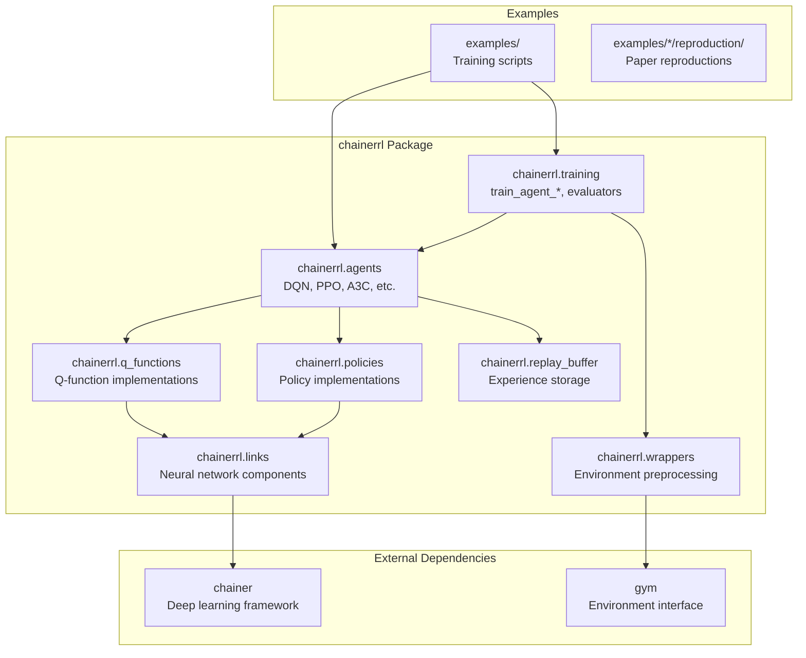
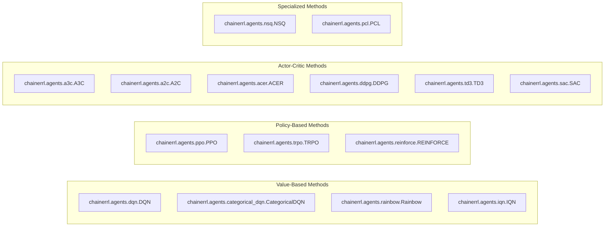
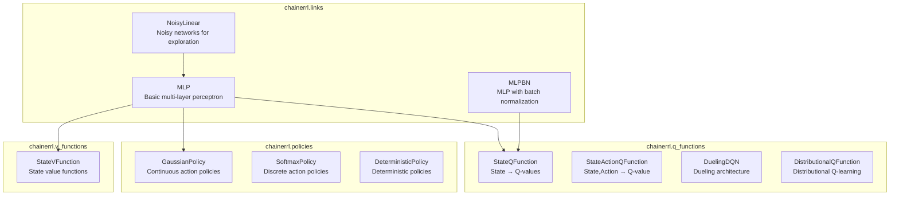
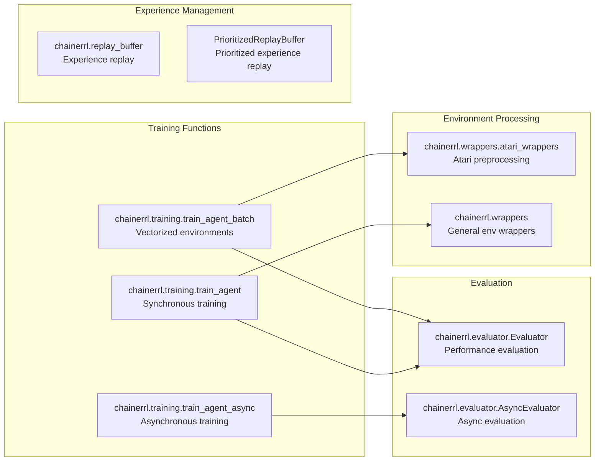
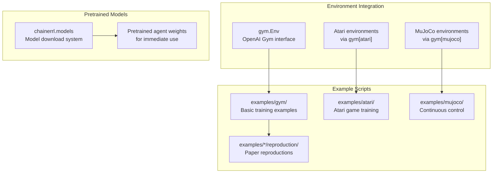

<!-- source: DeepWiki mcp.deepwiki.com · repo chainer/chainerrl · page 1 Overview · fetched 2026-10-30 -->

# Overview

<details>
<summary>Relevant source files</summary>

The following files were used as context for generating this wiki page:

- [README.md](README.md)
- [assets/ChainerRL.png](assets/ChainerRL.png)
- [assets/breakout.gif](assets/breakout.gif)
- [assets/grasping.gif](assets/grasping.gif)
- [assets/humanoid.gif](assets/humanoid.gif)
- [chainerrl/links/mlp_bn.py](chainerrl/links/mlp_bn.py)
- [docs/install.rst](docs/install.rst)

</details>


## Purpose and Scope

ChainerRL is a deep reinforcement learning library that implements various state-of-the-art deep reinforcement learning algorithms in Python using the Chainer deep learning framework. This document provides an architectural overview of the ChainerRL codebase, covering its core components, algorithm implementations, and system organization.

For detailed information about specific RL algorithms, see [Reinforcement Learning Agents](#2). For implementation details of neural network components, see [Core Components](#3). For guidance on training agents and evaluation, see [Training and Evaluation Infrastructure](#4).

## Library Architecture

ChainerRL is organized into several key subsystems that work together to provide a comprehensive deep RL framework:



Sources: [README.md:1-134](), [chainerrl/links/mlp_bn.py:1-83]()

## Algorithm Portfolio

ChainerRL implements a comprehensive set of modern RL algorithms across different paradigms:

### Algorithm Support Matrix

| Algorithm | Discrete Actions | Continuous Actions | Recurrent Models | Batch Training | Async Training |
|-----------|:----------------:|:------------------:|:----------------:|:--------------:|:--------------:|
| `DQN` (including `DoubleDQN`) | ✓ | ✓ (NAF) | ✓ | ✓ | ✗ |
| `CategoricalDQN` | ✓ | ✗ | ✓ | ✓ | ✗ |
| `Rainbow` | ✓ | ✗ | ✓ | ✓ | ✗ |
| `IQN` | ✓ | ✗ | ✓ | ✓ | ✗ |
| `DDPG` | ✗ | ✓ | ✓ | ✓ | ✗ |
| `A3C` | ✓ | ✓ | ✓ | ✓ (A2C) | ✓ |
| `ACER` | ✓ | ✓ | ✓ | ✗ | ✓ |
| `NSQ` | ✓ | ✓ (NAF) | ✓ | ✗ | ✓ |
| `PCL` | ✓ | ✓ | ✓ | ✗ | ✓ |
| `PPO` | ✓ | ✓ | ✓ | ✓ | ✗ |
| `TRPO` | ✓ | ✓ | ✓ | ✓ | ✗ |
| `TD3` | ✗ | ✓ | ✗ | ✓ | ✗ |
| `SAC` | ✗ | ✓ | ✗ | ✓ | ✗ |

Sources: [README.md:40-54]()

### Algorithm Organization by Approach



Sources: [README.md:56-86]()

## Core Neural Network Components

ChainerRL provides reusable neural network building blocks that agents compose for different tasks:



Sources: [chainerrl/links/mlp_bn.py:22-82](), [README.md:88-98]()

## Training Infrastructure

ChainerRL provides multiple training paradigms to accommodate different algorithm requirements:



Sources: [README.md:32-36]()

## Integration and Usage Patterns

ChainerRL integrates with standard RL environments and provides comprehensive examples:



Sources: [README.md:34-36](), [README.md:58-86]()

## Installation and Dependencies

ChainerRL requires Python 3.6+ and depends primarily on the Chainer deep learning framework. Installation is available via PyPI or from source:

```bash
pip install chainerrl
```

Or for development:
```bash
python setup.py install
```

Key dependencies include `chainer`, `numpy`, and `gym` for environment interfaces.

Sources: [README.md:16-30](), [docs/install.rst:1-26]()

---

