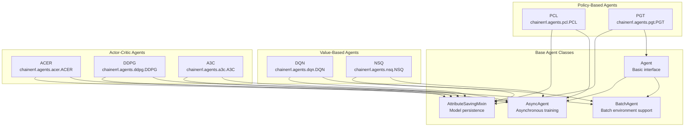
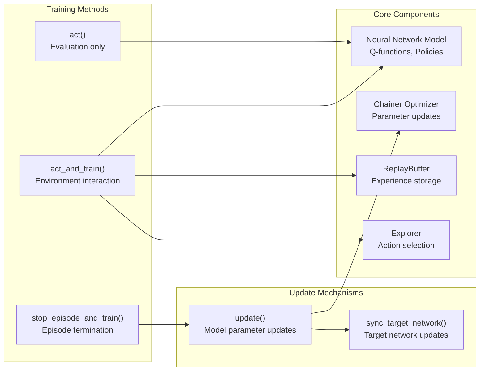
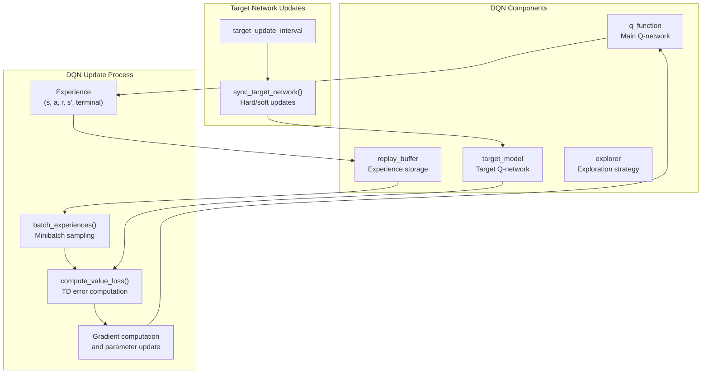
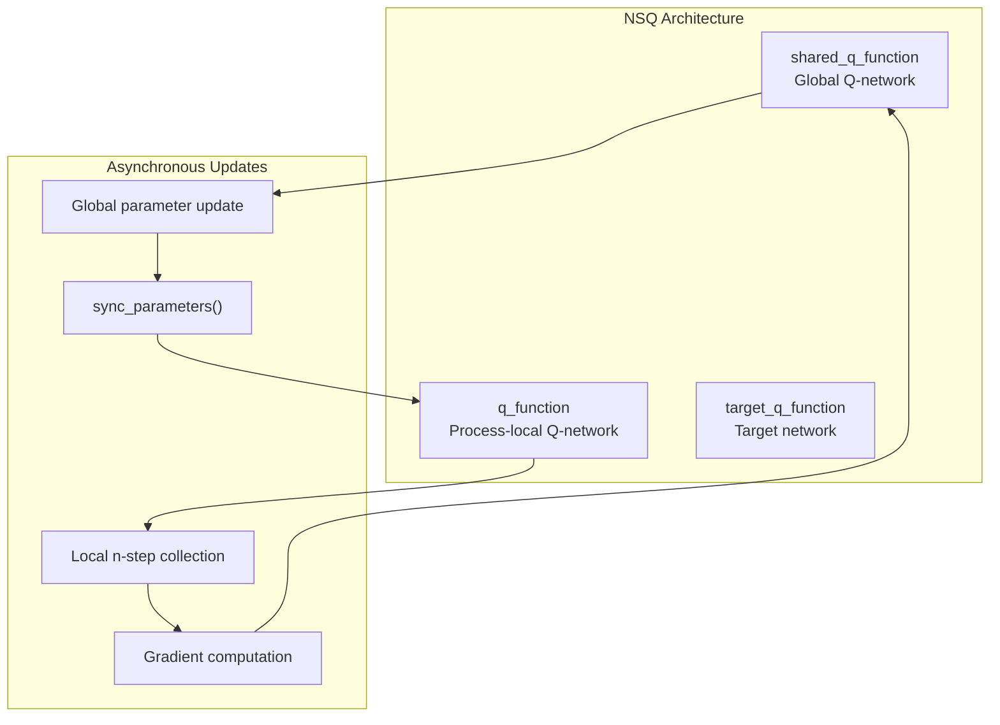
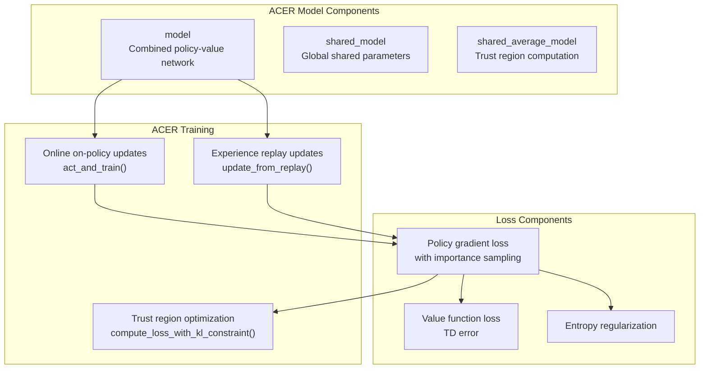
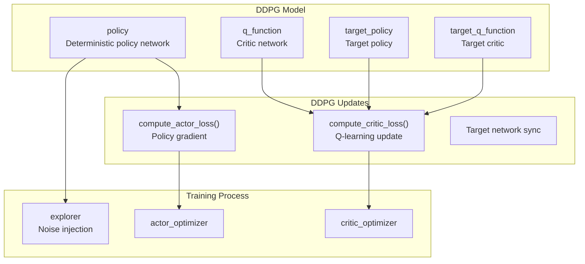
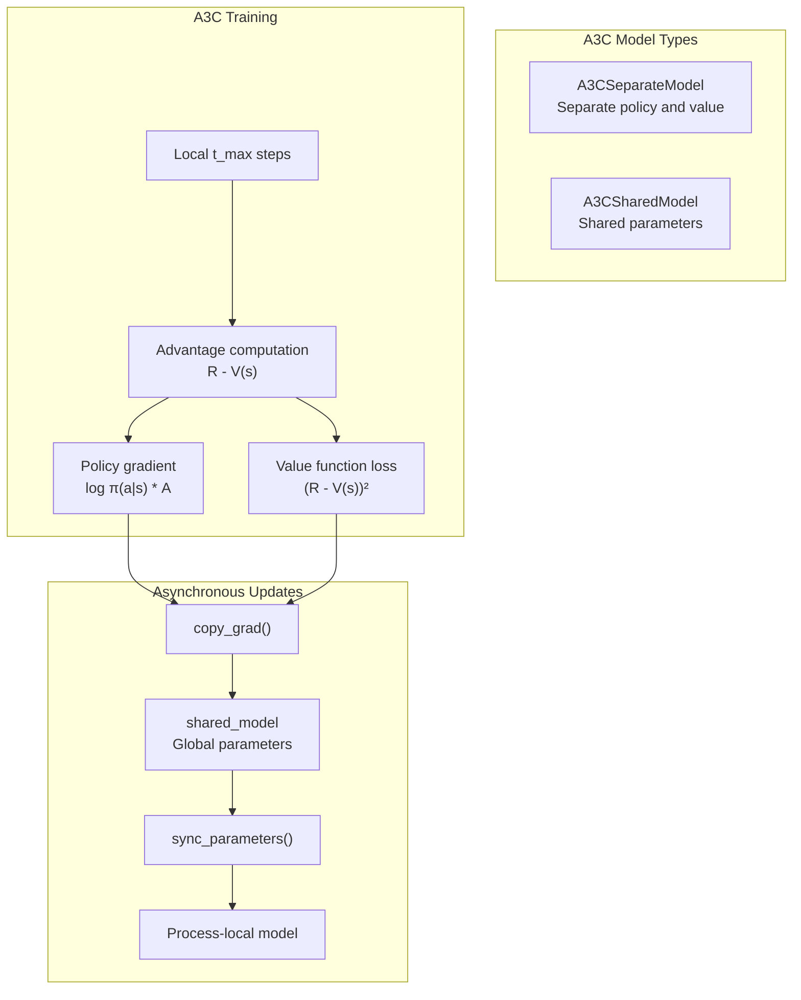
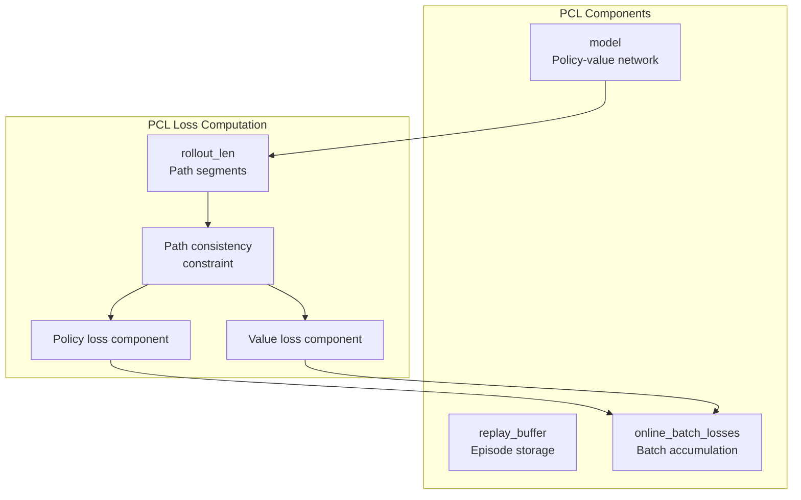
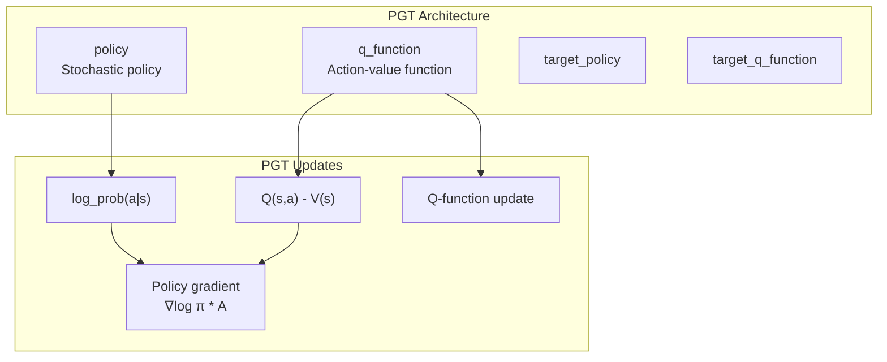

<!-- source: DeepWiki mcp.deepwiki.com · repo chainer/chainerrl · page 2 Reinforcement Learning Agents · fetched 2026-10-30 -->

# Reinforcement Learning Agents

Relevant source files

The following files were used as context for generating this wiki page:

- [chainerrl/agents/a3c.py](chainerrl/agents/a3c.py)
- [chainerrl/agents/acer.py](chainerrl/agents/acer.py)
- [chainerrl/agents/ddpg.py](chainerrl/agents/ddpg.py)
- [chainerrl/agents/dqn.py](chainerrl/agents/dqn.py)
- [chainerrl/agents/nsq.py](chainerrl/agents/nsq.py)
- [chainerrl/agents/pcl.py](chainerrl/agents/pcl.py)
- [chainerrl/agents/pgt.py](chainerrl/agents/pgt.py)
- [chainerrl/misc/prioritized.py](chainerrl/misc/prioritized.py)
- [chainerrl/replay_buffer.py](chainerrl/replay_buffer.py)
- [tests/agents_tests/basetest_dqn_like.py](tests/agents_tests/basetest_dqn_like.py)
- [tests/agents_tests/test_dqn.py](tests/agents_tests/test_dqn.py)
- [tests/misc_tests/test_prioritized.py](tests/misc_tests/test_prioritized.py)
- [tests/test_replay_buffer.py](tests/test_replay_buffer.py)

This document provides an overview of the reinforcement learning agent implementations in ChainerRL, covering the various algorithms, their architectural patterns, and relationships between different agent types. The agents represent the core learning algorithms that interact with environments to solve reinforcement learning problems.

For information about the neural network components used by these agents, see [Core Components](#3). For details about training infrastructure and evaluation systems, see [Training and Evaluation Infrastructure](#4).

## Agent Architecture Overview

ChainerRL implements a diverse collection of RL algorithms organized around common interface patterns. All agents inherit from base classes that define standard methods for acting, training, and episode management.

The agent hierarchy reflects fundamental differences in training paradigms:
- `BatchAgent`: Supports vectorized environments and batch operations
- `AsyncAgent`: Designed for asynchronous multi-process training
- `AttributeSavingMixin`: Provides model saving/loading capabilities

Sources: [chainerrl/agents/dqn.py:98](), [chainerrl/agents/acer.py:223](), [chainerrl/agents/ddpg.py:35](), [chainerrl/agents/a3c.py:72]()

## Agent Training Lifecycle

All agents follow a common training lifecycle that involves environment interaction, experience collection, and model updates:

Sources: [chainerrl/agents/dqn.py:376-428](), [chainerrl/agents/ddpg.py:299-331]()

## Value-Based Agents

Value-based agents learn action-value functions (Q-functions) to make decisions. The DQN agent is the most prominent implementation and serves as the foundation for many variants.

### DQN (Deep Q-Networks)

The `DQN` class implements the Deep Q-Networks algorithm with experience replay and target networks:

Key features of the DQN implementation:
- **Experience Replay**: Uses `ReplayBuffer` for storing and sampling transitions
- **Target Networks**: Maintains separate target network updated periodically
- **Loss Computation**: Supports both Huber loss and MSE with weighted variants
- **Recurrent Support**: Optional recurrent network support for partial observability

Sources: [chainerrl/agents/dqn.py:98-573](), [chainerrl/replay_buffer.py:135-176]()

The DQN agent supports both standard and recurrent variants:

| Configuration | Update Function | Replay Buffer Type | Use Case |
|---------------|-----------------|-------------------|----------|
| Standard DQN | `update()` | `ReplayBuffer` | Fully observable MDPs |
| Recurrent DQN | `update_from_episodes()` | `EpisodicReplayBuffer` | Partially observable MDPs |

Sources: [chainerrl/agents/dqn.py:173-176](), [chainerrl/agents/dqn.py:273-287]()

### NSQ (N-step Q-Learning)

The `NSQ` agent implements asynchronous n-step Q-learning for multi-process training:

Sources: [chainerrl/agents/nsq.py:18-193]()

## Actor-Critic Agents

Actor-critic agents combine policy optimization (actor) with value function learning (critic). These agents can handle both discrete and continuous action spaces.

### ACER (Actor-Critic with Experience Replay)

ACER combines on-policy actor-critic learning with off-policy experience replay:

ACER's key innovations include:
- **Importance Sampling**: Corrects for off-policy bias in experience replay
- **Trust Region**: Uses efficient trust region optimization to stabilize training
- **Truncated Importance Weights**: Prevents exploding importance ratios

Sources: [chainerrl/agents/acer.py:223-710](), [chainerrl/agents/acer.py:184-221]()

### DDPG (Deep Deterministic Policy Gradients)

DDPG extends DQN to continuous action spaces using deterministic policies:

DDPG training alternates between critic and actor updates:
1. **Critic Update**: Standard Q-learning with target networks
2. **Actor Update**: Policy gradient to maximize Q-values
3. **Target Updates**: Soft updates to target networks

Sources: [chainerrl/agents/ddpg.py:35-470](), [chainerrl/agents/ddpg.py:161-212](), [chainerrl/agents/ddpg.py:214-251]()

### A3C (Asynchronous Advantage Actor-Critic)

A3C implements asynchronous actor-critic learning across multiple processes:

Sources: [chainerrl/agents/a3c.py:72-304](), [chainerrl/agents/a3c.py:36-70]()

## Specialized Agents

### PCL (Path Consistency Learning)

PCL implements a novel approach that enforces consistency between different trajectory segments:

Sources: [chainerrl/agents/pcl.py:30-490]()

### PGT (Policy Gradient Theorem)

PGT implements likelihood ratio policy gradients with Q-function baselines:

Sources: [chainerrl/agents/pgt.py:18-284]()

## Agent Configuration Patterns

Most agents follow common configuration patterns for their key components:

| Component | Purpose | Common Types |
|-----------|---------|--------------|
| Model/Q-function | Neural network architecture | `StateQFunction`, `Policy`, `VFunction` |
| Optimizer | Parameter updates | `Adam`, `RMSprop` |
| Replay Buffer | Experience storage | `ReplayBuffer`, `EpisodicReplayBuffer`, `PrioritizedReplayBuffer` |
| Explorer | Action selection strategy | `EpsilonGreedy`, `AdditiveGaussian` |
| Target Update | Stabilization mechanism | Hard updates, soft updates with τ |

Sources: [chainerrl/agents/dqn.py:135-149](), [chainerrl/agents/ddpg.py:80-95](), [chainerrl/replay_buffer.py:230-281]()

---

