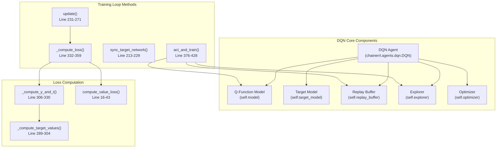
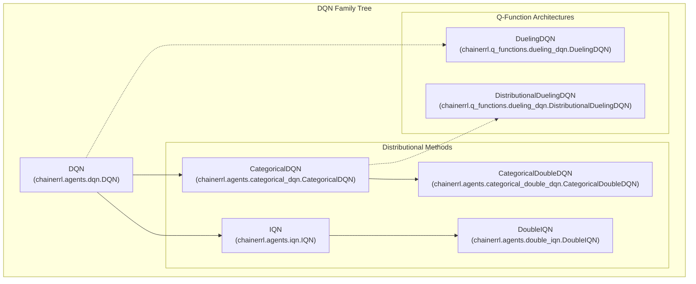
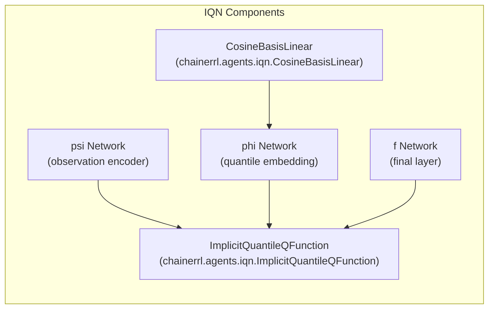
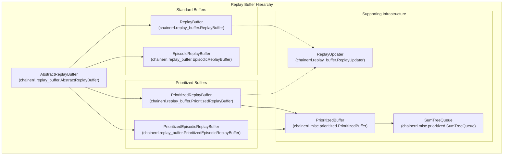
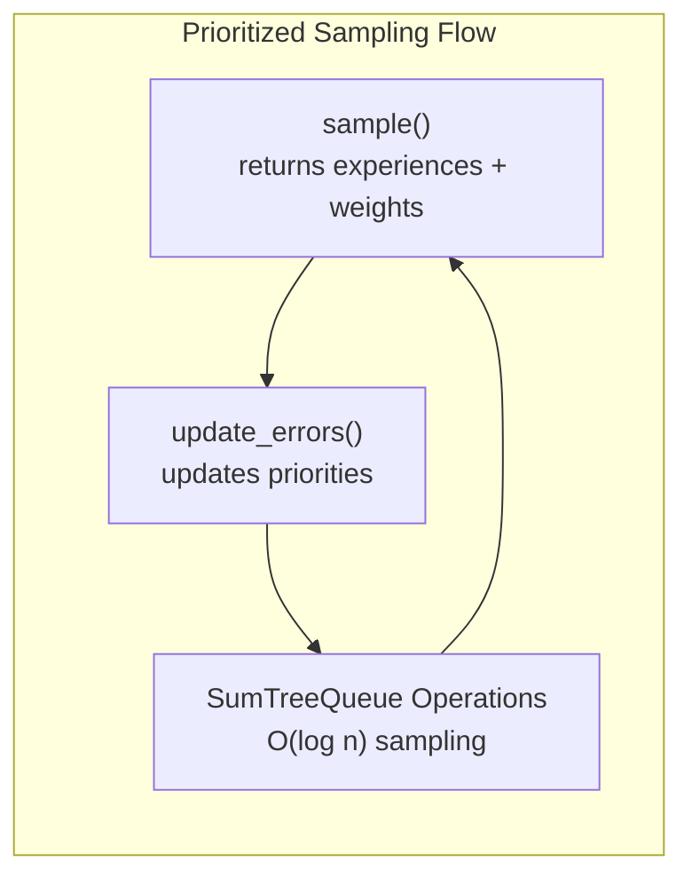
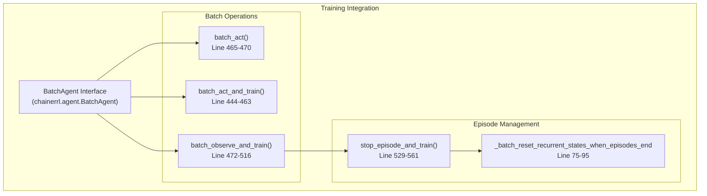

<!-- source: DeepWiki mcp.deepwiki.com · repo chainer/chainerrl · page 2.1 DQN and Value-Based Methods · fetched 2026-10-30 -->

# DQN and Value-Based Methods

Relevant source files

The following files were used as context for generating this wiki page:

- [chainerrl/agents/categorical_double_dqn.py](chainerrl/agents/categorical_double_dqn.py)
- [chainerrl/agents/categorical_dqn.py](chainerrl/agents/categorical_dqn.py)
- [chainerrl/agents/double_iqn.py](chainerrl/agents/double_iqn.py)
- [chainerrl/agents/dqn.py](chainerrl/agents/dqn.py)
- [chainerrl/agents/iqn.py](chainerrl/agents/iqn.py)
- [chainerrl/misc/prioritized.py](chainerrl/misc/prioritized.py)
- [chainerrl/q_functions/dueling_dqn.py](chainerrl/q_functions/dueling_dqn.py)
- [chainerrl/replay_buffer.py](chainerrl/replay_buffer.py)
- [chainerrl/wrappers/vector_frame_stack.py](chainerrl/wrappers/vector_frame_stack.py)
- [examples/atari/train_double_iqn.py](examples/atari/train_double_iqn.py)
- [examples/gym/train_iqn_gym.py](examples/gym/train_iqn_gym.py)
- [examples_tests/atari/test_double_iqn.sh](examples_tests/atari/test_double_iqn.sh)
- [tests/agents_tests/basetest_dqn_like.py](tests/agents_tests/basetest_dqn_like.py)
- [tests/agents_tests/test_categorical_dqn.py](tests/agents_tests/test_categorical_dqn.py)
- [tests/agents_tests/test_double_categorical_dqn.py](tests/agents_tests/test_double_categorical_dqn.py)
- [tests/agents_tests/test_dqn.py](tests/agents_tests/test_dqn.py)
- [tests/agents_tests/test_iqn.py](tests/agents_tests/test_iqn.py)
- [tests/misc_tests/test_prioritized.py](tests/misc_tests/test_prioritized.py)
- [tests/test_replay_buffer.py](tests/test_replay_buffer.py)

This document covers the Deep Q-Network (DQN) and related value-based reinforcement learning algorithms implemented in ChainerRL. It includes the core DQN implementation, distributional variants (Categorical DQN, IQN), architectural improvements (Dueling DQN, Double DQN), and supporting infrastructure like replay buffers and prioritized experience replay.

For policy-based methods like PPO and TRPO, see [Policy Gradient Methods](#2.2). For actor-critic methods that combine value estimation with policy optimization, see [Actor-Critic Methods](#2.3).

## Core DQN Architecture

The foundational DQN implementation provides the template for all value-based methods in ChainerRL. The `DQN` class orchestrates training through experience replay, target network updates, and exploration strategies.

**Sources:** [chainerrl/agents/dqn.py:98-573]()

The DQN agent maintains two neural networks: a primary model for action selection and learning, and a target model for stable target computation. The `ReplayUpdater` coordinates when updates occur based on configuration parameters.

| Component | Purpose | Key Configuration |
|-----------|---------|------------------|
| `model` | Primary Q-function for learning | Updated every step via gradient descent |
| `target_model` | Stable target computation | Updated every `target_update_interval` steps |
| `replay_buffer` | Experience storage | Capacity and sampling strategy |
| `explorer` | Action selection strategy | Epsilon-greedy, Boltzmann, etc. |

**Sources:** [chainerrl/agents/dqn.py:150-199]()

## Value-Based Method Variants

ChainerRL implements several important extensions to the basic DQN algorithm, each addressing specific limitations or adding capabilities.

**Sources:** [chainerrl/agents/categorical_dqn.py:112-120](), [chainerrl/agents/iqn.py:268-288](), [chainerrl/agents/double_iqn.py:7-15]()

### Categorical DQN

Categorical DQN represents the value distribution rather than just the expected value, providing richer information about return uncertainty.

The core innovation is replacing scalar Q-values with categorical distributions over a fixed support:

**Sources:** [chainerrl/agents/categorical_dqn.py:121-200]()

### Implicit Quantile Networks (IQN)

IQN extends distributional RL by learning the full quantile function rather than a fixed categorical distribution. It uses cosine basis functions to embed quantile thresholds.

**Sources:** [chainerrl/agents/iqn.py:84-126](), [chainerrl/agents/iqn.py:30-60]()

## Replay Buffer System

The replay buffer system provides experience storage and sampling for off-policy learning. ChainerRL supports multiple replay buffer types with different sampling strategies.

**Sources:** [chainerrl/replay_buffer.py:11-281](), [chainerrl/misc/prioritized.py:8-293]()

### Experience Batching

The replay buffer system provides utilities for batching experiences for training:

| Function | Purpose | Input | Output |
|----------|---------|-------|--------|
| `batch_experiences` | Batch transition sequences | List of experience sequences | Batched arrays |
| `batch_recurrent_experiences` | Batch for recurrent models | List of episodes | Sequences with recurrent states |

**Sources:** [chainerrl/replay_buffer.py:135-177](), [chainerrl/replay_buffer.py:179-228]()

### Prioritized Experience Replay

Prioritized replay samples experiences based on their temporal difference (TD) error, focusing learning on surprising transitions.

**Sources:** [chainerrl/misc/prioritized.py:70-107]()

## Q-Function Architectures

ChainerRL provides several Q-function architectures optimized for different types of value-based learning.

### Dueling Networks

Dueling networks separate the value function into state value and advantage components, improving learning efficiency.

**Sources:** [chainerrl/q_functions/dueling_dqn.py:12-54]()

### Distributional Q-Functions

For distributional methods, specialized Q-functions output probability distributions rather than scalar values.

**Sources:** [chainerrl/q_functions/dueling_dqn.py:56-113]()

## Training Infrastructure Integration

The DQN family integrates with ChainerRL's broader training infrastructure through standardized interfaces.

**Sources:** [chainerrl/agents/dqn.py:444-527](), [chainerrl/agents/dqn.py:75-95]()

The `ReplayUpdater` coordinates the training schedule, determining when to perform model updates based on buffer size, update intervals, and other configuration parameters.

| Parameter | Purpose | Default Value |
|-----------|---------|--------------|
| `replay_start_size` | Minimum buffer size before training | 50,000 |
| `update_interval` | Steps between model updates | 1 |
| `target_update_interval` | Steps between target network updates | 10,000 |
| `minibatch_size` | Batch size for training | 32 |

**Sources:** [chainerrl/replay_buffer.py:230-281]()

---

