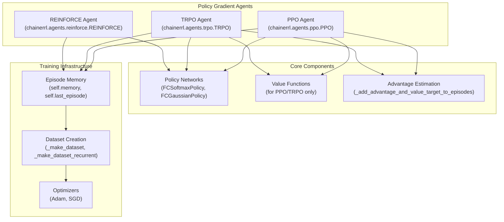
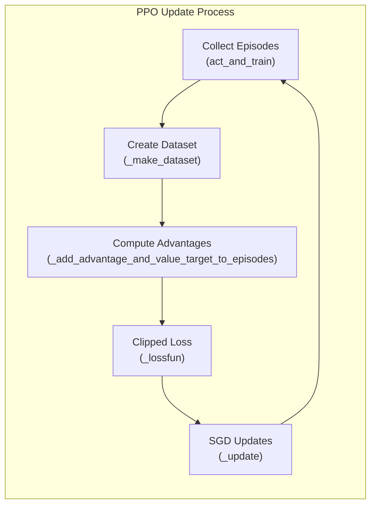
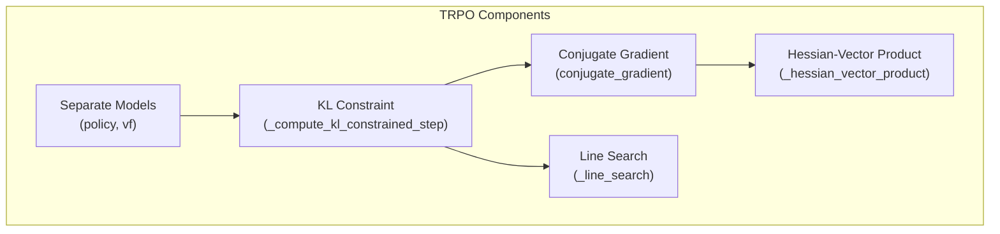
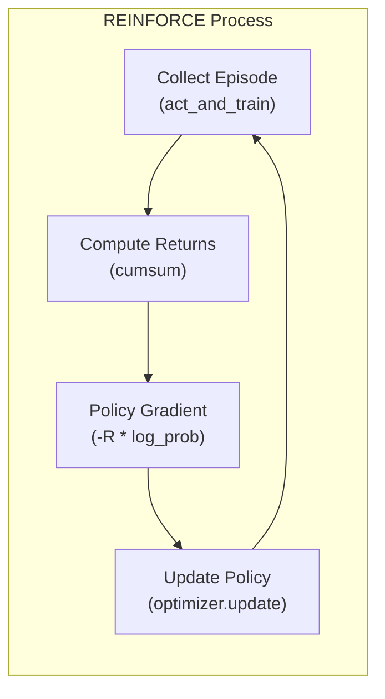
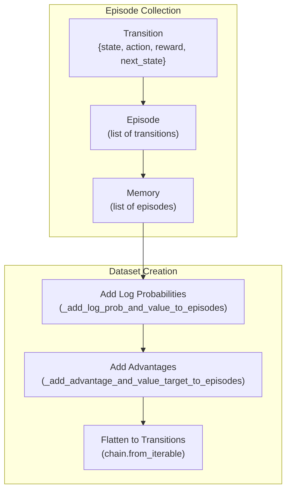

<!-- source: DeepWiki mcp.deepwiki.com · repo chainer/chainerrl · page 2.2 Policy Gradient Methods · fetched 2026-10-30 -->

# Policy Gradient Methods

<details>
<summary>Relevant source files</summary>

The following files were used as context for generating this wiki page:

- [chainerrl/agents/ppo.py](chainerrl/agents/ppo.py)
- [chainerrl/agents/reinforce.py](chainerrl/agents/reinforce.py)
- [chainerrl/agents/trpo.py](chainerrl/agents/trpo.py)
- [examples/quickstart/quickstart.ipynb](examples/quickstart/quickstart.ipynb)
- [tests/agents_tests/basetest_training.py](tests/agents_tests/basetest_training.py)
- [tests/agents_tests/test_ppo.py](tests/agents_tests/test_ppo.py)
- [tests/agents_tests/test_reinforce.py](tests/agents_tests/test_reinforce.py)
- [tests/agents_tests/test_trpo.py](tests/agents_tests/test_trpo.py)

</details>


## Purpose and Scope

This document covers the policy gradient algorithms implemented in ChainerRL, which optimize policies directly through gradient ascent on expected rewards. Policy gradient methods learn a parameterized policy that maps observations to action probabilities, rather than learning value functions like in value-based methods.

For value-based methods like DQN, see [DQN and Value-Based Methods](#2.1). For algorithms that combine policy gradients with value estimation, see [Actor-Critic Methods](#2.3).

The policy gradient algorithms covered here include:
- **PPO (Proximal Policy Optimization)** - clips policy updates to prevent large changes
- **TRPO (Trust Region Policy Optimization)** - constrains policy updates using KL divergence
- **REINFORCE** - basic policy gradient using Monte Carlo returns

## Algorithm Overview

| Algorithm | File | Key Features | Policy Update Method |
|-----------|------|--------------|---------------------|
| PPO | [chainerrl/agents/ppo.py]() | Clipped surrogate objective, GAE | Minibatch SGD with clipping |
| TRPO | [chainerrl/agents/trpo.py]() | KL divergence constraint, natural gradients | Conjugate gradient + line search |
| REINFORCE | [chainerrl/agents/reinforce.py]() | Monte Carlo returns, episodic | Direct policy gradient |

## Policy Gradient Architecture



Sources: [chainerrl/agents/ppo.py:233-817](), [chainerrl/agents/trpo.py:89-859](), [chainerrl/agents/reinforce.py:13-180]()

## PPO (Proximal Policy Optimization)

PPO implements the clipped surrogate objective to prevent destructively large policy updates while maintaining sample efficiency.

### Core Algorithm Components



### Key Implementation Details

The PPO agent uses a combined model that outputs both policy distributions and value estimates:

- **Model Structure**: [chainerrl/agents/ppo.py:239-240]() - Takes states and returns `(policy_distribution, value)`
- **Clipped Objective**: [chainerrl/agents/ppo.py:564-568]() - Implements clipped probability ratio
- **Value Function Loss**: [chainerrl/agents/ppo.py:570-579]() - Optional clipping for value updates
- **Advantage Estimation**: [chainerrl/agents/ppo.py:27-45]() - Generalized Advantage Estimation (GAE)

The loss function combines three components:
```python
loss = loss_policy + value_func_coef * loss_value_func + entropy_coef * loss_entropy
```

### Configuration Parameters

| Parameter | Purpose | Default |
|-----------|---------|---------|
| `clip_eps` | Policy ratio clipping threshold | 0.2 |
| `lambd` | GAE lambda parameter | 0.95 |
| `update_interval` | Steps between updates | 2048 |
| `epochs` | Training epochs per update | 10 |
| `minibatch_size` | Minibatch size for SGD | 64 |

Sources: [chainerrl/agents/ppo.py:291-314](), [chainerrl/agents/ppo.py:559-591]()

## TRPO (Trust Region Policy Optimization)

TRPO constrains policy updates using KL divergence to ensure stable learning through natural policy gradients.

### Algorithm Structure



### Implementation Details

TRPO requires separate policy and value function models and uses advanced optimization techniques:

- **Separate Models**: [chainerrl/agents/trpo.py:187-199]() - Policy and value function are separate
- **Fisher Information**: [chainerrl/agents/trpo.py:529-531]() - Hessian-vector product for natural gradients  
- **Line Search**: [chainerrl/agents/trpo.py:555-650]() - Backtracking to satisfy KL constraint
- **Second-order Requirements**: [chainerrl/agents/trpo.py:100-102]() - Requires functions supporting double backprop

### Key Functions

| Function | Purpose | Location |
|----------|---------|----------|
| `_compute_kl_constrained_step` | Natural gradient step with KL constraint | [chainerrl/agents/trpo.py:507-553]() |
| `_hessian_vector_product` | Efficient Hessian-vector computation | [chainerrl/agents/trpo.py:60-66]() |
| `_line_search` | Backtracking line search | [chainerrl/agents/trpo.py:555-650]() |

Sources: [chainerrl/agents/trpo.py:89-859](), [chainerrl/agents/trpo.py:19-66]()

## REINFORCE

REINFORCE implements the basic policy gradient algorithm using Monte Carlo estimates of returns.

### Algorithm Flow



### Implementation Features

- **Episodic Only**: [chainerrl/agents/reinforce.py:107-111]() - Only supports episodic environments
- **Batch Training**: [chainerrl/agents/reinforce.py:41]() - Configurable batch size for updates
- **Monte Carlo Returns**: [chainerrl/agents/reinforce.py:143]() - Uses cumulative sum of future rewards
- **Entropy Regularization**: [chainerrl/agents/reinforce.py:39]() - Optional entropy bonus

### Key Methods

| Method | Purpose | Location |
|--------|---------|----------|
| `act_and_train` | Action selection and data collection | [chainerrl/agents/reinforce.py:69-93]() |
| `stop_episode_and_train` | Episode termination and training | [chainerrl/agents/reinforce.py:105-131]() |
| `accumulate_grad` | Gradient computation | [chainerrl/agents/reinforce.py:133-156]() |

Sources: [chainerrl/agents/reinforce.py:13-180]()

## Training Infrastructure

### Episode Memory Management

All policy gradient agents collect complete episodes before training:



### Shared Utilities

Policy gradient agents share several utility functions:

- **Advantage Computation**: [chainerrl/agents/ppo.py:27-45]() - GAE implementation used by PPO and TRPO
- **Dataset Creation**: [chainerrl/agents/ppo.py:214-230]() - Converts episodes to training data
- **Recurrent Support**: [chainerrl/agents/ppo.py:48-100]() - Handles recurrent model states
- **Explained Variance**: [chainerrl/agents/ppo.py:174-186]() - Training diagnostic

### Update Patterns

| Agent | Update Frequency | Batch Processing |
|-------|------------------|------------------|
| PPO | Every `update_interval` steps | Multiple epochs over minibatches |
| TRPO | Every `update_interval` steps | Single full-batch update |
| REINFORCE | Every `batchsize` episodes | Single batch update |

Sources: [chainerrl/agents/ppo.py:375-409](), [chainerrl/agents/trpo.py:256-290](), [chainerrl/agents/reinforce.py:158-171]()

## Usage Examples

### Basic PPO Training

The tests demonstrate typical usage patterns:

```python
# Model combines policy and value function
model = A3CSeparateModel(
    pi=chainerrl.policies.FCSoftmaxPolicy(obs_size, n_actions),
    v=L.Linear(obs_size, 1),
)

# PPO agent with standard hyperparameters  
agent = PPO(
    model, optimizer, gamma=0.8, lambd=0.95,
    update_interval=64, minibatch_size=16, epochs=3,
    clip_eps=0.2, standardize_advantages=True
)
```

### TRPO with Separate Models

```python
# Separate policy and value function
policy = policies.FCSoftmaxPolicy(obs_size, n_actions)
vf = L.Linear(obs_size, 1)

agent = TRPO(
    policy=policy, vf=vf, vf_optimizer=vf_opt,
    gamma=0.5, lambd=0.95, max_kl=0.01,
    update_interval=64, standardize_advantages=True
)
```

Sources: [tests/agents_tests/test_ppo.py:422-440](), [tests/agents_tests/test_trpo.py:319-353](), [tests/agents_tests/test_reinforce.py:48-124]()

---

