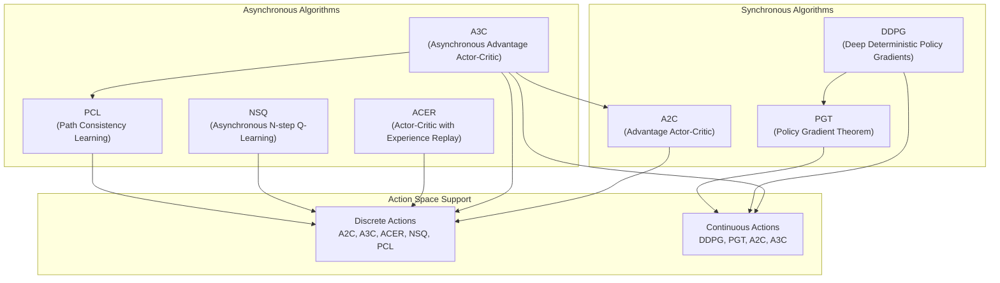
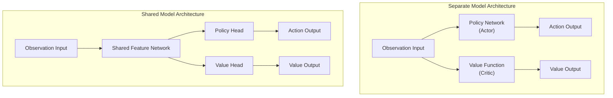
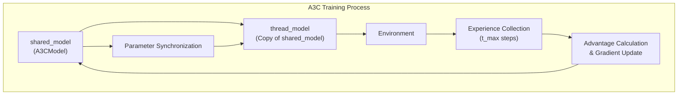
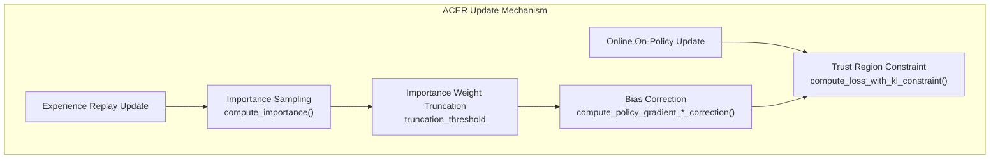
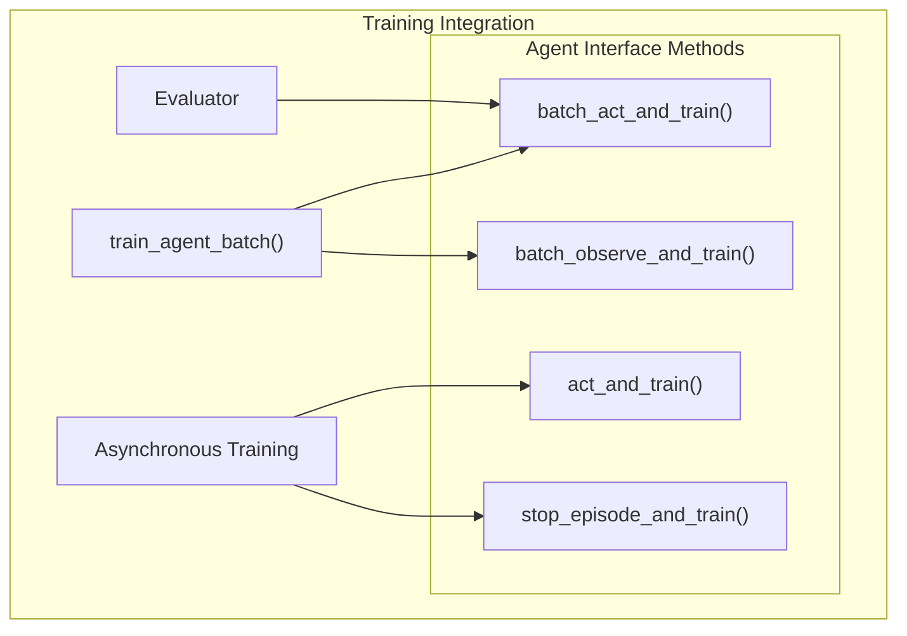

<!-- source: DeepWiki mcp.deepwiki.com · repo chainer/chainerrl · page 2.3 Actor-Critic Methods · fetched 2026-10-30 -->

# Actor-Critic Methods

Relevant source files

The following files were used as context for generating this wiki page:

- [chainerrl/agents/a2c.py](chainerrl/agents/a2c.py)
- [chainerrl/agents/a3c.py](chainerrl/agents/a3c.py)
- [chainerrl/agents/acer.py](chainerrl/agents/acer.py)
- [chainerrl/agents/ddpg.py](chainerrl/agents/ddpg.py)
- [chainerrl/agents/nsq.py](chainerrl/agents/nsq.py)
- [chainerrl/agents/pcl.py](chainerrl/agents/pcl.py)
- [chainerrl/agents/pgt.py](chainerrl/agents/pgt.py)
- [chainerrl/experiments/train_agent_batch.py](chainerrl/experiments/train_agent_batch.py)
- [examples/gym/train_a2c_gym.py](examples/gym/train_a2c_gym.py)
- [tests/agents_tests/test_a2c.py](tests/agents_tests/test_a2c.py)

This document covers the actor-critic reinforcement learning algorithms implemented in ChainerRL. Actor-critic methods combine policy-based and value-based approaches by maintaining both a policy (actor) that selects actions and a value function (critic) that evaluates states or state-action pairs.

For value-based methods like DQN, see [DQN and Value-Based Methods](#2.1). For pure policy gradient methods, see [Policy Gradient Methods](#2.2).

## Overview

ChainerRL implements several actor-critic algorithms that differ in their training paradigms, model architectures, and update mechanisms. These algorithms share common architectural patterns but employ different strategies for learning and exploration.

**Actor-Critic Algorithm Classification**

Sources: [chainerrl/agents/a2c.py:1-301](), [chainerrl/agents/a3c.py:1-304](), [chainerrl/agents/acer.py:1-710](), [chainerrl/agents/ddpg.py:1-470](), [chainerrl/agents/pcl.py:1-490](), [chainerrl/agents/pgt.py:1-284](), [chainerrl/agents/nsq.py:1-193]()

## Model Architecture Patterns

Actor-critic algorithms in ChainerRL follow two main architectural patterns: separate models where the policy and value function have independent parameters, and shared models where they share a common feature extraction backbone.

**Model Architecture Patterns for Actor-Critic Methods**

| Algorithm | Separate Model Class | Shared Model Class |
|-----------|---------------------|-------------------|
| A3C | `A3CSeparateModel` | `A3CSharedModel` |
| A2C | `A2CSeparateModel` | Not implemented |
| ACER | `ACERSeparateModel` | `ACERSharedModel` |
| DDPG | `DDPGModel` | N/A (inherently shared) |
| PCL | `PCLSeparateModel` | `PCLSharedModel` |

Sources: [chainerrl/agents/a3c.py:36-70](), [chainerrl/agents/a2c.py:31-46](), [chainerrl/agents/acer.py:112-182](), [chainerrl/agents/ddpg.py:29-34](), [chainerrl/agents/pcl.py:26-27]()

## Core Actor-Critic Components

### A3C: Asynchronous Advantage Actor-Critic

A3C serves as the foundation for many other actor-critic implementations in ChainerRL. It uses multiple asynchronous processes to collect experience and update a shared model.

**A3C Training Flow**

The `A3C` class implements the core actor-critic logic with the following key methods:

- `act_and_train()`: Collects experience and triggers updates every `t_max` steps
- `update()`: Computes advantages and performs gradient updates
- `sync_parameters()`: Synchronizes thread-local model with shared model

Sources: [chainerrl/agents/a3c.py:72-304](), [chainerrl/agents/a3c.py:156-239](), [chainerrl/agents/a3c.py:240-268]()

### A2C: Advantage Actor-Critic

A2C is the synchronous, batch version of A3C that processes multiple environments simultaneously.

The `A2C` class supports:
- Batch training with `batch_act_and_train()` and `batch_observe_and_train()`
- Generalized Advantage Estimation (GAE) when `use_gae=True`
- GPU acceleration for faster training

Key differences from A3C:
- Uses vectorized environments instead of asynchronous processes
- Accumulates gradients over multiple environments before updating
- Does not support single-environment training

Sources: [chainerrl/agents/a2c.py:48-301](), [chainerrl/agents/a2c.py:158-173](), [chainerrl/agents/a2c.py:219-244]()

### ACER: Actor-Critic with Experience Replay

ACER extends actor-critic methods to support off-policy learning through experience replay and importance sampling.

**ACER Off-Policy Learning Components**

ACER implements several advanced techniques:

- **Importance Sampling**: `compute_importance()` calculates ratios between current and behavior policies
- **Bias Correction**: `compute_policy_gradient_full_correction()` and `compute_policy_gradient_sample_correction()` handle truncated importance weights
- **Trust Region**: `compute_loss_with_kl_constraint()` maintains a KL constraint for stable updates

Sources: [chainerrl/agents/acer.py:20-221](), [chainerrl/agents/acer.py:223-710](), [chainerrl/agents/acer.py:32-109]()

### DDPG: Deep Deterministic Policy Gradients

DDPG applies actor-critic methods to continuous action spaces using deterministic policies and target networks.

The `DDPG` class architecture includes:
- **Actor**: Deterministic policy network (`policy`)
- **Critic**: Q-function network (`q_function`)
- **Target Networks**: Slowly updated copies for stable learning (`target_policy`, `target_q_function`)
- **Replay Buffer**: Off-policy experience storage

Key update methods:
- `compute_actor_loss()`: Maximizes Q-values for policy-generated actions
- `compute_critic_loss()`: Minimizes TD error for Q-function
- `sync_target_network()`: Updates target networks using soft or hard updates

Sources: [chainerrl/agents/ddpg.py:35-470](), [chainerrl/agents/ddpg.py:214-251](), [chainerrl/agents/ddpg.py:161-212]()

## Training Infrastructure Integration

Actor-critic methods integrate with ChainerRL's training infrastructure through standardized interfaces:

**Training Infrastructure Integration**

| Agent Type | Batch Support | Async Support | Training Function |
|------------|---------------|---------------|-------------------|
| A2C | ✓ | ✗ | `train_agent_batch()` |
| A3C | ✗ | ✓ | `train_agent_async()` |
| ACER | ✗ | ✓ | `train_agent_async()` |
| DDPG | ✓ | ✗ | `train_agent_batch()` |

Sources: [chainerrl/experiments/train_agent_batch.py:12-135](), [chainerrl/agents/a2c.py:219-276](), [chainerrl/agents/ddpg.py:373-436]()

## Algorithm-Specific Features

### Experience Replay Support

Different algorithms handle experience replay in various ways:

- **ACER**: Sophisticated off-policy replay with importance sampling and bias correction
- **DDPG**: Standard replay buffer with random sampling
- **PCL**: Optional replay buffer for batch updates
- **A3C/A2C**: No replay (on-policy only)

### Recurrent Network Support

All actor-critic algorithms support recurrent neural networks through the `RecurrentChainMixin`:

- State management with `state_kept()` and `state_reset()`
- Automatic state updates during episode boundaries
- Proper gradient flow through time steps

Sources: [chainerrl/agents/acer.py:513-567](), [chainerrl/agents/ddpg.py:260-298](), [chainerrl/recurrent.py]()

### Exploration Strategies

Actor-critic methods handle exploration differently:

- **Stochastic Policies** (A3C, A2C, ACER): Natural exploration through policy sampling
- **Deterministic Policies** (DDPG): Requires external `Explorer` for action noise
- **Entropy Regularization**: Available in most algorithms via `beta` parameter

Sources: [chainerrl/agents/ddpg.py:106-107](), [chainerrl/agents/a3c.py:184-185](), [chainerrl/agents/acer.py:388-390]()

---

