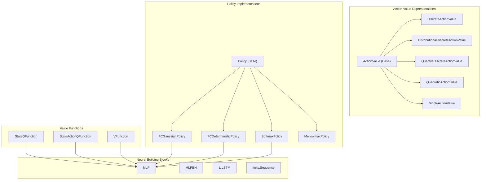
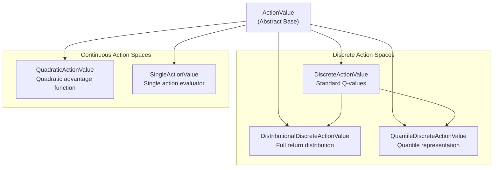
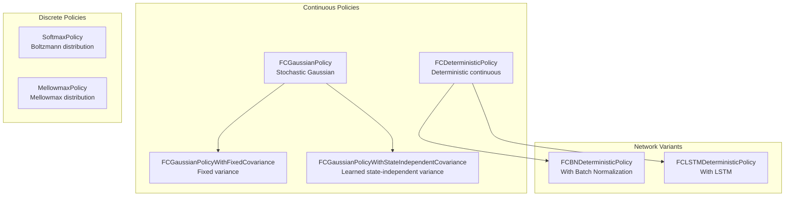
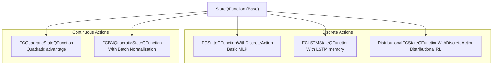

<!-- source: DeepWiki mcp.deepwiki.com · repo chainer/chainerrl · page 3 Core Components · fetched 2026-10-30 -->

# Core Components

<details>
<summary>Relevant source files</summary>

The following files were used as context for generating this wiki page:

- [chainerrl/action_value.py](chainerrl/action_value.py)
- [chainerrl/links/mlp.py](chainerrl/links/mlp.py)
- [chainerrl/policies/deterministic_policy.py](chainerrl/policies/deterministic_policy.py)
- [chainerrl/policies/gaussian_policy.py](chainerrl/policies/gaussian_policy.py)
- [chainerrl/policies/mellowmax_policy.py](chainerrl/policies/mellowmax_policy.py)
- [chainerrl/policies/softmax_policy.py](chainerrl/policies/softmax_policy.py)
- [chainerrl/q_functions/state_action_q_functions.py](chainerrl/q_functions/state_action_q_functions.py)
- [chainerrl/q_functions/state_q_functions.py](chainerrl/q_functions/state_q_functions.py)
- [chainerrl/v_functions/v_functions.py](chainerrl/v_functions/v_functions.py)
- [tests/policies_tests/test_deterministic_policy.py](tests/policies_tests/test_deterministic_policy.py)

</details>


This document covers the fundamental building blocks used across different reinforcement learning algorithms in ChainerRL. These components provide the neural network architectures and data structures that RL agents use to represent value functions, policies, and action values.

For information about specific RL algorithms that use these components, see [Reinforcement Learning Agents](#2). For training infrastructure that orchestrates these components, see [Training and Evaluation Infrastructure](#4).

## Architecture Overview

ChainerRL's core components form a modular architecture where different RL algorithms can mix and match components based on their needs. The system is organized around three main abstractions: action values, policies, and value functions.



**Sources:** [chainerrl/action_value.py:13-42](), [chainerrl/policies/gaussian_policy.py:18-106](), [chainerrl/policies/deterministic_policy.py:19-48](), [chainerrl/policies/softmax_policy.py:14-32](), [chainerrl/q_functions/state_q_functions.py:27-41](), [chainerrl/q_functions/state_action_q_functions.py:12-26](), [chainerrl/v_functions/v_functions.py:9-23]()

## Action Value Representations

Action values represent Q-functions and provide standardized interfaces for action selection and value evaluation. All action value classes inherit from the abstract `ActionValue` base class.



**Sources:** [chainerrl/action_value.py:13-365]()

### Core ActionValue Interface

The `ActionValue` base class defines four essential methods that all implementations must provide:

| Method | Purpose | Return Type |
|--------|---------|-------------|
| `greedy_actions` | Get argmax_a Q(s,a) | `chainer.Variable` |
| `max` | Evaluate max Q(s,a) | `chainer.Variable` |
| `evaluate_actions(actions)` | Evaluate Q(s,a) for given actions | `chainer.Variable` |
| `params` | Get learnable parameters | `tuple` |

**Sources:** [chainerrl/action_value.py:19-41]()

### Discrete Action Values

`DiscreteActionValue` handles Q-functions for discrete action spaces. It takes Q-values with shape `(batch_size, n_actions)` and provides efficient action selection and evaluation.

```python
# Example: Creating discrete action values from Q-function output
q_values = model(state)  # Shape: (batch_size, n_actions)
action_value = DiscreteActionValue(q_values)
greedy_action = action_value.greedy_actions  # argmax actions
max_q = action_value.max  # max Q-values
```

**Sources:** [chainerrl/action_value.py:44-94]()

### Distributional Action Values

`DistributionalDiscreteActionValue` represents the full return distribution for each action, supporting distributional RL algorithms like C51. It takes probability distributions over return atoms with shape `(batch_size, n_actions, n_atoms)`.

**Sources:** [chainerrl/action_value.py:96-182]()

### Continuous Action Values

`QuadraticActionValue` implements a quadratic advantage function for continuous control, as used in NAF (Normalized Advantage Functions). It represents Q(s,a) = V(s) + A(s,a) where A(s,a) has a quadratic form.

**Sources:** [chainerrl/action_value.py:237-322]()

## Policy Implementations

Policies define how agents select actions given states. ChainerRL provides several policy types for different action spaces and exploration strategies.



**Sources:** [chainerrl/policies/gaussian_policy.py:18-294](), [chainerrl/policies/deterministic_policy.py:19-218](), [chainerrl/policies/softmax_policy.py:14-56](), [chainerrl/policies/mellowmax_policy.py:12-30]()

### Gaussian Policies

`FCGaussianPolicy` implements stochastic policies for continuous action spaces using Gaussian distributions. The policy outputs both mean and variance, with options for action bounding and different variance parameterizations.

Key parameters:
- `var_type`: `'spherical'` (single variance) or `'diagonal'` (per-dimension variance)
- `bound_mean`: Whether to bound actions using tanh
- `min_var`: Minimum variance to ensure numerical stability

**Sources:** [chainerrl/policies/gaussian_policy.py:18-106]()

### Deterministic Policies

`FCDeterministicPolicy` implements deterministic policies for continuous control. Actions can optionally be bounded to `[min_action, max_action]` using tanh activation.

**Sources:** [chainerrl/policies/deterministic_policy.py:50-98]()

## Q-Function and Value Function Implementations

Q-functions and value functions provide the neural network architectures for value estimation. ChainerRL distinguishes between state Q-functions Q(s) that output action values for all actions, and state-action Q-functions Q(s,a) that evaluate specific state-action pairs.

### State Q-Functions

State Q-functions take states as input and output action values. They are used in value-based methods like DQN.



**Sources:** [chainerrl/q_functions/state_q_functions.py:27-276]()

### State-Action Q-Functions

State-action Q-functions take both states and actions as input, commonly used in actor-critic methods like DDPG.

**Implementation Variants:**

| Class | Architecture | Use Case |
|-------|-------------|-----------|
| `FCSAQFunction` | Basic concatenation of state and action | Standard DDPG |
| `FCBNSAQFunction` | With batch normalization | Improved training stability |
| `FCBNLateActionSAQFunction` | Late action injection | DDPG paper architecture |
| `FCLSTMSAQFunction` | With LSTM | Partially observable environments |

**Sources:** [chainerrl/q_functions/state_action_q_functions.py:29-243]()

### Value Functions

`VFunction` implementations estimate state values V(s) for policy gradient methods.

**Sources:** [chainerrl/v_functions/v_functions.py:9-40]()

## Neural Network Building Blocks

Core neural network components provide reusable architectures across different function approximators.

### Multi-Layer Perceptron (MLP)

The `MLP` class is the fundamental building block used throughout ChainerRL. It provides a configurable fully-connected network with customizable hidden layers and nonlinearities.

```python
# Basic MLP usage
mlp = MLP(
    in_size=state_dim,
    out_size=action_dim, 
    hidden_sizes=[64, 64],  # Two hidden layers with 64 units each
    nonlinearity=F.relu,
    last_wscale=1.0  # Weight initialization scale for output layer
)
```

**Key Features:**
- Configurable number of hidden layers and units
- Custom nonlinearity functions
- Weight initialization control via `last_wscale`
- Support for no hidden layers (linear transformation)

**Sources:** [chainerrl/links/mlp.py:7-36]()

### Specialized Network Components

ChainerRL also provides specialized network variants:

- **MLPBN**: MLP with batch normalization for improved training stability
- **Sequence**: For chaining multiple operations and transformations
- **LSTM layers**: For recurrent neural network implementations

These building blocks are composed together to create the policy and value function implementations described above.

**Sources:** [chainerrl/q_functions/state_q_functions.py:109-117](), [chainerrl/q_functions/state_action_q_functions.py:103-138]()

---

