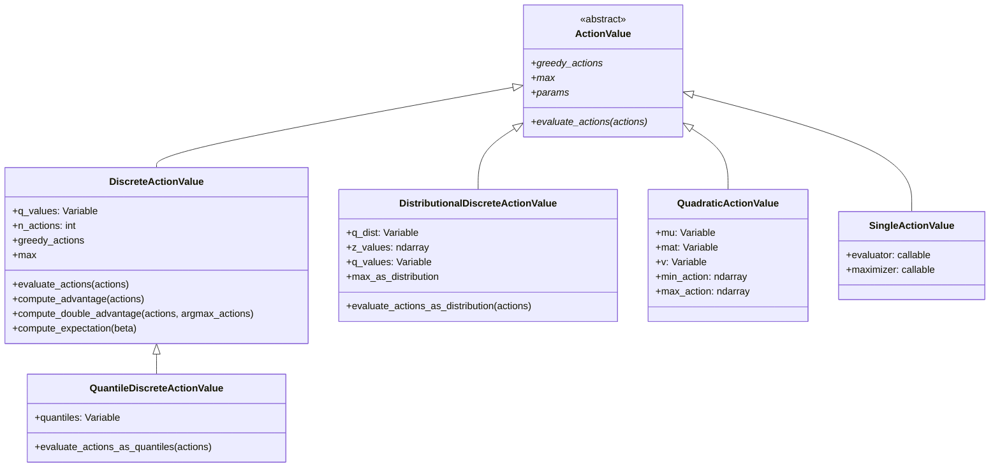
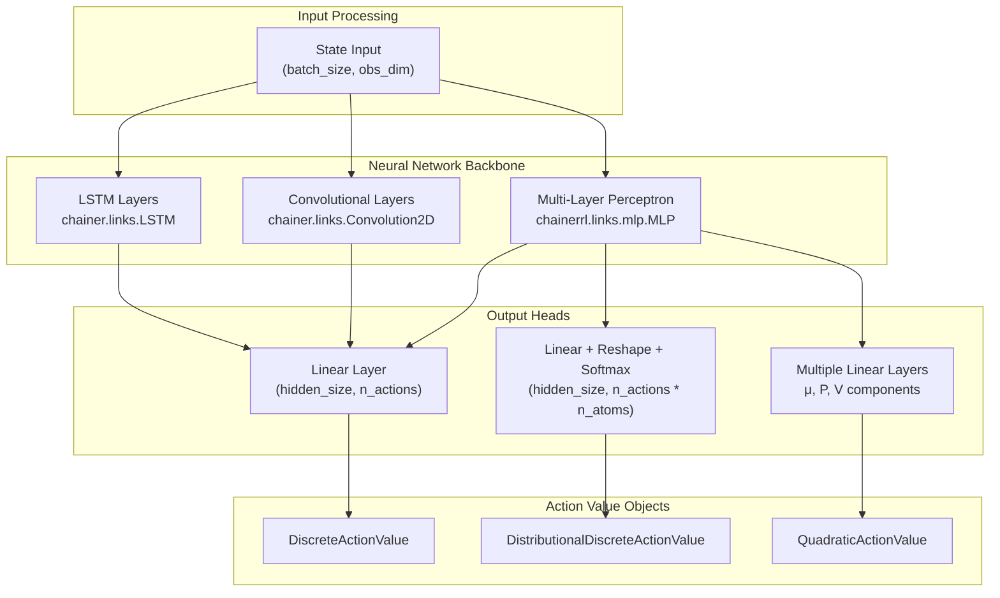
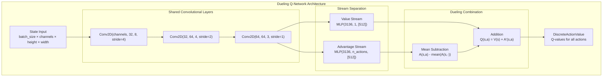
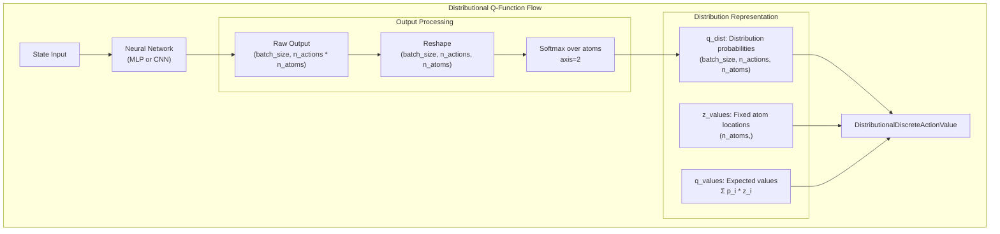
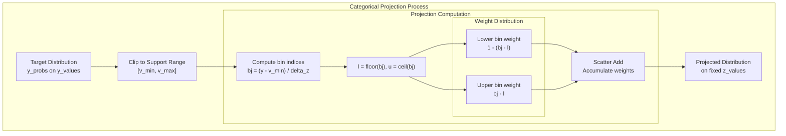
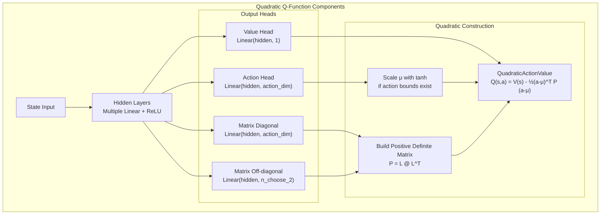

<!-- source: DeepWiki mcp.deepwiki.com · repo chainer/chainerrl · page 3.1 Q-Functions and Action Values · fetched 2026-10-30 -->

# Q-Functions and Action Values

<details>
<summary>Relevant source files</summary>

The following files were used as context for generating this wiki page:

- [chainerrl/action_value.py](chainerrl/action_value.py)
- [chainerrl/agents/categorical_double_dqn.py](chainerrl/agents/categorical_double_dqn.py)
- [chainerrl/agents/categorical_dqn.py](chainerrl/agents/categorical_dqn.py)
- [chainerrl/q_functions/dueling_dqn.py](chainerrl/q_functions/dueling_dqn.py)
- [chainerrl/q_functions/state_q_functions.py](chainerrl/q_functions/state_q_functions.py)
- [tests/agents_tests/test_categorical_dqn.py](tests/agents_tests/test_categorical_dqn.py)
- [tests/agents_tests/test_double_categorical_dqn.py](tests/agents_tests/test_double_categorical_dqn.py)

</details>


## Purpose and Scope

This document covers the neural network architectures for value estimation in ChainerRL, specifically Q-functions that estimate state-action values and the action value representations they produce. Q-functions are fundamental components used across value-based RL algorithms like DQN and actor-critic methods.

For information about policy networks and state value functions, see [Policies and Value Functions](#3.2). For details on specific RL algorithms that use these components, see [DQN and Value-Based Methods](#2.1) and [Actor-Critic Methods](#2.3).

## Action Value Interface and Types

The foundation of ChainerRL's Q-function system is the `ActionValue` abstract class that defines a common interface for representing state-action values across different action spaces and algorithmic variants.

### Core ActionValue Interface



Sources: [chainerrl/action_value.py:13-366]()

### Discrete Action Values

`DiscreteActionValue` is the most commonly used action value type, representing Q-values for discrete action spaces as a tensor of shape `(batch_size, n_actions)`. It provides efficient computation of greedy actions via `argmax` and supports various advantage calculations needed by different algorithms.

The class includes several utility methods:
- `compute_advantage()` for policy gradient methods
- `compute_double_advantage()` for double Q-learning variants  
- `compute_expectation()` for soft Q-learning approaches

Sources: [chainerrl/action_value.py:44-95]()

### Distributional Action Values

`DistributionalDiscreteActionValue` extends the discrete case to represent full return distributions rather than just expected values. This supports distributional RL algorithms like Categorical DQN and Quantile Regression DQN.

The distribution is represented as:
- `q_dist`: Probability distributions over atoms, shape `(batch_size, n_actions, n_atoms)`
- `z_values`: Fixed support values for the distribution atoms
- `q_values`: Expected Q-values computed from the distribution

Sources: [chainerrl/action_value.py:96-183]()

### Continuous Action Values

`QuadraticActionValue` handles continuous action spaces using a quadratic approximation of the advantage function:

```
Q(s,a) = V(s) + A(s,a)
A(s,a) = -1/2 (a - μ(s))^T P(s) (a - μ(s))
```

This representation allows for efficient optimization in continuous control problems and is used by algorithms like NAF (Normalized Advantage Functions).

Sources: [chainerrl/action_value.py:237-323]()

## Q-Function Architectures

Q-functions in ChainerRL implement the `StateQFunction` interface and produce `ActionValue` objects. The architecture varies based on the action space type and algorithmic requirements.

### Basic State Q-Functions



Sources: [chainerrl/q_functions/state_q_functions.py:27-277]()

### Dueling Architecture

The dueling architecture separates value and advantage estimation to improve learning stability, particularly in environments where action choices don't significantly affect outcomes in many states.



The key insight is the dueling combination formula at [chainerrl/q_functions/dueling_dqn.py:42-52]():
```python
ya = self.a_stream(h)
mean = F.sum(ya, axis=1) / self.n_actions
ya -= mean
ys = self.v_stream(h)
q = ya + ys
```

Sources: [chainerrl/q_functions/dueling_dqn.py:12-54]()

## Distributional Q-Function Variants

Distributional RL extends Q-learning by learning the full distribution of returns rather than just expected values. ChainerRL supports several distributional variants.

### Categorical DQN Implementation



The distributional Q-function creates a probability distribution over a fixed set of return values (atoms) for each action. The expected Q-value is computed as: `q_values = F.sum(F.scale(q_dist, z_values, axis=2), axis=2)`.

Sources: [chainerrl/q_functions/state_q_functions.py:87-117](), [chainerrl/action_value.py:106-118]()

### Categorical Projection

A critical component of distributional RL is the categorical projection operation that maps target distributions back onto the fixed support during training:



This projection ensures that target distributions from the Bellman update can be represented on the fixed atom locations used by the Q-function.

Sources: [chainerrl/agents/categorical_dqn.py:9-66]()

## Specialized Q-Function Implementations

### Recurrent Q-Functions

For partially observable environments, ChainerRL provides LSTM-based Q-functions that maintain hidden state across time steps:

| Component | Implementation | Purpose |
|-----------|---------------|---------|
| Feature Extraction | `MLP` or convolutional layers | Process observations |
| Memory | `chainer.links.LSTM` | Maintain temporal context |
| Output | Linear layer to action values | Final Q-value prediction |
| State Management | `RecurrentChainMixin` | Handle LSTM state reset/forward |

Sources: [chainerrl/q_functions/state_q_functions.py:120-149]()

### Continuous Control Q-Functions

For continuous action spaces, quadratic Q-functions parameterize the action-value function using a quadratic advantage term:



The quadratic formulation ensures that Q-values have a unique maximum at μ(s), making optimization tractable in continuous spaces.

Sources: [chainerrl/q_functions/state_q_functions.py:151-214]()

## Implementation Patterns

### StateQFunction Interface

All Q-functions inherit from `StateQFunction` and implement the `__call__` method that takes states and returns `ActionValue` objects:

```python
class StateQFunction:
    def __call__(self, x):
        # Process state input x
        # Return ActionValue object
```

This interface ensures compatibility across different RL algorithms while allowing for diverse internal architectures.

### Batch Processing

Q-functions are designed for efficient batch processing, with all operations supporting batched inputs of shape `(batch_size, ...)`. This is critical for sample efficiency in deep RL training.

### GPU Support

Through Chainer's backend, all Q-function implementations automatically support GPU acceleration when `cuda.get_array_module()` detects GPU arrays.

Sources: [chainerrl/q_function.py](), [chainerrl/action_value.py:54, 113, 196, 257]()

---

