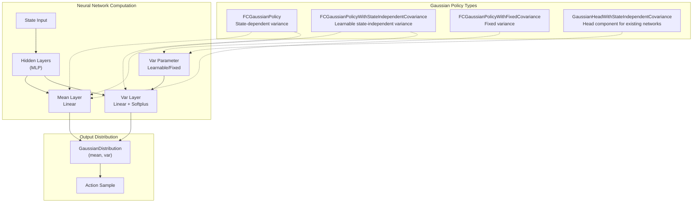
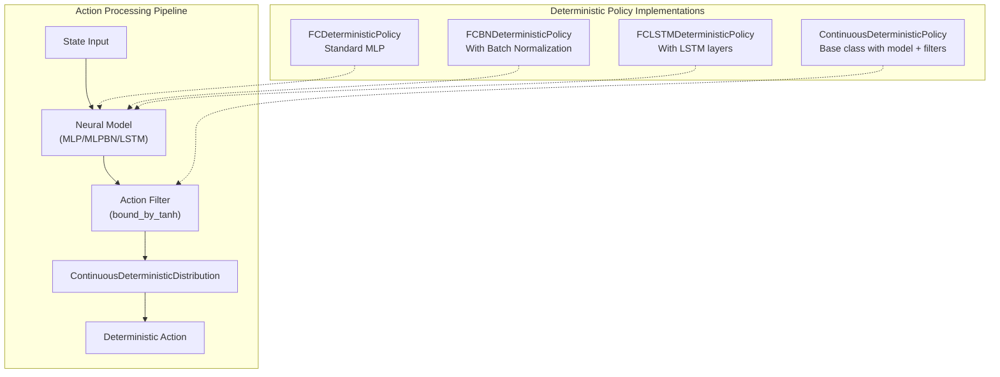
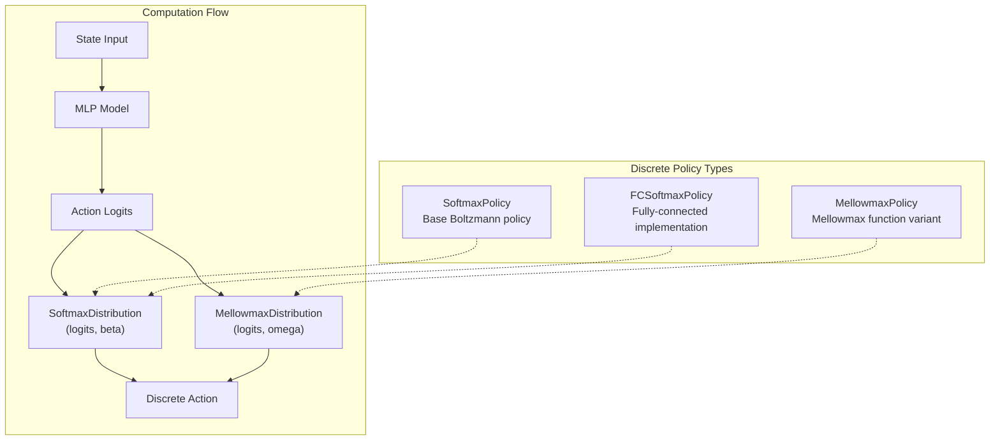
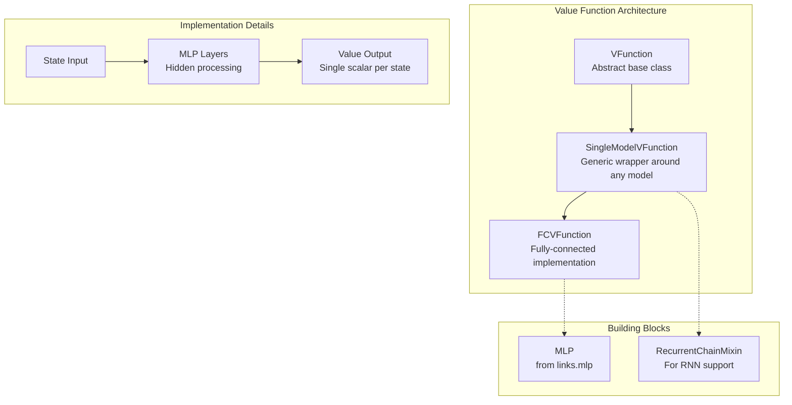
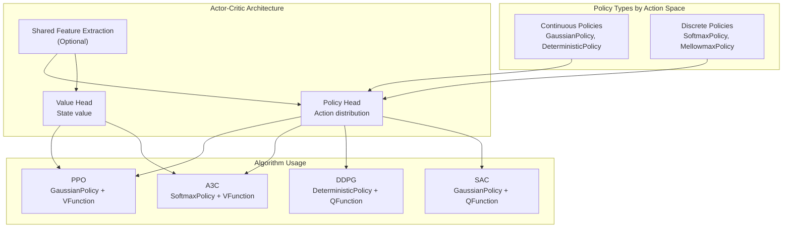

<!-- source: DeepWiki mcp.deepwiki.com · repo chainer/chainerrl · page 3.2 Policies and Value Functions · fetched 2026-10-30 -->

# Policies and Value Functions

Relevant source files

The following files were used as context for generating this wiki page:

- [chainerrl/links/mlp.py](chainerrl/links/mlp.py)
- [chainerrl/policies/deterministic_policy.py](chainerrl/policies/deterministic_policy.py)
- [chainerrl/policies/gaussian_policy.py](chainerrl/policies/gaussian_policy.py)
- [chainerrl/policies/mellowmax_policy.py](chainerrl/policies/mellowmax_policy.py)
- [chainerrl/policies/softmax_policy.py](chainerrl/policies/softmax_policy.py)
- [chainerrl/q_functions/state_action_q_functions.py](chainerrl/q_functions/state_action_q_functions.py)
- [chainerrl/v_functions/v_functions.py](chainerrl/v_functions/v_functions.py)
- [tests/policies_tests/test_deterministic_policy.py](tests/policies_tests/test_deterministic_policy.py)

This document covers ChainerRL's policy networks for action selection and value functions for state evaluation. These components serve as the core neural network architectures that implement the decision-making and value estimation capabilities of reinforcement learning agents.

For Q-functions and action-value representations, see [Q-Functions and Action Values](#3.1). For the neural network building blocks that these components use, see [Neural Network Building Blocks](#3.3).

## Policy Networks

Policy networks are neural networks that map states to action distributions (stochastic policies) or directly to actions (deterministic policies). ChainerRL provides implementations for both continuous and discrete action spaces.

### Continuous Action Space Policies

For continuous control tasks, ChainerRL offers both stochastic and deterministic policy implementations.

#### Gaussian Policies

Gaussian policies output probability distributions over continuous actions, enabling exploration through sampling from the distribution.

**Core Gaussian Policy Features:**

| Policy Class | Variance Type | Use Case |
|--------------|---------------|----------|
| `FCGaussianPolicy` | State-dependent | Full stochastic policy with adaptive exploration |
| `FCGaussianPolicyWithStateIndependentCovariance` | State-independent learnable | PPO/TRPO-style policies |
| `FCGaussianPolicyWithFixedCovariance` | Fixed | Simple exploration with known noise level |
| `GaussianHeadWithStateIndependentCovariance` | State-independent learnable | Component for custom architectures |

**Sources:** [chainerrl/policies/gaussian_policy.py:18-106](), [chainerrl/policies/gaussian_policy.py:108-177](), [chainerrl/policies/gaussian_policy.py:179-244](), [chainerrl/policies/gaussian_policy.py:247-295]()

#### Deterministic Policies

Deterministic policies output single action values for each state, commonly used in algorithms like DDPG and TD3.

**Sources:** [chainerrl/policies/deterministic_policy.py:19-48](), [chainerrl/policies/deterministic_policy.py:50-99](), [chainerrl/policies/deterministic_policy.py:101-155](), [chainerrl/policies/deterministic_policy.py:157-219]()

### Discrete Action Space Policies

For environments with discrete action spaces, ChainerRL provides categorical policy implementations.

#### Softmax Policies

Softmax policies use Boltzmann distributions over discrete actions, providing temperature-controlled exploration.

**Sources:** [chainerrl/policies/softmax_policy.py:14-33](), [chainerrl/policies/softmax_policy.py:35-57](), [chainerrl/policies/mellowmax_policy.py:12-31]()

## Value Functions

Value functions estimate the expected return from states, providing the baseline for advantage estimation in actor-critic algorithms.

### State Value Functions

State value functions `V(s)` estimate the expected return starting from a given state under the current policy.

The `FCVFunction` is the most commonly used implementation, providing a straightforward fully-connected architecture that maps states to scalar value estimates.

**Sources:** [chainerrl/v_functions/v_functions.py:9-24](), [chainerrl/v_functions/v_functions.py:26-41]()

## Policy and Value Function Integration

Policies and value functions work together in actor-critic algorithms, where the policy (actor) selects actions and the value function (critic) evaluates states.

**Architecture Patterns:**

- **Separate Networks**: Independent policy and value networks with no shared parameters
- **Shared Features**: Common feature extraction layers with separate heads for policy and value
- **Multi-Head**: Single network with multiple output heads for different components

**Sources:** [chainerrl/policies/gaussian_policy.py:247-295](), [chainerrl/v_functions/v_functions.py:9-41](), [chainerrl/links/mlp.py:7-37]()

## Implementation Details

### Neural Network Building Blocks

All policy and value function implementations build on the foundational `MLP` class that provides flexible fully-connected architectures.

| Component | Purpose | Key Features |
|-----------|---------|--------------|
| `MLP` | Base neural network | Configurable layers, nonlinearities, weight initialization |
| `MLPBN` | Batch normalized MLP | Batch normalization for stable training |
| `RecurrentChainMixin` | RNN support | LSTM/GRU integration for sequential data |

### Action Space Handling

The library handles different action space requirements through specialized output layers and post-processing:

- **Continuous Bounded**: `bound_by_tanh` function constrains actions to valid ranges
- **Continuous Unbounded**: Direct neural network outputs
- **Discrete**: Softmax over logits for categorical distributions

### Distribution Interface

All policies return distribution objects that provide a consistent interface for sampling actions and computing log probabilities, enabling algorithm-agnostic policy interaction.

**Sources:** [chainerrl/links/mlp.py:7-37](), [chainerrl/functions/bound_by_tanh.py](), [chainerrl/distribution]()

---

