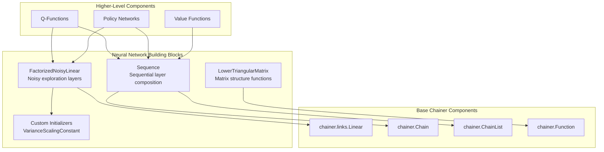
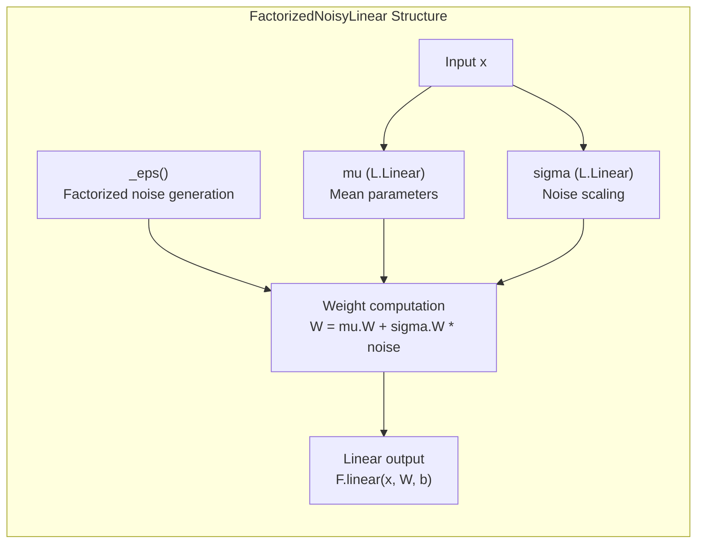
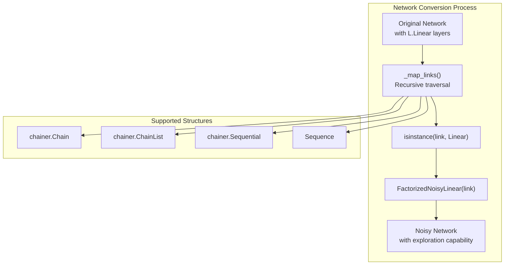
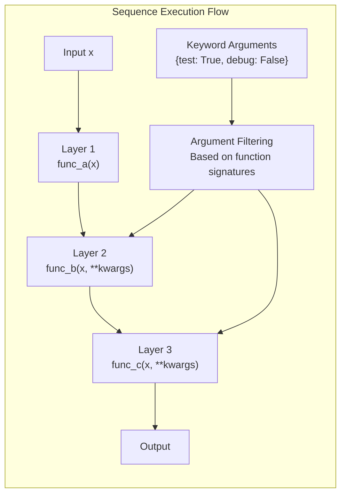
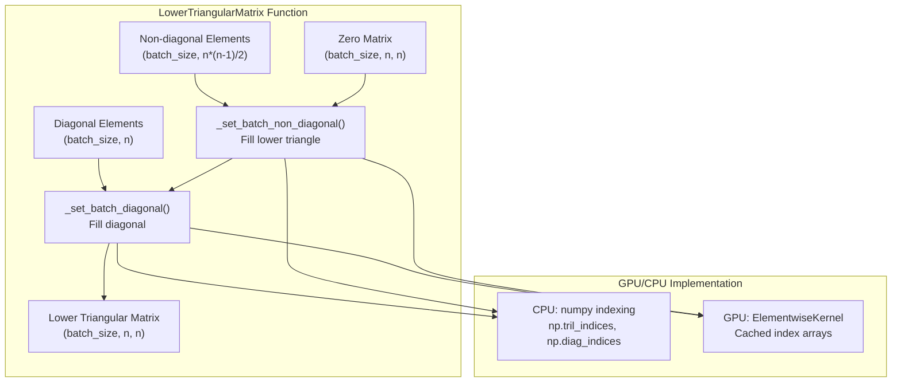
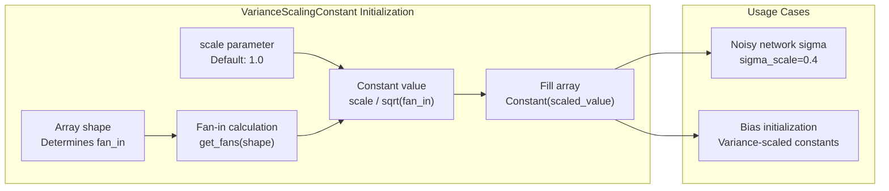
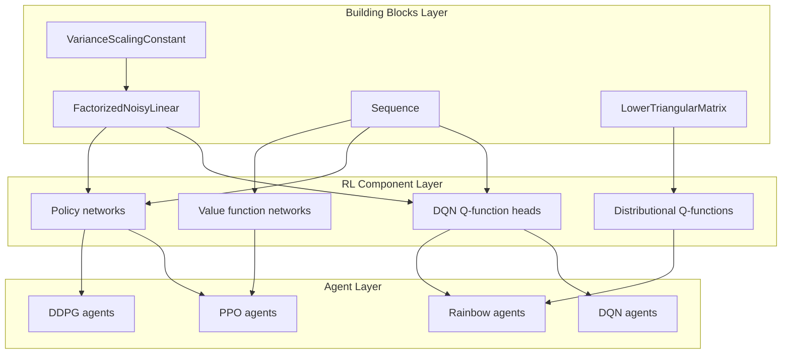

<!-- source: DeepWiki mcp.deepwiki.com · repo chainer/chainerrl · page 3.3 Neural Network Building Blocks · fetched 2026-10-30 -->

# Neural Network Building Blocks

Relevant source files

The following files were used as context for generating this wiki page:

- [chainerrl/functions/lower_triangular_matrix.py](chainerrl/functions/lower_triangular_matrix.py)
- [chainerrl/initializers/constant.py](chainerrl/initializers/constant.py)
- [chainerrl/links/noisy_chain.py](chainerrl/links/noisy_chain.py)
- [chainerrl/links/noisy_linear.py](chainerrl/links/noisy_linear.py)
- [chainerrl/links/sequence.py](chainerrl/links/sequence.py)
- [requirements.txt](requirements.txt)
- [setup.py](setup.py)
- [tests/links_tests/test_noisy_linear.py](tests/links_tests/test_noisy_linear.py)
- [tests/links_tests/test_sequence.py](tests/links_tests/test_sequence.py)

## Purpose and Scope

This document covers the reusable neural network components and building blocks that form the foundation of ChainerRL's neural network architectures. These components provide specialized functionality beyond standard layers, including noise injection for exploration, sequential composition utilities, matrix manipulation functions, and custom initialization schemes.

For information about higher-level neural network architectures like Q-functions and policies that use these building blocks, see [Q-Functions and Action Values](#3.1) and [Policies and Value Functions](#3.2).

## Core Building Block Components

ChainerRL provides several categories of neural network building blocks that extend Chainer's base functionality with RL-specific features:

**Sources:** [chainerrl/links/noisy_linear.py:1-81](), [chainerrl/links/sequence.py:1-42](), [chainerrl/functions/lower_triangular_matrix.py:1-155](), [chainerrl/initializers/constant.py:1-21]()

## Noisy Networks

### FactorizedNoisyLinear

The `FactorizedNoisyLinear` class implements the factorized noisy networks approach for exploration in deep reinforcement learning. This technique adds learnable noise to network parameters to encourage exploration without requiring separate exploration strategies.

**Sources:** [chainerrl/links/noisy_linear.py:12-81]()

The implementation uses factorized Gaussian noise where independent noise vectors are generated for input and output dimensions, then combined using an outer product. Key features include:

| Component | Purpose | Implementation |
|-----------|---------|----------------|
| `mu` | Mean weights and biases | Standard `L.Linear` with LeCun uniform initialization |
| `sigma` | Noise scaling parameters | `L.Linear` with `VarianceScalingConstant` initialization |
| `_eps()` | Noise generation | Factorized Gaussian noise with sign(x)√|x| transformation |
| `sigma_scale` | Hyperparameter controlling initial noise magnitude | Default: 0.4 |

**Sources:** [chainerrl/links/noisy_linear.py:21-40](), [chainerrl/links/noisy_linear.py:52-61]()

### Noisy Network Conversion

The `to_factorized_noisy` function provides automated conversion of existing networks to use noisy layers:

**Sources:** [chainerrl/links/noisy_chain.py:13-26](), [chainerrl/links/noisy_chain.py:28-58]()

## Sequential Composition

### Sequence Class

The `Sequence` class provides a flexible way to compose multiple layers or functions into a sequential pipeline, with support for keyword argument forwarding:

**Sources:** [chainerrl/links/sequence.py:17-42]()

Key features of the `Sequence` implementation:

| Feature | Implementation | Purpose |
|---------|---------------|---------|
| Signature inspection | `signature(layer).parameters` | Determines which kwargs each layer accepts |
| Variable argument support | `accept_variable_arguments()` | Detects `*args` and `**kwargs` in function signatures |
| Selective forwarding | Filtered `layer_kwargs` | Only passes relevant arguments to each layer |
| Mixed composition | Links and functions | Supports both Chainer links and plain functions |

**Sources:** [chainerrl/links/sequence.py:9-14](), [chainerrl/links/sequence.py:23-27](), [chainerrl/links/sequence.py:30-41]()

## Specialized Functions

### LowerTriangularMatrix

The `LowerTriangularMatrix` function creates batched lower triangular matrices from separate diagonal and non-diagonal elements, commonly used in covariance matrix parameterization:

**Sources:** [chainerrl/functions/lower_triangular_matrix.py:125-155](), [chainerrl/functions/lower_triangular_matrix.py:9-21](), [chainerrl/functions/lower_triangular_matrix.py:43-59]()

The implementation provides efficient GPU and CPU versions using cached index arrays and elementwise kernels for optimal performance.

## Custom Initializers

### VarianceScalingConstant

The `VarianceScalingConstant` initializer provides fan-in scaled constant initialization, commonly used for noise parameters in noisy networks:

**Sources:** [chainerrl/initializers/constant.py:6-21]()

This initializer is specifically used in `FactorizedNoisyLinear` for initializing the sigma parameters that control noise magnitude.

## Integration with ChainerRL Components

The neural network building blocks integrate seamlessly with higher-level ChainerRL components:

**Sources:** [chainerrl/links/noisy_linear.py:1-81](), [chainerrl/links/sequence.py:1-42](), [chainerrl/functions/lower_triangular_matrix.py:1-155](), [chainerrl/initializers/constant.py:1-21]()

These building blocks provide the foundation for implementing sophisticated neural network architectures required by modern deep reinforcement learning algorithms while maintaining modularity and reusability across different agent implementations.

---

