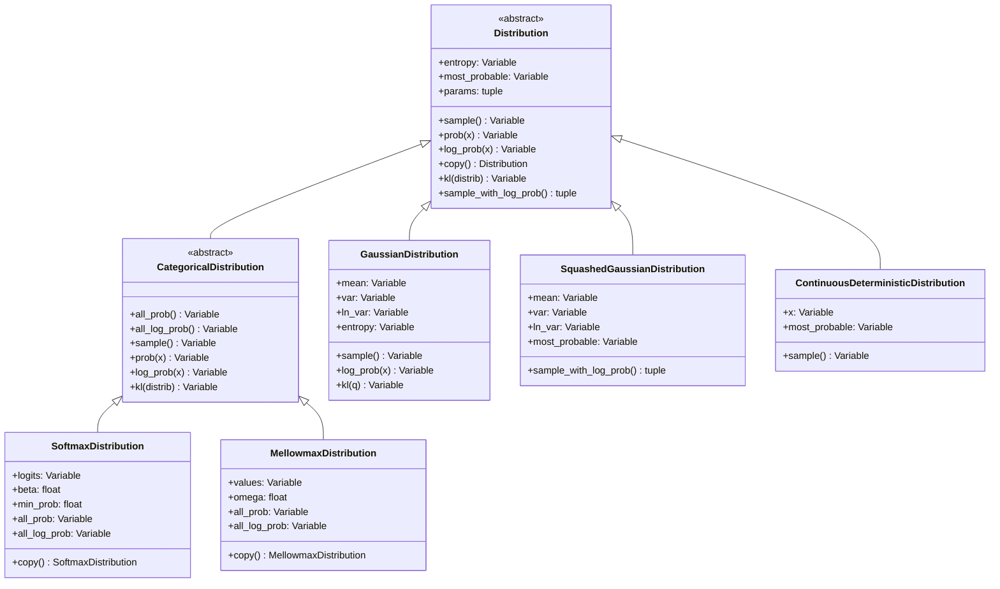
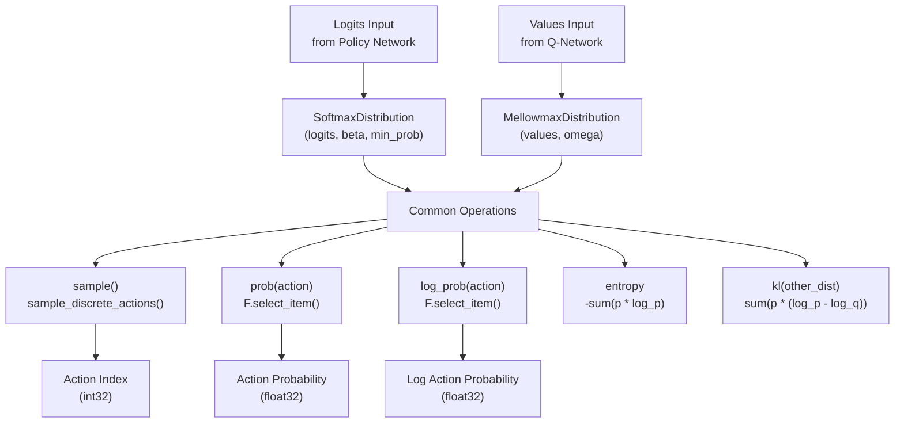
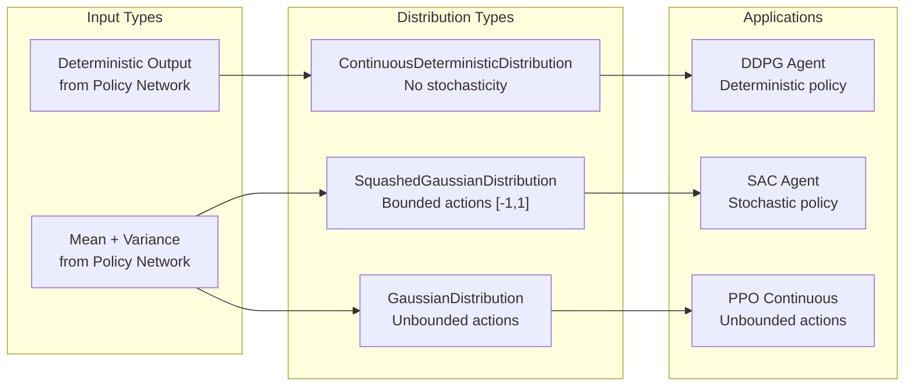
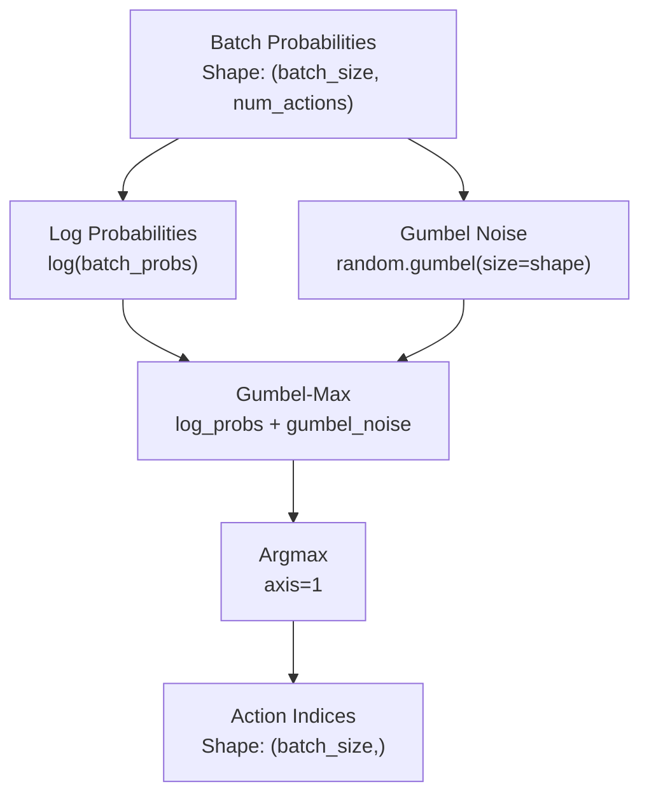

<!-- source: DeepWiki mcp.deepwiki.com · repo chainer/chainerrl · page 3.4 Probability Distributions · fetched 2026-10-30 -->

# Probability Distributions

<details>
<summary>Relevant source files</summary>

The following files were used as context for generating this wiki page:

- [chainerrl/distribution.py](chainerrl/distribution.py)
- [tests/test_distribution.py](tests/test_distribution.py)

</details>


This document covers the probability distribution classes used throughout ChainerRL for handling stochastic policies and probabilistic action selection. These distributions provide a unified interface for sampling actions, computing probabilities, and calculating key properties like entropy and KL divergence across different action space types.

For neural network components that use these distributions, see [Policies and Value Functions](#3.2). For specific agent implementations that utilize distributions, see [Reinforcement Learning Agents](#2).

## Distribution System Architecture

ChainerRL's distribution system provides a clean abstraction for handling both discrete and continuous action spaces through a common interface. The system supports various distribution types commonly used in reinforcement learning algorithms.

**Distribution Class Hierarchy**



Sources: [chainerrl/distribution.py:42-441]()

## Base Distribution Interface

The abstract `Distribution` class defines the core interface that all distributions must implement. This provides consistency across different distribution types used by various RL agents.

**Core Distribution Methods**

| Method | Purpose | Returns |
|--------|---------|---------|
| `sample()` | Sample from the distribution | `chainer.Variable` |
| `prob(x)` | Compute probability p(x) | `chainer.Variable` |
| `log_prob(x)` | Compute log probability log p(x) | `chainer.Variable` |
| `sample_with_log_prob()` | Combined sampling and log prob computation | `(Variable, Variable)` |
| `copy()` | Create detached copy of distribution | `Distribution` |

**Key Properties**

| Property | Purpose | Returns |
|----------|---------|---------|
| `entropy` | Distribution entropy | `chainer.Variable` |
| `most_probable` | Mode of the distribution | `chainer.Variable` |
| `params` | Learnable parameters | `tuple` |
| `kl(distrib)` | KL divergence computation | `chainer.Variable` |

The `sample_with_log_prob()` method is particularly important for efficiency, as many RL algorithms need both the sample and its log probability. This method can compute both more efficiently than calling the methods separately.

Sources: [chainerrl/distribution.py:42-131]()

## Categorical Distributions for Discrete Actions

Categorical distributions handle discrete action spaces, commonly used in algorithms like DQN, PPO, and A3C for environments with discrete actions.

**Distribution Usage Flow**



### SoftmaxDistribution

The `SoftmaxDistribution` class implements the standard categorical distribution using the softmax function. It supports temperature scaling via the `beta` parameter and minimum probability constraints via `min_prob`.

**Key Features:**
- **Temperature scaling**: The `beta` parameter controls the "sharpness" of the distribution
- **Minimum probability**: Ensures numerical stability and exploration
- **Efficient computation**: Uses `F.log_softmax` when `min_prob=0`

```python
# Example usage (not from codebase, for illustration)
logits = policy_network(state)
dist = SoftmaxDistribution(logits, beta=1.0, min_prob=0.01)
action = dist.sample()
log_prob = dist.log_prob(action)
```

### MellowmaxDistribution

The `MellowmaxDistribution` provides an alternative to softmax using the mellowmax operator, which can provide better exploration properties in some scenarios.

Sources: [chainerrl/distribution.py:133-259](), [tests/test_distribution.py:44-191]()

## Continuous Distributions

Continuous distributions handle environments with continuous action spaces, essential for algorithms like DDPG, SAC, and TD3.

**Continuous Distribution Types and Use Cases**



### GaussianDistribution

The `GaussianDistribution` class implements a multivariate Gaussian distribution with diagonal covariance. It's used for continuous control tasks where actions are not bounded.

**Key computations:**
- **Sampling**: Uses `F.gaussian(mean, ln_var)` for reparameterization trick compatibility
- **Log probability**: Implements the multivariate Gaussian log-likelihood formula
- **Entropy**: Computed analytically as `0.5 * (log(2πe) + log_var)`
- **KL divergence**: Closed-form computation between two Gaussian distributions

### SquashedGaussianDistribution  

The `SquashedGaussianDistribution` applies a `tanh` transformation to a Gaussian distribution, ensuring actions are bounded in `[-1, 1]`. This is particularly useful for algorithms like SAC.

**Important considerations:**
- **Jacobian correction**: Accounts for the change of variables when computing log probabilities
- **Numerical stability**: The `sample_with_log_prob()` method is more stable than separate calls
- **Bounded outputs**: All samples are guaranteed to be in `[-1, 1]`

### ContinuousDeterministicDistribution

This "distribution" represents deterministic policies that always output the same action for a given state. Many methods like `entropy()` and `prob()` raise `RuntimeError` since they're not meaningful for deterministic outputs.

Sources: [chainerrl/distribution.py:275-441](), [tests/test_distribution.py:193-373]()

## Discrete Action Sampling

The `sample_discrete_actions` function provides an efficient way to sample from categorical distributions using the Gumbel-max trick, which is more numerically stable than direct multinomial sampling.

**Gumbel-Max Sampling Process**



This sampling method is equivalent to multinomial sampling but avoids potential numerical issues with very small probabilities and is differentiable through the Gumbel distribution.

Sources: [chainerrl/distribution.py:28-39](), [tests/test_distribution.py:12-42]()

## Integration with RL Agents

Distributions are used throughout ChainerRL agents in several key ways:

**Distribution Usage Patterns**

| Agent Type | Distribution Usage | Primary Methods |
|------------|-------------------|-----------------|
| Policy Gradient (PPO, TRPO) | Action sampling + log prob for policy gradient | `sample()`, `log_prob()`, `entropy` |
| Actor-Critic (A3C, SAC) | Action sampling + KL divergence for regularization | `sample()`, `log_prob()`, `kl()` |
| Value-based (DQN variants) | Action sampling from value-derived distributions | `sample()`, `most_probable` |
| Deterministic (DDPG) | Deterministic action selection | `sample()`, `most_probable` |

The modular design allows agents to work with different distribution types by depending only on the abstract `Distribution` interface, enabling easy experimentation with different action selection mechanisms.

Sources: [chainerrl/distribution.py:1-441]()

---

