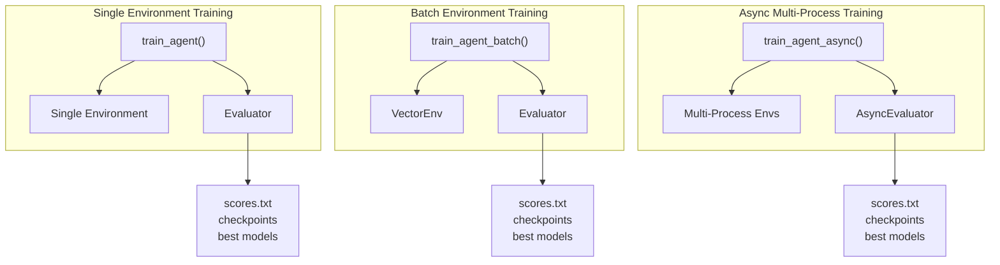
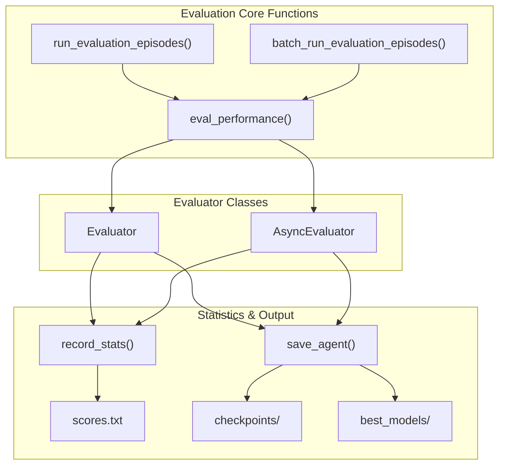
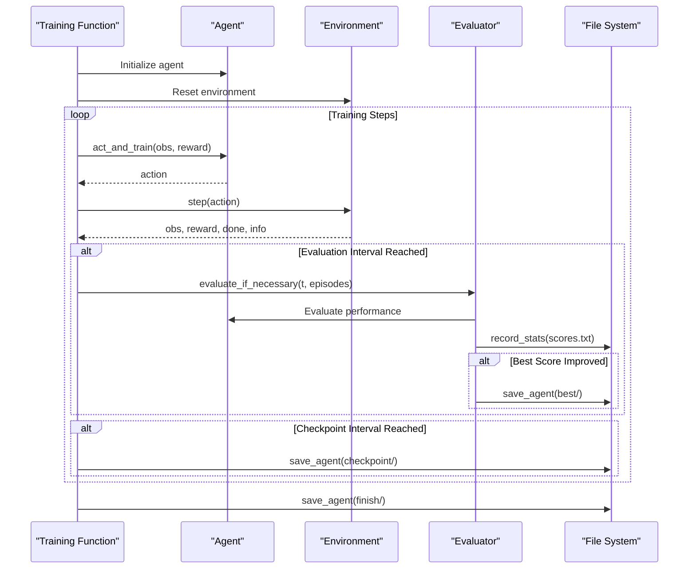
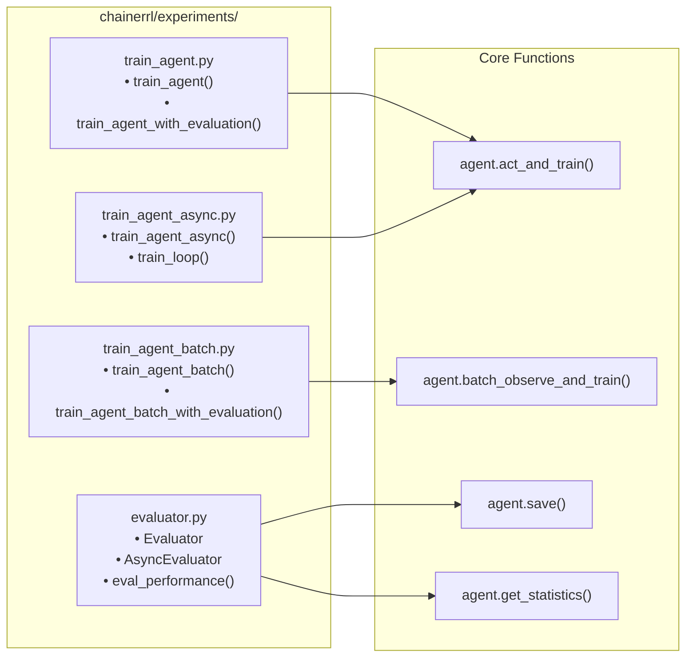
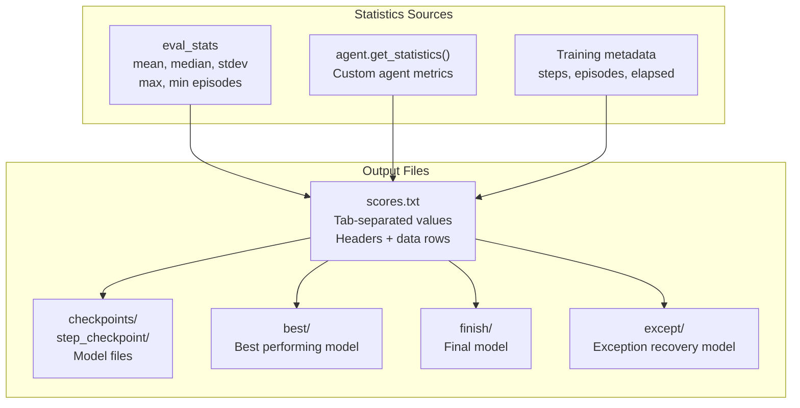

<!-- source: DeepWiki mcp.deepwiki.com · repo chainer/chainerrl · page 4 Training and Evaluation Infrastructure · fetched 2026-10-30 -->

# Training and Evaluation Infrastructure

Relevant source files

The following files were used as context for generating this wiki page:

- [chainerrl/agents/a2c.py](chainerrl/agents/a2c.py)
- [chainerrl/experiments/evaluator.py](chainerrl/experiments/evaluator.py)
- [chainerrl/experiments/train_agent.py](chainerrl/experiments/train_agent.py)
- [chainerrl/experiments/train_agent_async.py](chainerrl/experiments/train_agent_async.py)
- [chainerrl/experiments/train_agent_batch.py](chainerrl/experiments/train_agent_batch.py)
- [examples/gym/train_a2c_gym.py](examples/gym/train_a2c_gym.py)
- [test_examples.sh](test_examples.sh)
- [tests/agents_tests/test_a2c.py](tests/agents_tests/test_a2c.py)

This document covers ChainerRL's training and evaluation infrastructure, which provides systematic approaches for training reinforcement learning agents and measuring their performance. The infrastructure supports three main training paradigms: synchronous single-environment training, vectorized batch training, and asynchronous multi-process training, each paired with appropriate evaluation systems.

For information about specific RL algorithms and their implementations, see [Reinforcement Learning Agents](#2). For details about environment preprocessing and wrappers, see [Environment Wrappers](#4.2). For practical usage examples, see [Examples and Usage](#5).

## Training Paradigm Overview

ChainerRL provides three distinct training approaches, each optimized for different use cases and computational requirements. The choice of training paradigm affects both performance characteristics and the complexity of the training setup.

**Training Paradigm Architecture**

The three training paradigms each handle different scales of parallelization and have distinct performance characteristics. Single environment training (`train_agent`) is simplest and most suitable for debugging, batch training (`train_agent_batch`) leverages vectorized environments for efficiency, and async training (`train_agent_async`) uses multiple processes for maximum parallelization.

Sources: [chainerrl/experiments/train_agent.py:22-85](), [chainerrl/experiments/train_agent_batch.py:12-135](), [chainerrl/experiments/train_agent_async.py:124-246]()

## Evaluation System Architecture  

The evaluation infrastructure provides systematic performance measurement during training, with support for both synchronous and asynchronous evaluation depending on the training paradigm used.

**Evaluation System Components**

The evaluation system consists of core evaluation functions that run episodes and compute statistics, evaluator classes that manage the evaluation lifecycle, and output systems that record results and save models. The `Evaluator` class handles synchronous evaluation while `AsyncEvaluator` manages evaluation in multi-process environments.

Sources: [chainerrl/experiments/evaluator.py:27-84](), [chainerrl/experiments/evaluator.py:86-216](), [chainerrl/experiments/evaluator.py:269-355](), [chainerrl/experiments/evaluator.py:356-456]()

## Training-Evaluation Integration

The training and evaluation systems are tightly integrated, with evaluation occurring at regular intervals during training and automatic model saving based on performance improvements.

| Training Function | Evaluator Used | Key Features |
|-------------------|----------------|--------------|
| `train_agent` | `Evaluator` | Single environment, synchronous evaluation |
| `train_agent_batch` | `Evaluator` | Vectorized environments, batch evaluation |
| `train_agent_async` | `AsyncEvaluator` | Multi-process, shared memory coordination |

**Training-Evaluation Interaction Flow**

This sequence shows how training and evaluation are coordinated. The training loop periodically triggers evaluation, which measures agent performance and saves models when improvements are detected. Checkpoints are saved at regular intervals regardless of performance.

Sources: [chainerrl/experiments/train_agent.py:61-67](), [chainerrl/experiments/train_agent_batch.py:109-115](), [chainerrl/experiments/evaluator.py:348-354]()

## Key Components and File Organization

The training and evaluation infrastructure is organized across several key files, each containing specific functionality for different aspects of the system.

**File Organization and Key Functions**

The infrastructure is modularized across four main files in the experiments package. Each training paradigm has its own file with both basic and evaluation-enabled versions of training functions. The evaluator module provides shared evaluation functionality used by all training approaches.

| File | Primary Classes/Functions | Purpose |
|------|---------------------------|---------|
| `train_agent.py` | `train_agent`, `train_agent_with_evaluation` | Single environment training |
| `train_agent_batch.py` | `train_agent_batch`, `train_agent_batch_with_evaluation` | Vectorized environment training |
| `train_agent_async.py` | `train_agent_async`, `train_loop` | Multi-process asynchronous training |
| `evaluator.py` | `Evaluator`, `AsyncEvaluator`, evaluation functions | Performance measurement and model management |

Sources: [chainerrl/experiments/train_agent.py:1-161](), [chainerrl/experiments/train_agent_batch.py:1-218](), [chainerrl/experiments/train_agent_async.py:1-246](), [chainerrl/experiments/evaluator.py:1-456]()

## Statistics and Output Management

The infrastructure provides comprehensive logging and output management, tracking training progress and evaluation results in standardized formats.

The evaluation system records statistics in a consistent format across all training paradigms. The `_basic_columns` tuple defines the standard metrics: `('steps', 'episodes', 'elapsed', 'mean', 'median', 'stdev', 'max', 'min')`. Additional agent-specific statistics are appended through the `agent.get_statistics()` method.

**Output Management System**

The system maintains multiple types of output files for different purposes. The `scores.txt` file provides a complete training log with evaluation metrics, while model directories contain saved agent states at key points during training.

Sources: [chainerrl/experiments/evaluator.py:12-25](), [chainerrl/experiments/evaluator.py:258-267](), [chainerrl/experiments/evaluator.py:318-322]()

---

