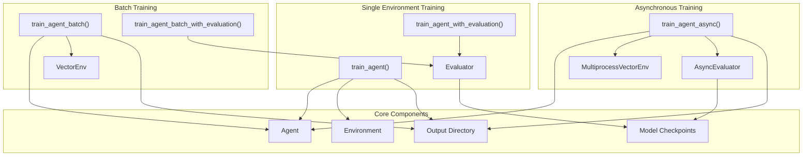
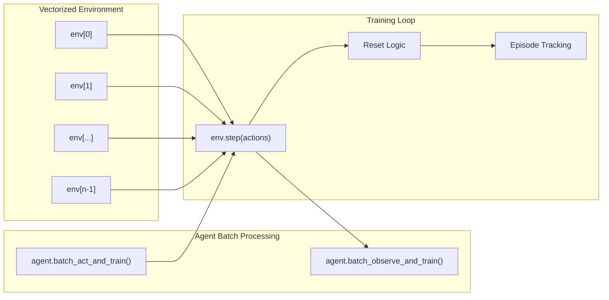
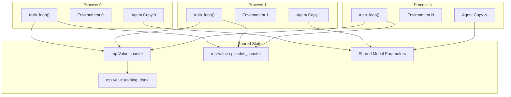
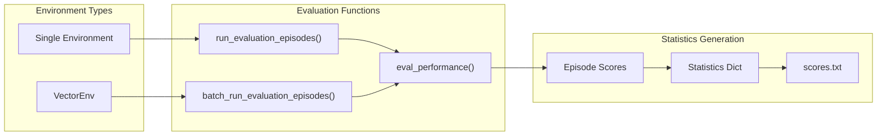

<!-- source: DeepWiki mcp.deepwiki.com · repo chainer/chainerrl · page 4.1 Training Systems · fetched 2026-10-30 -->

# Training Systems

<details>
<summary>Relevant source files</summary>

The following files were used as context for generating this wiki page:

- [chainerrl/agents/a2c.py](chainerrl/agents/a2c.py)
- [chainerrl/experiments/evaluator.py](chainerrl/experiments/evaluator.py)
- [chainerrl/experiments/train_agent.py](chainerrl/experiments/train_agent.py)
- [chainerrl/experiments/train_agent_async.py](chainerrl/experiments/train_agent_async.py)
- [chainerrl/experiments/train_agent_batch.py](chainerrl/experiments/train_agent_batch.py)
- [examples/gym/train_a2c_gym.py](examples/gym/train_a2c_gym.py)
- [test_examples.sh](test_examples.sh)
- [tests/agents_tests/test_a2c.py](tests/agents_tests/test_a2c.py)

</details>


This document covers ChainerRL's training infrastructure, which orchestrates the interaction between agents, environments, and evaluation systems during the learning process. The training systems provide three main paradigms: single-environment training, batch/vectorized training, and asynchronous multi-process training.

For information about specific RL agents and their algorithms, see [Reinforcement Learning Agents](#2). For details about evaluation metrics and performance measurement, see [Training and Evaluation Infrastructure](#4).

## Training Paradigms Overview

ChainerRL provides three distinct training orchestration approaches, each optimized for different use cases and computational resources:



**Sources:** [chainerrl/experiments/train_agent.py:22-84](), [chainerrl/experiments/train_agent_batch.py:12-134](), [chainerrl/experiments/train_agent_async.py:124-245]()

## Single Environment Training

The single environment training system in [chainerrl/experiments/train_agent.py]() provides sequential interaction between an agent and a single environment instance. This is the simplest training paradigm and is suitable for debugging and small-scale experiments.

### Core Training Function

The `train_agent` function [chainerrl/experiments/train_agent.py:22-84]() implements the basic training loop:

| Parameter | Type | Purpose |
|-----------|------|---------|
| `agent` | Agent | The RL agent to train |
| `env` | Environment | Single environment instance |
| `steps` | int | Total training timesteps |
| `outdir` | str | Output directory for logs and models |
| `checkpoint_freq` | int | Frequency for saving checkpoints |
| `max_episode_len` | int | Maximum episode length |
| `evaluator` | Evaluator | Optional evaluation system |

The training loop follows this sequence:
1. Get action from agent: `action = agent.act_and_train(obs, r)`
2. Step environment: `obs, r, done, info = env.step(action)`
3. Handle episode termination: `agent.stop_episode_and_train(obs, r, done=done)`
4. Periodic evaluation and checkpointing

### Training with Evaluation

The `train_agent_with_evaluation` function [chainerrl/experiments/train_agent.py:87-160]() wraps the basic training with built-in evaluation using the `Evaluator` class. It creates an `Evaluator` instance and passes it to `train_agent`.

**Sources:** [chainerrl/experiments/train_agent.py:22-84](), [chainerrl/experiments/train_agent.py:87-160]()

## Batch Training

The batch training system in [chainerrl/experiments/train_agent_batch.py]() enables training with vectorized environments, allowing multiple environment instances to run in parallel and agents to process batches of observations efficiently.

### Core Batch Training Function

The `train_agent_batch` function [chainerrl/experiments/train_agent_batch.py:12-134]() implements vectorized training:



Key differences from single-environment training:
- Uses `agent.batch_act_and_train(obss)` instead of `agent.act_and_train(obs, r)`
- Processes arrays of observations, rewards, and done flags
- Handles selective environment resets with `env.reset(not_end)`
- Tracks multiple episodes simultaneously

### Batch Training Data Structures

The batch training loop maintains several NumPy arrays to track state across multiple environments [chainerrl/experiments/train_agent_batch.py:42-49]():

| Variable | Shape | Purpose |
|----------|-------|---------|
| `episode_r` | `(num_envs,)` | Cumulative reward per environment |
| `episode_idx` | `(num_envs,)` | Episode index per environment |
| `episode_len` | `(num_envs,)` | Current episode length per environment |
| `obss` | `(num_envs, obs_shape)` | Current observations |
| `rs` | `(num_envs,)` | Current rewards |

**Sources:** [chainerrl/experiments/train_agent_batch.py:12-134](), [chainerrl/experiments/train_agent_batch.py:136-217]()

## Asynchronous Training

The asynchronous training system in [chainerrl/experiments/train_agent_async.py]() enables multi-process training where multiple agent processes interact with separate environment instances concurrently.

### Asynchronous Training Architecture



### Shared Object Management

The asynchronous system uses two key functions for managing shared state:

- `extract_shared_objects_from_agent(agent)` [chainerrl/experiments/train_agent_async.py:112-114]() - Extracts shareable attributes from an agent
- `set_shared_objects(agent, shared_objects)` [chainerrl/experiments/train_agent_async.py:117-121]() - Synchronizes agent state with shared objects

### Training Loop Process

Each process runs the `train_loop` function [chainerrl/experiments/train_agent_async.py:10-110]() which:
1. Maintains local episode state
2. Updates global counters with locks
3. Coordinates evaluation through `AsyncEvaluator`
4. Handles early termination when success criteria are met

**Sources:** [chainerrl/experiments/train_agent_async.py:124-245](), [chainerrl/experiments/train_agent_async.py:10-110](), [chainerrl/experiments/train_agent_async.py:112-121]()

## Evaluation Infrastructure

The evaluation infrastructure provides systematic performance measurement during training through two main classes in [chainerrl/experiments/evaluator.py]().

### Evaluator Class

The `Evaluator` class [chainerrl/experiments/evaluator.py:269-354]() handles synchronous evaluation for single and batch training:

| Method | Purpose |
|--------|---------|
| `evaluate_if_necessary(t, episodes)` | Checks if evaluation should run based on interval |
| `evaluate_and_update_max_score(t, episodes)` | Runs evaluation and updates best score |
| `save_agent(agent, "best", outdir, logger)` | Saves best-performing agent |

### AsyncEvaluator Class

The `AsyncEvaluator` class [chainerrl/experiments/evaluator.py:356-455]() handles evaluation for multi-process training with process-safe shared state using `multiprocessing.Value` objects.

### Evaluation Execution



The evaluation system automatically detects environment type and uses the appropriate evaluation method [chainerrl/experiments/evaluator.py:238-247]().

**Sources:** [chainerrl/experiments/evaluator.py:269-354](), [chainerrl/experiments/evaluator.py:356-455](), [chainerrl/experiments/evaluator.py:27-83](), [chainerrl/experiments/evaluator.py:86-215]()

## Integration with Agents

Different agent types integrate with the training systems through specific interfaces:

### Batch-Compatible Agents

Agents like `A2C` [chainerrl/agents/a2c.py:48-301]() implement batch training methods:
- `batch_act_and_train(batch_obs)` - Process batch of observations and return actions
- `batch_observe_and_train(batch_obs, batch_reward, batch_done, batch_reset)` - Learn from batch of transitions

### Training System Selection

The choice of training system depends on agent capabilities:

| Agent Type | Single Training | Batch Training | Async Training |
|------------|----------------|----------------|----------------|
| Standard agents | ✓ | ✗ | ✓ |
| Batch agents (A2C, etc.) | ✗ | ✓ | ✗ |
| Async agents (A3C, etc.) | ✗ | ✗ | ✓ |

### Example Usage

The A2C gym training example [examples/gym/train_a2c_gym.py:194-204]() demonstrates typical batch training setup:

```python
experiments.train_agent_batch_with_evaluation(
    agent=agent,
    env=make_batch_env(test=False),
    eval_env=make_batch_env(test=True),
    steps=args.steps,
    eval_n_episodes=args.eval_n_runs,
    eval_interval=args.eval_interval,
    outdir=args.outdir,
)
```

**Sources:** [chainerrl/agents/a2c.py:219-244](), [chainerrl/agents/a2c.py:253-272](), [examples/gym/train_a2c_gym.py:194-204](), [tests/agents_tests/test_a2c.py:63-74]()

---

