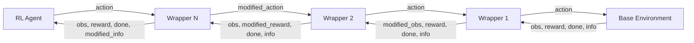
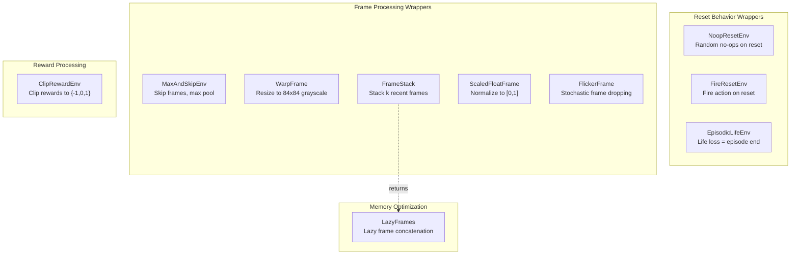
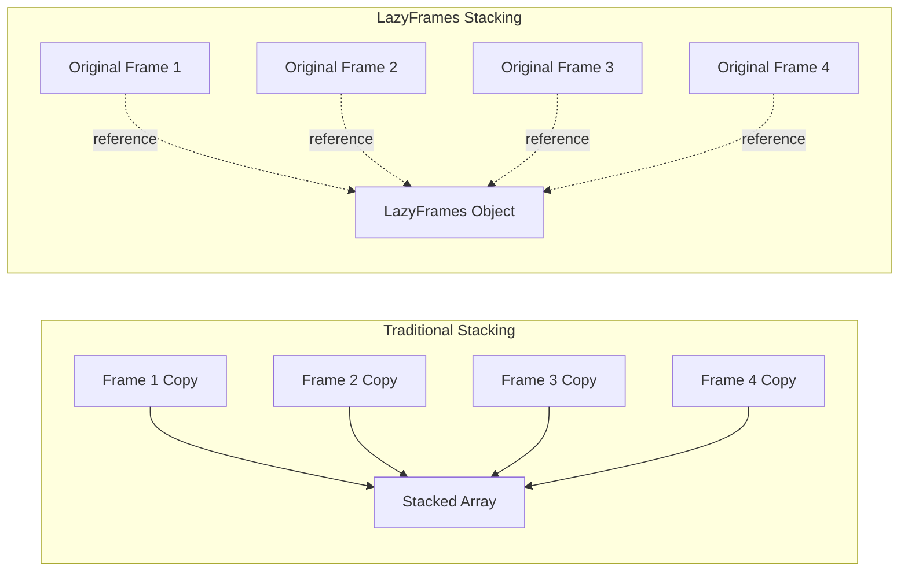
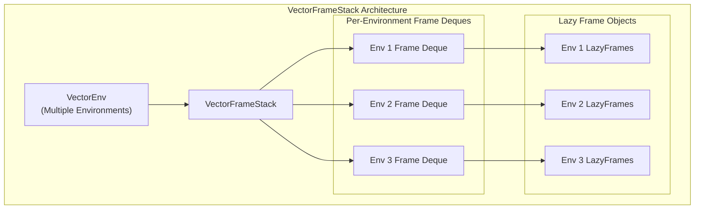
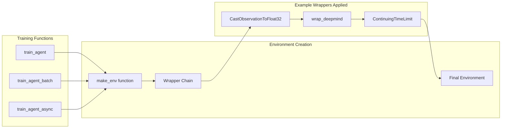

<!-- source: DeepWiki mcp.deepwiki.com · repo chainer/chainerrl · page 4.2 Environment Wrappers · fetched 2026-10-30 -->

# Environment Wrappers

<details>
<summary>Relevant source files</summary>

The following files were used as context for generating this wiki page:

- [.travis.yml](.travis.yml)
- [chainerrl/__init__.py](chainerrl/__init__.py)
- [chainerrl/wrappers/__init__.py](chainerrl/wrappers/__init__.py)
- [chainerrl/wrappers/atari_wrappers.py](chainerrl/wrappers/atari_wrappers.py)
- [chainerrl/wrappers/cast_observation.py](chainerrl/wrappers/cast_observation.py)
- [chainerrl/wrappers/continuing_time_limit.py](chainerrl/wrappers/continuing_time_limit.py)
- [chainerrl/wrappers/randomize_action.py](chainerrl/wrappers/randomize_action.py)
- [chainerrl/wrappers/scale_reward.py](chainerrl/wrappers/scale_reward.py)
- [examples/grasping/train_dqn_batch_grasping.py](examples/grasping/train_dqn_batch_grasping.py)
- [requirements-dev.txt](requirements-dev.txt)
- [tests/experiments_tests/test_collect_demos.py](tests/experiments_tests/test_collect_demos.py)
- [tests/experiments_tests/test_evaluator.py](tests/experiments_tests/test_evaluator.py)
- [tests/experiments_tests/test_train_agent.py](tests/experiments_tests/test_train_agent.py)
- [tests/experiments_tests/test_train_agent_async.py](tests/experiments_tests/test_train_agent_async.py)
- [tests/experiments_tests/test_train_agent_batch.py](tests/experiments_tests/test_train_agent_batch.py)
- [tests/wrappers_tests/test_atari_wrappers.py](tests/wrappers_tests/test_atari_wrappers.py)
- [tests/wrappers_tests/test_cast_observation.py](tests/wrappers_tests/test_cast_observation.py)
- [tests/wrappers_tests/test_continuing_time_limit.py](tests/wrappers_tests/test_continuing_time_limit.py)
- [tests/wrappers_tests/test_render.py](tests/wrappers_tests/test_render.py)
- [tests/wrappers_tests/test_scale_reward.py](tests/wrappers_tests/test_scale_reward.py)
- [tests/wrappers_tests/test_vector_frame_stack.py](tests/wrappers_tests/test_vector_frame_stack.py)

</details>


Environment wrappers provide a standardized way to modify and extend environment behavior without changing the underlying environment implementation. ChainerRL includes both general-purpose wrappers for common preprocessing tasks and specialized wrappers optimized for specific domains like Atari games.

For information about training systems that use these wrappers, see [Training Systems](#4.1). For examples of wrapper usage in practice, see [Basic Training Examples](#5.1).

## Wrapper Architecture

ChainerRL's environment wrappers follow the OpenAI Gym wrapper pattern, where each wrapper inherits from a specific Gym wrapper base class and modifies one aspect of environment behavior.

```mermaid
graph TD
    subgraph "Gym Base Classes"
        GymWrapper["gym.Wrapper"]
        ActionWrapper["gym.ActionWrapper"]
        ObservationWrapper["gym.ObservationWrapper"] 
        RewardWrapper["gym.RewardWrapper"]
    end
    
    subgraph "General Purpose Wrappers"
        CastObservation["CastObservation"]
        CastObservationToFloat32["CastObservationToFloat32"]
        ContinuingTimeLimit["ContinuingTimeLimit"]
        Monitor["Monitor"]
        NormalizeActionSpace["NormalizeActionSpace"]
        RandomizeAction["RandomizeAction"]
        Render["Render"]
        ScaleReward["ScaleReward"]
    end
    
    subgraph "Atari Specific Wrappers"
        NoopResetEnv["NoopResetEnv"]
        FireResetEnv["FireResetEnv"]
        EpisodicLifeEnv["EpisodicLifeEnv"]
        MaxAndSkipEnv["MaxAndSkipEnv"]
        ClipRewardEnv["ClipRewardEnv"]
        WarpFrame["WarpFrame"]
        FrameStack["FrameStack"]
        ScaledFloatFrame["ScaledFloatFrame"]
        FlickerFrame["FlickerFrame"]
    end
    
    subgraph "Vector Environment Wrappers"
        VectorFrameStack["VectorFrameStack"]
        VectorEnvWrapper["VectorEnvWrapper"]
    end
    
    GymWrapper --> ContinuingTimeLimit
    GymWrapper --> Monitor
    GymWrapper --> Render
    GymWrapper --> NoopResetEnv
    GymWrapper --> FireResetEnv
    GymWrapper --> EpisodicLifeEnv
    GymWrapper --> MaxAndSkipEnv
    GymWrapper --> FrameStack
    GymWrapper --> FlickerFrame
    
    ActionWrapper --> RandomizeAction
    ActionWrapper --> NormalizeActionSpace
    
    ObservationWrapper --> CastObservation
    ObservationWrapper --> WarpFrame
    ObservationWrapper --> ScaledFloatFrame
    
    RewardWrapper --> ScaleReward
    RewardWrapper --> ClipRewardEnv
    
    CastObservation --> CastObservationToFloat32
```



**Data Flow Through Wrapper Chain**



Sources: [chainerrl/wrappers/__init__.py:1-17](), [chainerrl/wrappers/atari_wrappers.py:1-315]()

## General Purpose Wrappers

### Observation Processing

| Wrapper | Purpose | Base Class |
|---------|---------|------------|
| `CastObservation` | Cast observations to specified dtype | `gym.ObservationWrapper` |
| `CastObservationToFloat32` | Cast observations to `float32` for Chainer compatibility | `CastObservation` |

The `CastObservation` wrapper modifies observation data types while preserving the original observation in the `original_observation` attribute. This is particularly useful for ensuring compatibility with neural network frameworks that expect specific data types.

Sources: [chainerrl/wrappers/cast_observation.py:5-37]()

### Action Processing

| Wrapper | Purpose | Base Class |
|---------|---------|------------|
| `RandomizeAction` | Replace actions with random ones at specified probability | `gym.ActionWrapper` |
| `NormalizeActionSpace` | Normalize action spaces to standard ranges | `gym.ActionWrapper` |

The `RandomizeAction` wrapper is designed for evaluation scenarios where stochastic behavior is needed. It supports only `gym.spaces.Discrete` action spaces and maintains its own random state for reproducibility.

Sources: [chainerrl/wrappers/randomize_action.py:5-40]()

### Reward Processing  

| Wrapper | Purpose | Base Class |
|---------|---------|------------|
| `ScaleReward` | Scale rewards by a constant factor | `gym.RewardWrapper` |

The `ScaleReward` wrapper multiplies all rewards by a scale factor while preserving the original reward value in the `original_reward` attribute.

Sources: [chainerrl/wrappers/scale_reward.py:4-24]()

### Episode Management

| Wrapper | Purpose | Base Class |
|---------|---------|------------|
| `ContinuingTimeLimit` | Set time limits without episode termination | `gym.Wrapper` |
| `Monitor` | Monitor environment statistics | `gym.Wrapper` |
| `Render` | Automatically render environment | `gym.Wrapper` |

The `ContinuingTimeLimit` wrapper implements time limits for continuing environments by setting `info['needs_reset'] = True` when the limit is reached, but keeps `done = False`. This allows the training code to handle resets explicitly.

Sources: [chainerrl/wrappers/continuing_time_limit.py:4-41]()

## Atari Environment Wrappers

ChainerRL includes a comprehensive set of Atari-specific wrappers adapted from OpenAI Baselines, designed to implement the preprocessing pipeline used in landmark papers like DQN.

### Core Atari Wrappers



### Frame Processing Pipeline

The typical Atari preprocessing pipeline follows this sequence:

1. **`NoopResetEnv`** - Adds 1-30 random no-op actions at episode start for stochastic initial states
2. **`MaxAndSkipEnv`** - Repeats actions for 4 frames and returns max-pooled observation  
3. **`EpisodicLifeEnv`** - Treats life loss as episode termination for better value estimation
4. **`FireResetEnv`** - Automatically fires to start games that require it
5. **`WarpFrame`** - Converts frames to 84x84 grayscale images
6. **`ScaledFloatFrame`** - Normalizes pixel values from [0,255] to [0,1] 
7. **`ClipRewardEnv`** - Clips rewards to {-1, 0, +1} by sign
8. **`FrameStack`** - Stacks 4 consecutive frames using `LazyFrames` for memory efficiency

### Helper Functions

ChainerRL provides convenience functions to apply standard Atari preprocessing:

- **`make_atari(env_id, max_frames)`** - Creates base Atari environment with time limits
- **`wrap_deepmind(env, **kwargs)`** - Applies full DeepMind-style preprocessing pipeline

```python
# Typical usage pattern from atari_wrappers.py
env = make_atari('BreakoutNoFrameskip-v4')
env = wrap_deepmind(env, episode_life=True, clip_rewards=True, frame_stack=True)
```

Sources: [chainerrl/wrappers/atari_wrappers.py:281-315]()

### Memory-Efficient Frame Stacking

The `LazyFrames` class implements memory-efficient frame stacking by storing references to frames rather than copying them. This is crucial for DQN's 1M frame replay buffers.



Sources: [chainerrl/wrappers/atari_wrappers.py:244-266]()

## Vector Environment Wrappers

For batch training with multiple environments, ChainerRL provides specialized vector environment wrappers.

### VectorFrameStack

The `VectorFrameStack` wrapper applies frame stacking across multiple environments simultaneously, sharing frame references between environments for memory efficiency.



Unlike individually wrapped environments, `VectorFrameStack` allows frames to be shared between environments, providing better memory efficiency for batch training scenarios.

Sources: [chainerrl/wrappers/vector_frame_stack.py](), [tests/wrappers_tests/test_vector_frame_stack.py:37-124]()

## Integration with Training Systems

Environment wrappers integrate seamlessly with ChainerRL's training infrastructure:



Training functions accept `make_env` functions that return pre-wrapped environments, allowing flexible environment configuration while maintaining consistent interfaces.

Sources: [examples/grasping/train_dqn_batch_grasping.py:194-223](), [tests/experiments_tests/test_train_agent_batch.py:27-47]()

---

