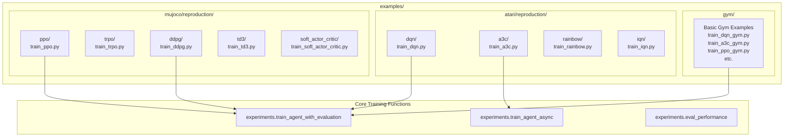
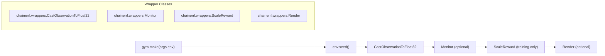
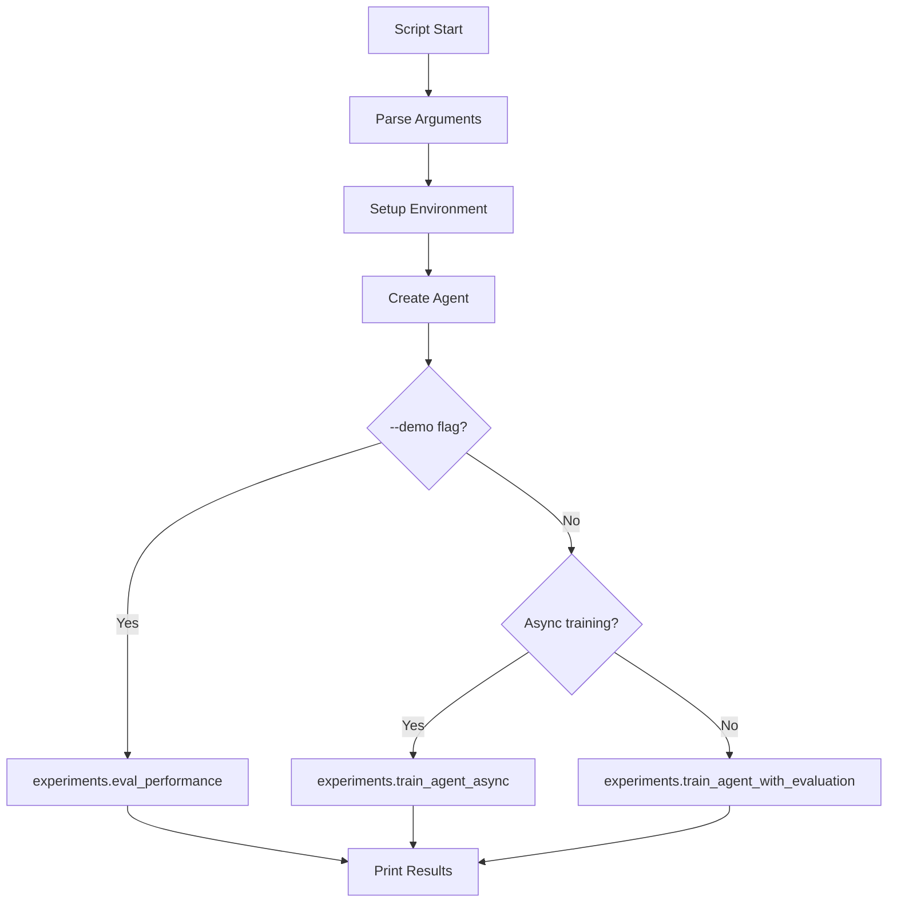
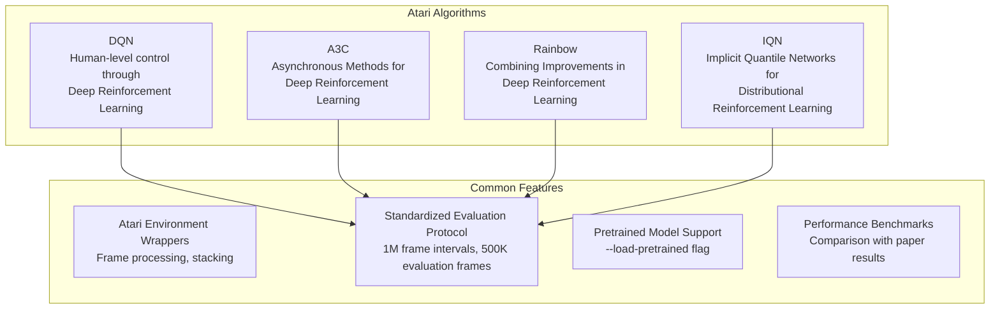
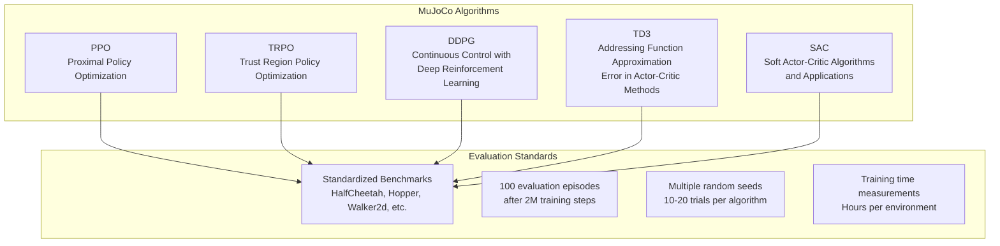

<!-- source: DeepWiki mcp.deepwiki.com · repo chainer/chainerrl · page 5 Examples and Usage · fetched 2026-10-30 -->

# Examples and Usage

<details>
<summary>Relevant source files</summary>

The following files were used as context for generating this wiki page:

- [examples/atari/reproduction/a3c/README.md](examples/atari/reproduction/a3c/README.md)
- [examples/atari/reproduction/dqn/README.md](examples/atari/reproduction/dqn/README.md)
- [examples/atari/reproduction/iqn/README.md](examples/atari/reproduction/iqn/README.md)
- [examples/atari/reproduction/rainbow/README.md](examples/atari/reproduction/rainbow/README.md)
- [examples/gym/train_a3c_gym.py](examples/gym/train_a3c_gym.py)
- [examples/gym/train_acer_gym.py](examples/gym/train_acer_gym.py)
- [examples/gym/train_categorical_dqn_gym.py](examples/gym/train_categorical_dqn_gym.py)
- [examples/gym/train_dqn_gym.py](examples/gym/train_dqn_gym.py)
- [examples/gym/train_pcl_gym.py](examples/gym/train_pcl_gym.py)
- [examples/gym/train_reinforce_gym.py](examples/gym/train_reinforce_gym.py)
- [examples/mujoco/reproduction/ddpg/README.md](examples/mujoco/reproduction/ddpg/README.md)
- [examples/mujoco/reproduction/ppo/README.md](examples/mujoco/reproduction/ppo/README.md)
- [examples/mujoco/reproduction/soft_actor_critic/README.md](examples/mujoco/reproduction/soft_actor_critic/README.md)
- [examples/mujoco/reproduction/td3/README.md](examples/mujoco/reproduction/td3/README.md)
- [examples/mujoco/reproduction/trpo/README.md](examples/mujoco/reproduction/trpo/README.md)

</details>


This page provides practical guidance for using ChainerRL through its comprehensive collection of examples and reproduction scripts. The examples demonstrate how to train reinforcement learning agents on standard benchmarks and reproduce results from published research papers.

For information about the underlying training infrastructure, see [Training and Evaluation Infrastructure](#4). For details about specific RL algorithms, see [Reinforcement Learning Agents](#2).

## Overview of Examples Structure

ChainerRL provides examples organized into three main categories: basic training examples for getting started, algorithm reproduction scripts that match paper results, and a pretrained models system for immediate evaluation.

### Example Categories and Code Structure



Sources: [examples/gym/train_dqn_gym.py:1-187](), [examples/gym/train_a3c_gym.py:1-203](), [examples/atari/reproduction/a3c/README.md:1-139](), [examples/mujoco/reproduction/ppo/README.md:1-90]()

### Common Command Line Interface

All examples follow a consistent command line interface pattern with standard options for training, evaluation, and model management.

| Option | Purpose | Example |
|--------|---------|---------|
| `--env` | Environment name | `--env CartPole-v0` |
| `--gpu` | GPU device ID (-1 for CPU) | `--gpu 0` |
| `--seed` | Random seed | `--seed 42` |
| `--outdir` | Output directory | `--outdir results` |
| `--demo` | Evaluation mode | `--demo` |
| `--load` | Load saved model | `--load model.pkl` |
| `--load-pretrained` | Load pretrained model | `--load-pretrained` |
| `--steps` | Training steps | `--steps 1000000` |
| `--eval-interval` | Evaluation frequency | `--eval-interval 10000` |

Sources: [examples/gym/train_dqn_gym.py:37-69](), [examples/gym/train_a3c_gym.py:91-116]()

## Basic Training Examples

The basic examples in `examples/gym/` demonstrate how to train popular RL algorithms on OpenAI Gym environments. These examples are designed for learning and experimentation with straightforward configurations.

### Environment Setup Pattern

All basic examples follow a consistent environment setup pattern using ChainerRL wrappers:



Sources: [examples/gym/train_dqn_gym.py:81-99](), [examples/gym/train_a3c_gym.py:133-149]()

### Agent Configuration Patterns

The examples demonstrate different agent configuration patterns based on action space types:

**Discrete Action Spaces (DQN Example):**
- Uses `FCStateQFunctionWithDiscreteAction` for Q-functions
- Employs `LinearDecayEpsilonGreedy` exploration
- Configures `ReplayBuffer` or `PrioritizedReplayBuffer`

**Continuous Action Spaces (DQN with NAF):**
- Uses `FCQuadraticStateQFunction` for continuous control
- Employs `AdditiveOU` exploration noise
- Handles action clipping with `make_action_filtered`

Sources: [examples/gym/train_dqn_gym.py:107-128](), [examples/gym/train_dqn_gym.py:153-160]()

### Training Loop Integration

Basic examples use the high-level training functions from the `experiments` module:



Sources: [examples/gym/train_dqn_gym.py:167-183](), [examples/gym/train_a3c_gym.py:176-198]()

## Algorithm Reproductions

The reproduction scripts in `examples/atari/reproduction/` and `examples/mujoco/reproduction/` are designed to match published paper results with carefully tuned hyperparameters and evaluation protocols.

### Atari Reproduction Structure



Sources: [examples/atari/reproduction/a3c/README.md:32-43](), [examples/atari/reproduction/dqn/README.md:34-49](), [examples/atari/reproduction/rainbow/README.md:35-46]()

### MuJoCo Reproduction Structure



Sources: [examples/mujoco/reproduction/ppo/README.md:42-59](), [examples/mujoco/reproduction/trpo/README.md:42-55](), [examples/mujoco/reproduction/ddpg/README.md:39-82]()

### Evaluation Protocols

Reproduction scripts implement rigorous evaluation protocols that match the original papers:

**Atari Evaluation Protocol:**
- Evaluation frequency: Every 1 million frames (250K timesteps)
- Evaluation duration: 500K frames (125K timesteps) per evaluation
- Episode constraints: Random no-ops (up to 30), time limits vary by algorithm
- Reporting: Best intermediate score across 200 evaluations

**MuJoCo Evaluation Protocol:**
- Training duration: 2M timesteps for most algorithms
- Evaluation frequency: Every 5K-50K timesteps depending on algorithm
- Episode evaluation: 100 episodes without exploration noise
- Reporting: Average return ± standard error across multiple seeds

Sources: [examples/atari/reproduction/a3c/README.md:110-125](), [examples/mujoco/reproduction/ppo/README.md:42-52]()

## Pretrained Models System

ChainerRL provides a pretrained models system that allows immediate evaluation of trained agents without running lengthy training procedures.

### Loading Pretrained Models

The pretrained model system uses the `--load-pretrained` flag with optional `--pretrained-type` specification:

```bash
# Load best intermediate model
python train_dqn.py --demo --load-pretrained --env BreakoutNoFrameskip-v4 --pretrained-type best

# Load final model after training
python train_rainbow.py --demo --load-pretrained --env BreakoutNoFrameskip-v4 --pretrained-type final
```

### Pretrained Model Types

| Type | Description | Use Case |
|------|-------------|----------|
| `best` | Best intermediate network during training | Highest performance evaluation |
| `final` | Final network after training completion | End-of-training state |

Sources: [examples/atari/reproduction/dqn/README.md:16-30](), [examples/atari/reproduction/rainbow/README.md:16-30]()

### Model Availability

Pretrained models are available for:
- **Atari domains**: DQN, A3C, Rainbow, IQN across 50+ games
- **MuJoCo domains**: PPO, TRPO, DDPG, TD3, SAC across standard continuous control tasks

Each reproduction script includes pretrained models that represent the performance reported in the corresponding README files.

Sources: [examples/atari/reproduction/a3c/README.md:16-19](), [examples/mujoco/reproduction/ppo/README.md:19-23]()

## Practical Usage Patterns

### Quick Start for New Environments

1. **Choose an appropriate base example** based on action space:
   - Discrete actions: Use `train_dqn_gym.py` as starting point
   - Continuous actions: Use DQN with NAF or actor-critic methods

2. **Modify environment creation**:
   ```python
   def make_env(test):
       env = gym.make(args.env)
       env = chainerrl.wrappers.CastObservationToFloat32(env)
       # Add environment-specific wrappers
       return env
   ```

3. **Adjust hyperparameters** in the argument parser section

4. **Run training**:
   ```bash
   python your_script.py --env YourEnv-v0 --steps 100000
   ```

### Reproducing Paper Results

1. **Use the appropriate reproduction script** from the paper you want to reproduce
2. **Check requirements** in the README (e.g., MuJoCo Pro, atari_py)
3. **Run with paper-matching hyperparameters**:
   ```bash
   python train_algorithm.py --env PaperEnv-v0 --seed 0
   ```
4. **Compare results** with the benchmarks provided in the README

### Custom Algorithm Development

1. **Start with the closest existing example** to your algorithm type
2. **Replace the agent creation section** with your custom agent
3. **Maintain the environment setup and training loop patterns**
4. **Use the same evaluation infrastructure** for consistent comparisons

Sources: [examples/gym/train_dqn_gym.py:33-187](), [examples/gym/train_a3c_gym.py:88-202]()

---

