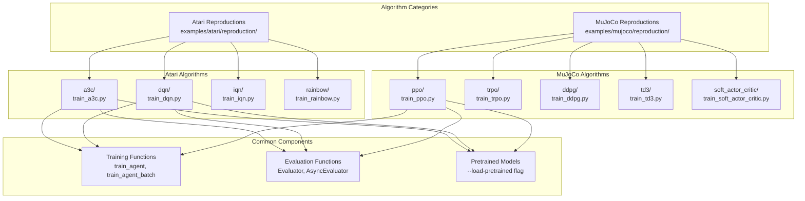
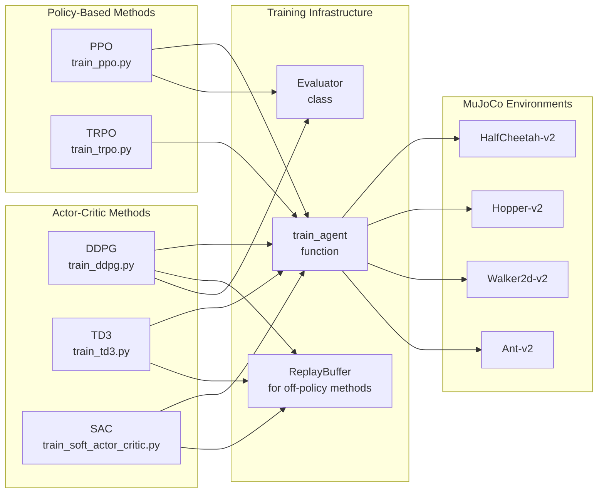
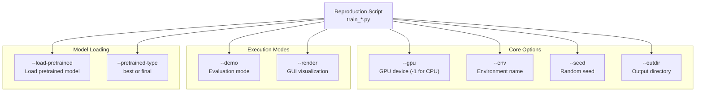

<!-- source: DeepWiki mcp.deepwiki.com · repo chainer/chainerrl · page 5.2 Algorithm Reproductions · fetched 2026-10-30 -->

# Algorithm Reproductions

<details>
<summary>Relevant source files</summary>

The following files were used as context for generating this wiki page:

- [examples/atari/reproduction/a3c/README.md](examples/atari/reproduction/a3c/README.md)
- [examples/atari/reproduction/dqn/README.md](examples/atari/reproduction/dqn/README.md)
- [examples/atari/reproduction/iqn/README.md](examples/atari/reproduction/iqn/README.md)
- [examples/atari/reproduction/rainbow/README.md](examples/atari/reproduction/rainbow/README.md)
- [examples/mujoco/reproduction/ddpg/README.md](examples/mujoco/reproduction/ddpg/README.md)
- [examples/mujoco/reproduction/ppo/README.md](examples/mujoco/reproduction/ppo/README.md)
- [examples/mujoco/reproduction/soft_actor_critic/README.md](examples/mujoco/reproduction/soft_actor_critic/README.md)
- [examples/mujoco/reproduction/td3/README.md](examples/mujoco/reproduction/td3/README.md)
- [examples/mujoco/reproduction/trpo/README.md](examples/mujoco/reproduction/trpo/README.md)

</details>


This page documents the algorithm reproduction scripts provided in ChainerRL that reproduce results from original research papers across different algorithms and environments. These scripts serve as validation of the library's implementations and provide researchers with baseline results for comparison.

For basic training examples and tutorials, see [Basic Training Examples](#5.1). For information about downloading and using pretrained models generated by these reproduction scripts, see [Pretrained Models](#5.3).

## Purpose and Scope

The reproduction scripts implement rigorous experimental protocols that mirror the evaluation methodologies from original research papers. Each reproduction includes:

- Faithful implementation of training hyperparameters
- Standardized evaluation protocols
- Multiple random seeds for statistical significance
- Comparison tables against published results
- Training time benchmarks

## Reproduction Structure Overview

The reproduction examples are organized by environment domain and algorithm type, following a consistent structure across all implementations.



Sources: [examples/atari/reproduction/a3c/README.md:1-139](), [examples/mujoco/reproduction/ppo/README.md:1-90](), [examples/atari/reproduction/iqn/README.md:1-134]()

## Atari Reproductions

### Value-Based Methods on Atari

The Atari reproduction suite includes several value-based algorithms that operate on discrete action spaces with visual observations.

#### DQN (Deep Q-Networks)
The DQN reproduction implements the Nature paper protocol with extensive Atari game coverage.

**Training Script**: [examples/atari/reproduction/dqn/train_dqn.py]()
**Evaluation Protocol**: 
- 200 intermediate evaluations (every 1M frames)
- 500K frames per evaluation phase
- Best intermediate agent re-evaluated for 30 episodes
- Episodes capped at 5 minutes (4500 timesteps)

| Evaluation Metric | Value |
|------------------|-------|
| Number of seeds | 5 |
| Common domains | 49 |
| Training time (average) | 4.23 days |
| GPU requirement | Single GPU |

#### Rainbow
Rainbow combines six DQN improvements in a single algorithm.

**Training Script**: [examples/atari/reproduction/rainbow/train_rainbow.py]()
**Key Features**:
- Distributional RL with categorical distributions
- Prioritized experience replay
- Dueling network architecture
- Multi-step learning
- Double Q-learning
- Noisy networks

| Evaluation Metric | Value |
|------------------|-------|
| Number of seeds | 3 |
| Common domains | 52 |
| Training time (average) | 12.27 days |
| ChainerRL wins vs paper | 34/52 domains |

#### IQN (Implicit Quantile Networks)
IQN implements distributional RL using implicit quantile regression.

**Training Script**: [examples/atari/reproduction/iqn/train_iqn.py]()
**Evaluation Protocol**:
- Episodes capped at 30 minutes (27K timesteps)
- Random no-ops (up to 30) at episode start
- Best intermediate evaluation reported

| Evaluation Metric | Value |
|------------------|-------|
| Number of seeds | 3 |
| Common domains | 55 |
| Training time (average) | 9.10 days |
| ChainerRL wins vs paper | 28/55 domains |

Sources: [examples/atari/reproduction/dqn/README.md:1-130](), [examples/atari/reproduction/rainbow/README.md:1-139](), [examples/atari/reproduction/iqn/README.md:1-134]()

#### A3C (Asynchronous Advantage Actor-Critic)
A3C implements multi-process training with actor-critic architecture.

**Training Script**: [examples/atari/reproduction/a3c/train_a3c.py]()
**Key Features**:
- 16 parallel processes (no GPU required)
- Asynchronous parameter updates
- Advantage estimation with baseline

| Evaluation Metric | Value |
|------------------|-------|
| Number of seeds | 5 |
| Common domains | 54 |
| Training time (average) | 0.84 days |
| Hardware requirement | 17 CPUs |

Sources: [examples/atari/reproduction/a3c/README.md:1-139]()

## MuJoCo Reproductions

### Continuous Control Algorithms

The MuJoCo reproduction suite covers algorithms designed for continuous action spaces and physics simulation environments.



Sources: [examples/mujoco/reproduction/ppo/README.md:1-90](), [examples/mujoco/reproduction/ddpg/README.md:1-116](), [examples/mujoco/reproduction/td3/README.md:1-121]()

#### PPO (Proximal Policy Optimization)
PPO implements clipped policy gradients for stable policy updates.

**Training Script**: [examples/mujoco/reproduction/ppo/train_ppo.py]()
**Protocol**: Follows "Deep Reinforcement Learning that Matters" evaluation
**Training**: 2M timesteps, 100 evaluation episodes

| Environment | ChainerRL Score | Reported Score |
|-------------|:---------------:|:--------------:|
| HalfCheetah | **2404**±185 | 2201±323 |
| Hopper | 2719±67 | **2790**±62 |
| Walker2d | 2994±113 | N/A |
| Swimmer | 111±4 | N/A |

#### TRPO (Trust Region Policy Optimization)
TRPO uses natural policy gradients with trust region constraints.

**Training Script**: [examples/mujoco/reproduction/trpo/train_trpo.py]()
**Key Features**:
- Natural policy gradient updates
- KL divergence constraints
- Line search for step size

| Environment | ChainerRL Score | Reported Score |
|-------------|:---------------:|:--------------:|
| HalfCheetah | **1474**±112 | 205±256 |
| Hopper | **3056**±44 | 2828±70 |
| Walker2d | 3073±59 | N/A |
| Swimmer | 200±25 | N/A |

Sources: [examples/mujoco/reproduction/ppo/README.md:54-60](), [examples/mujoco/reproduction/trpo/README.md:49-54]()

#### DDPG (Deep Deterministic Policy Gradients)
DDPG extends DQN to continuous action spaces using the actor-critic framework.

**Training Script**: [examples/mujoco/reproduction/ddpg/train_ddpg.py]()
**Protocol**: 1M timesteps, evaluation every 5000 timesteps

| Environment | ChainerRL Score | Reported Score |
|-------------|:---------------:|:--------------:|
| HalfCheetah-v2 | **10797.04** | 8577.29 |
| Hopper-v2 | **3565.60** | 1860.02 |
| Walker2d-v2 | **3594.26** | 3098.11 |
| Ant-v2 | **1505.47** | 888.77 |

#### TD3 (Twin Delayed Deep Deterministic Policy Gradients)
TD3 improves upon DDPG with three key modifications.

**Training Script**: [examples/mujoco/reproduction/td3/train_td3.py]()
**Key Improvements**:
- Twin critic networks
- Delayed policy updates
- Target policy smoothing

| Environment | ChainerRL Score | Reported Score |
|-------------|:---------------:|:--------------:|
| HalfCheetah-v2 | **10248.51**±1063.48 | 9636.95±859.065 |
| Hopper-v2 | **3662.85**±144.98 | 3564.07±114.74 |
| Walker2d-v2 | **4978.32**±517.44 | 4682.82±539.64 |
| Ant-v2 | **4626.25**±1020.70 | 4372.44±1000.33 |

#### SAC (Soft Actor-Critic)
SAC implements maximum entropy reinforcement learning for robust policy learning.

**Training Script**: [examples/mujoco/reproduction/soft_actor_critic/train_soft_actor_critic.py]()
**Key Features**:
- Entropy regularization
- Automatic temperature tuning
- Off-policy learning

| Environment | ChainerRL Score | Reported Score |
|-------------|:---------------:|:--------------:|
| HalfCheetah-v2 | 14850.54 | ~15000 |
| Hopper-v2 | 2911.89 | ~3300 |
| Walker2d-v2 | 5282.61 | ~5600 |
| Ant-v2 | 5925.63 | ~5800 |

Sources: [examples/mujoco/reproduction/ddpg/README.md:56-64](), [examples/mujoco/reproduction/td3/README.md:59-67](), [examples/mujoco/reproduction/soft_actor_critic/README.md:52-58]()

## Common Script Interface

All reproduction scripts follow a standardized command-line interface for consistency and ease of use.

### Standard Command-Line Options



### Example Usage Patterns

**Training a new agent**:
```bash
python train_ppo.py --env HalfCheetah-v2 --seed 42 --gpu 0
```

**Loading a pretrained model for evaluation**:
```bash
python train_dqn.py --demo --load-pretrained --env BreakoutNoFrameskip-v4 --pretrained-type best --gpu -1
```

**Running with CPU only**:
```bash
python train_a3c.py --env PongNoFrameskip-v4 --gpu -1
```

Sources: [examples/atari/reproduction/dqn/README.md:22-32](), [examples/mujoco/reproduction/ppo/README.md:25-36]()

## Evaluation Protocols

Each algorithm family implements domain-specific evaluation protocols that match the original research papers.

### Atari Evaluation Standard

The Atari evaluations follow a consistent protocol across all value-based methods:

- **Evaluation Frequency**: Every 1M frames (250K timesteps)
- **Evaluation Duration**: 500K frames (125K timesteps) per phase
- **Episode Constraints**: 30 minutes maximum, random no-ops (up to 30)
- **Reporting**: Best intermediate evaluation score

### MuJoCo Evaluation Standard

MuJoCo evaluations vary by algorithm but typically include:

- **Evaluation Frequency**: Every 5K-50K timesteps
- **Evaluation Episodes**: 10-100 episodes per evaluation
- **Reporting Metrics**: Maximum average return and final average return
- **Statistical Analysis**: Multiple seeds with standard deviation reporting

Sources: [examples/atari/reproduction/dqn/README.md:114-125](), [examples/mujoco/reproduction/td3/README.md:47-51]()

## Training Performance Benchmarks

### Hardware Requirements and Training Times

| Algorithm | Environment | Hardware | Training Time | Seeds |
|-----------|-------------|----------|---------------|-------|
| DQN | Atari | Single GPU | 4.23 days | 5 |
| Rainbow | Atari | Single GPU | 12.27 days | 3 |
| IQN | Atari | Single GPU | 9.10 days | 3 |
| A3C | Atari | 17 CPUs | 0.84 days | 5 |
| PPO | MuJoCo | CPU only | 2.06 hours | 20 |
| TD3 | MuJoCo | CPU + GPU | 3.79 hours | 10 |
| DDPG | MuJoCo | CPU + GPU | 4.04 hours | 10 |

### Performance vs. Original Papers

The reproduction results demonstrate that ChainerRL implementations generally achieve competitive or superior performance compared to original paper results:

- **Atari**: ChainerRL outperforms original papers in 60-65% of tested domains
- **MuJoCo**: ChainerRL consistently matches or exceeds reported scores
- **Statistical Significance**: Multiple seeds ensure robust comparisons

Sources: [examples/atari/reproduction/dqn/README.md:127-130](), [examples/mujoco/reproduction/ppo/README.md:62-79](), [examples/mujoco/reproduction/td3/README.md:87-107]()

---

