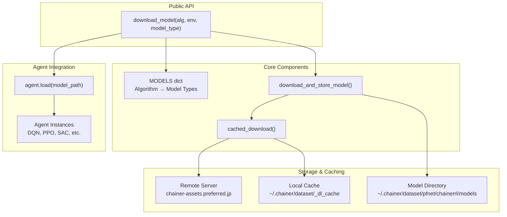
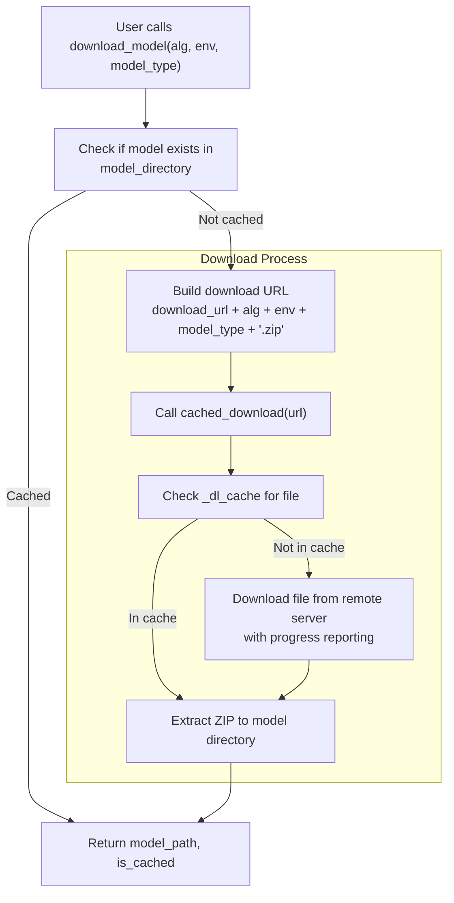
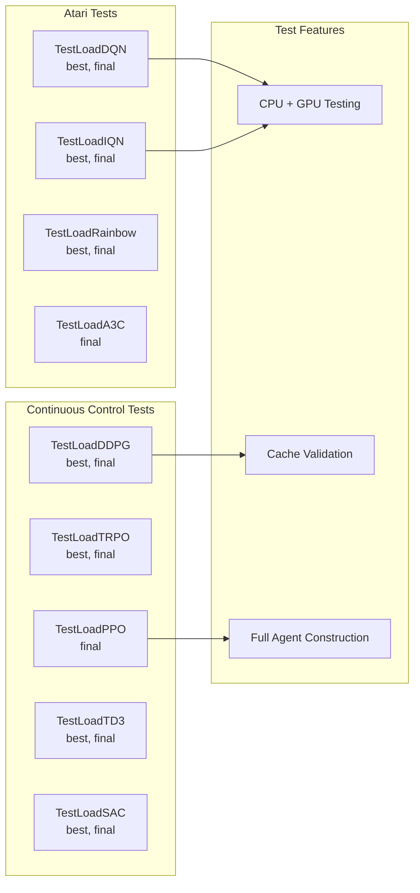

<!-- source: DeepWiki mcp.deepwiki.com · repo chainer/chainerrl · page 5.3 Pretrained Models · fetched 2026-10-30 -->

# Pretrained Models

<details>
<summary>Relevant source files</summary>

The following files were used as context for generating this wiki page:

- [chainerrl/misc/pretrained_models.py](chainerrl/misc/pretrained_models.py)
- [examples/atari/reproduction/a3c/train_a3c.py](examples/atari/reproduction/a3c/train_a3c.py)
- [examples/atari/reproduction/dqn/train_dqn.py](examples/atari/reproduction/dqn/train_dqn.py)
- [examples/atari/reproduction/iqn/train_iqn.py](examples/atari/reproduction/iqn/train_iqn.py)
- [examples/atari/reproduction/rainbow/train_rainbow.py](examples/atari/reproduction/rainbow/train_rainbow.py)
- [tests/misc_tests/test_pretrained_models.py](tests/misc_tests/test_pretrained_models.py)

</details>


This document covers ChainerRL's pretrained model system, which provides pre-trained agents for various reinforcement learning algorithms across different environments. The system handles automatic downloading, caching, and loading of models that have been trained on standard benchmark environments.

For information about training agents from scratch, see [Basic Training Examples](#5.1). For reproducing research results, see [Algorithm Reproductions](#5.2).

## Overview

ChainerRL provides a centralized system for accessing pretrained models across multiple RL algorithms. The system automatically downloads models from a remote server, caches them locally, and provides a simple API for loading them into agents.

### Pretrained Model System Architecture



Sources: [chainerrl/misc/pretrained_models.py:20-32](), [chainerrl/misc/pretrained_models.py:133-152]()

## Supported Algorithms and Environments

The pretrained model system supports multiple algorithms across different environment categories:

| Algorithm | Environment Type | Available Models | Example Environment |
|-----------|------------------|------------------|-------------------|
| DQN | Atari | best, final | BreakoutNoFrameskip-v4 |
| IQN | Atari | best, final | BreakoutNoFrameskip-v4 |
| Rainbow | Atari | best, final | BreakoutNoFrameskip-v4 |
| A3C | Atari | final | BreakoutNoFrameskip-v4 |
| DDPG | Continuous Control | best, final | Hopper-v2 |
| TRPO | Continuous Control | best, final | Hopper-v2 |
| PPO | Continuous Control | final | Hopper-v2 |
| TD3 | Continuous Control | best, final | Hopper-v2 |
| SAC | Continuous Control | best, final | Hopper-v2 |

### Model Types

- **best**: Model with the highest evaluation performance during training
- **final**: Model at the end of training (may not be the best performing)

Sources: [chainerrl/misc/pretrained_models.py:20-30](), [tests/misc_tests/test_pretrained_models.py:25-575]()

## Download and Caching System

### Download Flow Diagram



### Caching Strategy

The system uses a two-level caching approach:

1. **Download Cache**: Raw downloaded files stored in `~/.chainer/dataset/_dl_cache`
2. **Model Directory**: Extracted and organized models in `~/.chainer/dataset/pfnet/chainerrl/models/{alg}/{env}/`

Sources: [chainerrl/misc/pretrained_models.py:57-97](), [chainerrl/misc/pretrained_models.py:100-131]()

## Usage Examples

### Basic Usage Pattern

```python
from chainerrl.misc import download_model

# Download and load a pretrained DQN model
model_path, is_cached = download_model("DQN", "BreakoutNoFrameskip-v4", "best")
agent.load(model_path)
```

### Integration in Training Scripts

The pretrained models are commonly used in example scripts with the `--load-pretrained` flag:

```python
if args.load_pretrained:
    agent.load(misc.download_model("A3C", args.env, model_type="final")[0])
```

### Environment Name Processing

The system automatically processes environment names to remove version suffixes:

```python
env = env.replace("NoFrameskip-v4", "")  # BreakoutNoFrameskip-v4 → Breakout
```

Sources: [chainerrl/misc/pretrained_models.py:148](), [examples/atari/reproduction/a3c/train_a3c.py:122-123](), [examples/atari/reproduction/dqn/train_dqn.py:133-134]()

## Implementation Details

### Core Functions

#### `download_model(alg, env, model_type="best")`

Main public API function that:
- Validates algorithm and model type availability
- Processes environment name
- Calls `download_and_store_model()`
- Returns `(model_path, is_cached)`

#### `cached_download(url)`

Handles file downloading with:
- MD5-based cache lookup
- Progress reporting via `_reporthook()`
- Thread-safe file operations using `filelock`

#### `download_and_store_model(alg, url, env, model_type)`

Manages model organization:
- Creates appropriate directory structure
- Downloads and extracts ZIP files
- Returns path to extracted model directory

Sources: [chainerrl/misc/pretrained_models.py:133-152](), [chainerrl/misc/pretrained_models.py:57-97](), [chainerrl/misc/pretrained_models.py:100-131]()

## Testing Infrastructure

### Test Coverage by Algorithm



Each test class:
- Constructs the appropriate agent architecture
- Downloads the pretrained model
- Loads the model into the agent
- Validates caching behavior when `CHAINERRL_ASSERT_DOWNLOADED_MODEL_IS_CACHED` is set

Sources: [tests/misc_tests/test_pretrained_models.py:30-575]()

### Agent Architecture Validation

The tests ensure that pretrained models are compatible with standard agent configurations by constructing complete agents with:
- Appropriate Q-functions or policy networks
- Correct optimizers and hyperparameters
- Proper replay buffers and explorers
- Environment-specific preprocessing (`phi` functions)

This validates that the pretrained models can be seamlessly integrated into both training and evaluation workflows.

Sources: [tests/misc_tests/test_pretrained_models.py:32-59](), [tests/misc_tests/test_pretrained_models.py:194-213]()

---

