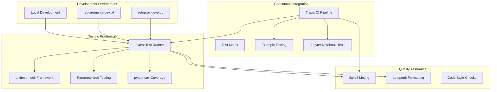
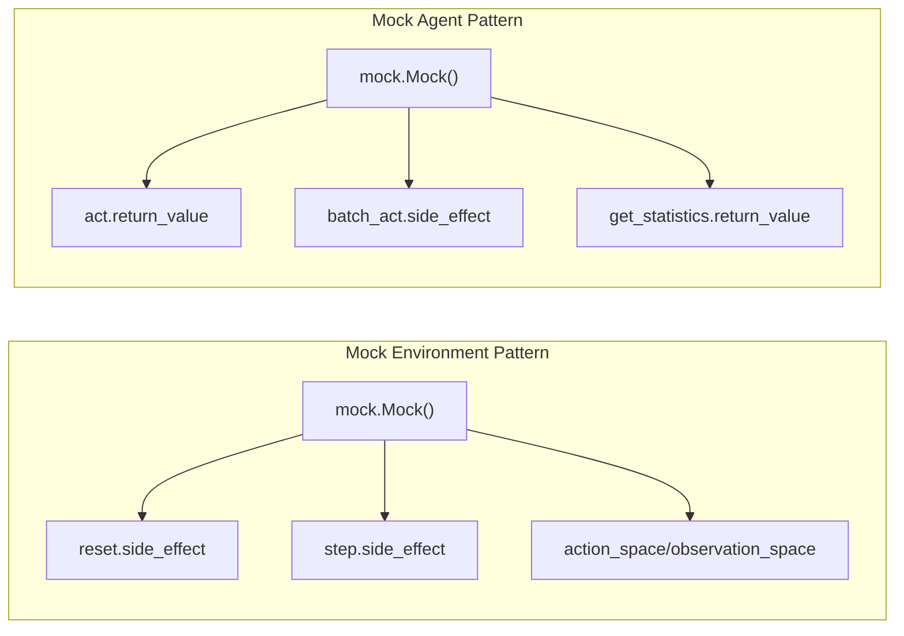
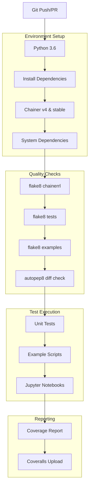

<!-- source: DeepWiki mcp.deepwiki.com · repo chainer/chainerrl · page 6 Development and Testing · fetched 2026-10-30 -->

# Development and Testing

Relevant source files

The following files were used as context for generating this wiki page:

- [.travis.yml](.travis.yml)
- [requirements-dev.txt](requirements-dev.txt)
- [tests/agents_tests/test_a3c.py](tests/agents_tests/test_a3c.py)
- [tests/agents_tests/test_acer.py](tests/agents_tests/test_acer.py)
- [tests/agents_tests/test_nsq.py](tests/agents_tests/test_nsq.py)
- [tests/agents_tests/test_pcl.py](tests/agents_tests/test_pcl.py)
- [tests/experiments_tests/test_collect_demos.py](tests/experiments_tests/test_collect_demos.py)
- [tests/experiments_tests/test_evaluator.py](tests/experiments_tests/test_evaluator.py)
- [tests/experiments_tests/test_train_agent.py](tests/experiments_tests/test_train_agent.py)
- [tests/experiments_tests/test_train_agent_async.py](tests/experiments_tests/test_train_agent_async.py)
- [tests/experiments_tests/test_train_agent_batch.py](tests/experiments_tests/test_train_agent_batch.py)
- [tests/wrappers_tests/test_atari_wrappers.py](tests/wrappers_tests/test_atari_wrappers.py)
- [tests/wrappers_tests/test_render.py](tests/wrappers_tests/test_render.py)
- [tests/wrappers_tests/test_vector_frame_stack.py](tests/wrappers_tests/test_vector_frame_stack.py)

This document covers the development infrastructure, testing framework, and quality assurance systems used in ChainerRL. It provides guidance for contributors on running tests, understanding the continuous integration pipeline, and setting up a development environment.

For information about training agents and conducting experiments, see [Training and Evaluation Infrastructure](#4). For details about usage examples and running algorithms, see [Examples and Usage](#5).

## Overview

ChainerRL employs a comprehensive testing and development infrastructure built around pytest, Travis CI, and automated quality assurance tools. The system ensures code reliability through extensive unit testing, integration testing, and continuous validation across different configurations.

**Testing Architecture Overview**

Sources: [.travis.yml:1-49](), [requirements-dev.txt:1-10]()

---

## Testing Framework

ChainerRL uses pytest as its primary testing framework, with extensive use of parameterized testing and mock objects to ensure comprehensive coverage of algorithms and components.

### Test Organization Structure

The test suite is organized into logical modules that mirror the main codebase structure:

```mermaid
graph TB
    subgraph "tests/"
        AGENTS_TESTS["agents_tests/"]
        EXPERIMENTS_TESTS["experiments_tests/"]
        WRAPPERS_TESTS["wrappers_tests/"]
        MISC_TESTS["misc_tests/"]
    end
    
    subgraph "Agent Testing"
        A3C_TEST["test_a3c.py"]
        ACER_TEST["test_acer.py"]
        NSQ_TEST["test_nsq.py"]
        PCL_TEST["test_pcl.py"]
        DQN_TEST["test_dqn.py"]
    end
    
    subgraph "Experiment Testing"
        EVAL_TEST["test_evaluator.py"]
        TRAIN_ASYNC_TEST["test_train_agent_async.py"]
        TRAIN_BATCH_TEST["test_train_agent_batch.py"]
        TRAIN_TEST["test_train_agent.py"]
        DEMOS_TEST["test_collect_demos.py"]
    end
    
    subgraph "Wrapper Testing"
        ATARI_TEST["test_atari_wrappers.py"]
        VECTOR_TEST["test_vector_frame_stack.py"]
        RENDER_TEST["test_render.py"]
    end
    
    AGENTS_TESTS --> A3C_TEST
    AGENTS_TESTS --> ACER_TEST
    AGENTS_TESTS --> NSQ_TEST
    AGENTS_TESTS --> PCL_TEST
    
    EXPERIMENTS_TESTS --> EVAL_TEST
    EXPERIMENTS_TESTS --> TRAIN_ASYNC_TEST
    EXPERIMENTS_TESTS --> TRAIN_BATCH_TEST
    EXPERIMENTS_TESTS --> DEMOS_TEST
    
    WRAPPERS_TESTS --> ATARI_TEST
    WRAPPERS_TESTS --> VECTOR_TEST
    WRAPPERS_TESTS --> RENDER_TEST
```

**Test Suite Organization**

Sources: [tests/agents_tests/test_acer.py:1-505](), [tests/experiments_tests/test_evaluator.py:1-355](), [tests/wrappers_tests/test_atari_wrappers.py:1-157]()

### Testing Patterns and Utilities

ChainerRL tests employ several key patterns for comprehensive validation:

#### Parameterized Testing
Tests use `chainer.testing.parameterize` extensively to validate algorithms across different configurations:

| Test Parameter | Purpose | Example Values |
|---|---|---|
| `distrib_type` | Distribution types | `'Gaussian'`, `'Softmax'` |
| `t_max` | Temporal horizons | `1`, `2`, `5` |
| `use_lstm` | LSTM usage | `True`, `False` |
| `episodic` | Environment types | `True`, `False` |
| `discrete` | Action spaces | `True`, `False` |

#### Mock-Based Testing
The framework uses `unittest.mock` for isolating components and testing interactions:

**Mock Testing Pattern**

Sources: [tests/experiments_tests/test_evaluator.py:23-29](), [tests/experiments_tests/test_train_agent_batch.py:24-44]()

#### Integration Testing with ABC Environment
Many agent tests use the `ABC` (Always Be Counting) environment for integration testing:

- **Purpose**: Simple deterministic environment for validating agent training
- **Configuration**: Supports discrete/continuous actions, episodic/continuing tasks
- **Success Criteria**: Agents must achieve score of 1.0 for successful training

Sources: [tests/agents_tests/test_acer.py:356-361](), [tests/agents_tests/test_a3c.py:61-65]()

### Test Execution and Coverage

The test suite supports different execution modes:

- **Fast Tests**: Quick validation without `@testing.attr.slow` decorator
- **Slow Tests**: Full integration tests with actual agent training
- **GPU Tests**: Tests marked with GPU requirements (excluded in CI)
- **Coverage Reporting**: Uses `pytest-cov` for coverage analysis

Test execution command from CI: `pytest -m "not gpu and not slow" -x tests --cov=chainerrl`

Sources: [.travis.yml:42]()

---

## Continuous Integration

ChainerRL uses Travis CI for automated testing and quality assurance across multiple configurations.

### CI Pipeline Workflow

**Travis CI Pipeline**

Sources: [.travis.yml:1-49]()

### CI Configuration Matrix

The CI pipeline tests across multiple configurations:

| Configuration | Values | Purpose |
|---|---|---|
| Python Version | `3.6` | Core Python version support |
| Chainer Version | `4`, `stable` | Backward compatibility and latest features |
| Environment | `xenial` | Ubuntu distribution for testing |
| Services | `xvfb` | Virtual display for GUI-dependent tests |

### Quality Assurance Tools

#### Code Style Enforcement
- **flake8**: Linting for PEP 8 compliance and code quality
- **autopep8**: Automatic formatting validation
- **Configuration**: Different rules for main code vs examples (`--ignore=E402,W504` for examples)

#### Coverage Requirements
- **Tool**: `pytest-cov` with coveralls integration
- **Reporting**: Automatic upload to coveralls.io for coverage tracking
- **Exclusions**: Pretrained model tests excluded from CI runs

Sources: [.travis.yml:37-42](), [.travis.yml:47-48]()

### Example and Notebook Testing

The CI pipeline includes validation of:

#### Example Scripts
- **Command**: `./test_examples.sh -1`
- **Purpose**: Ensure example scripts run without errors
- **Scope**: Quick validation runs to verify basic functionality

#### Jupyter Notebooks
- **Target**: `examples/quickstart/quickstart.ipynb`
- **Execution**: Full notebook execution with 600-second timeout
- **Condition**: Only on Python 3.6 with stable Chainer version

Sources: [.travis.yml:43-46]()

---

## Setup and Dependencies

ChainerRL requires specific development dependencies and environment configuration for testing and development.

### Development Dependencies

The development environment is defined in `requirements-dev.txt`:

| Dependency | Purpose |
|---|---|
| `autopep8` | Code formatting |
| `atari_py` | Atari environment support |
| `flake8` | Code linting |
| `opencv-python` | Computer vision operations |
| `pybullet` | Physics simulation environments |
| `pytest` | Testing framework |
| `sphinx` | Documentation generation |
| `sphinx_rtd_theme` | Documentation theme |

### System Dependencies

CI installation includes system-level dependencies:

```mermaid
graph LR
    subgraph "APT Packages"
        FFMPEG["ffmpeg-4"]
        FREEGLUT["freeglut3-dev"]
        PPA["PPA: cran/ffmpeg-4"]
    end
    
    subgraph "Python Packages"
        GYM["gym[atari]==0.16.0"]
        CHAINER["chainer (version-specific)"]
        OPENCV["opencv-python"]
        PYBULLET["pybullet"]
        JUPYTER["jupyter"]
    end
    
    subgraph "Development Setup"
        DEVELOP["python setup.py develop"]
        CONFIG["numpy.show_config()"]
    end
    
    PPA --> FFMPEG
    FFMPEG --> FREEGLUT
    
    FREEGLUT --> GYM
    GYM --> CHAINER
    CHAINER --> OPENCV
    OPENCV --> PYBULLET
    PYBULLET --> JUPYTER
    
    JUPYTER --> DEVELOP
    DEVELOP --> CONFIG
```

**Development Environment Setup**

Sources: [.travis.yml:11-34](), [requirements-dev.txt:1-10]()

### Installation Process

For development setup, the CI process follows this sequence:

1. **System Dependencies**: Install ffmpeg and OpenGL libraries
2. **Python Environment**: Upgrade pip, setuptools, wheel
3. **Chainer Installation**: Version-specific Chainer installation
4. **Testing Dependencies**: pytest-cov and related tools
5. **RL Dependencies**: Gym with Atari support, physics simulators
6. **Development Tools**: Code quality and documentation tools
7. **Package Installation**: Install ChainerRL in development mode

The development installation uses `python setup.py develop` to enable in-place editing and testing.

Sources: [.travis.yml:16-33]()

---

