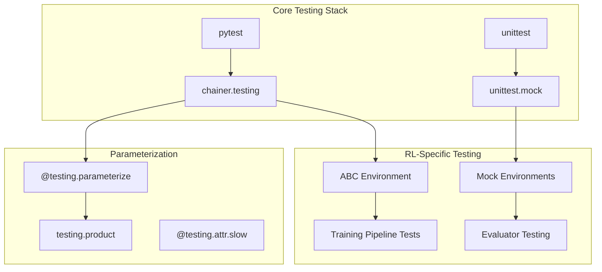
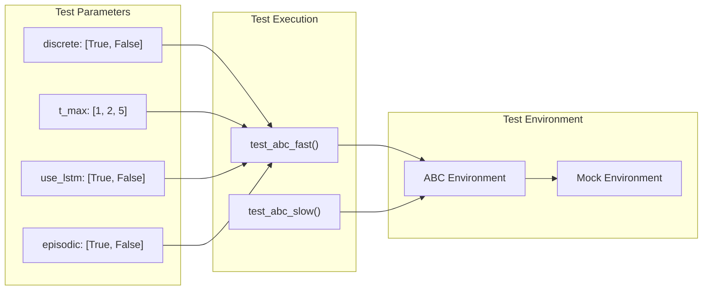
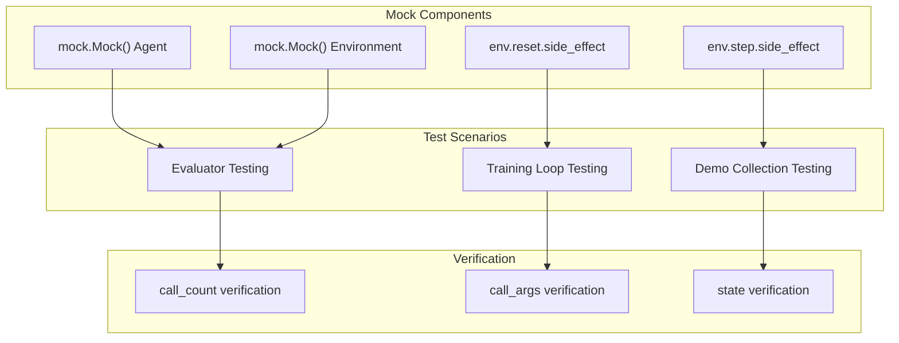
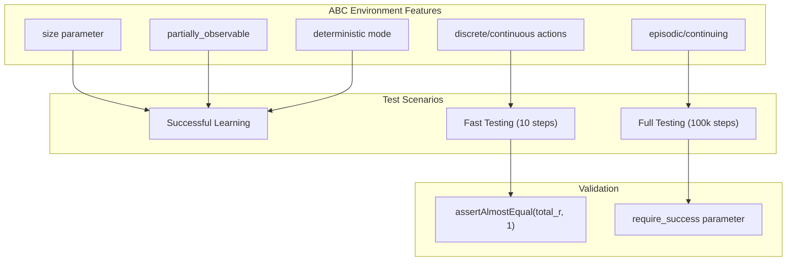
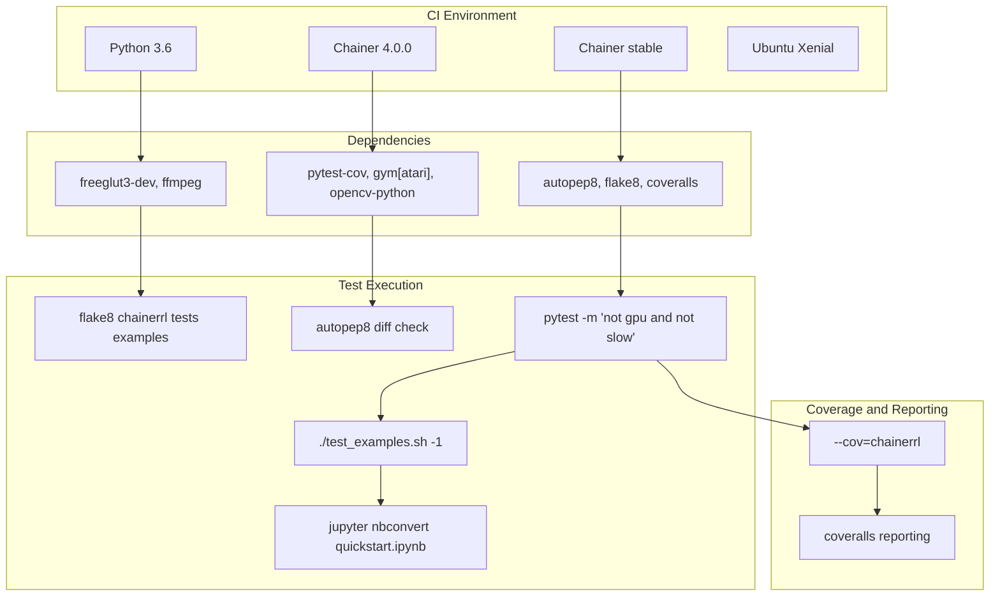
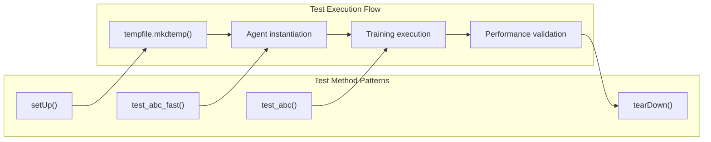
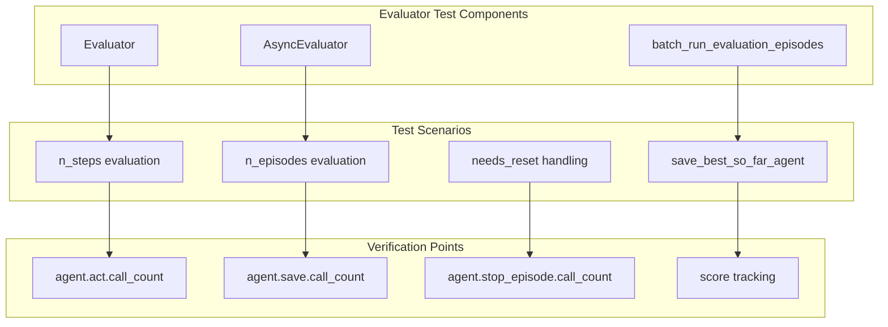

<!-- source: DeepWiki mcp.deepwiki.com · repo chainer/chainerrl · page 6.1 Testing Framework · fetched 2026-10-30 -->

# Testing Framework

Relevant source files

The following files were used as context for generating this wiki page:

- [.travis.yml](.travis.yml)
- [requirements-dev.txt](requirements-dev.txt)
- [tests/agents_tests/test_a3c.py](tests/agents_tests/test_a3c.py)
- [tests/agents_tests/test_acer.py](tests/agents_tests/test_acer.py)
- [tests/agents_tests/test_nsq.py](tests/agents_tests/test_nsq.py)
- [tests/agents_tests/test_pcl.py](tests/agents_tests/test_pcl.py)
- [tests/experiments_tests/test_collect_demos.py](tests/experiments_tests/test_collect_demos.py)
- [tests/experiments_tests/test_evaluator.py](tests/experiments_tests/test_evaluator.py)
- [tests/experiments_tests/test_train_agent.py](tests/experiments_tests/test_train_agent.py)
- [tests/experiments_tests/test_train_agent_async.py](tests/experiments_tests/test_train_agent_async.py)
- [tests/experiments_tests/test_train_agent_batch.py](tests/experiments_tests/test_train_agent_batch.py)
- [tests/wrappers_tests/test_atari_wrappers.py](tests/wrappers_tests/test_atari_wrappers.py)
- [tests/wrappers_tests/test_render.py](tests/wrappers_tests/test_render.py)
- [tests/wrappers_tests/test_vector_frame_stack.py](tests/wrappers_tests/test_vector_frame_stack.py)

## Purpose and Scope

This document covers the testing infrastructure used in ChainerRL, including test organization, testing utilities, continuous integration setup, and common testing patterns. The testing framework ensures code quality and correctness across all RL agents, training infrastructure, and supporting components.

For information about the continuous integration pipeline, see [Continuous Integration](#6.2). For development setup requirements, see [Setup and Dependencies](#6.3).

## Test Organization Structure

ChainerRL organizes tests into a hierarchical structure that mirrors the main codebase organization. Tests are grouped by functional area to facilitate targeted testing and maintenance.

```mermaid
graph TD
    subgraph "tests/"
        AGENTS["agents_tests/"]
        EXPERIMENTS["experiments_tests/"]
        WRAPPERS["wrappers_tests/"]
        MISC["misc_tests/"]
    end
    
    subgraph "Agent Tests"
        AGENTS --> A3C["test_a3c.py"]
        AGENTS --> ACER["test_acer.py"]
        AGENTS --> NSQ["test_nsq.py"]
        AGENTS --> PCL["test_pcl.py"]
        AGENTS --> DQN["test_dqn.py"]
        AGENTS --> PPO["test_ppo.py"]
    end
    
    subgraph "Experiment Tests"
        EXPERIMENTS --> EVALUATOR["test_evaluator.py"]
        EXPERIMENTS --> TRAIN_AGENT["test_train_agent.py"]
        EXPERIMENTS --> TRAIN_BATCH["test_train_agent_batch.py"]
        EXPERIMENTS --> TRAIN_ASYNC["test_train_agent_async.py"]
        EXPERIMENTS --> COLLECT_DEMOS["test_collect_demos.py"]
    end
    
    subgraph "Wrapper Tests"
        WRAPPERS --> ATARI["test_atari_wrappers.py"]
        WRAPPERS --> VECTOR_FRAME["test_vector_frame_stack.py"]
        WRAPPERS --> RENDER["test_render.py"]
    end
```

**Sources**: [tests/agents_tests/test_acer.py:1-505](), [tests/experiments_tests/test_evaluator.py:1-355](), [tests/wrappers_tests/test_atari_wrappers.py:1-157]()

## Testing Framework Components

The testing framework relies on several key components that provide parameterization, mocking, and specialized testing utilities for reinforcement learning scenarios.

**Sources**: [tests/agents_tests/test_acer.py:8-24](), [tests/experiments_tests/test_evaluator.py:5-8](), [requirements-dev.txt:7]()

## Test Types and Patterns

### Parameterized Agent Tests

Agent tests use extensive parameterization to test different configurations and scenarios. The `@testing.parameterize` decorator with `testing.product` enables comprehensive coverage of parameter combinations.

**Sources**: [tests/agents_tests/test_acer.py:316-335](), [tests/agents_tests/test_a3c.py:19-30](), [tests/agents_tests/test_pcl.py:20-39]()

### Mock-Based Testing

Experiments and evaluator tests extensively use mocking to isolate components and test specific behaviors without running full RL training loops.

**Sources**: [tests/experiments_tests/test_evaluator.py:23-29](), [tests/experiments_tests/test_train_agent_async.py:25-45](), [tests/experiments_tests/test_collect_demos.py:24-33]()

## ABC Test Environment

The `ABC` (Artificial Bee Colony) environment serves as a standardized test environment for validating agent performance. It provides a simple, deterministic environment that agents should be able to solve reliably.

**Sources**: [tests/agents_tests/test_acer.py:356-360](), [tests/agents_tests/test_a3c.py:61-65](), [tests/agents_tests/test_nsq.py:57-60]()

## Continuous Integration Pipeline

The Travis CI configuration defines the automated testing pipeline that runs on every code change, ensuring consistent quality across different Python and Chainer versions.

**Sources**: [.travis.yml:1-49](), [.travis.yml:36-46]()

## Test Execution and Filtering

The testing framework provides multiple execution modes to balance comprehensive testing with development speed.

### Test Markers and Filtering

| Marker | Purpose | Usage |
|--------|---------|-------|
| `@testing.attr.slow` | Long-running integration tests | `pytest -m "not slow"` |
| `gpu` marker | GPU-dependent tests | `pytest -m "not gpu"` |
| Fast variants | Quick smoke tests | `test_abc_fast()` methods |

### Common Test Patterns

**Sources**: [tests/agents_tests/test_acer.py:342-349](), [tests/agents_tests/test_a3c.py:37-43](), [.travis.yml:42]()

## Evaluation Testing Framework

The evaluator testing system validates the evaluation infrastructure used during training, ensuring proper episode management and metric collection.

**Sources**: [tests/experiments_tests/test_evaluator.py:18-92](), [tests/experiments_tests/test_evaluator.py:100-161](), [tests/experiments_tests/test_evaluator.py:242-303]()

**Sources**: [tests/agents_tests/test_acer.py:1-505](), [tests/experiments_tests/test_evaluator.py:1-355](), [tests/agents_tests/test_a3c.py:1-194](), [tests/experiments_tests/test_train_agent_async.py:1-160](), [.travis.yml:1-49](), [requirements-dev.txt:1-10]()

---

