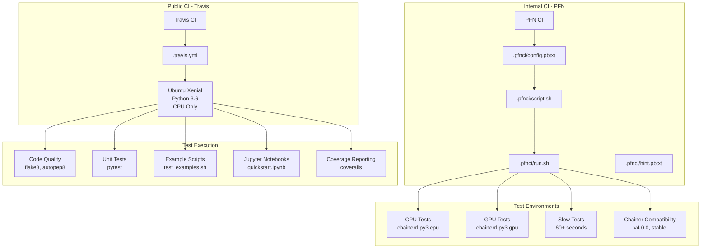
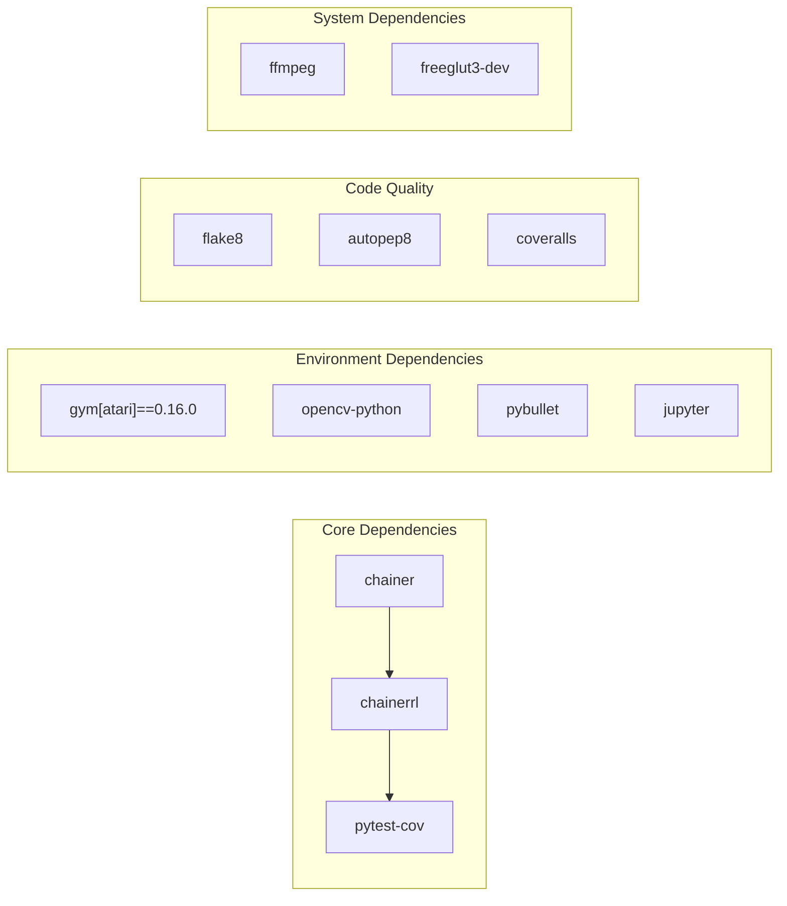
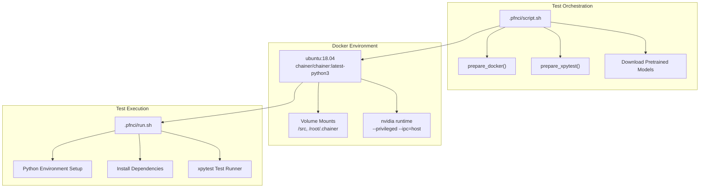
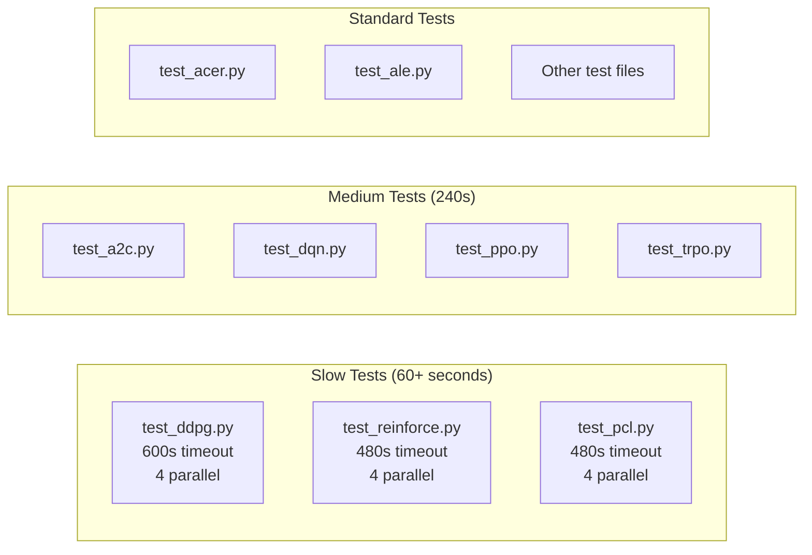
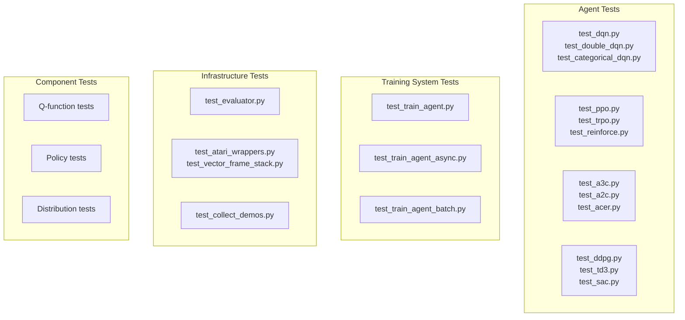

<!-- source: DeepWiki mcp.deepwiki.com · repo chainer/chainerrl · page 6.2 Continuous Integration · fetched 2026-10-30 -->

# Continuous Integration

<details>
<summary>Relevant source files</summary>

The following files were used as context for generating this wiki page:

- [.pfnci/config.pbtxt](.pfnci/config.pbtxt)
- [.pfnci/hint.pbtxt](.pfnci/hint.pbtxt)
- [.pfnci/run.sh](.pfnci/run.sh)
- [.pfnci/script.sh](.pfnci/script.sh)
- [.travis.yml](.travis.yml)
- [requirements-dev.txt](requirements-dev.txt)
- [tests/experiments_tests/test_collect_demos.py](tests/experiments_tests/test_collect_demos.py)
- [tests/experiments_tests/test_evaluator.py](tests/experiments_tests/test_evaluator.py)
- [tests/experiments_tests/test_train_agent.py](tests/experiments_tests/test_train_agent.py)
- [tests/experiments_tests/test_train_agent_async.py](tests/experiments_tests/test_train_agent_async.py)
- [tests/experiments_tests/test_train_agent_batch.py](tests/experiments_tests/test_train_agent_batch.py)
- [tests/wrappers_tests/test_atari_wrappers.py](tests/wrappers_tests/test_atari_wrappers.py)
- [tests/wrappers_tests/test_render.py](tests/wrappers_tests/test_render.py)
- [tests/wrappers_tests/test_vector_frame_stack.py](tests/wrappers_tests/test_vector_frame_stack.py)

</details>


This document covers the continuous integration (CI) and testing infrastructure used in ChainerRL. The CI system ensures code quality, validates functionality across different configurations, and maintains compatibility with various dependencies and hardware setups.

For information about the testing framework and test structure, see [Testing Framework](#6.1). For setup and development dependencies, see [Setup and Dependencies](#6.3).

## CI Architecture Overview

ChainerRL uses a dual CI system combining Travis CI for public builds and PFN CI for internal testing with GPU resources and extensive test matrices.



Sources: [.travis.yml:1-48](), [.pfnci/config.pbtxt:1-105](), [.pfnci/script.sh:1-112]()

## Travis CI Configuration

The Travis CI setup provides public continuous integration for the ChainerRL repository with comprehensive testing across different Chainer versions.

### Environment Configuration

| Configuration | Value |
|---------------|-------|
| OS | Ubuntu Xenial |
| Language | Python 3.6 |
| Services | xvfb (Virtual Framebuffer) |
| Cache | pip |

### Test Matrix

Travis CI tests against multiple Chainer versions:
- `CHAINER_VERSION=4` - Tests compatibility with Chainer 4.0.0
- `CHAINER_VERSION=stable` - Tests with latest stable Chainer

### Dependency Installation

The CI installs a comprehensive set of dependencies:



Sources: [.travis.yml:16-33]()

### Test Execution Pipeline

The Travis CI executes tests in the following sequence:

1. **Code Quality Checks**
   - `flake8 chainerrl` - Lints core library code
   - `flake8 tests` - Lints test code
   - `flake8 --ignore=E402,W504 examples` - Lints examples with relaxed rules
   - `autopep8` diff check - Ensures PEP8 compliance

2. **Unit Tests**
   - `pytest -m "not gpu and not slow"` - Runs CPU-only, fast tests
   - Excludes `tests/misc_tests/test_pretrained_models.py`
   - Includes coverage reporting with `--cov=chainerrl`

3. **Integration Tests**
   - `./test_examples.sh -1` - Tests example scripts
   - Jupyter notebook execution for quickstart guide

Sources: [.travis.yml:36-46]()

## PFN CI System

The PFN CI system provides more comprehensive testing with GPU support, multiple configurations, and extensive test parallelization.

### Test Configurations

The PFN CI defines multiple test targets in `config.pbtxt`:

| Configuration | GPU | Memory | CPU | Time Limit | Environment |
|---------------|-----|--------|-----|------------|-------------|
| `chainerrl.py3.gpu` | 1 | 30GB | 10 | 20min | GPU=1 |
| `chainerrl.py3.gpu.slow` | 1 | 30GB | 10 | 40min | GPU=1, SLOW=1 |
| `chainerrl.py3.cpu` | 0 | 10GB | 10 | 20min | CPU only |
| `chainerrl.py3.cpu.slow` | 0 | 30GB | 10 | 40min | SLOW=1 |
| `chainerrl.py3.chainer4` | 0 | 10GB | 10 | 20min | Chainer 4.0.0 |

### Docker-Based Test Execution



Sources: [.pfnci/script.sh:28-74](), [.pfnci/run.sh:43-110]()

### Pretrained Model Management

The CI system downloads pretrained models to ensure reproducible testing:

```bash
# Downloaded model archives
a3c_results.zip
dqn_results.zip  
iqn_results.zip
rainbow_results.zip
ddpg_results.zip
trpo_results.zip
ppo_results.zip
td3_results.zip
sac_results.zip
```

These are extracted to `~/.chainer/dataset/pfnet/chainerrl/models/` and used by tests marked with `CHAINERRL_ASSERT_DOWNLOADED_MODEL_IS_CACHED=1`.

Sources: [.pfnci/script.sh:66-72]()

## Test Parallelization and Optimization

### xpytest Configuration

The CI uses `xpytest` for intelligent test parallelization and timeout management. Test-specific configurations are defined in `hint.pbtxt`:



### Test Categories and Markers

Tests are categorized using pytest markers:

| Marker | Description | Usage |
|--------|-------------|-------|
| `gpu` | Requires GPU hardware | GPU-specific algorithm tests |
| `slow` | Takes >60 seconds | Integration and training tests |
| `not gpu` | CPU-only tests | Standard unit tests |
| `not slow` | Fast tests | Quick validation tests |

Sources: [.pfnci/hint.pbtxt:6-40](), [.pfnci/run.sh:44-55]()

## Test Coverage Areas

### Core Component Testing

The CI system validates all major ChainerRL components:



### Example and Integration Testing

The CI runs comprehensive example testing through `test_examples.sh`:

- Algorithm reproduction scripts
- Environment integration examples
- Quickstart Jupyter notebook execution
- Pretrained model usage validation

Sources: [tests/experiments_tests/test_evaluator.py:1-355](), [tests/experiments_tests/test_train_agent_async.py:1-160](), [tests/experiments_tests/test_train_agent_batch.py:1-159]()

## Quality Assurance Measures

### Code Style Enforcement

| Tool | Purpose | Configuration |
|------|---------|---------------|
| `flake8` | Linting and style checking | Standard rules, relaxed for examples |
| `autopep8` | PEP8 formatting validation | Diff-based checking |
| Coverage reporting | Test coverage tracking | `pytest-cov` with coveralls |

### Environment Isolation

- **Docker containerization** for consistent test environments
- **Virtual display** (`xvfb`) for headless GUI testing
- **GPU isolation** using NVIDIA MPS for stable GPU testing
- **Dependency pinning** for reproducible builds

### Timeout and Resource Management

- **Per-test timeouts** to prevent hanging tests
- **Memory limits** (10-30GB) based on test requirements  
- **CPU allocation** (10 cores) for parallel execution
- **GPU allocation** (0-1 GPU) based on test needs

Sources: [.travis.yml:37-41](), [.pfnci/config.pbtxt:5-105](), [.pfnci/run.sh:34-37]()

---

