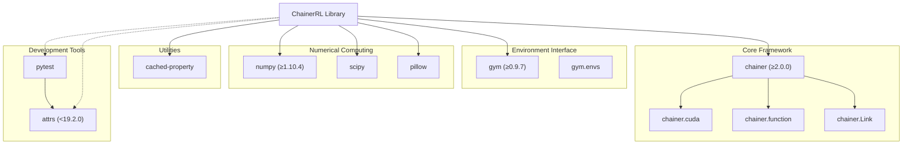
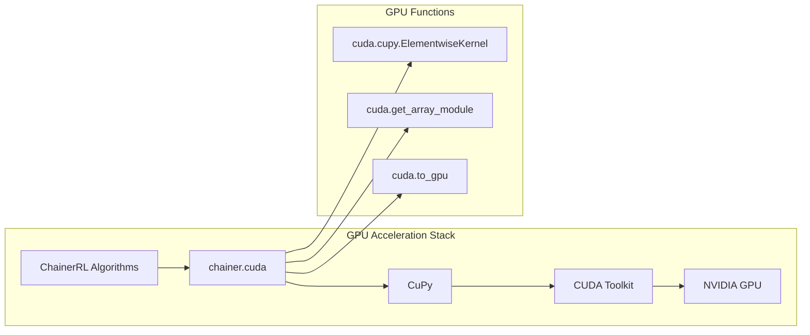

<!-- source: DeepWiki mcp.deepwiki.com · repo chainer/chainerrl · page 6.3 Setup and Dependencies · fetched 2026-10-30 -->

# Setup and Dependencies

<details>
<summary>Relevant source files</summary>

The following files were used as context for generating this wiki page:

- [chainerrl/functions/lower_triangular_matrix.py](chainerrl/functions/lower_triangular_matrix.py)
- [chainerrl/links/sequence.py](chainerrl/links/sequence.py)
- [requirements.txt](requirements.txt)
- [setup.py](setup.py)
- [tests/links_tests/test_sequence.py](tests/links_tests/test_sequence.py)

</details>


This document covers the installation requirements, package structure, and development environment setup for ChainerRL. It provides guidance for both end users installing the library and developers contributing to the codebase. For information about the testing framework and validation approaches, see [Testing Framework](#6.1). For details about the CI/CD pipeline, see [Continuous Integration](#6.2).

## Core Dependencies

ChainerRL is built on top of several key dependencies that provide deep learning, reinforcement learning environment interfaces, and numerical computation capabilities.

### Primary Dependencies

| Dependency | Version | Purpose |
|------------|---------|---------|
| `chainer` | ≥2.0.0 (≥4.0.0 in requirements.txt) | Core deep learning framework |
| `gym` | ≥0.9.7 | OpenAI Gym environment interface |
| `numpy` | ≥1.10.4 | Numerical computing |
| `scipy` | Any | Scientific computing utilities |
| `pillow` | Any | Image processing for visual environments |
| `cached-property` | Any | Caching utilities |

**Sources:** [setup.py:5-12](), [requirements.txt:1-6]()

### Development and Testing Dependencies

| Dependency | Version | Purpose |
|------------|---------|---------|
| `pytest` | Any | Testing framework |
| `attrs` | <19.2.0 | Testing utilities (version constraint due to pytest compatibility) |

**Sources:** [setup.py:14-17]()

## Dependency Architecture



**Sources:** [setup.py:5-17](), [chainerrl/functions/lower_triangular_matrix.py:3-6](), [chainerrl/links/sequence.py:4]()

## Installation Methods

### Standard Installation

The library can be installed using standard Python package management tools:

```bash
pip install chainerrl
```

### Development Installation

For development purposes, install from source with editable mode:

```bash
git clone https://github.com/chainer/chainerrl
cd chainerrl
pip install -e .
```

**Sources:** [setup.py:19-29]()

## Package Structure

ChainerRL follows a standard Python package structure organized around functional modules:

```mermaid
graph TD
    Root["chainerrl/"]
    
    subgraph "Core Components"
        Agents["agents/"]
        Links["links/"]
        Functions["functions/"]
        Policies["policies/"]
        QFunctions["q_functions/"]
        ValueFunctions["v_functions/"]
    end
    
    subgraph "Training Infrastructure"
        Misc["misc/"]
        Replay["replay_buffer/"]
        Optimizers["optimizers/"]
    end
    
    subgraph "Environment Integration"
        Wrappers["wrappers/"]
        Envs["envs/"]
    end
    
    subgraph "Utilities"
        Experiments["experiments/"]
        Distribution["distribution/"]
        Recurrent["recurrent/"]
    end
    
    Root --> Agents
    Root --> Links
    Root --> Functions
    Root --> Policies
    Root --> QFunctions
    Root --> ValueFunctions
    Root --> Misc
    Root --> Replay
    Root --> Optimizers
    Root --> Wrappers
    Root --> Envs
    Root --> Experiments
    Root --> Distribution
    Root --> Recurrent
```



**Sources:** [chainerrl/links/sequence.py:1](), [chainerrl/functions/lower_triangular_matrix.py:1]()

## Development Environment Requirements

### Python Version Support

ChainerRL is designed to work with Python 3.x environments. The specific version requirements are inherited from the Chainer framework dependency.

### Hardware Requirements

#### CPU Support
- Standard x86_64 architecture
- NumPy and SciPy provide optimized BLAS operations
- Multi-core support through Chainer's computational graph

#### GPU Support
ChainerRL supports GPU acceleration through Chainer's CUDA integration:



**Sources:** [chainerrl/functions/lower_triangular_matrix.py:3, 46-49, 62-66]()

### Memory Management

The library implements efficient memory management for both CPU and GPU operations:

- **CPU Operations**: Uses NumPy arrays with efficient indexing operations
- **GPU Operations**: Leverages CuPy's memory pool and CUDA memory management
- **Caching**: Utilizes `@lru_cache()` decorators for expensive computations

**Sources:** [chainerrl/functions/lower_triangular_matrix.py:23, 33, 61-75]()

## Testing Environment Setup

### Test Dependencies Installation

Install testing dependencies for development:

```bash
pip install pytest "attrs<19.2.0"
```

### Running Tests

The test suite uses pytest and includes component-specific tests:

```bash
pytest tests/
```

**Sources:** [setup.py:14-17](), [tests/links_tests/test_sequence.py:1-3]()

## Environment Integration

ChainerRL integrates with multiple environment types, each with specific setup requirements:

### OpenAI Gym Environments
- Requires `gym>=0.9.7`
- Supports discrete and continuous action spaces
- Compatible with Atari environments through additional wrappers

### Custom Environment Development
The library provides base classes and utilities for implementing custom environments compatible with the ChainerRL training infrastructure.

**Sources:** [setup.py:8](), [requirements.txt:3]()