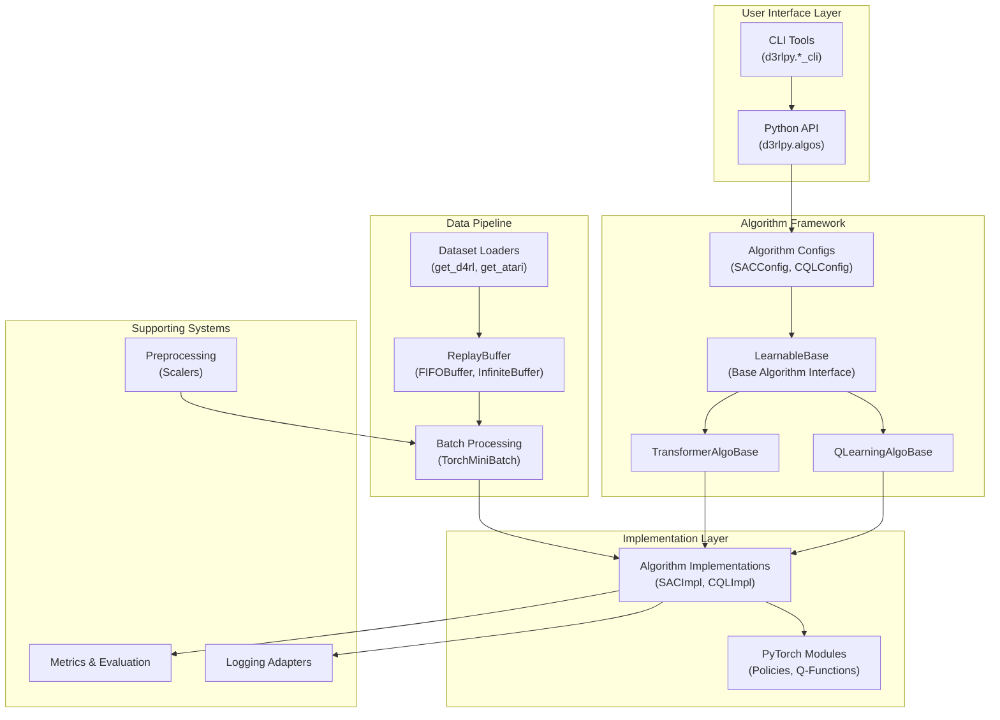
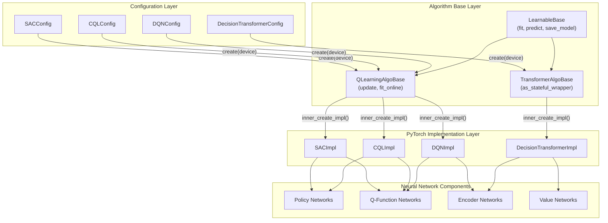
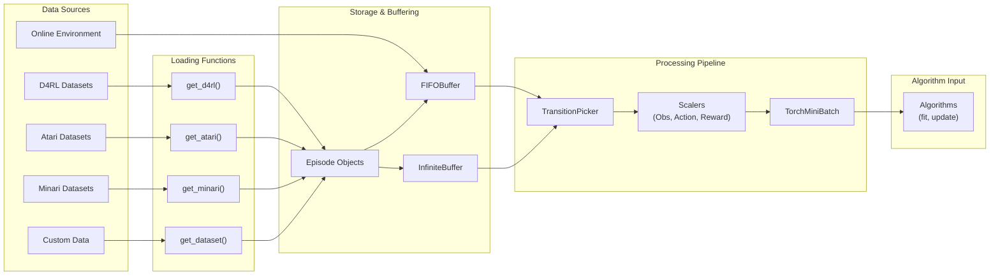

<!-- source: DeepWiki mcp.deepwiki.com · repo takuseno/d3rlpy · page 1 Overview · fetched 2026-10-30 -->

# Overview

<details>
<summary>Relevant source files</summary>

The following files were used as context for generating this wiki page:

- [README.md](README.md)
- [ROADMAP.md](ROADMAP.md)
- [d3rlpy/_version.py](d3rlpy/_version.py)
- [d3rlpy/algos/__init__.py](d3rlpy/algos/__init__.py)
- [docker/Dockerfile](docker/Dockerfile)
- [docs/index.rst](docs/index.rst)
- [docs/installation.rst](docs/installation.rst)
- [docs/references/algos.rst](docs/references/algos.rst)
- [docs/requirements.txt](docs/requirements.txt)
- [scripts/build-docker](scripts/build-docker)

</details>


This document provides a high-level introduction to d3rlpy, covering its purpose, key features, and overall architecture. For specific algorithm implementations, see [Algorithm System](#5). For data handling details, see [Data Management](#6). For installation instructions, see [Installation and Setup](#2).

## Purpose and Scope

d3rlpy is an offline deep reinforcement learning library designed for practitioners and researchers. It provides state-of-the-art offline RL algorithms with intuitive APIs that require minimal deep learning expertise. The library supports both offline training from static datasets and online training with environment interaction.

The library's primary goals are:
- **Practical offline RL**: Enable powerful offline RL when online interaction is not feasible (e.g., robotics, medical applications)
- **User-friendly APIs**: Provide scikit-learn-style interfaces that abstract away deep learning complexity  
- **Beyond state-of-the-art performance**: Achieve superior results through distributional Q-functions and advanced optimization techniques
- **Scalability**: Support large-scale training with data-parallel distributed computing and GPU acceleration

Sources: [README.md:11-12](), [README.md:39-50](), [docs/index.rst:6-19]()

## Key Features

| Feature Category | Description | Key Benefits |
|-----------------|-------------|--------------|
| **Algorithm Support** | 25+ state-of-the-art algorithms including SAC, CQL, BCQ, Decision Transformer | Comprehensive coverage of offline and online RL methods |
| **Distributional Q-Functions** | First library to support distributional Q-functions across all algorithms | Enhanced performance and uncertainty estimation |
| **Data-Parallel Training** | Multi-GPU and multi-node distributed training support | Scalable training for large datasets |
| **Performance Optimization** | CudaGraph and `torch.compile` acceleration | Significant speedup in training and inference |
| **Flexible Data Support** | D4RL, Atari, Minari datasets plus custom data formats | Easy integration with existing datasets |

Sources: [README.md:37-50](), [README.md:88-112](), [README.md:114-117]()

## Overall Architecture

The d3rlpy architecture follows a layered design with clear separation of concerns:

### High-Level System Architecture



Sources: [README.md:13-29](), [docs/references/algos.rst:26-51](), [d3rlpy/algos/__init__.py:1-3]()

### Core Algorithm Framework

The algorithm framework implements a three-layer architecture that separates configuration, algorithm logic, and PyTorch implementation:



Sources: [docs/references/algos.rst:29-51](), [docs/references/algos.rst:390-407](), [README.md:18-19]()

## Supported Algorithms

d3rlpy provides comprehensive algorithm coverage across different RL paradigms:

### Algorithm Categories

| Category | Algorithms | Action Spaces |
|----------|------------|---------------|
| **Behavior Cloning** | BC, DiscreteBC | Discrete, Continuous |
| **Value-Based** | NFQ, DQN, DoubleDQN | Discrete |
| **Actor-Critic** | DDPG, TD3, SAC, DiscreteSAC | Both |
| **Offline RL** | BCQ, BEAR, CQL, AWAC, CRR, IQL, CalQL | Both |
| **Hybrid Methods** | PLAS, TD3+BC, PRDC, ReBRAC | Continuous |
| **Transformer-Based** | Decision Transformer, QDT, TACR | Both |

### Q-Function Support

d3rlpy is the first library to provide distributional Q-function support across all algorithms:
- Standard Q-function
- Quantile Regression
- Implicit Quantile Network (IQN)

Sources: [README.md:88-117](), [docs/references/algos.rst:54-462]()

## Data Processing Pipeline

The library implements a sophisticated data processing pipeline that handles various data sources and formats:



Sources: [README.md:131-143](), [README.md:150-173](), [README.md:16]()

## Usage Patterns

The library supports both offline and online training workflows through consistent APIs:

### Offline Training Example
```python
import d3rlpy

# Load dataset
dataset, env = d3rlpy.datasets.get_dataset("hopper-medium-v0")

# Configure algorithm
sac = d3rlpy.algos.SACConfig(compile_graph=True).create(device="cuda:0")

# Train offline
sac.fit(dataset, n_steps=1000000)
```

### Online Training Example  
```python
# Prepare environment and buffer
env = gym.make('Hopper-v3')
buffer = d3rlpy.dataset.create_fifo_replay_buffer(limit=1000000, env=env)

# Train online
sac.fit_online(env, buffer, n_steps=1000000)
```

### Prediction and Deployment
```python
# Make predictions
actions = sac.predict(observations)

# Save/load models
sac.save_model("model.d3")
sac = d3rlpy.load_learnable("model.d3")
```

Sources: [README.md:13-29](), [README.md:179-195]()

## Development and Ecosystem

d3rlpy includes comprehensive development infrastructure:

- **Testing**: Automated CI/CD with GitHub Actions
- **Documentation**: Full API documentation and tutorials
- **Containerization**: Docker images for reproducible environments  
- **Benchmarking**: Reproduction scripts and benchmark results
- **CLI Tools**: Command-line utilities for model management and evaluation

The library integrates with popular ML tools and frameworks:
- **Logging**: WandB, TensorBoard, file-based logging
- **Environments**: Gymnasium, D4RL, custom environments
- **Hardware**: CUDA acceleration, multi-GPU support

Sources: [README.md:82-86](), [README.md:120-122](), [README.md:197-203](), [docker/Dockerfile:1-42]()

---

