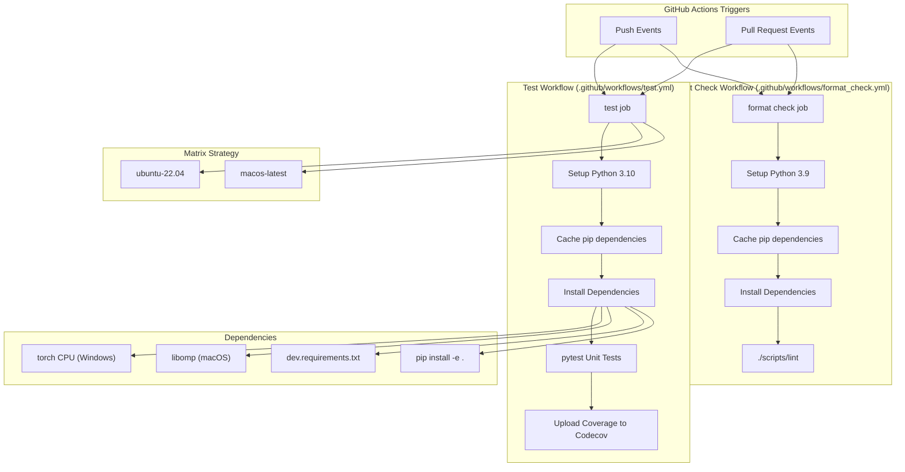
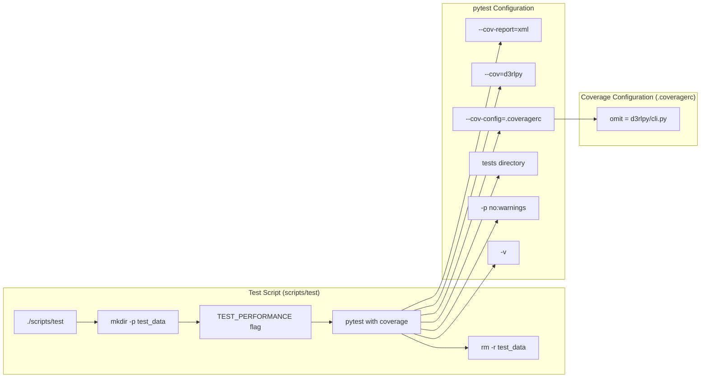
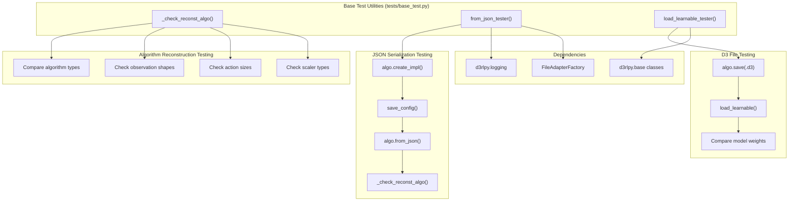
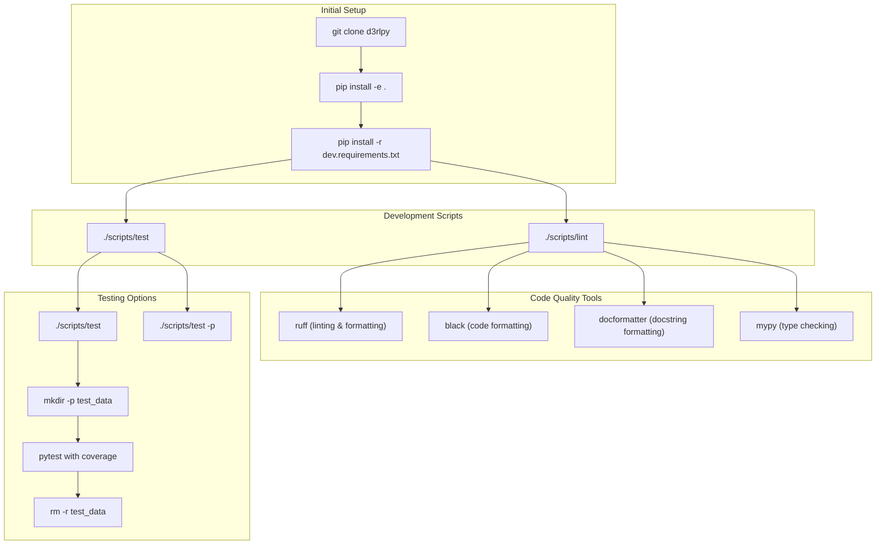

<!-- source: DeepWiki mcp.deepwiki.com · repo takuseno/d3rlpy · page 11 Development and Testing · fetched 2026-10-30 -->

# Development and Testing

<details>
<summary>Relevant source files</summary>

The following files were used as context for generating this wiki page:

- [.coveragerc](.coveragerc)
- [.github/workflows/format_check.yml](.github/workflows/format_check.yml)
- [.github/workflows/test.yml](.github/workflows/test.yml)
- [CONTRIBUTING.md](CONTRIBUTING.md)
- [dev.requirements.txt](dev.requirements.txt)
- [scripts/test](scripts/test)
- [tests/base_test.py](tests/base_test.py)

</details>


## Purpose and Scope

This document covers the development and testing infrastructure of d3rlpy, including continuous integration pipelines, testing frameworks, code quality tools, and development workflows. This system ensures code reliability, maintains consistent formatting, and provides tools for contributors to develop and test the library effectively.

For information about algorithm-specific testing patterns, see the individual algorithm documentation in [Algorithm System](#5). For CLI testing tools, see [CLI and Utilities](#9).

## CI/CD Pipeline Architecture

The d3rlpy project uses GitHub Actions to automate testing and quality assurance across multiple platforms and Python versions.

### Continuous Integration Workflows



The CI system runs two main workflows on every push and pull request:

**Test Workflow**: Executes comprehensive unit tests across Ubuntu and macOS platforms, generating coverage reports and uploading them to Codecov. The workflow includes platform-specific dependency handling, such as installing `libomp` for macOS compatibility.

**Format Check Workflow**: Runs static analysis and format checking using the `./scripts/lint` script to ensure code quality standards.

Sources: [.github/workflows/test.yml:1-55](), [.github/workflows/format_check.yml:1-35]()

### Test Execution Pipeline



The test execution follows a structured pipeline that creates temporary directories, configures coverage reporting, and executes pytest with comprehensive coverage analysis while excluding CLI components from coverage requirements.

Sources: [scripts/test:1-34](), [.coveragerc:1-3]()

## Testing Framework

### Core Testing Dependencies

The testing framework is built on pytest with additional tools for coverage, type checking, and code quality:

| Tool | Purpose | Configuration |
|------|---------|---------------|
| `pytest` | Test runner and framework | Command-line flags in test script |
| `pytest-cov` | Coverage reporting | `.coveragerc` configuration |
| `mypy` | Static type checking | Used in lint script |
| `ruff` | Linting and formatting | Used in lint script |
| `black` | Code formatting | Used in lint script |
| `docformatter` | Docstring formatting | Used in lint script |

Sources: [dev.requirements.txt:1-15]()

### Test Utility Framework



The test utility framework provides standardized patterns for testing algorithm serialization, deserialization, and reconstruction. The `_check_reconst_algo` function validates that reconstructed algorithms maintain identical properties including observation shapes, action sizes, and scaler configurations.

Sources: [tests/base_test.py:17-102]()

### Algorithm Testing Patterns

The framework defines two primary testing patterns for algorithm persistence:

**JSON Configuration Testing**: The `from_json_tester` function validates that algorithms can be saved as JSON configuration files and reconstructed with identical properties. This pattern uses the `FileAdapterFactory` and `D3RLPyLogger` to simulate the standard logging workflow.

**Binary Model Testing**: The `load_learnable_tester` function tests the complete save/load cycle for `.d3` files, including neural network weights. It compares the binary representation of model parameters to ensure exact reconstruction.

Sources: [tests/base_test.py:55-102]()

## Development Workflow

### Local Development Setup

The development workflow follows these standardized steps:



The development setup emphasizes editable installation to enable rapid iteration, comprehensive dependency management through `dev.requirements.txt`, and standardized scripts for testing and quality assurance.

Sources: [CONTRIBUTING.md:10-39](), [scripts/test:1-34]()

### Code Quality Standards

The project enforces strict code quality standards through automated tools:

**Formatting**: `ruff` and `black` ensure consistent code style across the codebase, while `docformatter` standardizes docstring formatting.

**Type Safety**: Full type annotation coverage is enforced and validated by `mypy` static analysis.

**Testing**: Comprehensive test coverage is required, with coverage reports generated automatically and uploaded to external services for tracking.

The `./scripts/lint` command executes all quality checks locally before submission, mirroring the CI/CD format check workflow.

Sources: [CONTRIBUTING.md:32-38](), [.github/workflows/format_check.yml:28-30]()

## Performance Testing

The testing framework includes optional performance testing capabilities controlled by the `TEST_PERFORMANCE` environment variable. When enabled via the `-p` flag in the test script, additional performance benchmarks are executed to validate algorithmic efficiency and resource usage.

```bash
# Standard testing
./scripts/test

# With performance testing  
./scripts/test -p
```

Sources: [scripts/test:17-30]()

---

