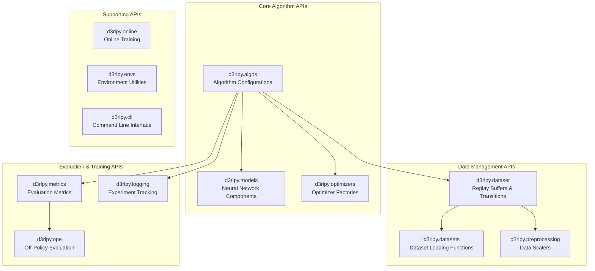
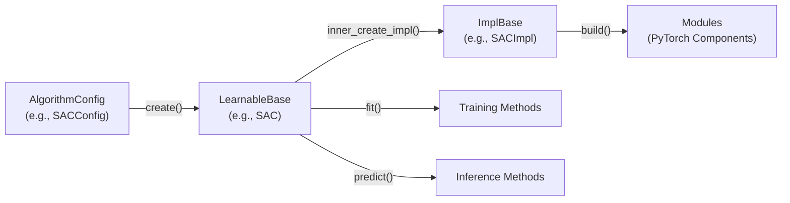
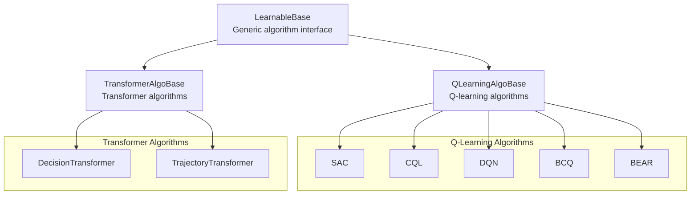
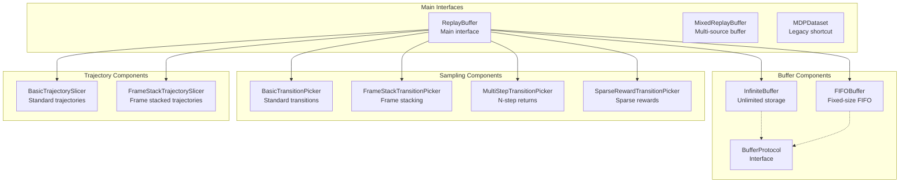
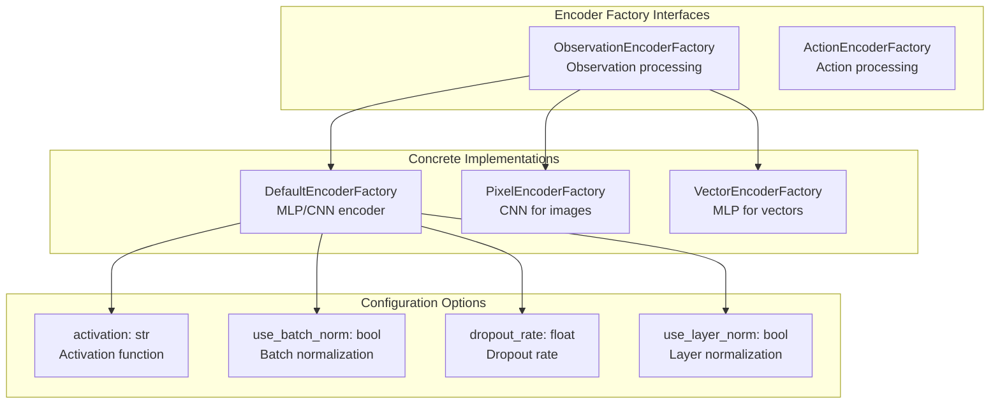
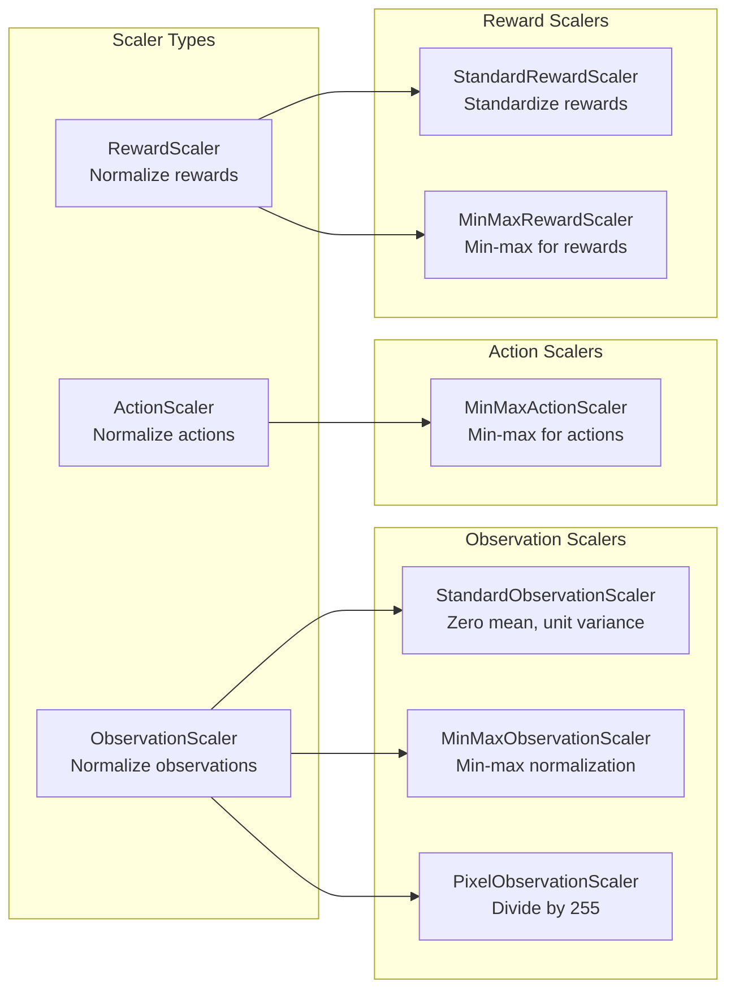
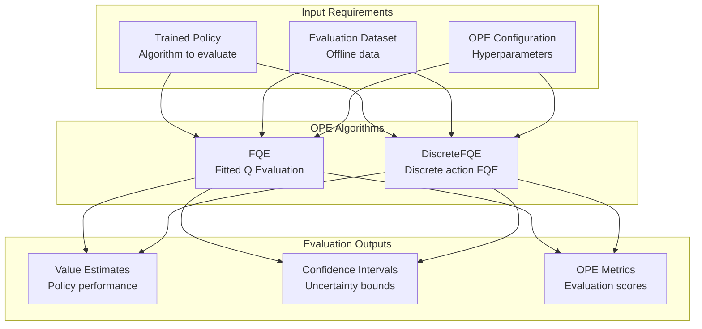

<!-- source: DeepWiki mcp.deepwiki.com · repo takuseno/d3rlpy · page 12 API Reference · fetched 2026-10-30 -->

# API Reference

Relevant source files

The following files were used as context for generating this wiki page:

- [docs/references/dataset.rst](docs/references/dataset.rst)
- [docs/references/datasets.rst](docs/references/datasets.rst)
- [docs/references/index.rst](docs/references/index.rst)
- [docs/references/off_policy_evaluation.rst](docs/references/off_policy_evaluation.rst)
- [docs/tips.rst](docs/tips.rst)

This page provides comprehensive API documentation for all public classes, methods, and functions in d3rlpy. The API is organized by functional area to help you quickly locate the components you need for your reinforcement learning projects.

For algorithm usage examples and tutorials, see [Quick Start Tutorial](#3). For architectural concepts behind these APIs, see [Core Architecture](#4) and [Algorithm System](#5). For data handling patterns, see [Data Management](#6).

## API Organization

The d3rlpy API is structured around several core modules that correspond to different aspects of reinforcement learning:

**Sources:** [docs/references/index.rst:7-21]()

## Core Algorithm API

The algorithm API forms the heart of d3rlpy, providing configuration-based interfaces for all supported reinforcement learning algorithms.

### Algorithm Configuration Pattern

All algorithms in d3rlpy follow a consistent configuration-creation pattern:

**Sources:** [docs/references/index.rst:10]()

### Q-Learning Algorithm Configurations

The `d3rlpy.algos` module provides configuration classes for Q-learning based algorithms:

| Algorithm | Configuration Class | Description |
|-----------|-------------------|-------------|
| DQN | `DQNConfig` | Deep Q-Network for discrete actions |
| CQL | `CQLConfig` | Conservative Q-Learning for offline RL |
| SAC | `SACConfig` | Soft Actor-Critic for continuous control |
| BEAR | `BEARConfig` | Bootstrapping Error Accumulation Reduction |
| BCQ | `BCQConfig` | Batch-Constrained Q-Learning |
| AWR | `AWRConfig` | Advantage-Weighted Regression |
| AWAC | `AWACConfig` | Advantage-Weighted Actor-Critic |
| TD3 | `TD3Config` | Twin Delayed Deep Deterministic Policy Gradient |
| TD3+BC | `TD3PlusBCConfig` | TD3 with Behavior Cloning |

**Sources:** [docs/references/index.rst:10]()

### Transformer Algorithm Configurations

For sequence modeling approaches:

| Algorithm | Configuration Class | Description |
|-----------|-------------------|-------------|
| Decision Transformer | `DecisionTransformerConfig` | Sequence modeling for RL |
| Trajectory Transformer | `TrajectedTransformerConfig` | Trajectory-based sequence modeling |

**Sources:** [docs/references/index.rst:10]()

### Algorithm Base Classes

The inheritance hierarchy for algorithm implementations:

**Sources:** [docs/references/index.rst:10]()

## Data Management API

### Dataset Loading Functions

The `d3rlpy.datasets` module provides functions to load standard RL datasets:

| Function | Purpose | Return Type |
|----------|---------|-------------|
| `get_d4rl()` | Load D4RL datasets | `(ReplayBuffer, gym.Env)` |
| `get_atari()` | Load Atari datasets | `(ReplayBuffer, gym.Env)` |
| `get_minari()` | Load Minari datasets | `(ReplayBuffer, gym.Env)` |
| `get_cartpole()` | Load CartPole dataset | `(ReplayBuffer, gym.Env)` |
| `get_pendulum()` | Load Pendulum dataset | `(ReplayBuffer, gym.Env)` |
| `get_dataset()` | Load custom datasets | `(ReplayBuffer, gym.Env)` |

**Sources:** [docs/references/datasets.rst:9-20]()

### Replay Buffer System

The replay buffer API follows a modular design with interchangeable components:

**Sources:** [docs/references/dataset.rst:69-142](), [docs/references/dataset.rst:144-156](), [docs/references/dataset.rst:159-197](), [docs/references/dataset.rst:199-268]()

### Data Structures

Core data structures for representing RL experiences:

| Class | Purpose | Key Fields |
|-------|---------|------------|
| `Episode` | Single episode container | `observations`, `actions`, `rewards`, `terminated` |
| `Transition` | Single transition | `observation`, `action`, `reward`, `next_observation`, `terminal` |
| `PartialTrajectory` | Trajectory slice | `observations`, `actions`, `returns_to_go`, `timesteps`, `masks` |
| `TransitionMiniBatch` | Batch of transitions | Batched transition data |
| `TrajectoryMiniBatch` | Batch of trajectories | Batched trajectory data |

**Sources:** [docs/references/dataset.rst:59-60]()

## Model Components API

### Encoder Factories

The `d3rlpy.models` module provides encoder factories for feature extraction:

**Sources:** [docs/references/index.rst:16](), [docs/tips.rst:65-78]()

### Q-Function Factories

Q-function architectures for value estimation:

| Factory Class | Architecture | Use Case |
|---------------|-------------|----------|
| `MeanQFunctionFactory` | Standard Q-network | Basic value estimation |
| `QRQFunctionFactory` | Quantile Regression | Distributional RL |
| `IQNQFunctionFactory` | Implicit Quantile Networks | Advanced distributional RL |
| `FQFQFunctionFactory` | Fully Parameterized Quantile Function | State-of-the-art distributional RL |

**Sources:** [docs/references/index.rst:11](), [docs/tips.rst:69]()

### Policy Architectures

Policy network implementations:

| Class | Algorithm Family | Action Space |
|-------|-----------------|--------------|
| `DeterministicPolicy` | DDPG, TD3 | Continuous |
| `StochasticPolicy` | SAC | Continuous |
| `CategoricalPolicy` | DQN variants | Discrete |
| `SquashedNormalPolicy` | SAC variants | Continuous with bounds |

**Sources:** [docs/references/index.rst:16]()

## Preprocessing API

### Scaler System

The `d3rlpy.preprocessing` module provides data normalization:

**Sources:** [docs/references/index.rst:14](), [docs/tips.rst:50]()

## Metrics and Evaluation API

### Evaluation Metrics

The `d3rlpy.metrics` module provides comprehensive evaluation tools:

| Metric Category | Classes | Purpose |
|----------------|---------|---------|
| Environment Evaluation | `EnvironmentEvaluator` | Test in actual environment |
| Value Estimation | `InitialStateValueEstimationEvaluator` | Estimate state values |
| Policy Evaluation | `SoftOPCEvaluator` | Off-policy confidence intervals |
| Scoring Functions | `scorer` decorators | Custom evaluation metrics |

**Sources:** [docs/references/index.rst:17](), [docs/references/off_policy_evaluation.rst:26-29]()

### Off-Policy Evaluation

The `d3rlpy.ope` module provides methods to evaluate policies without environment interaction:

**Sources:** [docs/references/off_policy_evaluation.rst:37-51]()

## Logging API

### Experiment Tracking

The `d3rlpy.logging` module provides adapters for popular experiment tracking tools:

| Adapter Class | Platform | Features |
|---------------|----------|----------|
| `FileAdapterFactory` | Local files | CSV/JSON logging |
| `TensorBoardAdapterFactory` | TensorBoard | Scalar/histogram tracking |  
| `WandbAdapterFactory` | Weights & Biases | Cloud-based tracking |

**Sources:** [docs/references/index.rst:19]()

## Utilities and CLI API

### Environment Utilities

The `d3rlpy.envs` module provides environment management functions:

| Function | Purpose |
|----------|---------|
| `seed_env()` | Set environment random seed |
| `AsyncBatchEnv` | Parallel environment execution |

**Sources:** [docs/tips.rst:21]()

### Command Line Interface

The `d3rlpy.cli` module provides command-line tools:

| Command | Purpose |
|---------|---------|
| `d3rlpy plot` | Generate training plots |
| `d3rlpy export` | Model format conversion |
| `d3rlpy eval` | Policy evaluation |

**Sources:** [docs/references/index.rst:20]()

### Core Utilities

Top-level utility functions:

| Function | Purpose |
|----------|---------|
| `seed()` | Set global random seeds |
| `load_learnable()` | Load saved algorithms |
| `save_learnable()` | Save algorithm state |

**Sources:** [docs/tips.rst:17](), [docs/references/off_policy_evaluation.rst:14]()