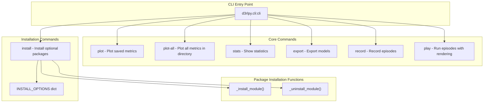

<!-- source: DeepWiki mcp.deepwiki.com · repo takuseno/d3rlpy · page 2 Installation and Setup · fetched 2026-10-30 -->

# Installation and Setup

<details>
<summary>Relevant source files</summary>

The following files were used as context for generating this wiki page:

- [d3rlpy/__init__.py](d3rlpy/__init__.py)
- [d3rlpy/cli.py](d3rlpy/cli.py)
- [d3rlpy/datasets.py](d3rlpy/datasets.py)
- [d3rlpy/envs/wrappers.py](d3rlpy/envs/wrappers.py)
- [docker/Dockerfile](docker/Dockerfile)
- [docs/cli.rst](docs/cli.rst)
- [docs/index.rst](docs/index.rst)
- [docs/installation.rst](docs/installation.rst)
- [examples/custom_algo.py](examples/custom_algo.py)
- [examples/deepmind_control.py](examples/deepmind_control.py)
- [mypy.ini](mypy.ini)
- [requirements.txt](requirements.txt)
- [scripts/build-docker](scripts/build-docker)
- [setup.py](setup.py)
- [tests/test_datasets.py](tests/test_datasets.py)

</details>


This document covers the installation and setup procedures for d3rlpy, including dependency management, CLI configuration, and optional package installation. It focuses on the technical installation workflows and their underlying implementation.

For information about using d3rlpy after installation, see [Quick Start Tutorial](#3). For details about the CLI commands available after installation, see [CLI and Utilities](#9).

## Installation Methods Overview

D3rlpy supports multiple installation approaches, each implemented through different mechanisms in the codebase. The installation system is configured through several key files that define dependencies, entry points, and optional components.

### Installation Workflow Diagram

```mermaid
graph TD
    subgraph "Installation Methods"
        PIP["pip install d3rlpy"]
        CONDA["conda install -c conda-forge d3rlpy"]
        DOCKER["docker run takuseno/d3rlpy"]
        SOURCE["git clone + pip install -e ."]
    end
    
    subgraph "Core Setup Files"
        SETUP["setup.py"]
        REQ["requirements.txt"]
        DOCKERFILE["docker/Dockerfile"]
    end
    
    subgraph "Dependency Categories"
        CORE["Core Dependencies"]
        OPTIONAL["Optional Dependencies"]
        CLI_DEPS["CLI Dependencies"]
    end
    
    subgraph "Post-Installation"
        CLI_ENTRY["d3rlpy CLI command"]
        HEALTHCHECK["run_healthcheck()"]
        OPTIONAL_INSTALL["d3rlpy install <package>"]
    end
    
    PIP --> SETUP
    CONDA --> SETUP
    SOURCE --> SETUP
    DOCKER --> DOCKERFILE
    
    SETUP --> CORE
    SETUP --> CLI_DEPS
    REQ --> CORE
    
    SETUP --> CLI_ENTRY
    CLI_ENTRY --> OPTIONAL_INSTALL
    
    CORE --> HEALTHCHECK
    OPTIONAL_INSTALL --> OPTIONAL
    
    HEALTHCHECK --> "Ready to Use"
    OPTIONAL --> "Extended Functionality"
```

Sources: [setup.py:1-53](), [requirements.txt:1-11](), [docker/Dockerfile:1-43](), [d3rlpy/__init__.py:69-70]()

## Core Dependencies

The core dependencies are defined in `setup.py` and provide the essential functionality for d3rlpy's operation. These packages are automatically installed with any installation method.

| Package | Version Requirement | Purpose |
|---------|-------------------|----------|
| `torch` | `>=2.5.0` | PyTorch deep learning framework |
| `gymnasium` | `==1.0.0` | OpenAI Gym environment interface |
| `gym` | `>=0.26.0` | Legacy Gym compatibility |
| `tqdm` | `>=4.66.3` | Progress bars |
| `h5py` | No version specified | HDF5 file format support |
| `click` | No version specified | CLI framework |
| `structlog` | No version specified | Structured logging |
| `scikit-learn` | No version specified | Machine learning utilities |

Sources: [setup.py:35-47](), [requirements.txt:1-11]()

### Dependency Configuration Diagram

```mermaid
graph LR
    subgraph "setup.py Configuration"
        INSTALL_REQUIRES["install_requires"]
        PYTHON_REQUIRES["python_requires>=3.9.0"]
        ENTRY_POINTS["entry_points"]
    end
    
    subgraph "Core Dependencies"
        TORCH["torch>=2.5.0"]
        GYM_NEW["gymnasium==1.0.0"]
        GYM_OLD["gym>=0.26.0"]
        TQDM["tqdm>=4.66.3"]
        H5PY["h5py"]
        CLICK["click"]
        STRUCTLOG["structlog"]
        SKLEARN["scikit-learn"]
        OTHERS["colorama, typing-extensions, dataclasses-json"]
    end
    
    subgraph "CLI Entry Point"
        CLI_COMMAND["d3rlpy=d3rlpy.cli:cli"]
    end
    
    INSTALL_REQUIRES --> TORCH
    INSTALL_REQUIRES --> GYM_NEW
    INSTALL_REQUIRES --> GYM_OLD
    INSTALL_REQUIRES --> TQDM
    INSTALL_REQUIRES --> H5PY
    INSTALL_REQUIRES --> CLICK
    INSTALL_REQUIRES --> STRUCTLOG
    INSTALL_REQUIRES --> SKLEARN
    INSTALL_REQUIRES --> OTHERS
    
    ENTRY_POINTS --> CLI_COMMAND
    CLI_COMMAND --> "d3rlpy CLI available in PATH"
```

Sources: [setup.py:35-47](), [setup.py:49](), [setup.py:51]()

## PyPI Installation

The standard installation method uses PyPI and pip, configured through the `setup.py` file:

```bash
pip install d3rlpy
```

The setup configuration defines the package metadata, dependencies, and CLI entry points:

- **Package name**: `d3rlpy`
- **Python compatibility**: `>=3.9.0` 
- **Platform support**: Linux, macOS, Windows
- **CLI command**: `d3rlpy` (registered via `console_scripts`)

Sources: [setup.py:10-12](), [setup.py:49](), [setup.py:51](), [docs/installation.rst:16-18]()

## Conda Installation

D3rlpy is available through conda-forge:

```bash
conda install -c conda-forge d3rlpy
```

This method uses the same `setup.py` configuration but handles dependency resolution through conda's package manager.

Sources: [docs/installation.rst:23-25]()

## Docker Installation

The Docker setup provides a complete environment with all dependencies pre-installed. The configuration is defined in `docker/Dockerfile`:

### Docker Environment Specifications

- **Base image**: `pytorch/pytorch:2.5.1-cuda12.4-cudnn9-devel`
- **GPU support**: CUDA 12.4 with cuDNN 9
- **Pre-installed packages**: d4rl-atari, Cython
- **Exposed port**: 6006 (for TensorBoard)

```bash
docker run -it --gpus all --name d3rlpy takuseno/d3rlpy:latest bash
```

The Dockerfile installs d3rlpy from the GitHub master branch and includes additional system dependencies for rendering and scientific computing.

Sources: [docker/Dockerfile:1-43](), [docs/installation.rst:31-33]()

## Source Installation

For development or accessing the latest features, install from source:

```bash
git clone https://github.com/takuseno/d3rlpy
cd d3rlpy
pip install -e .
```

This method uses the same `setup.py` configuration but installs in editable mode, allowing modifications to take effect immediately.

Sources: [docs/installation.rst:41-45]()

## CLI Tool Setup

After installation, the `d3rlpy` command becomes available in the system PATH. The CLI is implemented through the Click framework and provides subcommands for various operations.

### CLI Command Structure



Sources: [d3rlpy/cli.py:61-63](), [d3rlpy/cli.py:373-401](), [setup.py:51]()

## Optional Package Installation

D3rlpy supports optional packages for extended functionality, installed through the CLI `install` command. The available packages are defined in the `INSTALL_OPTIONS` dictionary.

### Available Optional Packages

| Package | Description | Installation Command |
|---------|-------------|---------------------|
| `atari` | Atari 2600 environments for Gym | `d3rlpy install atari` |
| `d4rl_atari` | Datasets for Atari 2600 | `d3rlpy install d4rl_atari` |
| `d4rl` | D4RL benchmark datasets | `d3rlpy install d4rl` |
| `minari` | Minari dataset format | `d3rlpy install minari` |
| `dm_control` | DeepMind Control via Shimmy | `d3rlpy install dm_control` |

### Optional Package Installation Implementation

The installation system uses subprocess calls to pip for package management:

- **Installation function**: `_install_module()` in [d3rlpy/cli.py:353-357]()
- **Uninstallation function**: `_uninstall_module()` in [d3rlpy/cli.py:360-361]()
- **Package definitions**: `INSTALL_OPTIONS` dict in [d3rlpy/cli.py:364-370]()

Sources: [d3rlpy/cli.py:364-370](), [d3rlpy/cli.py:373-401](), [docs/cli.rst:138-152]()

### Optional Package Dependencies in Code

Several modules demonstrate conditional imports for optional packages:

```python
# d4rl-atari dependency check
try:
    import d4rl_atari  # type: ignore # noqa
    # ... d4rl-atari functionality
except ImportError as e:
    raise ImportError(
        "d4rl-atari is not installed.\n" "$ d3rlpy install d4rl_atari"
    ) from e
```

Sources: [d3rlpy/datasets.py:221-263](), [d3rlpy/datasets.py:417-462](), [d3rlpy/datasets.py:495-586]()

## Post-Installation Verification

After installation, d3rlpy runs an automatic health check to verify the setup. This process is implemented in the package initialization:

### Health Check Process

1. **Automatic execution**: Triggered during package import
2. **Implementation**: `run_healthcheck()` function
3. **GPU optimization**: Enables autograd compilation if CUDA is available
4. **Environment registration**: Registers Shimmy environments if available

```python
# run healthcheck
run_healthcheck()

if torch.cuda.is_available():
    # enable autograd compilation
    torch._dynamo.config.compiled_autograd = True
    torch.set_float32_matmul_precision("high")

# register Shimmy if available
try:
    import shimmy
    gymnasium.register_envs(shimmy)
    logging.LOG.info("Register Shimmy environments.")
except ImportError:
    pass
```

Sources: [d3rlpy/__init__.py:69-84](), [d3rlpy/healthcheck.py]()

## Environment Configuration

D3rlpy automatically configures various aspects of the runtime environment during initialization:

### Configuration Steps

1. **Random seed utilities**: Available via `d3rlpy.seed()` function
2. **GPU optimization**: Automatic PyTorch optimizations for CUDA
3. **Environment registration**: Optional Shimmy integration
4. **Type checking**: MyPy configuration for development

The MyPy configuration in `mypy.ini` defines strict type checking rules and handles imports for optional dependencies.

Sources: [d3rlpy/__init__.py:56-67](), [d3rlpy/__init__.py:72-84](), [mypy.ini:1-77]()

---

