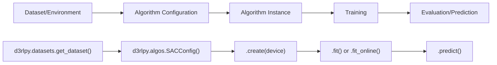
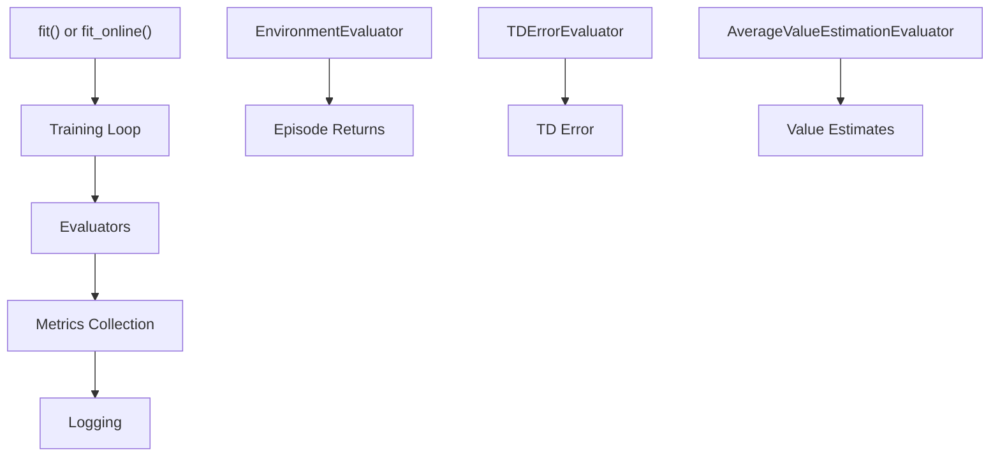

<!-- source: DeepWiki mcp.deepwiki.com · repo takuseno/d3rlpy · page 3 Quick Start Tutorial · fetched 2026-10-30 -->

# Quick Start Tutorial

<details>
<summary>Relevant source files</summary>

The following files were used as context for generating this wiki page:

- [README.md](README.md)
- [ROADMAP.md](ROADMAP.md)
- [d3rlpy/algos/__init__.py](d3rlpy/algos/__init__.py)
- [d3rlpy/notebook_utils.py](d3rlpy/notebook_utils.py)
- [docs/notebooks.rst](docs/notebooks.rst)
- [docs/references/algos.rst](docs/references/algos.rst)
- [docs/requirements.txt](docs/requirements.txt)
- [tutorials/atari.ipynb](tutorials/atari.ipynb)
- [tutorials/cartpole.ipynb](tutorials/cartpole.ipynb)
- [tutorials/online.ipynb](tutorials/online.ipynb)
- [tutorials/tpu.ipynb](tutorials/tpu.ipynb)

</details>


This document provides hands-on examples demonstrating the core workflows of d3rlpy for both offline and online reinforcement learning. It covers the essential steps from dataset loading to algorithm training and evaluation, with practical examples for continuous and discrete control tasks.

For comprehensive algorithm details, see [Algorithm System](#5). For data management concepts, see [Data Management](#6). For installation instructions, see [Installation and Setup](#2).

## Overview

d3rlpy follows a consistent pattern across all algorithms and domains:



**Core Workflow Components**
- **Configuration**: Algorithm parameters defined via config classes
- **Creation**: Algorithm instances created with device specification
- **Training**: Offline training via `fit()` or online training via `fit_online()`
- **Inference**: Action prediction via `predict()`

Sources: [README.md:13-29](), [docs/references/algos.rst:11-21]()

## Offline Reinforcement Learning

### Continuous Control Example

This example demonstrates offline RL with continuous control using the SAC algorithm on D4RL datasets:

```python
import d3rlpy

# Load dataset and environment
dataset, env = d3rlpy.datasets.get_dataset("hopper-medium-v0")

# Configure algorithm
sac = d3rlpy.algos.SACConfig(compile_graph=True).create(device="cuda:0")

# Train offline
sac.fit(dataset, n_steps=1000000)

# Evaluate
actions = sac.predict(observations)
```

**Key Components**:
- `d3rlpy.datasets.get_dataset()`: Loads D4RL datasets
- `SACConfig`: Configuration class for Soft Actor-Critic
- `compile_graph=True`: Enables PyTorch compilation for speed
- `fit()`: Offline training method

Sources: [README.md:16-22](), [README.md:132-143]()

### Discrete Control Example

For discrete action spaces like Atari games, use discrete algorithm variants:

```python
import d3rlpy

# Load Atari dataset
dataset, env = d3rlpy.datasets.get_atari_transitions(
    'breakout',
    fraction=0.01,
    num_stack=4,
)

# Configure discrete CQL algorithm
cql = d3rlpy.algos.DiscreteCQLConfig(
    observation_scaler=d3rlpy.preprocessing.PixelObservationScaler(),
    reward_scaler=d3rlpy.preprocessing.ClipRewardScaler(-1.0, 1.0),
    compile_graph=True,
).create(device='cuda:0')

# Train with environment evaluation
cql.fit(
    dataset,
    n_steps=1000000,
    evaluators={"environment": d3rlpy.metrics.EnvironmentEvaluator(env, epsilon=0.001)},
)
```

**Key Components**:
- `get_atari_transitions()`: Loads Atari datasets with frame stacking
- `DiscreteCQLConfig`: CQL variant for discrete actions
- `PixelObservationScaler`: Preprocesses image observations
- `EnvironmentEvaluator`: Evaluates policy during training

Sources: [README.md:154-173](), [tutorials/atari.ipynb:35-77]()

## Online Reinforcement Learning

### Basic Online Training

Online RL requires environment interaction and replay buffer management:

```python
import d3rlpy
import gym

# Create environments
env = gym.make('Hopper-v3')
eval_env = gym.make('Hopper-v3')

# Configure algorithm
sac = d3rlpy.algos.SACConfig(compile_graph=True).create(device='cuda:0')

# Create replay buffer
buffer = d3rlpy.dataset.create_fifo_replay_buffer(limit=1000000, env=env)

# Train online
sac.fit_online(env, buffer, n_steps=1000000, eval_env=eval_env)
```

**Online Training Components**:
- `create_fifo_replay_buffer()`: Creates FIFO replay buffer
- `fit_online()`: Online training method with environment interaction
- `eval_env`: Separate environment for evaluation

Sources: [README.md:183-195]()

### Online Training with Exploration

For value-based methods, specify exploration strategy:

```python
import d3rlpy
import gym

# Setup environment
env = gym.make('CartPole-v1')
eval_env = gym.make('CartPole-v1')

# Configure DQN algorithm
dqn = d3rlpy.algos.DQNConfig(
    learning_rate=1e-3,
    target_update_interval=100,
).create(device='cuda:0')

# Setup exploration strategy
explorer = d3rlpy.algos.ConstantEpsilonGreedy(epsilon=0.3)

# Setup replay buffer
buffer = d3rlpy.dataset.create_fifo_replay_buffer(limit=50000, env=env)

# Train online with exploration
dqn.fit_online(
    env,
    buffer,
    explorer,
    eval_env=eval_env,
    n_steps=50000,
    n_steps_per_epoch=10000,
)
```

**Exploration Components**:
- `ConstantEpsilonGreedy`: Epsilon-greedy exploration strategy
- `explorer` parameter: Required for value-based online algorithms
- `target_update_interval`: Q-network target update frequency

Sources: [tutorials/online.ipynb:71-91]()

## Training Configuration

### Device Selection

All algorithms support CPU, GPU, and TPU devices:

```python
# CPU training
algo = d3rlpy.algos.SACConfig().create(device="cpu:0")

# GPU training
algo = d3rlpy.algos.SACConfig().create(device="cuda:0")

# Multi-GPU (second GPU)
algo = d3rlpy.algos.SACConfig().create(device="cuda:1")

# TPU training (requires torch_xla)
import torch_xla.core.xla_model as xm
device = xm.xla_device()
algo = d3rlpy.algos.SACConfig().create(device=str(device))
```

Sources: [docs/references/algos.rst:16-20](), [tutorials/tpu.ipynb:84-89]()

### Training Monitoring



**Evaluator Usage**:
```python
# Environment evaluation
env_evaluator = d3rlpy.metrics.EnvironmentEvaluator(env)

# Multiple evaluators
evaluators = {
    "environment": d3rlpy.metrics.EnvironmentEvaluator(env),
    "td_error": d3rlpy.metrics.TDErrorEvaluator(),
}

algo.fit(dataset, evaluators=evaluators)
```

Sources: [tutorials/cartpole.ipynb:76-79](), [README.md:141-142]()

## Algorithm Selection Guide

| Task Type | Recommended Algorithms | Configuration Classes |
|-----------|----------------------|---------------------|
| Continuous Offline | CQL, SAC, IQL | `CQLConfig`, `SACConfig`, `IQLConfig` |
| Discrete Offline | DiscreteCQL, DiscreteSAC | `DiscreteCQLConfig`, `DiscreteSACConfig` |
| Continuous Online | SAC, TD3, DDPG | `SACConfig`, `TD3Config`, `DDPGConfig` |
| Discrete Online | DQN, DoubleDQN | `DQNConfig`, `DoubleDQNConfig` |
| Sequential Decision | DecisionTransformer | `DecisionTransformerConfig` |

Sources: [README.md:88-112]()

## Next Steps

After completing these basic examples:

1. **Advanced Algorithms**: Explore specialized algorithms in [Algorithm Implementations](#5.3)
2. **Data Processing**: Learn about preprocessing and data management in [Data Management](#6)
3. **Model Customization**: Understand neural network components in [Model Components](#7)
4. **Evaluation Metrics**: Study comprehensive evaluation in [Training and Evaluation](#8)
5. **Production Deployment**: See CLI tools and utilities in [CLI and Utilities](#9)

The [tutorials directory](https://github.com/takuseno/d3rlpy/tree/master/tutorials) contains interactive Jupyter notebooks for hands-on experimentation.

Sources: [README.md:198-203](), [docs/notebooks.rst:4-7]()

---

