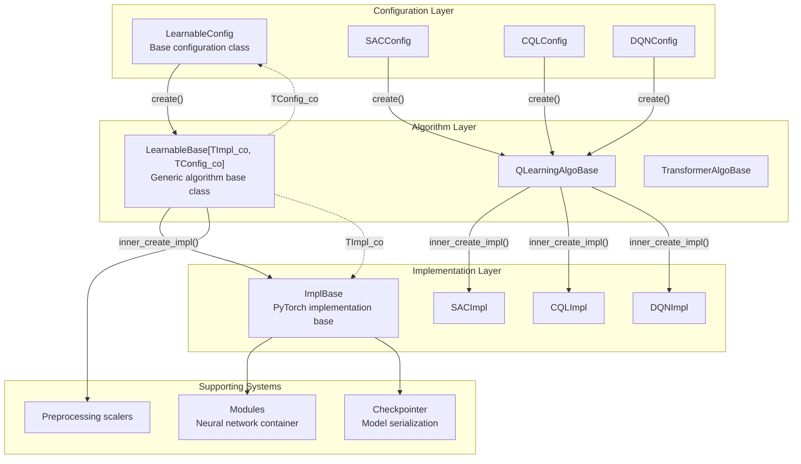
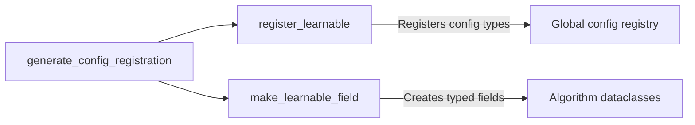
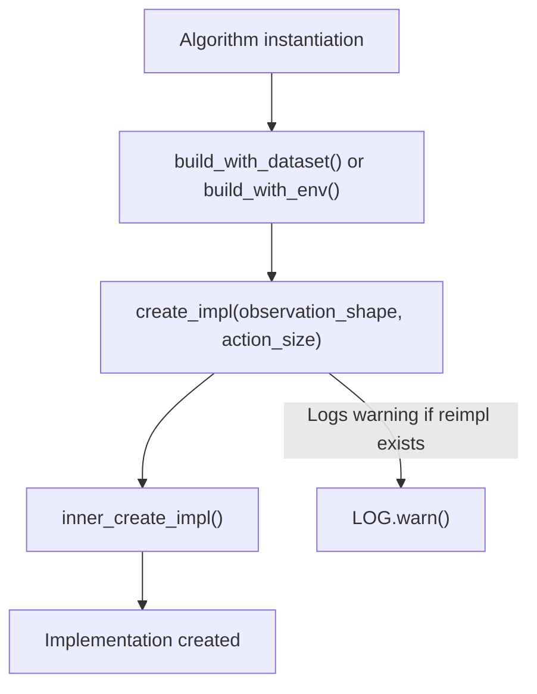
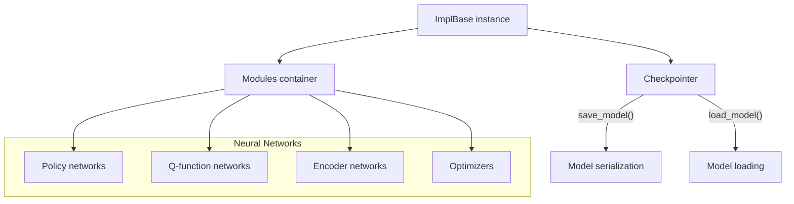
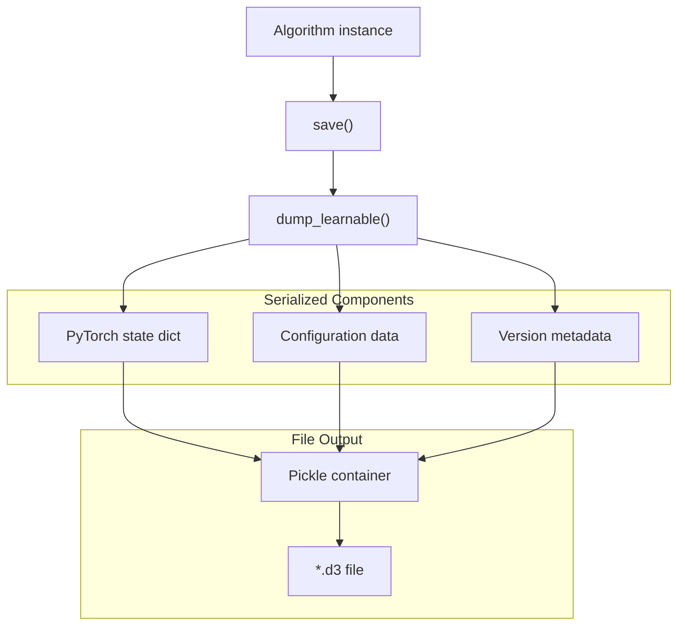

<!-- source: DeepWiki mcp.deepwiki.com · repo takuseno/d3rlpy · page 4 Core Architecture · fetched 2026-10-30 -->

# Core Architecture

<details>
<summary>Relevant source files</summary>

The following files were used as context for generating this wiki page:

- [d3rlpy/base.py](d3rlpy/base.py)
- [docs/references/logging.rst](docs/references/logging.rst)
- [tests/base_test.py](tests/base_test.py)

</details>


This document explains the foundational design patterns and base classes that underpin all d3rlpy algorithms. The core architecture provides a three-layer abstraction that separates configuration, algorithm logic, and PyTorch implementation details.

For comprehensive coverage of the algorithm framework that builds on these foundations, see [Algorithm System](#5). For details about the neural network components used in implementations, see [Model Components](#7).

## Architectural Overview

The d3rlpy architecture follows a consistent three-layer pattern that separates concerns between configuration, algorithm lifecycle management, and PyTorch implementation details.

### Core Architecture Layers



**Sources:** [d3rlpy/base.py:47-88](), [d3rlpy/base.py:207-231](), [d3rlpy/base.py:90-117]()

## Configuration Layer

The configuration layer uses dataclasses to define algorithm parameters and provides factory methods for creating algorithm instances.

### LearnableConfig Base Class

The `LearnableConfig` class serves as the base for all algorithm configurations, providing common parameters and the creation interface.

| Property | Type | Default | Purpose |
|----------|------|---------|---------|
| `batch_size` | `int` | 256 | Training batch size |
| `gamma` | `float` | 0.99 | Discount factor |
| `observation_scaler` | `Optional[ObservationScaler]` | None | Observation preprocessing |
| `action_scaler` | `Optional[ActionScaler]` | None | Action preprocessing |
| `reward_scaler` | `Optional[RewardScaler]` | None | Reward preprocessing |
| `compile_graph` | `bool` | False | Enable torch.compile optimization |

The `create()` method serves as the factory interface:

```python
def create(
    self, device: DeviceArg = False, enable_ddp: bool = False
) -> "LearnableBase[ImplBase, LearnableConfig]"
```

### Configuration Registration System

The architecture includes a dynamic configuration registration system that enables serialization and deserialization:



**Sources:** [d3rlpy/base.py:90-122](), [d3rlpy/base.py:120-122]()

## Algorithm Base Layer

The `LearnableBase` class provides the core algorithm interface and lifecycle management. It uses generic typing to maintain type safety across the configuration-algorithm-implementation chain.

### Generic Type System

```python
TImpl_co = TypeVar("TImpl_co", bound="ImplBase", covariant=True)
TConfig_co = TypeVar("TConfig_co", bound="LearnableConfig", covariant=True)

class LearnableBase(Generic[TImpl_co, TConfig_co], metaclass=ABCMeta):
```

This design ensures type safety while allowing algorithm-specific implementations to specialize the base types.

### Core Algorithm Properties

The algorithm layer exposes configuration properties and manages the implementation lifecycle:

| Property | Source | Purpose |
|----------|--------|---------|
| `config` | Configuration instance | Access to algorithm parameters |
| `impl` | Implementation instance | Access to PyTorch components |
| `observation_shape` | Implementation delegate | Input data shape |
| `action_size` | Implementation delegate | Output action dimensions |
| `grad_step` | Internal counter | Training progress tracking |

### Implementation Creation Workflow



**Sources:** [d3rlpy/base.py:301-318](), [d3rlpy/base.py:320-329](), [d3rlpy/base.py:331-342]()

## Implementation Layer

The `ImplBase` class provides the PyTorch-specific implementation interface. All algorithm implementations inherit from this base to ensure consistent neural network management.

### Implementation Base Structure

```python
class ImplBase(metaclass=ABCMeta):
    _observation_shape: Shape
    _action_size: int
    _modules: Modules
    _checkpointer: Checkpointer
    _device: str
```

### Neural Network Management

The implementation layer uses the `Modules` container pattern for managing PyTorch components:



**Sources:** [d3rlpy/base.py:47-88](), [d3rlpy/base.py:63-64]()

## Lifecycle Management

The architecture provides comprehensive lifecycle management including creation, serialization, and reconstruction of algorithm instances.

### Serialization Architecture



### Reconstruction Workflow

The architecture supports multiple reconstruction pathways:

| Method | Input | Purpose |
|--------|-------|---------|
| `load_learnable()` | `*.d3` file | Full algorithm reconstruction |
| `from_json()` | `params.json` | Configuration-based reconstruction |
| `load_model()` | `*.pt` file | Model weights only |

**Sources:** [d3rlpy/base.py:169-204](), [d3rlpy/base.py:232-275](), [d3rlpy/base.py:276-299]()

## Device and Compilation Handling

The architecture provides unified device management and performance optimization through compilation.

### Device Processing

```python
def _process_device(value: DeviceArg) -> str:
    if isinstance(value, bool):
        return "cuda:0" if value else "cpu:0"
    if isinstance(value, int):
        return f"cuda:{value}"
    if isinstance(value, str):
        return value
    if value is None:
        return "cpu:0"
```

### Compilation Support

The architecture integrates with PyTorch's compilation features:

```python
@property
def compiled(self) -> bool:
    return self._config.compile_graph and "cuda" in self._device
```

This enables CudaGraph optimization and `torch.compile` when running on CUDA devices with the `compile_graph` flag enabled.

**Sources:** [d3rlpy/base.py:151-166](), [d3rlpy/base.py:361-371]()

---

