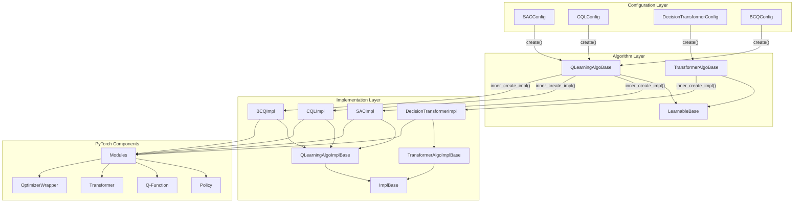
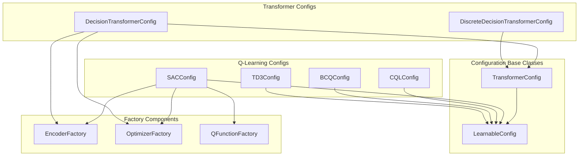
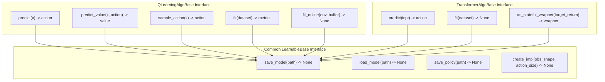
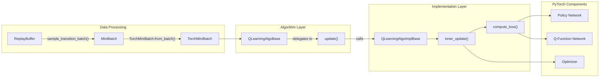
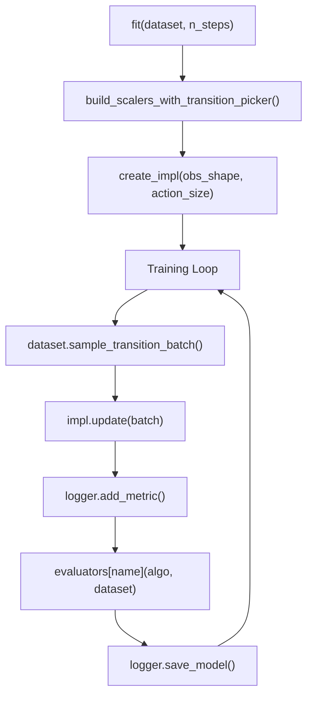
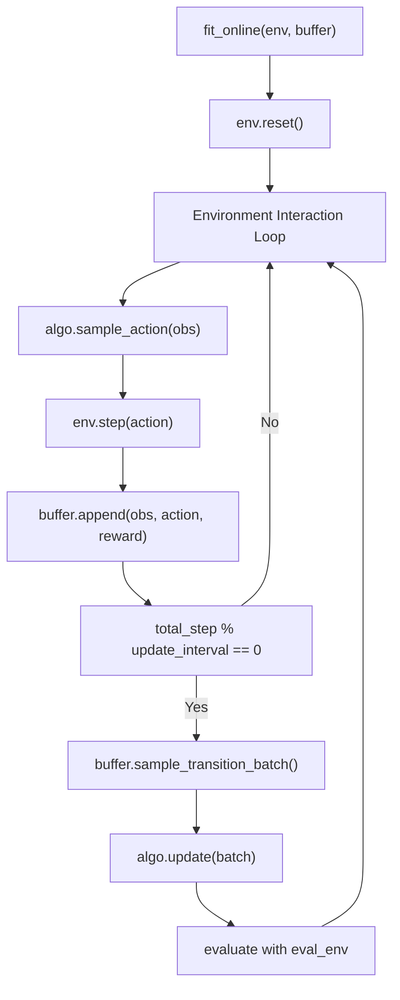
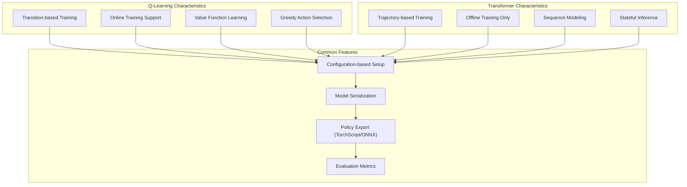

<!-- source: DeepWiki mcp.deepwiki.com · repo takuseno/d3rlpy · page 5 Algorithm System · fetched 2026-10-30 -->

# Algorithm System

<details>
<summary>Relevant source files</summary>

The following files were used as context for generating this wiki page:

- [README.md](README.md)
- [ROADMAP.md](ROADMAP.md)
- [d3rlpy/algos/__init__.py](d3rlpy/algos/__init__.py)
- [d3rlpy/algos/qlearning/base.py](d3rlpy/algos/qlearning/base.py)
- [d3rlpy/algos/transformer/base.py](d3rlpy/algos/transformer/base.py)
- [d3rlpy/algos/transformer/decision_transformer.py](d3rlpy/algos/transformer/decision_transformer.py)
- [d3rlpy/algos/transformer/torch/decision_transformer_impl.py](d3rlpy/algos/transformer/torch/decision_transformer_impl.py)
- [docs/references/algos.rst](docs/references/algos.rst)
- [docs/requirements.txt](docs/requirements.txt)

</details>


## Purpose and Scope

The Algorithm System is the core framework of d3rlpy that provides a unified interface for deep reinforcement learning algorithms. This system manages algorithm configuration, instantiation, training, and inference through a three-layer architecture: configuration classes, algorithm base classes, and PyTorch implementations.

This document covers the algorithm framework's architecture, base classes, and training interfaces. For specific algorithm implementations like SAC, CQL, and Decision Transformer, see [Algorithm Implementations](#5.3). For Q-learning specific details, see [Q-Learning Algorithms](#5.1). For transformer-based algorithms, see [Transformer Algorithms](#5.2).

## Architecture Overview

The Algorithm System follows a three-layer design pattern that separates configuration, algorithm logic, and PyTorch-specific implementation:

**Algorithm System Architecture**


Sources: [d3rlpy/algos/qlearning/base.py:163-166](), [d3rlpy/algos/transformer/base.py:208-211](), [d3rlpy/base.py](), [d3rlpy/algos/transformer/decision_transformer.py:28-29]()

## Configuration System

All algorithms use dataclass-based configuration objects that define hyperparameters and factory objects for creating neural network components. The configuration system provides type safety and serialization capabilities.

**Configuration Class Structure**


### Configuration Usage Pattern

Configuration objects are instantiated with hyperparameters and then used to create algorithm instances:

| Step | Code Pattern | Description |
|------|-------------|------------|
| 1. Configure | `config = SACConfig(batch_size=256, learning_rate=3e-4)` | Set hyperparameters |
| 2. Create | `algo = config.create(device="cuda:0")` | Instantiate algorithm |
| 3. Build | `algo.build_with_dataset(dataset)` | Build neural networks |
| 4. Train | `algo.fit(dataset, n_steps=100000)` | Execute training |

Sources: [d3rlpy/algos/transformer/decision_transformer.py:28-84](), [d3rlpy/base.py](), [README.md:18-19]()

## Algorithm Base Classes

The algorithm layer provides two main base classes that define the core interfaces for different algorithm families:

### QLearningAlgoBase

`QLearningAlgoBase` provides the interface for value-based algorithms that learn Q-functions. It implements both offline and online training methods.

**Key Methods:**
- `predict(x)` - Returns greedy actions
- `predict_value(x, action)` - Returns Q-values
- `sample_action(x)` - Returns stochastic actions
- `fit(dataset)` - Offline training
- `fit_online(env, buffer)` - Online training with environment interaction

### TransformerAlgoBase

`TransformerAlgoBase` provides the interface for sequence modeling algorithms like Decision Transformer. It handles trajectory-based training and stateful inference.

**Key Methods:**
- `predict(inpt)` - Returns actions from transformer input
- `fit(dataset)` - Offline training on trajectories
- `as_stateful_wrapper(target_return)` - Creates stateful wrapper for evaluation

**Algorithm Interface Comparison**


Sources: [d3rlpy/algos/qlearning/base.py:163-166](), [d3rlpy/algos/transformer/base.py:208-211](), [d3rlpy/algos/qlearning/base.py:256-368](), [d3rlpy/algos/transformer/base.py:347-374]()

## Implementation Layer

The implementation layer contains PyTorch-specific code that performs the actual neural network operations. Each algorithm has a corresponding implementation class that inherits from either `QLearningAlgoImplBase` or `TransformerAlgoImplBase`.

### Implementation Responsibilities

| Component | Responsibility | Key Methods |
|-----------|---------------|-------------|
| `QLearningAlgoImplBase` | Q-learning computations | `inner_update()`, `inner_predict_best_action()` |
| `TransformerAlgoImplBase` | Transformer computations | `inner_update()`, `inner_predict()` |
| `Modules` | PyTorch module container | Neural networks and optimizers |
| `ImplBase` | Common implementation logic | Device management, module access |

### Training Data Flow



Sources: [d3rlpy/algos/qlearning/base.py:65-108](), [d3rlpy/algos/transformer/base.py:49-68](), [d3rlpy/algos/qlearning/base.py:859-880](), [d3rlpy/torch_utility.py]()

## Training Interfaces

The Algorithm System provides two primary training interfaces:

### Offline Training

Offline training uses pre-collected datasets and implements the standard supervised learning loop:

```python
# Training interface pattern
algo.fit(
    dataset=replay_buffer,
    n_steps=1000000,
    n_steps_per_epoch=10000,
    evaluators={"environment": evaluator}
)
```

**Offline Training Flow**


### Online Training

Online training interacts with environments to collect experience while simultaneously learning:

```python
# Online training pattern
algo.fit_online(
    env=environment,
    buffer=replay_buffer,
    n_steps=1000000,
    update_interval=1
)
```

**Online Training Flow**


Sources: [d3rlpy/algos/qlearning/base.py:370-434](), [d3rlpy/algos/qlearning/base.py:592-777](), [d3rlpy/algos/transformer/base.py:376-509]()

## Algorithm Categories

The Algorithm System supports two main categories of algorithms, each with distinct characteristics:

### Q-Learning Algorithms

Q-learning algorithms learn value functions and are suitable for both offline and online training:

| Algorithm | Config Class | Implementation | Action Space |
|-----------|-------------|---------------|--------------|
| SAC | `SACConfig` | `SACImpl` | Continuous/Discrete |
| CQL | `CQLConfig` | `CQLImpl` | Continuous/Discrete |
| BCQ | `BCQConfig` | `BCQImpl` | Continuous/Discrete |
| TD3 | `TD3Config` | `TD3Impl` | Continuous |
| DQN | `DQNConfig` | `DQNImpl` | Discrete |

### Transformer Algorithms

Transformer algorithms model sequential decision-making and primarily support offline training:

| Algorithm | Config Class | Implementation | Action Space |
|-----------|-------------|---------------|--------------|
| Decision Transformer | `DecisionTransformerConfig` | `DecisionTransformerImpl` | Continuous |
| Discrete Decision Transformer | `DiscreteDecisionTransformerConfig` | `DiscreteDecisionTransformerImpl` | Discrete |

**Algorithm Category Characteristics**


Sources: [docs/references/algos.rst:40-51](), [docs/references/algos.rst:353-462](), [d3rlpy/algos/transformer/decision_transformer.py:20-25](), [README.md:88-112]()

---

