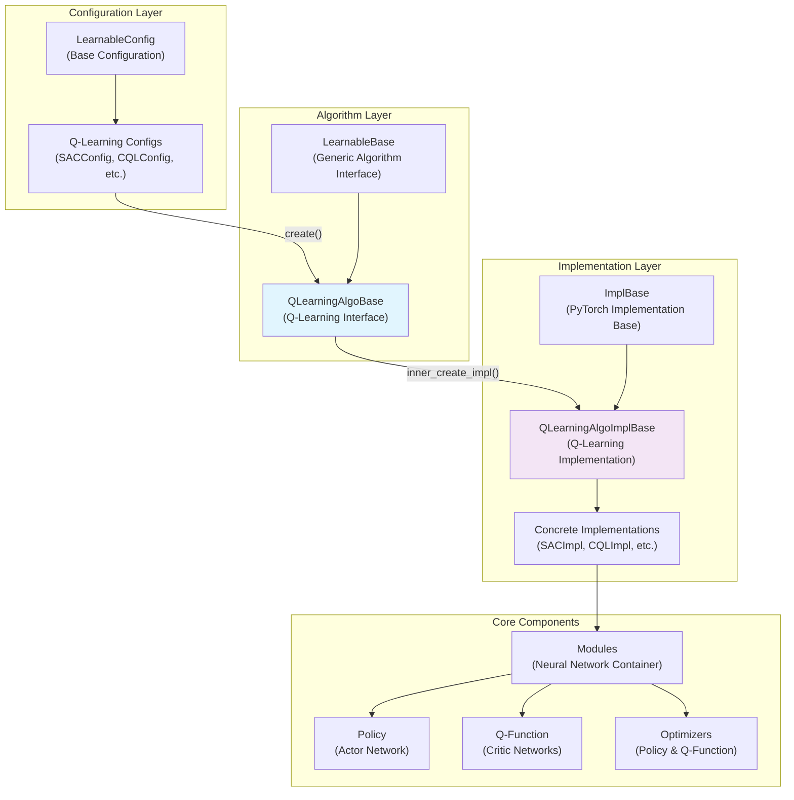
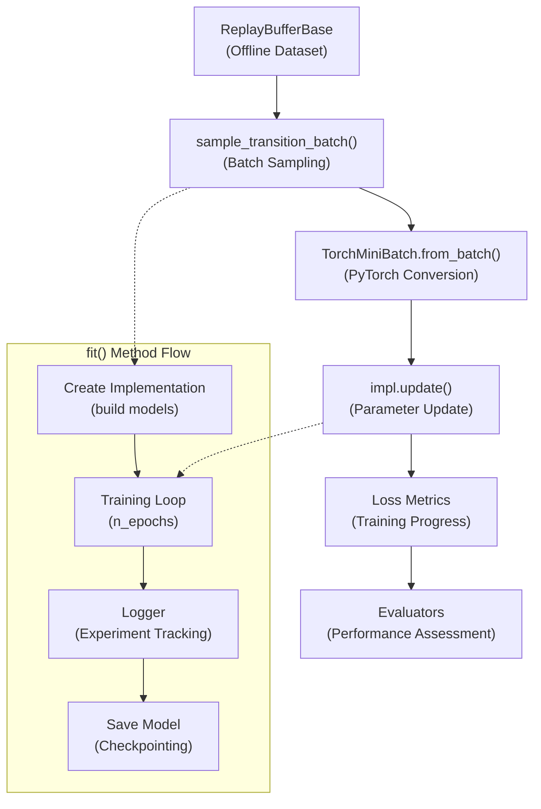
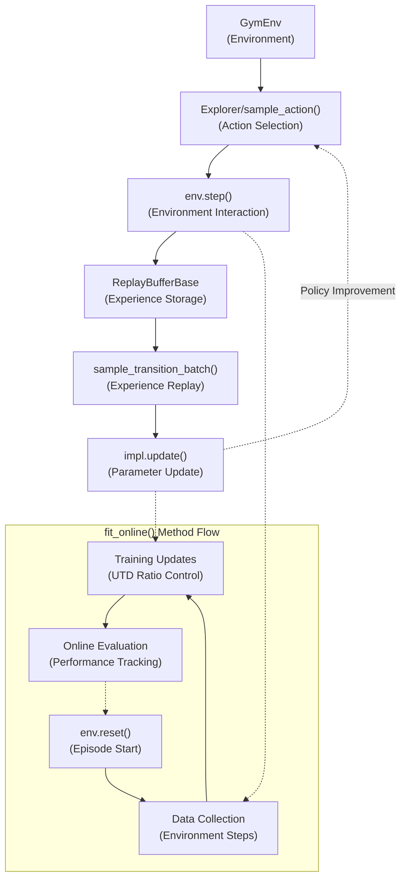
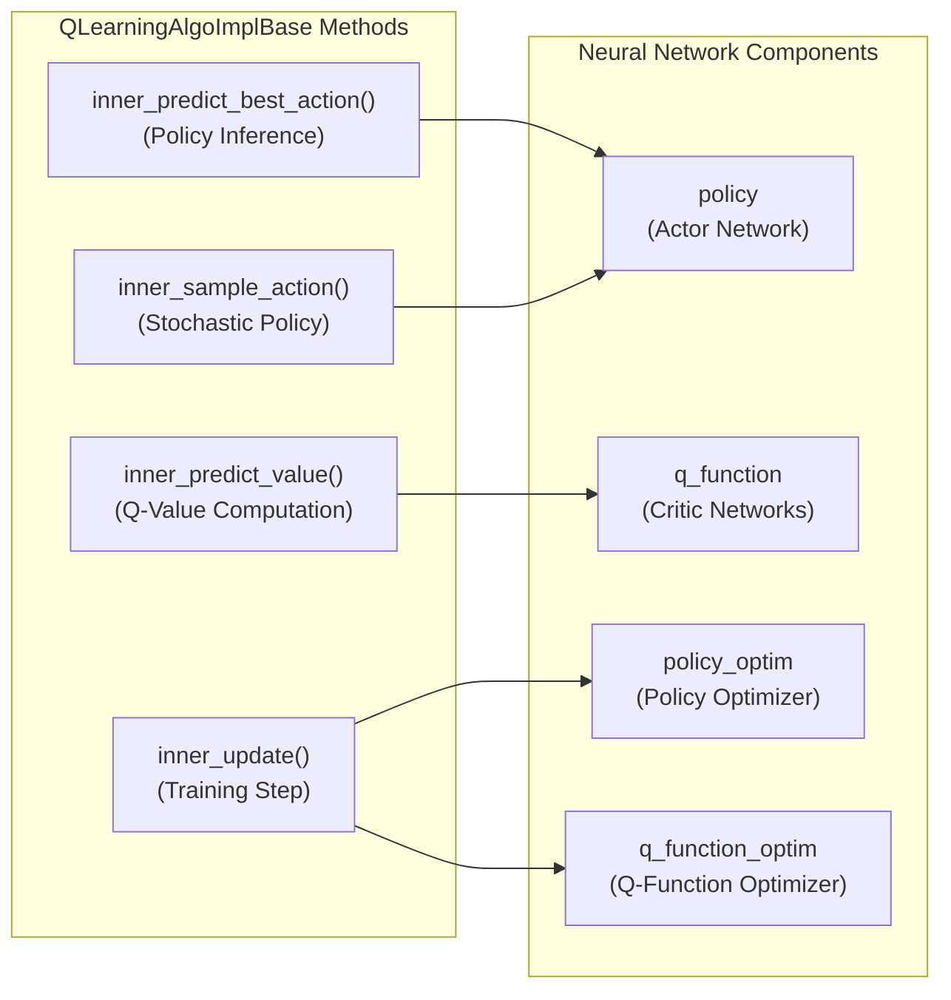
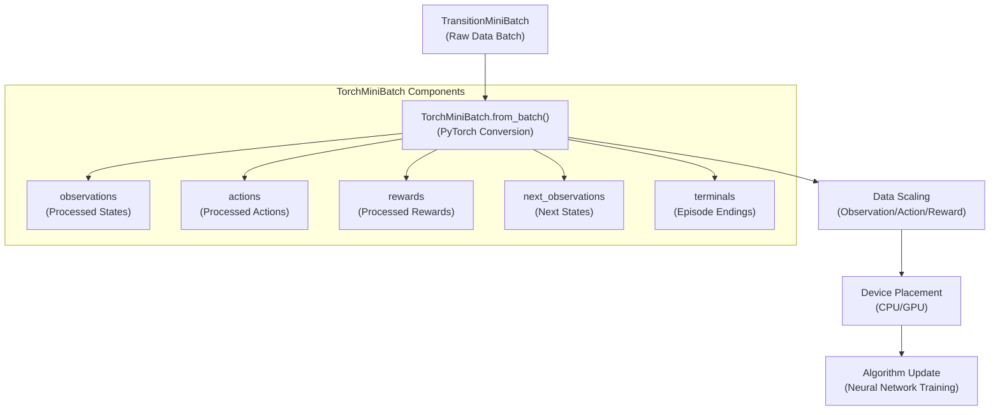
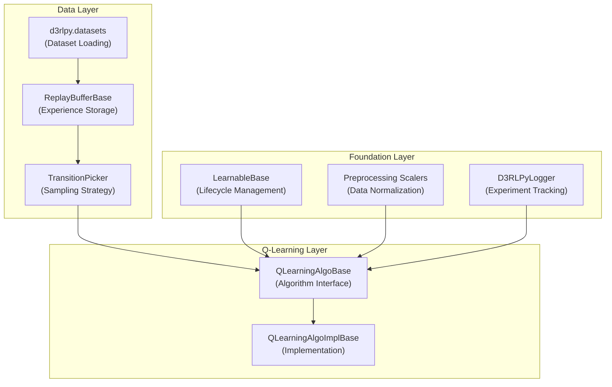

<!-- source: DeepWiki mcp.deepwiki.com · repo takuseno/d3rlpy · page 5.1 Q-Learning Algorithms · fetched 2026-10-30 -->

# Q-Learning Algorithms

Relevant source files

The following files were used as context for generating this wiki page:

- [README.md](README.md)
- [ROADMAP.md](ROADMAP.md)
- [d3rlpy/algos/__init__.py](d3rlpy/algos/__init__.py)
- [d3rlpy/algos/qlearning/base.py](d3rlpy/algos/qlearning/base.py)
- [d3rlpy/algos/transformer/base.py](d3rlpy/algos/transformer/base.py)
- [d3rlpy/algos/transformer/decision_transformer.py](d3rlpy/algos/transformer/decision_transformer.py)
- [d3rlpy/algos/transformer/torch/decision_transformer_impl.py](d3rlpy/algos/transformer/torch/decision_transformer_impl.py)
- [docs/references/algos.rst](docs/references/algos.rst)
- [docs/requirements.txt](docs/requirements.txt)

This document covers the Q-learning algorithm framework in d3rlpy, which provides the base classes and training workflows for value-based reinforcement learning algorithms. This includes both offline and online training capabilities, policy evaluation methods, and the core interfaces that all Q-learning algorithms implement.

For information about specific Q-learning algorithm implementations like SAC, CQL, and BCQ, see [Algorithm Implementations](#5.3). For transformer-based algorithms like Decision Transformer, see [Transformer Algorithms](#5.2).

## Architecture Overview

The Q-learning system is built on a two-layer architecture with configuration classes, algorithm base classes, and PyTorch implementation classes.

### Class Hierarchy

**Class Responsibilities**

| Class | Purpose | Key Methods |
|-------|---------|-------------|
| `QLearningAlgoBase` | User-facing algorithm interface | `fit()`, `fit_online()`, `predict()`, `predict_value()` |
| `QLearningAlgoImplBase` | PyTorch implementation interface | `inner_update()`, `inner_predict_best_action()` |
| Configuration Classes | Algorithm hyperparameters | `create()`, algorithm-specific parameters |

Sources: [d3rlpy/algos/qlearning/base.py:163-166](), [d3rlpy/algos/qlearning/base.py:65-66]()

## Training Workflows

The Q-learning framework supports both offline and online training modes with distinct data processing pipelines.

### Offline Training Workflow

### Online Training Workflow

Sources: [d3rlpy/algos/qlearning/base.py:370-434](), [d3rlpy/algos/qlearning/base.py:592-777]()

## Key Methods and Interfaces

### Core Algorithm Interface

The `QLearningAlgoBase` class provides the main user interface for Q-learning algorithms:

| Method | Purpose | Input/Output |
|--------|---------|--------------|
| `predict(x)` | Greedy action selection | `Observation` → `NDArray` |
| `sample_action(x)` | Stochastic action sampling | `Observation` → `NDArray` |
| `predict_value(x, action)` | Q-value estimation | `Observation, Action` → `NDArray` |
| `fit(dataset)` | Offline training | `ReplayBufferBase` → `List[Metrics]` |
| `fit_online(env)` | Online training | `GymEnv` → `None` |

### Implementation Interface

The `QLearningAlgoImplBase` class defines the PyTorch implementation contract:

Sources: [d3rlpy/algos/qlearning/base.py:70-102](), [d3rlpy/algos/qlearning/base.py:104-154]()

## Data Processing Pipeline

The Q-learning algorithms process data through a standardized pipeline that handles preprocessing, batching, and device placement.

### Batch Processing Flow

### Update Method Implementation

The `update()` method in `QLearningAlgoBase` orchestrates the data processing and parameter updates:

1. **Batch Conversion**: `TorchMiniBatch.from_batch()` converts raw data to PyTorch tensors
2. **Scaling Application**: Observation, action, and reward scalers are applied
3. **Implementation Delegation**: `self._impl.update()` performs the actual neural network updates
4. **Gradient Step Tracking**: `self._grad_step` is incremented for learning rate schedules

Sources: [d3rlpy/algos/qlearning/base.py:859-880]()

## Integration with Core Architecture

The Q-learning system integrates with d3rlpy's core architecture through several key interfaces:

### Data Management Integration

### Component Transfer Methods

The Q-learning base classes provide methods for transferring learned components between algorithms:

| Method | Purpose | Use Case |
|--------|---------|----------|
| `copy_policy_from()` | Transfer policy parameters | Offline → Online transfer |
| `copy_q_function_from()` | Transfer Q-function parameters | Pre-training scenarios |
| `copy_policy_optim_from()` | Transfer optimizer states | Warm-start training |
| `copy_q_function_optim_from()` | Transfer Q-function optimizer states | Continue training |

Sources: [d3rlpy/algos/qlearning/base.py:886-976]()

## Training Configuration

The Q-learning framework provides extensive configuration options for training behavior:

| Parameter | Purpose | Default Behavior |
|-----------|---------|------------------|
| `n_steps_per_epoch` | Training steps per epoch | 10,000 steps |
| `update_interval` | Online update frequency | Every step |
| `n_updates` | Updates per interval (UTD ratio) | 1 update |
| `update_start_step` | Delay before training starts | 0 steps |
| `random_steps` | Initial random exploration | 0 steps |

The training loops support extensive customization through callback functions and evaluator protocols, enabling integration with experiment tracking systems and custom evaluation metrics.

Sources: [d3rlpy/algos/qlearning/base.py:436-590](), [d3rlpy/algos/qlearning/base.py:614-643]()

---

