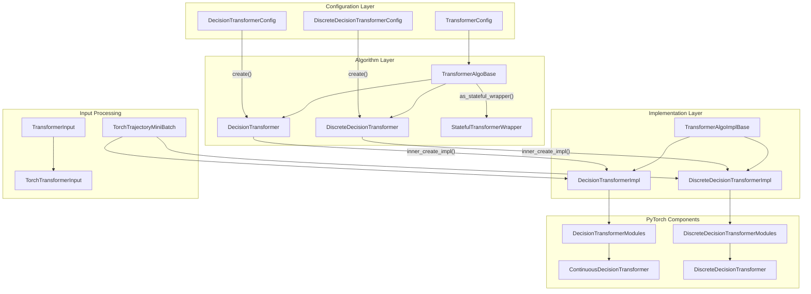
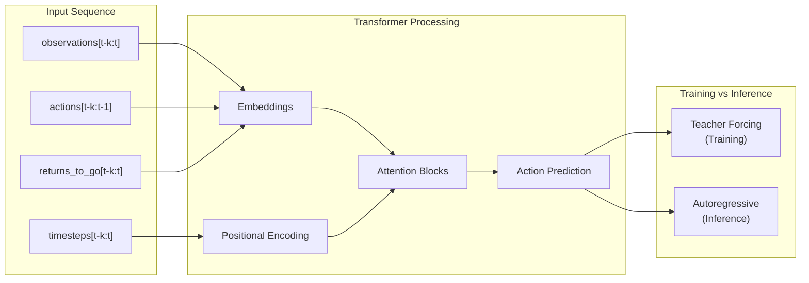
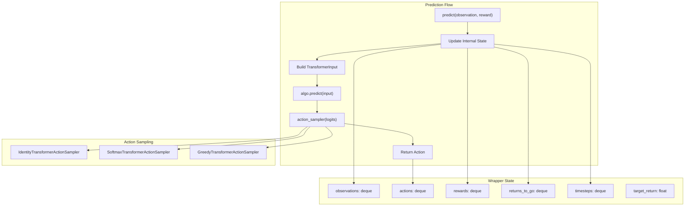
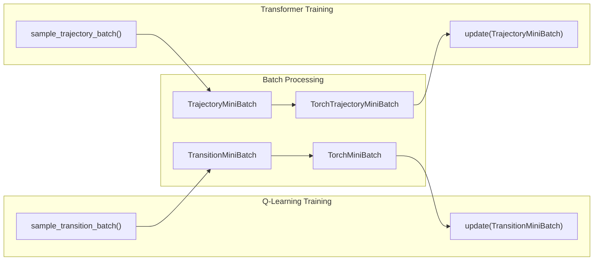

<!-- source: DeepWiki mcp.deepwiki.com · repo takuseno/d3rlpy · page 5.2 Transformer Algorithms · fetched 2026-10-30 -->

# Transformer Algorithms

<details>
<summary>Relevant source files</summary>

The following files were used as context for generating this wiki page:

- [README.md](README.md)
- [ROADMAP.md](ROADMAP.md)
- [d3rlpy/algos/__init__.py](d3rlpy/algos/__init__.py)
- [d3rlpy/algos/qlearning/base.py](d3rlpy/algos/qlearning/base.py)
- [d3rlpy/algos/transformer/base.py](d3rlpy/algos/transformer/base.py)
- [d3rlpy/algos/transformer/decision_transformer.py](d3rlpy/algos/transformer/decision_transformer.py)
- [d3rlpy/algos/transformer/torch/decision_transformer_impl.py](d3rlpy/algos/transformer/torch/decision_transformer_impl.py)
- [docs/references/algos.rst](docs/references/algos.rst)
- [docs/requirements.txt](docs/requirements.txt)

</details>


This document covers the transformer-based algorithm system in d3rlpy, which provides sequence modeling approaches to reinforcement learning. These algorithms solve decision-making problems by treating them as sequence prediction tasks, using transformer architectures to model the relationship between observations, actions, rewards, and returns-to-go over time.

For Q-learning based algorithms, see [Q-Learning Algorithms](#5.1). For specific algorithm implementations beyond the transformer framework, see [Algorithm Implementations](#5.3).

## Overview

Transformer algorithms in d3rlpy are fundamentally different from Q-learning approaches. Instead of learning value functions, they learn to predict actions given sequences of past experiences. The primary implementation is the Decision Transformer, which predicts actions conditioned on desired returns-to-go.

The transformer system supports both continuous and discrete action spaces, and provides specialized evaluation interfaces through stateful wrappers that maintain context across sequential predictions.

Sources: [d3rlpy/algos/transformer/base.py:1-552](), [README.md:109-111](), [docs/references/algos.rst:352-463]()

## Architecture Overview

The transformer algorithm system follows a three-layer architecture similar to Q-learning algorithms but with sequence-specific components:



**Transformer Algorithm Architecture**

This architecture enables sequence modeling for reinforcement learning by processing trajectories rather than individual transitions. The `StatefulTransformerWrapper` provides a Q-learning-like interface for evaluation while maintaining the transformer's sequential context requirements.

Sources: [d3rlpy/algos/transformer/base.py:71-552](), [d3rlpy/algos/transformer/decision_transformer.py:28-248](), [d3rlpy/algos/transformer/torch/decision_transformer_impl.py:30-197]()

## Base Classes

### TransformerConfig

`TransformerConfig` extends `LearnableConfig` with transformer-specific parameters that control sequence processing:

| Parameter | Type | Default | Description |
|-----------|------|---------|-------------|
| `context_size` | `int` | 20 | Maximum sequence length for attention |
| `max_timestep` | `int` | 1000 | Maximum environmental timestep for positional encoding |

Sources: [d3rlpy/algos/transformer/base.py:71-75]()

### TransformerAlgoImplBase

The implementation base class defines the core interface for transformer algorithms:

- `inner_predict(inpt: TorchTransformerInput) -> torch.Tensor`: Predicts next action given sequence input
- `inner_update(batch: TorchTrajectoryMiniBatch, grad_step: int) -> dict[str, float]`: Updates model parameters using trajectory batches

Unlike Q-learning implementations, transformer implementations work with trajectory data rather than single transitions.

Sources: [d3rlpy/algos/transformer/base.py:49-68]()

### TransformerAlgoBase

`TransformerAlgoBase` provides the main algorithm interface, including:

- **Training**: `fit()` method that samples trajectory batches using `sample_trajectory_batch()` instead of transition batches
- **Prediction**: `predict()` method that accepts `TransformerInput` containing sequence data
- **Policy Export**: `save_policy()` method for exporting transformer models
- **Stateful Wrapper**: `as_stateful_wrapper()` method for creating evaluation interfaces

Sources: [d3rlpy/algos/transformer/base.py:208-552]()

## Decision Transformer Implementation

Decision Transformer solves reinforcement learning as a sequence modeling problem by predicting actions conditioned on desired returns-to-go:



**Decision Transformer Processing Flow**

### Continuous vs Discrete Variants

The system provides separate implementations for different action spaces:

- **DecisionTransformer**: Continuous actions using MSE loss
- **DiscreteDecisionTransformer**: Discrete actions using cross-entropy loss with learning rate scheduling

| Feature | Continuous | Discrete |
|---------|------------|----------|
| Loss Function | MSE | Cross-entropy |
| Learning Rate | Fixed | Cosine decay with warmup |
| Action Output | Direct regression | Logits + softmax |
| Default Config | 3 layers, 1 head | 6 layers, 8 heads |

Sources: [d3rlpy/algos/transformer/decision_transformer.py:28-248](), [d3rlpy/algos/transformer/torch/decision_transformer_impl.py:36-197]()

## Stateful Wrapper for Evaluation

Transformer algorithms require maintaining context across multiple time steps during evaluation. The `StatefulTransformerWrapper` provides a Q-learning-like interface while handling this complexity:



**Stateful Wrapper Prediction Flow**

The wrapper maintains fixed-size deques (controlled by `context_size`) and automatically handles:
- Return-to-go computation based on target return and observed rewards
- Padding for initial actions before any history exists  
- Timestep tracking with maximum bounds from `max_timestep`

Sources: [d3rlpy/algos/transformer/base.py:81-206]()

## Training and Data Processing

Transformer algorithms use trajectory-based sampling instead of transition-based sampling:

### Training Loop Differences



**Training Data Flow Comparison**

### Sequence Processing

Transformer training requires special handling for:
- **Context Length**: Trajectories are sampled with length equal to `context_size`
- **Masking**: Invalid positions in sequences are masked during loss computation
- **Returns-to-go**: Computed dynamically during batch conversion

The `TorchTrajectoryMiniBatch` provides the structured input that transformer implementations expect, containing observations, actions, rewards, returns-to-go, timesteps, and attention masks.

Sources: [d3rlpy/algos/transformer/base.py:460-530](), [d3rlpy/algos/transformer/torch/decision_transformer_impl.py:67-93]()

## Configuration and Usage

### Basic Usage Pattern

```python
# Configuration
config = DecisionTransformerConfig(
    context_size=20,
    max_timestep=1000,
    batch_size=64,
    learning_rate=1e-4
)

# Algorithm creation
dt = config.create(device="cuda:0")

# Training
dt.fit(
    dataset,
    n_steps=100000,
    eval_env=env,
    eval_target_return=500.0
)

# Evaluation wrapper
wrapper = dt.as_stateful_wrapper(target_return=500.0)
action = wrapper.predict(observation, reward)
```

### Key Configuration Differences

| Parameter | Q-Learning | Transformer | Notes |
|-----------|------------|-------------|-------|
| Batch Processing | Transitions | Trajectories | Fundamental difference |
| Context | Single step | Sequence window | `context_size` parameter |
| Evaluation | Direct predict | Stateful wrapper | Requires return target |
| Data Requirements | Any episodes | Complete trajectories | May need trajectory reconstruction |

The transformer system integrates with the same preprocessing, logging, and evaluation infrastructure as Q-learning algorithms, but operates on fundamentally different data structures and training paradigms.

Sources: [d3rlpy/algos/transformer/decision_transformer.py:28-248](), [docs/references/algos.rst:356-463]()

---

