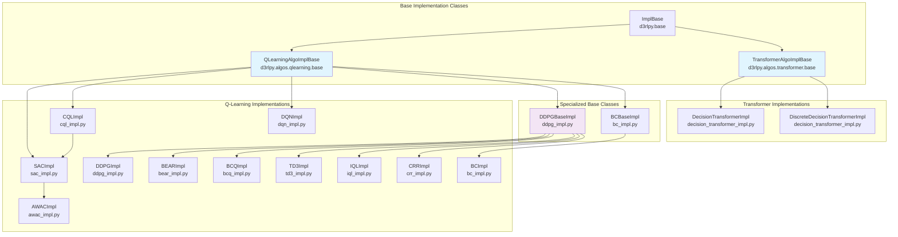
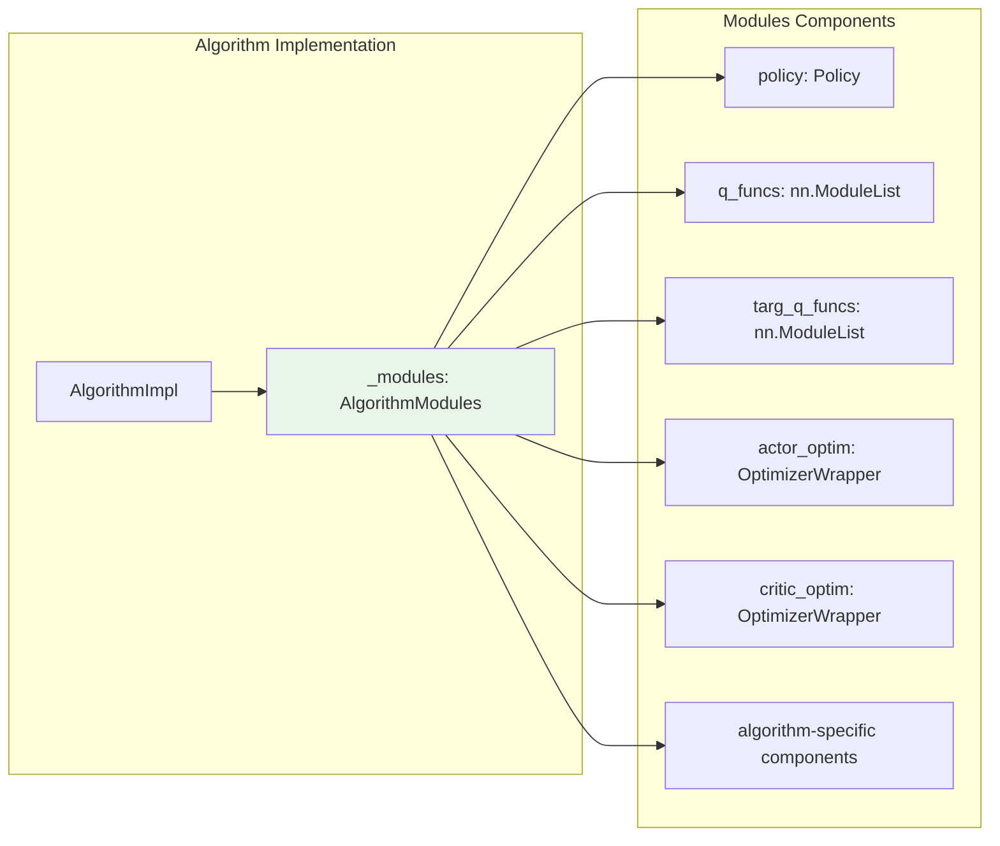
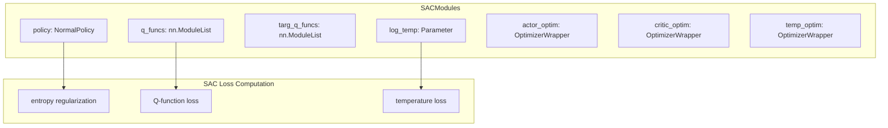
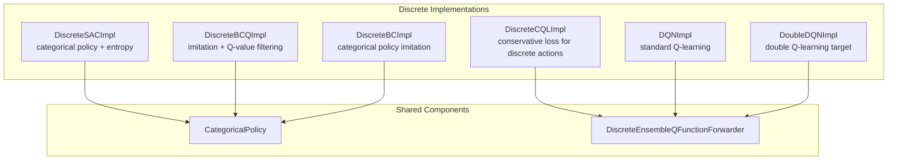
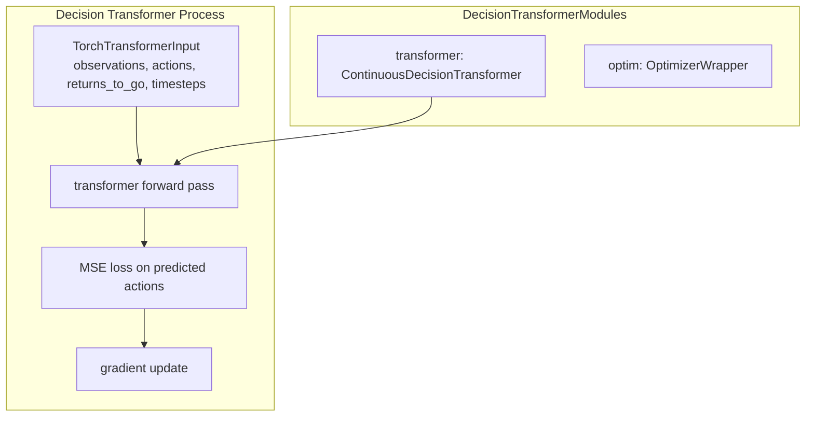
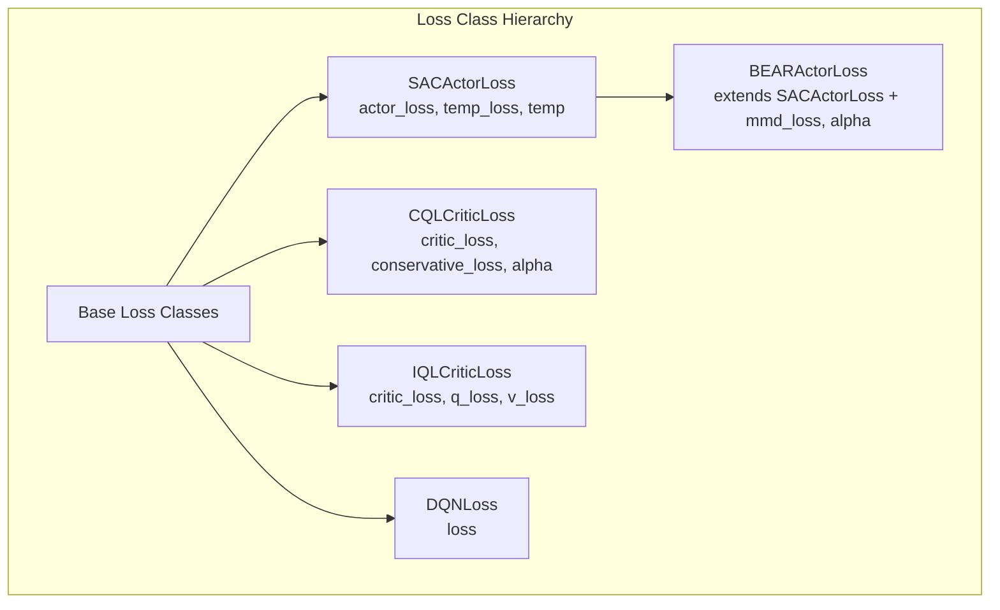

<!-- source: DeepWiki mcp.deepwiki.com · repo takuseno/d3rlpy · page 5.3 Algorithm Implementations · fetched 2026-10-30 -->

# Algorithm Implementations

Relevant source files

The following files were used as context for generating this wiki page:

- [d3rlpy/algos/qlearning/base.py](d3rlpy/algos/qlearning/base.py)
- [d3rlpy/algos/qlearning/torch/awac_impl.py](d3rlpy/algos/qlearning/torch/awac_impl.py)
- [d3rlpy/algos/qlearning/torch/bc_impl.py](d3rlpy/algos/qlearning/torch/bc_impl.py)
- [d3rlpy/algos/qlearning/torch/bcq_impl.py](d3rlpy/algos/qlearning/torch/bcq_impl.py)
- [d3rlpy/algos/qlearning/torch/bear_impl.py](d3rlpy/algos/qlearning/torch/bear_impl.py)
- [d3rlpy/algos/qlearning/torch/cql_impl.py](d3rlpy/algos/qlearning/torch/cql_impl.py)
- [d3rlpy/algos/qlearning/torch/crr_impl.py](d3rlpy/algos/qlearning/torch/crr_impl.py)
- [d3rlpy/algos/qlearning/torch/ddpg_impl.py](d3rlpy/algos/qlearning/torch/ddpg_impl.py)
- [d3rlpy/algos/qlearning/torch/dqn_impl.py](d3rlpy/algos/qlearning/torch/dqn_impl.py)
- [d3rlpy/algos/qlearning/torch/iql_impl.py](d3rlpy/algos/qlearning/torch/iql_impl.py)
- [d3rlpy/algos/qlearning/torch/plas_impl.py](d3rlpy/algos/qlearning/torch/plas_impl.py)
- [d3rlpy/algos/qlearning/torch/sac_impl.py](d3rlpy/algos/qlearning/torch/sac_impl.py)
- [d3rlpy/algos/qlearning/torch/td3_impl.py](d3rlpy/algos/qlearning/torch/td3_impl.py)
- [d3rlpy/algos/qlearning/torch/td3_plus_bc_impl.py](d3rlpy/algos/qlearning/torch/td3_plus_bc_impl.py)
- [d3rlpy/algos/transformer/base.py](d3rlpy/algos/transformer/base.py)
- [d3rlpy/algos/transformer/decision_transformer.py](d3rlpy/algos/transformer/decision_transformer.py)
- [d3rlpy/algos/transformer/torch/decision_transformer_impl.py](d3rlpy/algos/transformer/torch/decision_transformer_impl.py)

This document covers the specific PyTorch implementations of reinforcement learning algorithms in d3rlpy. These implementations inherit from the base algorithm classes and provide the concrete neural network architectures, loss functions, and update procedures for each algorithm.

For information about the base algorithm framework and lifecycle management, see [Algorithm System](#5). For details about Q-learning and transformer base classes, see [Q-Learning Algorithms](#5.1) and [Transformer Algorithms](#5.2).

## Implementation Architecture

Algorithm implementations in d3rlpy follow a three-layer architecture where configuration classes create algorithm instances, which delegate to PyTorch implementation classes that contain the actual neural network logic.

### Implementation Hierarchy

Sources: [d3rlpy/algos/qlearning/base.py:65-158](), [d3rlpy/algos/transformer/base.py:49-68](), [d3rlpy/algos/qlearning/torch/sac_impl.py:56-133](), [d3rlpy/algos/qlearning/torch/cql_impl.py:41-200](), [d3rlpy/algos/qlearning/torch/ddpg_impl.py:56-184]()

### Modules Pattern

All algorithm implementations use a consistent modules pattern to organize their PyTorch components. Each implementation contains a `Modules` dataclass that groups related neural networks and optimizers.

Sources: [d3rlpy/algos/qlearning/torch/sac_impl.py:43-47](), [d3rlpy/algos/qlearning/torch/ddpg_impl.py:37-44](), [d3rlpy/algos/qlearning/torch/dqn_impl.py:24-28]()

## Q-Learning Algorithm Implementations

### Core Q-Learning Implementations

#### SAC (Soft Actor-Critic)
`SACImpl` implements the Soft Actor-Critic algorithm with automatic temperature tuning. It uses a stochastic policy with entropy regularization.

Key components:
- `NormalPolicy` for stochastic action sampling
- `log_temp` parameter for entropy coefficient
- Temperature optimization with target entropy

Sources: [d3rlpy/algos/qlearning/torch/sac_impl.py:43-133]()

#### CQL (Conservative Q-Learning)
`CQLImpl` extends SAC with conservative Q-learning to prevent overestimation in offline settings. It adds a conservative penalty term to the Q-function loss.

Key features:
- Conservative loss computation using policy and random action samples
- Automatic alpha tuning for the conservative penalty
- Support for both soft and deterministic Q-backup

Sources: [d3rlpy/algos/qlearning/torch/cql_impl.py:41-200]()

#### BEAR (Bootstrapping Error Accumulation Reduction)
`BEARImpl` uses a VAE to model the behavior policy and constrains the learned policy using Maximum Mean Discrepancy (MMD).

Unique components:
- `VAEEncoder` and `VAEDecoder` for behavior modeling
- MMD computation with Gaussian or Laplacian kernels
- Dual optimization of policy and VAE

Sources: [d3rlpy/algos/qlearning/torch/bear_impl.py:61-315]()

#### BCQ (Batch-Constrained Q-Learning)
`BCQImpl` uses a VAE to generate candidate actions and selects the best action using Q-values, constraining the policy to stay close to the data distribution.

Key features:
- VAE-based action generation
- Residual policy for action refinement
- Delayed reinforcement learning after VAE pre-training

Sources: [d3rlpy/algos/qlearning/torch/bcq_impl.py:51-302]()

### Discrete Action Space Implementations

Several algorithms have specialized implementations for discrete action spaces:

Sources: [d3rlpy/algos/qlearning/torch/sac_impl.py:146-332](), [d3rlpy/algos/qlearning/torch/cql_impl.py:237-292](), [d3rlpy/algos/qlearning/torch/bcq_impl.py:243-302](), [d3rlpy/algos/qlearning/torch/dqn_impl.py:36-143]()

### Behavioral Cloning Implementations

#### BC (Behavioral Cloning)
`BCImpl` provides pure imitation learning without Q-functions. It supports both deterministic and stochastic policies.

Policy types:
- `deterministic`: Uses `DeterministicPolicy` with MSE loss
- `stochastic`: Uses `NormalPolicy` with log-likelihood loss

Sources: [d3rlpy/algos/qlearning/torch/bc_impl.py:93-141]()

### Actor-Critic Implementations

#### DDPG (Deep Deterministic Policy Gradient)
`DDPGImpl` implements the basic actor-critic algorithm with deterministic policies.

#### TD3 (Twin Delayed Deep Deterministic Policy Gradient)
`TD3Impl` extends DDPG with target policy smoothing and delayed policy updates.

Key features:
- Target action smoothing with clipped noise
- Delayed policy updates based on `update_actor_interval`

Sources: [d3rlpy/algos/qlearning/torch/td3_impl.py:11-77]()

#### IQL (Implicit Q-Learning)
`IQLImpl` uses expectile regression for value function learning and weighted behavioral cloning for policy learning.

Unique components:
- `ValueFunction` for state value estimation
- Expectile loss for value function training
- Advantage-weighted policy learning

Sources: [d3rlpy/algos/qlearning/torch/iql_impl.py:36-125]()

## Transformer Algorithm Implementations

### Decision Transformer

`DecisionTransformerImpl` implements sequence modeling for reinforcement learning using transformer architectures.

Sources: [d3rlpy/algos/transformer/torch/decision_transformer_impl.py:36-93]()

### Discrete Decision Transformer

`DiscreteDecisionTransformerImpl` handles discrete action spaces with additional features:

- Learning rate scheduling with warmup and cosine decay
- Cross-entropy loss for discrete action prediction
- Token-based learning rate adjustment

Sources: [d3rlpy/algos/transformer/torch/decision_transformer_impl.py:101-197]()

## Algorithm-Specific Components

### Loss Computation Patterns

Each algorithm implementation defines specialized loss classes that extend base loss types:

Sources: [d3rlpy/algos/qlearning/torch/sac_impl.py:50-54](), [d3rlpy/algos/qlearning/torch/cql_impl.py:35-39](), [d3rlpy/algos/qlearning/torch/bear_impl.py:55-59](), [d3rlpy/algos/qlearning/torch/dqn_impl.py:31-34]()

### Update Patterns

Algorithm implementations follow consistent update patterns:

1. **Gradient Computation**: `compute_grad` methods prepare gradients
2. **Component Updates**: Separate methods for updating actors, critics, etc.
3. **Target Updates**: Soft or hard synchronization of target networks
4. **Metric Collection**: Return dictionaries of training metrics

The `inner_update` method orchestrates these steps and handles algorithm-specific timing (e.g., delayed updates in TD3).

Sources: [d3rlpy/algos/qlearning/torch/ddpg_impl.py:140-147](), [d3rlpy/algos/qlearning/torch/td3_impl.py:63-76](), [d3rlpy/algos/transformer/torch/decision_transformer_impl.py:75-80]()

---

