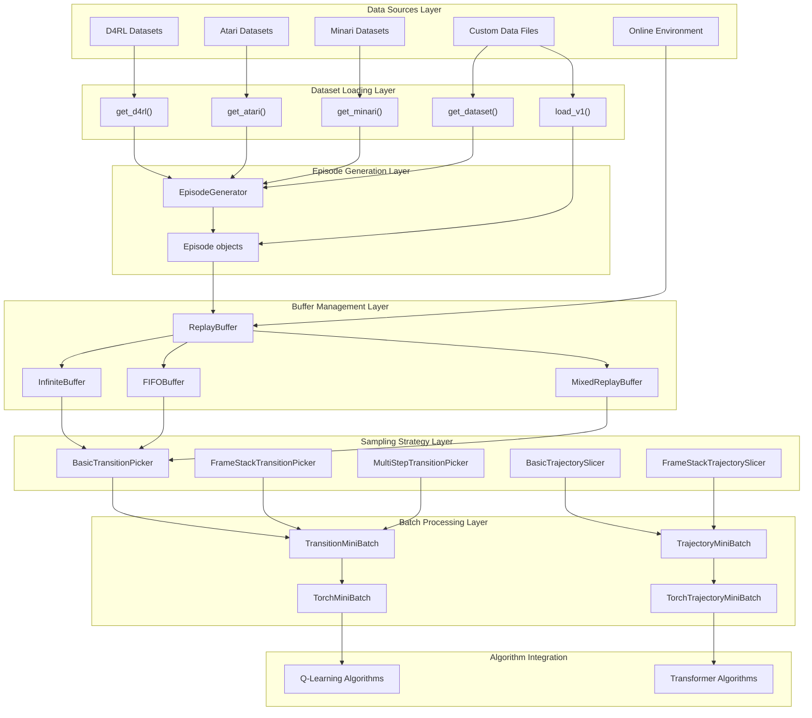
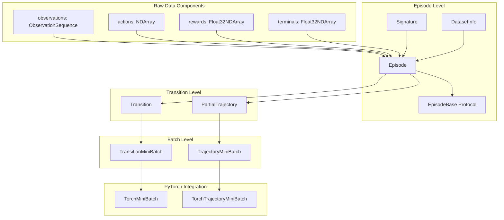
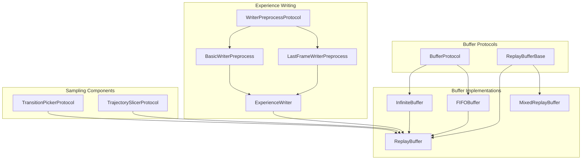
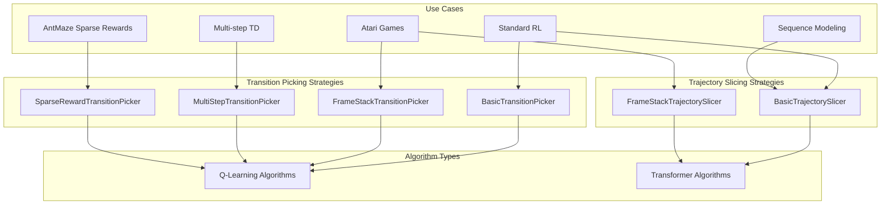
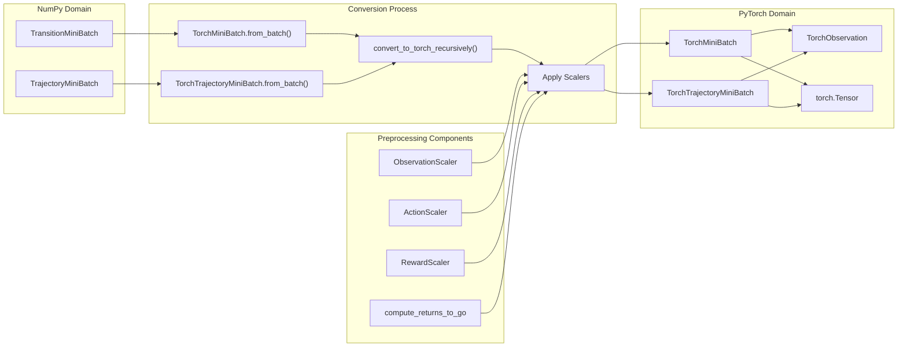

<!-- source: DeepWiki mcp.deepwiki.com · repo takuseno/d3rlpy · page 6 Data Management · fetched 2026-10-30 -->

# Data Management

Relevant source files

The following files were used as context for generating this wiki page:

- [d3rlpy/__init__.py](d3rlpy/__init__.py)
- [d3rlpy/cli.py](d3rlpy/cli.py)
- [d3rlpy/dataset/buffers.py](d3rlpy/dataset/buffers.py)
- [d3rlpy/dataset/components.py](d3rlpy/dataset/components.py)
- [d3rlpy/dataset/episode_generator.py](d3rlpy/dataset/episode_generator.py)
- [d3rlpy/dataset/io.py](d3rlpy/dataset/io.py)
- [d3rlpy/dataset/mini_batch.py](d3rlpy/dataset/mini_batch.py)
- [d3rlpy/dataset/replay_buffer.py](d3rlpy/dataset/replay_buffer.py)
- [d3rlpy/dataset/transition_pickers.py](d3rlpy/dataset/transition_pickers.py)
- [d3rlpy/dataset/utils.py](d3rlpy/dataset/utils.py)
- [d3rlpy/dataset/writers.py](d3rlpy/dataset/writers.py)
- [d3rlpy/datasets.py](d3rlpy/datasets.py)
- [d3rlpy/envs/wrappers.py](d3rlpy/envs/wrappers.py)
- [d3rlpy/ope/torch/fqe_impl.py](d3rlpy/ope/torch/fqe_impl.py)
- [d3rlpy/torch_utility.py](d3rlpy/torch_utility.py)
- [docs/cli.rst](docs/cli.rst)
- [examples/custom_algo.py](examples/custom_algo.py)
- [examples/deepmind_control.py](examples/deepmind_control.py)
- [mypy.ini](mypy.ini)
- [requirements.txt](requirements.txt)
- [setup.py](setup.py)
- [tests/algos/qlearning/algo_test.py](tests/algos/qlearning/algo_test.py)
- [tests/dataset/test_components.py](tests/dataset/test_components.py)
- [tests/dataset/test_mini_batch.py](tests/dataset/test_mini_batch.py)
- [tests/dataset/test_transition_pickers.py](tests/dataset/test_transition_pickers.py)
- [tests/test_datasets.py](tests/test_datasets.py)
- [tests/test_torch_utility.py](tests/test_torch_utility.py)
- [tests/testing_utils.py](tests/testing_utils.py)

This document covers d3rlpy's comprehensive data management system, which handles dataset acquisition, storage, sampling, and preprocessing for offline and online reinforcement learning. The system provides a unified interface for working with various data sources while supporting different algorithm requirements through configurable sampling strategies.

For information about data preprocessing and scaling, see [Data Preprocessing](#6.3). For details about specific dataset loading functions, see [Datasets and Loading](#6.1). For replay buffer implementations and data processing, see [Replay Buffers and Data Processing](#6.2).

## System Architecture Overview

The data management system follows a layered architecture that transforms raw data through several stages before reaching the training algorithms.

**Data Management System Architecture**

Sources: [d3rlpy/datasets.py](), [d3rlpy/dataset/replay_buffer.py](), [d3rlpy/dataset/components.py](), [d3rlpy/torch_utility.py]()

## Core Data Structures

The system is built around several fundamental data structures that represent different aspects of reinforcement learning data.

**Core Data Structure Relationships**

The `Episode` class [d3rlpy/dataset/components.py:320-384]() serves as the fundamental container for trajectory data, implementing the `EpisodeBase` protocol. Each episode contains sequences of observations, actions, rewards, and a termination flag. The `Transition` class [d3rlpy/dataset/components.py:56-120]() represents individual timesteps extracted from episodes, while `PartialTrajectory` [d3rlpy/dataset/components.py:122-194]() represents subsequences used by transformer-based algorithms.

Sources: [d3rlpy/dataset/components.py:56-384](), [d3rlpy/dataset/mini_batch.py:19-231](), [d3rlpy/torch_utility.py:203-388]()

## Buffer Management System

The replay buffer system provides flexible storage and sampling mechanisms for both offline and online learning scenarios.

**Buffer Implementation Hierarchy**

The `ReplayBuffer` class [d3rlpy/dataset/replay_buffer.py:274-557]() serves as the main interface, wrapping either an `InfiniteBuffer` [d3rlpy/dataset/buffers.py:43-72]() for unlimited storage or a `FIFOBuffer` [d3rlpy/dataset/buffers.py:74-119]() for bounded capacity. The `MixedReplayBuffer` [d3rlpy/dataset/replay_buffer.py:559-707]() combines two buffers for mixing offline and online data.

For online learning, the `ExperienceWriter` [d3rlpy/dataset/writers.py:241-405]() handles incremental data collection with configurable preprocessing through the `WriterPreprocessProtocol` interface.

Sources: [d3rlpy/dataset/replay_buffer.py:43-707](), [d3rlpy/dataset/buffers.py:9-119](), [d3rlpy/dataset/writers.py:18-405]()

## Sampling Strategy System

Different reinforcement learning algorithms require different data sampling strategies, which are handled through pluggable picker and slicer components.

**Sampling Strategy Components**

The `BasicTransitionPicker` [d3rlpy/dataset/transition_pickers.py:43-73]() provides standard single-step sampling, while `FrameStackTransitionPicker` [d3rlpy/dataset/transition_pickers.py:109-165]() handles frame stacking for visual observations. The `MultiStepTransitionPicker` [d3rlpy/dataset/transition_pickers.py:168-226]() computes multi-step returns, and `SparseRewardTransitionPicker` [d3rlpy/dataset/transition_pickers.py:75-107]() handles special return calculations for sparse reward environments.

For transformer-based algorithms, trajectory slicers extract sequences from episodes. The `BasicTrajectorySlicer` provides standard sequential sampling, while `FrameStackTrajectorySlicer` handles frame stacking in the sequence dimension.

Sources: [d3rlpy/dataset/transition_pickers.py:27-226](), [d3rlpy/dataset/trajectory_slicers.py]()

## PyTorch Integration Pipeline

The final stage of the data pipeline converts numpy-based batches into PyTorch tensors with integrated preprocessing.

**PyTorch Data Conversion Pipeline**

The `TorchMiniBatch.from_batch()` method [d3rlpy/torch_utility.py:216-276]() converts `TransitionMiniBatch` objects to PyTorch tensors, applying preprocessing and computing returns-to-go as needed. The `convert_to_torch_recursively()` function [d3rlpy/torch_utility.py:113-122]() handles the underlying tensor conversion, supporting both single arrays and nested sequences for tuple observations.

The conversion process integrates with the preprocessing system, automatically applying observation, action, and reward scalers when provided. For transformer algorithms, the `TorchTrajectoryMiniBatch` class [d3rlpy/torch_utility.py:290-388]() provides additional methods like `to_transition_batch()` for converting sequence data back to transition format when needed.

Sources: [d3rlpy/torch_utility.py:95-388](), [d3rlpy/dataset/mini_batch.py:62-106](), [d3rlpy/dataset/mini_batch.py:172-231]()

## Dataset Loading Interface

The top-level dataset loading functions provide a unified interface for acquiring data from various sources.

| Function | Purpose | Data Source | Return Type |
|----------|---------|-------------|-------------|
| `get_d4rl()` | Load D4RL datasets | D4RL package | `(ReplayBuffer, gym.Env)` |
| `get_atari()` | Load Atari datasets | d4rl-atari package | `(ReplayBuffer, gym.Env)` |
| `get_minari()` | Load Minari datasets | Minari package | `(ReplayBuffer, gymnasium.Env)` |
| `get_cartpole()` | Load cartpole datasets | Built-in datasets | `(ReplayBuffer, gym.Env)` |
| `get_pendulum()` | Load pendulum datasets | Built-in datasets | `(ReplayBuffer, gym.Env)` |
| `get_dataset()` | Auto-detect dataset type | Multiple sources | `(ReplayBuffer, gym.Env)` |

The `get_dataset()` function [d3rlpy/datasets.py:655-740]() provides automatic dataset type detection based on naming patterns, routing to the appropriate specialized loader. All functions return a tuple of a configured `ReplayBuffer` and the corresponding environment for evaluation.

For custom data, the `load_v1()` function [d3rlpy/dataset/io.py:84-117]() handles loading legacy dataset formats, while the `dump()` and `load()` functions [d3rlpy/dataset/io.py:15-81]() provide serialization for the current format.

Sources: [d3rlpy/datasets.py:58-740](), [d3rlpy/dataset/io.py:15-117]()

---

