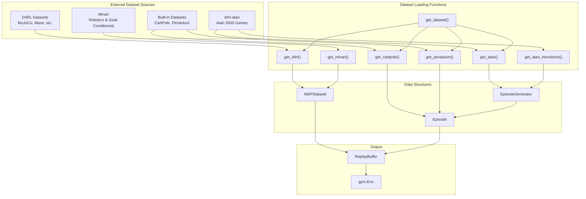
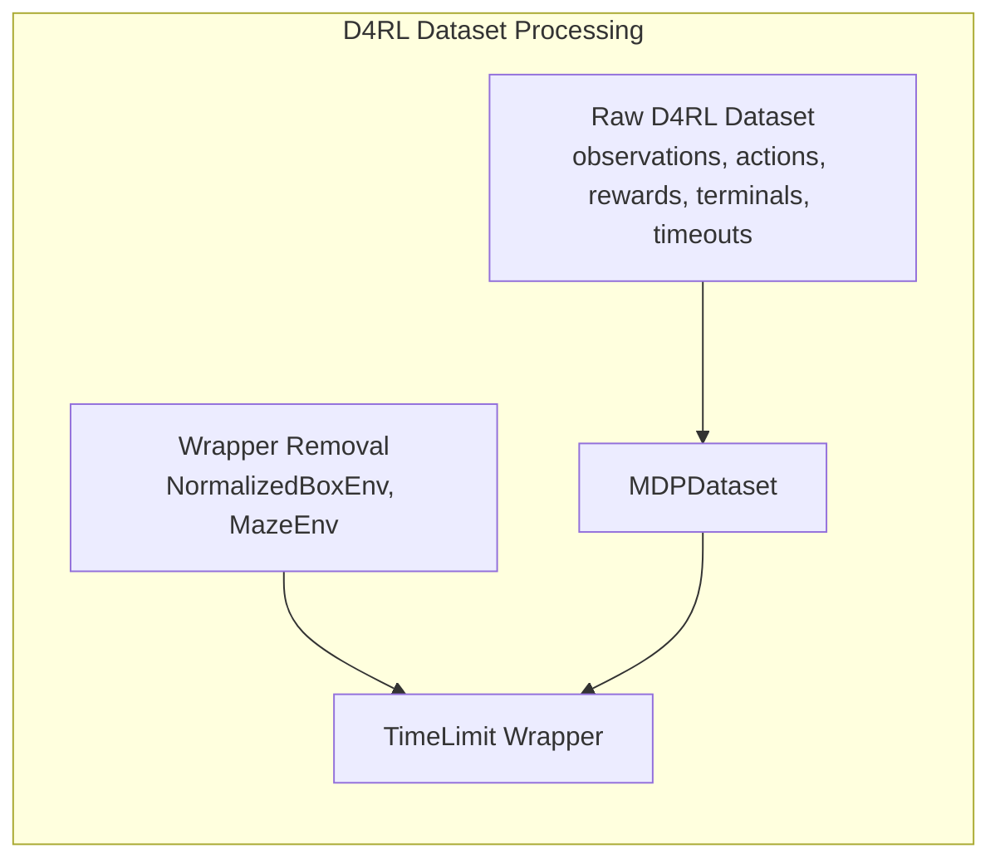
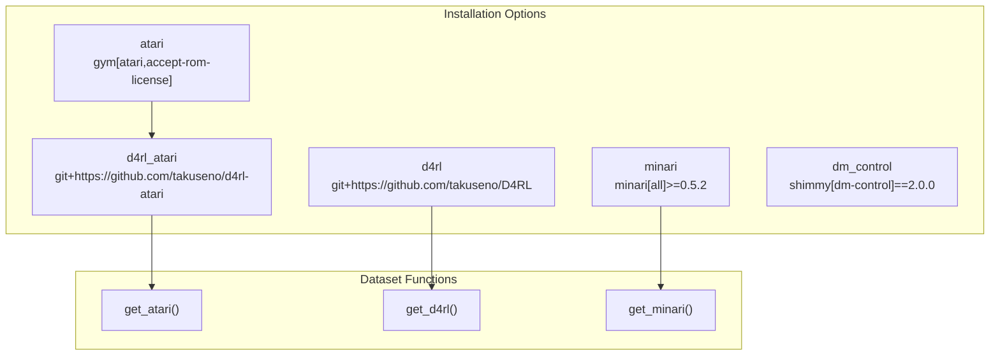

<!-- source: DeepWiki mcp.deepwiki.com · repo takuseno/d3rlpy · page 6.1 Datasets and Loading · fetched 2026-10-30 -->

# Datasets and Loading

<details>
<summary>Relevant source files</summary>

The following files were used as context for generating this wiki page:

- [d3rlpy/__init__.py](d3rlpy/__init__.py)
- [d3rlpy/cli.py](d3rlpy/cli.py)
- [d3rlpy/datasets.py](d3rlpy/datasets.py)
- [d3rlpy/envs/wrappers.py](d3rlpy/envs/wrappers.py)
- [docs/cli.rst](docs/cli.rst)
- [docs/references/dataset.rst](docs/references/dataset.rst)
- [docs/references/datasets.rst](docs/references/datasets.rst)
- [docs/tips.rst](docs/tips.rst)
- [examples/custom_algo.py](examples/custom_algo.py)
- [examples/deepmind_control.py](examples/deepmind_control.py)
- [mypy.ini](mypy.ini)
- [requirements.txt](requirements.txt)
- [setup.py](setup.py)
- [tests/test_datasets.py](tests/test_datasets.py)

</details>


This page covers d3rlpy's dataset acquisition and loading system, which provides unified interfaces for loading datasets from various sources including built-in datasets, D4RL, Atari environments, and Minari. For information about replay buffer management and data processing after loading, see [Replay Buffers and Data Processing](#6.2). For preprocessing and normalization of loaded data, see [Data Preprocessing](#6.3).

## Overview

The dataset loading system in d3rlpy provides a unified interface for acquiring datasets from multiple sources and converting them into `ReplayBuffer` objects that can be used with algorithms. The system handles automatic downloading, format conversion, and environment setup for various dataset types.

## Dataset Loading Architecture



**Dataset Loading Flow Diagram**

Sources: [d3rlpy/datasets.py:1-741]()

## Built-in Datasets

d3rlpy provides two built-in datasets that are automatically downloaded from cloud storage when first accessed.

### CartPole Dataset

The `get_cartpole()` function loads CartPole-v1 datasets with two variants:

| Function | Dataset Type | Description |
|----------|-------------|-------------|
| `get_cartpole(dataset_type="replay")` | Replay | Policy-generated trajectory data |
| `get_cartpole(dataset_type="random")` | Random | Random action trajectory data |

```python
import d3rlpy

# Load replay dataset
dataset, env = d3rlpy.datasets.get_cartpole(dataset_type="replay")

# Load random dataset  
dataset, env = d3rlpy.datasets.get_cartpole(dataset_type="random")
```

The function automatically downloads data to the `d3rlpy_data` directory and returns a tuple of (`ReplayBuffer`, `gym.Env`).

Sources: [d3rlpy/datasets.py:58-109]()

### Pendulum Dataset

The `get_pendulum()` function provides similar functionality for Pendulum-v1 environments:

```python
# Load pendulum datasets
dataset, env = d3rlpy.datasets.get_pendulum(dataset_type="replay")
dataset, env = d3rlpy.datasets.get_pendulum(dataset_type="random")
```

Both functions support optional `TransitionPickerProtocol` and `TrajectorySlicerProtocol` parameters for customizing data sampling behavior.

Sources: [d3rlpy/datasets.py:112-162]()

## External Dataset Integration

### D4RL Integration

The `get_d4rl()` function provides access to the D4RL dataset collection, which includes MuJoCo locomotion tasks, maze navigation, and other continuous control environments.

```python
# Load D4RL dataset
dataset, env = d3rlpy.datasets.get_d4rl('hopper-medium-v0')
```

The function handles environment wrapper compatibility issues and returns unwrapped environments with proper rendering configuration.



**D4RL Processing Pipeline**

Sources: [d3rlpy/datasets.py:385-462]()

### Atari Dataset Integration

d3rlpy provides two functions for Atari dataset loading through the d4rl-atari package:

#### Standard Atari Loading

```python
# Load single epoch Atari dataset
dataset, env = d3rlpy.datasets.get_atari('breakout-mixed-v0')
```

The `get_atari()` function supports frame stacking options:
- `num_stack`: Number of frames to stack
- `pre_stack`: Whether to pre-stack frames or stack at sampling time
- `sticky_action`: Enable sticky action mechanism

#### Multi-Epoch Atari Loading

```python
# Load 1% of transitions from all 50 epochs
dataset, env = d3rlpy.datasets.get_atari_transitions('breakout', fraction=0.01)
```

The `get_atari_transitions()` function samples transitions across all 50 training epochs, which is necessary for reproducing published Atari experiments.

Sources: [d3rlpy/datasets.py:188-382]()

### Minari Integration

The `get_minari()` function provides access to Minari datasets, which focus on robotics and goal-conditioned tasks:

```python
# Load Minari dataset
dataset, env = d3rlpy.datasets.get_minari('door-cloned-v1')

# Load with tuple observations for goal-conditioned tasks
dataset, env = d3rlpy.datasets.get_minari('door-cloned-v1', tuple_observation=True)
```

Minari datasets support different observation space types:
- `Box`: Standard vector observations
- `Dict` with goal conditioning: Automatically handled with `GoalConcatWrapper`

Sources: [d3rlpy/datasets.py:470-586]()

## Generic Dataset Loading

The `get_dataset()` function provides a unified interface that automatically detects dataset types:

```python
# Automatically detects dataset type
dataset, env = d3rlpy.datasets.get_dataset('hopper-medium-v0')  # D4RL
dataset, env = d3rlpy.datasets.get_dataset('breakout-mixed-v0')  # Atari
dataset, env = d3rlpy.datasets.get_dataset('cartpole-replay')   # Built-in
```

The function uses pattern matching to determine the appropriate loader:

| Pattern | Dataset Type | Example |
|---------|-------------|---------|
| `cartpole-*` | Built-in CartPole | `cartpole-replay` |
| `pendulum-*` | Built-in Pendulum | `pendulum-random` |
| `bullet-*` | D4RL PyBullet | `bullet-halfcheetah-medium-v0` |
| `hopper\|halfcheetah\|walker\|ant` | D4RL MuJoCo | `hopper-medium-v0` |

Sources: [d3rlpy/datasets.py:655-741]()

## Installation and Dependencies

Dataset loading requires additional packages that can be installed via the CLI:

```bash
# Install D4RL
$ d3rlpy install d4rl

# Install Atari support
$ d3rlpy install d4rl_atari

# Install Minari
$ d3rlpy install minari
```

The CLI `install` command handles package installation and dependency management:



**Package Dependencies**

Sources: [d3rlpy/cli.py:364-402]()

## Data Formats and Return Types

All dataset loading functions return a consistent tuple format:

```python
(dataset: ReplayBuffer, env: gym.Env) = get_dataset_function(...)
```

The `ReplayBuffer` contains:
- Episodes or transitions depending on the source
- Configured transition pickers and trajectory slicers
- Proper buffer implementation (`InfiniteBuffer` or `FIFOBuffer`)

The `gym.Env` is configured with:
- Appropriate wrappers for the dataset type
- Proper observation and action spaces
- Rendering configuration when specified

Sources: [d3rlpy/datasets.py:16-30]()

## Constants and Configuration

The dataset system uses several constants for configuration:

| Constant | Value | Purpose |
|----------|-------|---------|
| `DATA_DIRECTORY` | `"d3rlpy_data"` | Local dataset storage directory |
| `DROPBOX_URL` | `"https://www.dropbox.com/s"` | Built-in dataset hosting |
| `ATARI_GAMES` | List of 52 games | Supported Atari game names |

Sources: [d3rlpy/datasets.py:50-652]()

---

