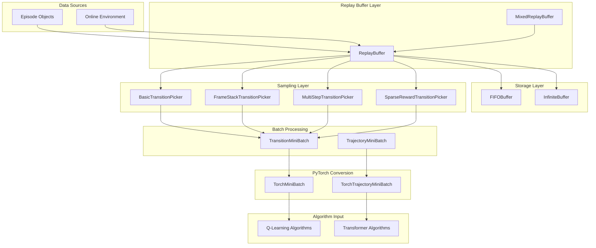
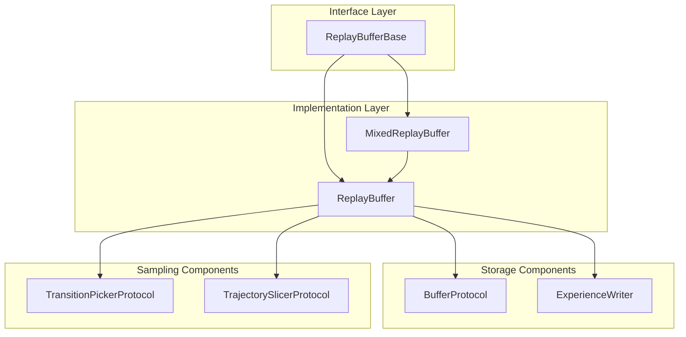
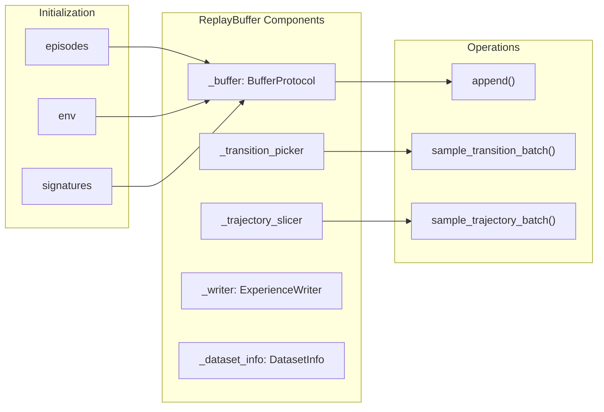
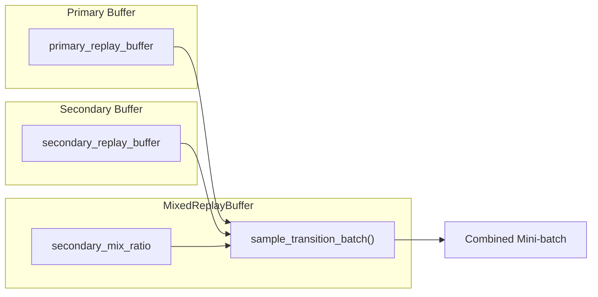
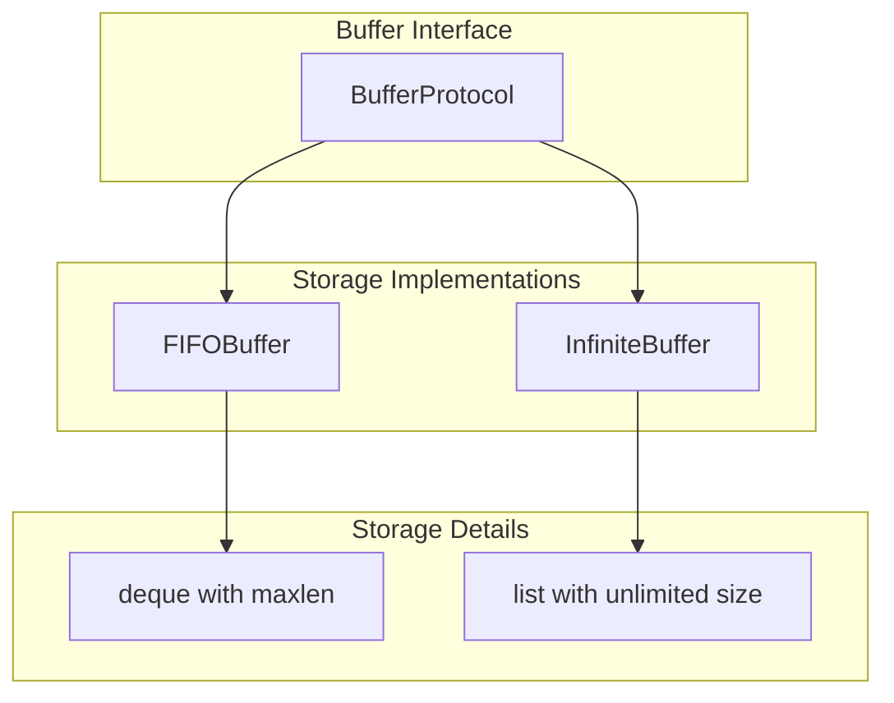
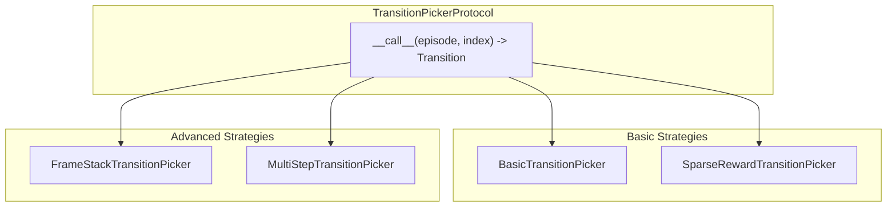
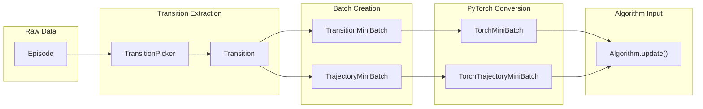
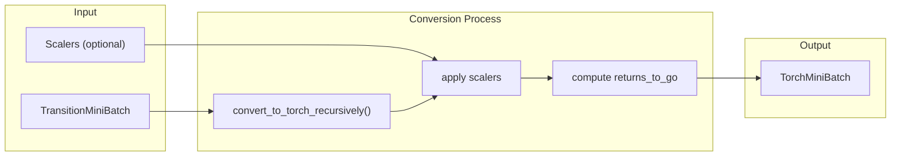

<!-- source: DeepWiki mcp.deepwiki.com · repo takuseno/d3rlpy · page 6.2 Replay Buffers and Data Processing · fetched 2026-10-30 -->

# Replay Buffers and Data Processing

<details>
<summary>Relevant source files</summary>

The following files were used as context for generating this wiki page:

- [d3rlpy/dataset/buffers.py](d3rlpy/dataset/buffers.py)
- [d3rlpy/dataset/components.py](d3rlpy/dataset/components.py)
- [d3rlpy/dataset/episode_generator.py](d3rlpy/dataset/episode_generator.py)
- [d3rlpy/dataset/io.py](d3rlpy/dataset/io.py)
- [d3rlpy/dataset/mini_batch.py](d3rlpy/dataset/mini_batch.py)
- [d3rlpy/dataset/replay_buffer.py](d3rlpy/dataset/replay_buffer.py)
- [d3rlpy/dataset/transition_pickers.py](d3rlpy/dataset/transition_pickers.py)
- [d3rlpy/dataset/utils.py](d3rlpy/dataset/utils.py)
- [d3rlpy/dataset/writers.py](d3rlpy/dataset/writers.py)
- [d3rlpy/ope/torch/fqe_impl.py](d3rlpy/ope/torch/fqe_impl.py)
- [d3rlpy/torch_utility.py](d3rlpy/torch_utility.py)
- [tests/algos/qlearning/algo_test.py](tests/algos/qlearning/algo_test.py)
- [tests/dataset/test_components.py](tests/dataset/test_components.py)
- [tests/dataset/test_mini_batch.py](tests/dataset/test_mini_batch.py)
- [tests/dataset/test_transition_pickers.py](tests/dataset/test_transition_pickers.py)
- [tests/test_torch_utility.py](tests/test_torch_utility.py)
- [tests/testing_utils.py](tests/testing_utils.py)

</details>


This document covers the replay buffer system and data processing pipeline in d3rlpy, which handles experience storage, sampling, and conversion to PyTorch tensors for algorithm training. This system bridges the gap between raw episode data and the format required by reinforcement learning algorithms.

For information about dataset loading and acquisition, see [Datasets and Loading](#6.1). For data preprocessing and scaling, see [Data Preprocessing](#6.3).

## Overview

The replay buffer and data processing system consists of several interconnected components that manage the storage, sampling, and transformation of experience data. The system supports both offline training with pre-collected datasets and online training with real-time experience collection.



**Sources:** [d3rlpy/dataset/replay_buffer.py:1-833](), [d3rlpy/dataset/buffers.py:1-112](), [d3rlpy/dataset/transition_pickers.py:1-227]()

## Replay Buffer Architecture

The replay buffer system is built around the `ReplayBufferBase` interface, which defines the core operations for experience storage and sampling. The main implementation is `ReplayBuffer`, which coordinates between storage buffers, transition pickers, and experience writers.



**Core Methods:**
- `append()` - Add single transition to buffer
- `append_episode()` - Add complete episode to buffer
- `sample_transition_batch()` - Sample mini-batch of transitions
- `sample_trajectory_batch()` - Sample mini-batch of trajectories

**Sources:** [d3rlpy/dataset/replay_buffer.py:43-272](), [d3rlpy/dataset/replay_buffer.py:274-557]()

### ReplayBuffer Implementation

The `ReplayBuffer` class is the primary implementation that manages experience storage and sampling. It automatically detects data signatures and action spaces from provided episodes or environments.



**Key Features:**
- Automatic signature detection from episodes or environment
- Pluggable storage backends (`FIFOBuffer`, `InfiniteBuffer`)
- Configurable sampling strategies
- Support for both online and offline training

**Sources:** [d3rlpy/dataset/replay_buffer.py:274-557](), [d3rlpy/dataset/replay_buffer.py:342-455]()

### MixedReplayBuffer

The `MixedReplayBuffer` combines two replay buffers with configurable mixing ratios, commonly used for combining offline datasets with online experience.



**Sources:** [d3rlpy/dataset/replay_buffer.py:559-745]()

## Buffer Storage Implementations

The storage layer provides different strategies for managing experience data with different memory and performance characteristics.



### InfiniteBuffer

Stores all transitions with unlimited capacity, suitable for offline datasets or when memory is not a constraint.

**Key Characteristics:**
- No size limit
- Simple list-based storage
- Preserves all historical data

**Sources:** [d3rlpy/dataset/buffers.py:43-72]()

### FIFOBuffer

First-in-first-out buffer with fixed capacity, automatically evicts oldest transitions when full. Used for online training with memory constraints.

**Key Characteristics:**
- Fixed capacity with automatic eviction
- Uses `collections.deque` for efficient operations
- Maintains episode boundaries correctly

**Sources:** [d3rlpy/dataset/buffers.py:74-112]()

## Transition Picking Strategies

Transition pickers define how individual transitions are extracted from episodes, enabling different training strategies and data augmentation techniques.



### BasicTransitionPicker

Standard transition extraction with no modifications, creates transitions with immediate next states and actions.

```python
# Basic transition structure
transition = Transition(
    observation=episode.observations[index],
    action=episode.actions[index], 
    reward=episode.rewards[index],
    next_observation=episode.observations[index + 1],
    next_action=episode.actions[index + 1],
    terminal=is_terminal,
    interval=1
)
```

**Sources:** [d3rlpy/dataset/transition_pickers.py:43-73]()

### FrameStackTransitionPicker

Stacks multiple consecutive frames for visual observations, commonly used in Atari environments.

**Key Features:**
- Stacks `n_frames` observations
- Zero-pads when insufficient history
- Maintains temporal relationships

**Sources:** [d3rlpy/dataset/transition_pickers.py:109-166]()

### MultiStepTransitionPicker

Creates transitions with multi-step discounted returns for improved learning efficiency.

**Key Features:**
- Computes n-step discounted rewards
- Adjusts next observation to n-steps ahead
- Handles episode boundaries correctly

**Sources:** [d3rlpy/dataset/transition_pickers.py:168-227]()

### SparseRewardTransitionPicker

Handles sparse reward environments by modifying return calculations for failed trajectories.

**Sources:** [d3rlpy/dataset/transition_pickers.py:75-107]()

## Data Processing Pipeline

The data processing pipeline converts raw episode data through several transformation stages to create algorithm-ready input.



### Mini-batch Creation

The `TransitionMiniBatch` and `TrajectoryMiniBatch` classes aggregate individual transitions into batched format for efficient processing.

**TransitionMiniBatch Structure:**
- `observations` - Batched observation arrays
- `actions` - Batched action arrays  
- `rewards` - Batched reward arrays
- `next_observations` - Batched next observation arrays
- `terminals` - Batched terminal flags
- `intervals` - Batched time intervals

**Sources:** [d3rlpy/dataset/mini_batch.py:19-137](), [d3rlpy/dataset/mini_batch.py:139-235]()

## PyTorch Conversion

The PyTorch conversion layer transforms numpy-based mini-batches into PyTorch tensors with optional preprocessing applied.



### TorchMiniBatch

The `TorchMiniBatch` class provides PyTorch tensor versions of transition data with device placement and optional preprocessing.

**Key Methods:**
- `from_batch()` - Convert numpy mini-batch to PyTorch
- `copy_()` - In-place copy between tensor batches
- Device-aware tensor management

**Preprocessing Support:**
- Observation scaling via `ObservationScaler`
- Action scaling via `ActionScaler`  
- Reward scaling via `RewardScaler`
- Returns-to-go computation with gamma discounting

**Sources:** [d3rlpy/torch_utility.py:203-288](), [d3rlpy/torch_utility.py:290-388]()

### TorchTrajectoryMiniBatch

Specialized for transformer-based algorithms that process sequences of transitions.

**Additional Features:**
- `to_transition_batch()` - Convert to transition format
- Mask handling for variable-length sequences
- Timestep encoding for positional information

**Sources:** [d3rlpy/torch_utility.py:290-388]()

### Utility Functions

The conversion system provides several utility functions for tensor operations:

- `convert_to_torch_recursively()` - Handle nested observation structures
- `copy_recursively()` - Deep copy tensor structures
- `get_device()` / `get_batch_size()` - Extract tensor metadata

**Sources:** [d3rlpy/torch_utility.py:95-184]()

---

