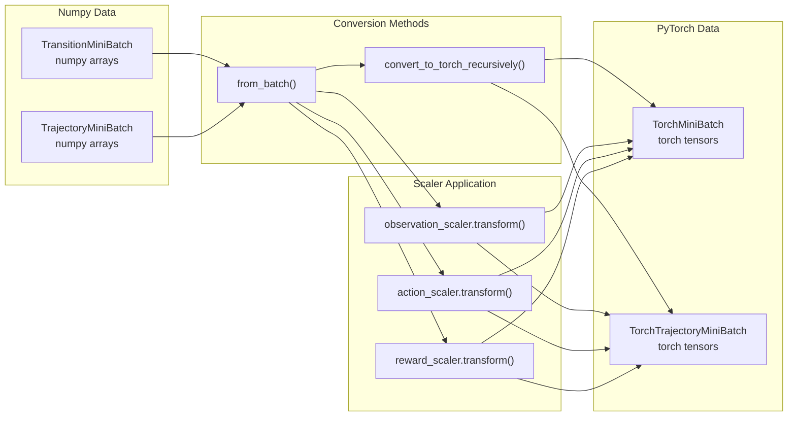

<!-- source: DeepWiki mcp.deepwiki.com · repo takuseno/d3rlpy · page 6.3 Data Preprocessing · fetched 2026-10-30 -->

# Data Preprocessing

<details>
<summary>Relevant source files</summary>

The following files were used as context for generating this wiki page:

- [d3rlpy/dataset/components.py](d3rlpy/dataset/components.py)
- [d3rlpy/dataset/mini_batch.py](d3rlpy/dataset/mini_batch.py)
- [d3rlpy/dataset/transition_pickers.py](d3rlpy/dataset/transition_pickers.py)
- [d3rlpy/ope/torch/fqe_impl.py](d3rlpy/ope/torch/fqe_impl.py)
- [d3rlpy/preprocessing/action_scalers.py](d3rlpy/preprocessing/action_scalers.py)
- [d3rlpy/preprocessing/base.py](d3rlpy/preprocessing/base.py)
- [d3rlpy/preprocessing/observation_scalers.py](d3rlpy/preprocessing/observation_scalers.py)
- [d3rlpy/preprocessing/reward_scalers.py](d3rlpy/preprocessing/reward_scalers.py)
- [d3rlpy/torch_utility.py](d3rlpy/torch_utility.py)
- [tests/algos/qlearning/algo_test.py](tests/algos/qlearning/algo_test.py)
- [tests/dataset/test_components.py](tests/dataset/test_components.py)
- [tests/dataset/test_mini_batch.py](tests/dataset/test_mini_batch.py)
- [tests/dataset/test_transition_pickers.py](tests/dataset/test_transition_pickers.py)
- [tests/dummy_scalers.py](tests/dummy_scalers.py)
- [tests/preprocessing/test_action_scalers.py](tests/preprocessing/test_action_scalers.py)
- [tests/preprocessing/test_observation_scalers.py](tests/preprocessing/test_observation_scalers.py)
- [tests/preprocessing/test_reward_scalers.py](tests/preprocessing/test_reward_scalers.py)
- [tests/test_torch_utility.py](tests/test_torch_utility.py)
- [tests/testing_utils.py](tests/testing_utils.py)

</details>


Data preprocessing in d3rlpy provides a standardized system for normalizing and transforming observations, actions, and rewards during training and inference. The preprocessing system ensures data is properly scaled for neural network training while maintaining the ability to reverse transformations when needed.

For information about data loading and replay buffers, see [6.2](#6.2). For details about neural network model components, see [7](#7).

## Preprocessing Architecture

The preprocessing system is built around three main scaler types that transform different data modalities during the reinforcement learning pipeline:

```mermaid
graph TB
    subgraph "Scaler Base Classes"
        SCALER["Scaler<br/>(base.py)"]
        OBS_SCALER["ObservationScaler"]
        ACT_SCALER["ActionScaler"] 
        REW_SCALER["RewardScaler"]
    end
    
    subgraph "Observation Scalers"
        PIXEL["PixelObservationScaler<br/>(/255.0)"]
        MINMAX_OBS["MinMaxObservationScaler<br/>[-1, 1] range"]
        STD_OBS["StandardObservationScaler<br/>z-score"]
        TUPLE_OBS["TupleObservationScaler<br/>multiple obs"]
    end
    
    subgraph "Action Scalers"
        MINMAX_ACT["MinMaxActionScaler<br/>[-1, 1] range"]
    end
    
    subgraph "Reward Scalers"
        MULTIPLY["MultiplyRewardScaler<br/>constant multiplication"]
        CLIP["ClipRewardScaler<br/>value clipping"]
        MINMAX_REW["MinMaxRewardScaler<br/>[0, 1] range"]
        STD_REW["StandardRewardScaler<br/>z-score"]
        RETURN_REW["ReturnBasedRewardScaler<br/>return-based scaling"]
        SHIFT_REW["ConstantShiftRewardScaler<br/>constant shift"]
    end
    
    subgraph "Data Processing Pipeline"
        TRANS_BATCH["TransitionMiniBatch"]
        TRAJ_BATCH["TrajectoryMiniBatch"] 
        TORCH_BATCH["TorchMiniBatch"]
        TORCH_TRAJ["TorchTrajectoryMiniBatch"]
    end
    
    SCALER --> OBS_SCALER
    SCALER --> ACT_SCALER
    SCALER --> REW_SCALER
    
    OBS_SCALER --> PIXEL
    OBS_SCALER --> MINMAX_OBS
    OBS_SCALER --> STD_OBS
    OBS_SCALER --> TUPLE_OBS
    
    ACT_SCALER --> MINMAX_ACT
    
    REW_SCALER --> MULTIPLY
    REW_SCALER --> CLIP
    REW_SCALER --> MINMAX_REW
    REW_SCALER --> STD_REW
    REW_SCALER --> RETURN_REW
    REW_SCALER --> SHIFT_REW
    
    TRANS_BATCH --> TORCH_BATCH
    TRAJ_BATCH --> TORCH_TRAJ
    
    PIXEL -.-> TORCH_BATCH
    MINMAX_OBS -.-> TORCH_BATCH
    MINMAX_ACT -.-> TORCH_BATCH
    MINMAX_REW -.-> TORCH_BATCH
```



Sources: [d3rlpy/preprocessing/base.py:18-113](), [d3rlpy/preprocessing/observation_scalers.py:34-89](), [d3rlpy/preprocessing/action_scalers.py:29-31](), [d3rlpy/preprocessing/reward_scalers.py:29-32]()

## Scaler Interface

All scalers inherit from the abstract `Scaler` base class, which defines a consistent interface for data transformation:

| Method | Purpose | Input | Output |
|--------|---------|-------|--------|
| `fit_with_transition_picker` | Learn parameters from transitions | `episodes`, `transition_picker` | None |
| `fit_with_trajectory_slicer` | Learn parameters from trajectories | `episodes`, `trajectory_slicer` | None |
| `fit_with_env` | Learn parameters from environment | `env` | None |
| `transform` | Apply scaling to PyTorch tensors | `torch.Tensor` | `torch.Tensor` |
| `reverse_transform` | Reverse scaling for PyTorch tensors | `torch.Tensor` | `torch.Tensor` |
| `transform_numpy` | Apply scaling to numpy arrays | `NDArray` | `NDArray` |
| `reverse_transform_numpy` | Reverse scaling for numpy arrays | `NDArray` | `NDArray` |
| `built` (property) | Check if scaler is ready | None | `bool` |

Sources: [d3rlpy/preprocessing/base.py:18-113]()

## Data Flow Integration

The preprocessing system integrates seamlessly with d3rlpy's data processing pipeline through the `TorchMiniBatch` and `TorchTrajectoryMiniBatch` classes:



Sources: [d3rlpy/torch_utility.py:216-276](), [d3rlpy/torch_utility.py:302-340]()

## Observation Scalers

### PixelObservationScaler

Normalizes pixel values by dividing by 255.0, converting uint8 pixel values to float32 in range [0, 1]:

```python
# Transform: x' = x / 255.0
# Reverse: x = x' * 255.0
```

This scaler requires no fitting and is always ready (`built=True`).

Sources: [d3rlpy/preprocessing/observation_scalers.py:38-89]()

### MinMaxObservationScaler

Normalizes observations to the range [-1, 1] using min-max scaling:

```python
# Transform: x' = (x - min) / (max - min) * 2.0 - 1.0
# Reverse: x = ((x' + 1.0) / 2.0) * (max - min) + min
```

Parameters learned during fitting:
- `minimum`: Minimum values per feature
- `maximum`: Maximum values per feature

Sources: [d3rlpy/preprocessing/observation_scalers.py:92-240]()

### StandardObservationScaler

Applies z-score standardization to observations:

```python
# Transform: x' = (x - mean) / (std + eps)
# Reverse: x = x' * (std + eps) + mean
```

Parameters:
- `mean`: Mean values per feature
- `std`: Standard deviation per feature  
- `eps`: Small constant to avoid division by zero (default: 1e-3)

Sources: [d3rlpy/preprocessing/observation_scalers.py:243-366]()

### TupleObservationScaler

Handles tuple observations by applying individual scalers to each observation component. Used for environments with multiple observation modalities.

Sources: [d3rlpy/preprocessing/observation_scalers.py:369-450]()

## Action Scalers

### MinMaxActionScaler

The primary action scaler normalizes continuous actions to the range [-1, 1]:

```python
# Transform: a' = (a - min) / (max - min) * 2.0 - 1.0  
# Reverse: a = ((a' + 1.0) / 2.0) * (max - min) + min
```

Can be fitted from:
- **Datasets**: Using `fit_with_transition_picker()` or `fit_with_trajectory_slicer()`
- **Environment**: Using `fit_with_env()` to extract action space bounds

Sources: [d3rlpy/preprocessing/action_scalers.py:34-182]()

## Reward Scalers

### MultiplyRewardScaler

Applies constant multiplication to rewards:

```python
# Transform: r' = r * multiplier
# Reverse: r = r' / multiplier
```

No fitting required - multiplier is specified at initialization.

Sources: [d3rlpy/preprocessing/reward_scalers.py:34-88]()

### ClipRewardScaler  

Clips rewards to a specified range with optional multiplication:

```python
# Transform: r' = multiplier * clip(r, low, high)
# Reverse: r = r' / multiplier
```

Parameters:
- `low`: Minimum clip value (optional)
- `high`: Maximum clip value (optional)
- `multiplier`: Constant multiplication factor

Sources: [d3rlpy/preprocessing/reward_scalers.py:90-146]()

### MinMaxRewardScaler

Normalizes rewards to range [0, 1]:

```python
# Transform: r' = multiplier * (r - min) / (max - min)
# Reverse: r = r' * (max - min) / multiplier + min
```

Sources: [d3rlpy/preprocessing/reward_scalers.py:148-240]()

### StandardRewardScaler

Applies z-score standardization to rewards:

```python  
# Transform: r' = multiplier * (r - mean) / (std + eps)
# Reverse: r = r' * (std + eps) / multiplier + mean
```

Sources: [d3rlpy/preprocessing/reward_scalers.py:242-333]()

### ReturnBasedRewardScaler

Normalizes rewards based on return scale, useful for environments with varying return magnitudes:

```python
# Transform: r' = multiplier * r / (return_max - return_min)
# Reverse: r = r' * (return_max - return_min) / multiplier
```

Parameters learned from episode returns:
- `return_max`: Maximum episode return
- `return_min`: Minimum episode return

Sources: [d3rlpy/preprocessing/reward_scalers.py:335-430]()

### ConstantShiftRewardScaler

Applies constant shift with optional multiplication:

```python
# If multiply_first=True: r' = r * multiplier + shift
# If multiply_first=False: r' = (r + shift) * multiplier
```

Useful for environments where reward distribution needs to be shifted (e.g., IQL paper implementations).

Sources: [d3rlpy/preprocessing/reward_scalers.py:432-509]()

## Fitting Strategies

Scalers can be fitted using three different strategies depending on the data source and algorithm requirements:

| Strategy | Use Case | Data Source |
|----------|----------|-------------|
| `fit_with_transition_picker` | Q-learning algorithms | Individual transitions from episodes |
| `fit_with_trajectory_slicer` | Transformer algorithms | Full trajectory sequences |
| `fit_with_env` | Environment-based fitting | Gym environment action/observation spaces |

The choice of fitting strategy depends on the algorithm type and whether you're using offline datasets or online environments.

Sources: [d3rlpy/preprocessing/base.py:19-54](), [d3rlpy/dataset/transition_pickers.py:27-41]()

---

